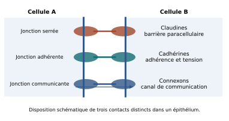
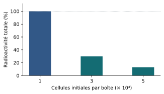
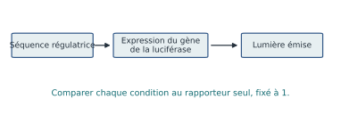
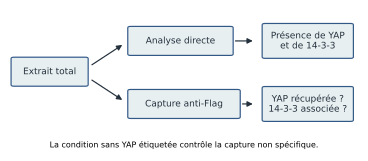
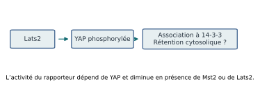
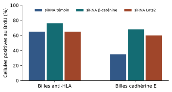
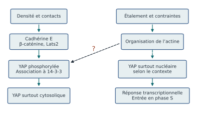

# ENS de Lyon — Second concours, Biologie-biochimie 2023 · Corrigé guidé

*Corrigé rédigé par IA, non officiel.*

**Rédaction** · GPT-6.2 Astra Ultra · vitesse non renseignée

> [!INDICATION]
> Pour la synthèse, partir d’une observation de tissu et associer chaque exemple à une structure observée, un partenaire dans chacune des cellules et une fonction mesurable. Le rapport souligne notamment l’intérêt de la fécondation et de la fonction des jonctions.

## I. Les contacts entre les cellules

Dans un épithélium intestinal, des cellules bord à bord retiennent des solutés dans la lumière tout en échangeant des informations avec leurs voisines. Un contact cellulaire suppose ici une continuité locale ou l’interaction de composants membranaires de **deux cellules qui se touchent**. Comment ces interfaces assurent-elles des fonctions aussi diverses que la cohésion d’un tissu, sa compartimentation et la coordination de son activité ?

### Maintenir les cellules ensemble et répartir les contraintes

Dans la ceinture d’adhérence d’un épithélium, des cadhérines dépendantes du calcium interagissent par leurs domaines extracellulaires. Côté cytoplasmique, un ensemble de protéines comprenant les caténines couple ces cadhérines à l’actine corticale. L’alignement des ceintures entre voisines distribue la tension à l’échelle du feuillet. Lors d’une morphogenèse, une contraction de l’actomyosine peut ainsi modifier la forme de plusieurs cellules solidaires. Le rôle du calcium peut être mis en évidence par la dissociation d’un feuillet après chélation du calcium extracellulaire et la reconstitution des contacts après sa restitution.

Les desmosomes forment des points d’ancrage localisés. Leurs cadhérines spécialisées, desmogléines et desmocollines, sont reliées, par des plaques protéiques intracellulaires, aux filaments intermédiaires des deux cellules. En microscopie électronique, on reconnaît les deux plaques denses en regard et les filaments qui s’y insèrent. Ce dispositif répartit l’effort de traction dans des tissus sollicités comme l’épiderme. Une atteinte des protéines d’adhérence peut se traduire par une perte de cohésion et par le décollement des cellules.

### Régler les échanges et préserver des compartiments

Près du pôle apical des cellules épithéliales, les claudines de deux membranes voisines s’associent en cordons de jonction serrée. Une sonde hydrophile ajoutée d’un côté d’un épithélium intact peut être arrêtée au niveau de ces cordons. Leur composition détermine la sélectivité du passage **paracellulaire** ; certaines claudines forment des pores sélectifs. Les jonctions serrées contribuent également à la séparation des domaines membranaires apical et basolatéral. Cette polarité donne un sens aux transports à travers l’épithélium.

À une jonction communicante, au contraire, deux hémicanaux ou connexons, chacun fourni par une cellule, s’accolent. Le pore continu autorise le passage d’ions et de petites molécules entre cytosols, selon l’état d’ouverture du canal. Un petit traceur fluorescent injecté dans une cellule peut apparaître dans les voisines, tandis qu’un traceur volumineux y reste confiné. Dans le myocarde, le courant ionique passant par ces jonctions contribue à propager la dépolarisation.

Chez les végétaux, les plasmodesmes traversent la paroi commune. La membrane plasmique borde un canal continu reliant les cellules, souvent parcouru par un desmotubule issu du réticulum endoplasmique. Le transport symplasmique permet des échanges dont la sélectivité peut être modulée, notamment au niveau du col du plasmodesme.

### Reconnaître une voisine et modifier son comportement

Une cellule peut porter à sa surface un ligand reconnu par un récepteur de la cellule adjacente. Lors d’un contact Delta–Notch, le ligand membranaire Delta favorise les clivages du récepteur Notch. Son domaine intracellulaire libéré rejoint le noyau et y modifie la transcription. Le signal est local ; l’inhibition latérale peut faire diverger les destins de voisines initialement semblables. Une comparaison entre cellules en contact direct et cellules séparées par une membrane perméable aux molécules solubles permet de tester cette exigence de contact.

La synapse immunologique fournit un autre exemple de contact transitoire. Le récepteur d’un lymphocyte T reconnaît un peptide présenté par une molécule du CMH sur la cellule partenaire. Des molécules d’adhérence stabilisent l’interface et des signaux de costimulation contribuent à la réponse. La spécificité de reconnaissance et la durée du contact participent ainsi à la décision cellulaire.

À la fécondation chez les mammifères, après la traversée des enveloppes extracellulaires, les membranes du spermatozoïde et de l’ovocyte entrent en contact. La reconnaissance entre IZUMO1 du spermatozoïde et JUNO de l’ovocyte contribue à leur adhérence. D’autres protéines et réorganisations membranaires sont nécessaires à la fusion ; le contact change ici la continuité même des deux cellules.

Enfin, une même interface peut servir à l’adhérence et à la signalisation. L’engagement de la cadhérine E peut renseigner une cellule épithéliale sur la présence de voisines et contribuer à limiter son entrée en phase S.

Les contacts entre cellules reposent donc sur des organisations identifiables : ponts d’adhérence liés au cytosquelette, barrières ou canaux sélectifs et couples ligand–récepteur. Leur répartition et leur dynamique contribuent ensemble à organiser le tissu, à coordonner son activité et à ajuster son renouvellement.

## II. Contact et prolifération cellulaire

### Question 1a — Que mesure le marquage ?

> [!INDICATION]
> Suivre le devenir d’un nucléotide de l’ADN.

#### Solution

Les cellules qui synthétisent de l’ADN incorporent le précurseur tritié dans le brin en formation. Après élimination du marqueur libre, le signal renseigne sur **la synthèse d’ADN pendant la fenêtre de marquage**, principalement la réplication en phase S dans ce contexte. Ce signal global ne dénombre pas directement les mitoses.

### Question 1b — Comparer densité et réplication

> [!INDICATION]
> Comparer deux jours et sept jours pour chacun des tissus, puis lire toute l’ordonnée de la figure 2.

#### Solution

Au deuxième jour, les cellules de peau comme les cellules pulmonaires de souris sont encore espacées ; au septième jour les deux cultures forment des tapis denses et jointifs. Dans les fibroblastes de peau, avec $10^4$, $3\times10^4$ puis $5\times10^4$ cellules initiales par boîte, le signal global d’incorporation passe d’environ **100 à 30 puis 13 %** de la première condition. Malgré un effectif initial plus grand, la synthèse totale d’ADN décroît. Cela suggère un frein à l’entrée en phase S lorsque la densité augmente. Des contacts entre voisines pourraient en être la cause. À ce stade, le manque de place, une modification du milieu, l’épuisement d’un nutriment ou un signal diffusible restent aussi envisageables.

### Question 1c — Prévoir l’aspect de la culture

> [!INDICATION]
> Envisager un épithélium ou un tapis de fibroblastes possédant un contrôle par contact intact.

#### Solution

Même si l’on renouvelle le milieu, on attend principalement un **tapis confluent en monocouche** : peu d’espaces libres, des cellules jointives et peu d’augmentation de densité supplémentaire. Un éventuel renouvellement de cellules isolées reste compatible avec un effectif global proche du plateau. Cette prévision teste l’hypothèse d’un frein lié à la confluence.

### Question 2a — Localiser YAP

> [!INDICATION]
> DAPI repère l’ADN nucléaire. Comparer le signal YAP à ces régions sur les deux séries.

#### Solution

En culture peu dense, le signal rouge anti-YAP recouvre largement les noyaux marqués au DAPI ; la superposition y est claire. En culture dense, les noyaux apparaissent comme des régions pauvres en YAP au sein d’un signal surtout cytoplasmique. À exposition comparable, on conclut à une **redistribution** de YAP selon la densité. L’image ne mesure à elle seule ni le flux de transport ni la quantité totale de protéine.

### Question 2b — Expliquer le changement de compartiment

> [!INDICATION]
> Distinguer le lieu de synthèse d’une protéine du lieu où elle s’accumule.

#### Solution

YAP est traduite dans le cytosol. À faible densité, son accumulation nucléaire peut refléter un import, une rétention nucléaire ou un export réduit. À forte densité, une rétention cytosolique ou un export accru peuvent prédominer. Une modification covalente ou la fixation d’un partenaire pourrait modifier ces équilibres. Le récepteur des glucocorticoïdes et NF-κB fournissent d’autres exemples de régulateurs dont la localisation nucléaire varie selon le signal reçu.

### Question 3 — Interpréter un retard de migration

> [!INDICATION]
> Comparer à densité identique les pistes avec et sans phosphatase. Examiner le témoin de charge.

#### Solution

À mesure que la culture devient dense, la bande de YAP se déplace vers la région de migration plus lente, en haut du gel. En culture dense, la phosphatase ramène la bande vers la migration plus rapide ; l’actine contrôle le chargement comparable des pistes. La différence de mobilité est donc **compatible avec une phosphorylation accrue de YAP à forte densité**. Le déplacement apparent sur gel dénaturant n’est pas une mesure de la masse exacte des phosphates et ne localise pas les sites modifiés.

### Question 4 — Tester l’action de Lats2

> [!INDICATION]
> Distinguer la présence d’une protéine kinase de la présence de son activité catalytique.

#### Solution

Aucune bande anti-YAP n’est visible sans YAP. YAP seule et YAP avec la kinase inactive migrent majoritairement au même niveau. La kinase Lats2 active, en présence d’ATP, fait apparaître une bande de YAP retardée. L’anticorps anti-Lats2 confirme la présence de la kinase dans les conditions active et inactive. Associé à la sensibilité à la phosphatase de la figure 4, le résultat montre que **Lats2 peut phosphoryler YAP dans ce système purifié**. Cela n’établit pas que Lats2 soit sa seule kinase en cellule.

### Question 5a — Lire un gène rapporteur

> [!INDICATION]
> Distinguer la séquence régulatrice interrogée et le produit effectivement mesuré.

#### Solution

Le montage est un **gène rapporteur transcriptionnel**. Une séquence régulatrice reconnue par la voie étudiée contrôle l’expression de la luciférase. Selon les protéines présentes dans les conditions comparées, l’activité de ce promoteur modifie la quantité d’enzyme produite, puis le signal lumineux dans l’extrait. La construction rapporteur seule fournit la valeur de référence. La lumière renseigne sur l’activité du système régulateur ; elle ne mesure pas directement la phosphorylation de YAP.

### Question 5b — Quel type de gènes ?

> [!INDICATION]
> Partir des observations sur l’ADN en réplication plutôt que du nom d’une protéine.

#### Solution

La densité s’accompagne simultanément d’une moindre entrée en phase S et d’une modification de la localisation de YAP. Des **gènes impliqués dans la progression du cycle cellulaire ou dans les signaux de croissance** sont donc des cibles plausibles. Les premières figures ne désignent aucun gène particulier et n’établissent pas que toutes ces cibles seraient directes.

### Question 5c — Comparer les activités du rapporteur

> [!INDICATION]
> Prendre le rapporteur seul comme référence 1 et comparer chaque condition à celle qui contient YAP seule.

#### Solution

La référence vaut 1. Avec YAP, le signal atteint environ **13**. L’ajout de Mst2 avec YAP le ramène vers **7**, celui de Lats2 vers **2,5**, et les deux kinases ensemble vers **1**. Dans ce système, YAP favorise l’expression du rapporteur ; chacune des kinases atténue cette activation et leur association la ramène près de la référence. Cela ne démontre ni que YAP lie directement l’ADN ni que les kinases agissent dans un ordre déterminé.

### Question 5d — Distinguer une cascade de deux actions parallèles

> [!INDICATION]
> Une comparaison à une sortie commune suffit-elle à ordonner deux enzymes ?

#### Solution

Les quatre valeurs de la figure 6 restent compatibles avec une cascade ou des actions parallèles. On peut étudier les protéines purifiées. On teste si Mst2 modifie Lats2 et son activité ultérieure sur YAP, puis si Lats2 modifie de façon analogue Mst2. Des témoins sans première kinase et avec kinase inactive, un contrôle de la quantité de protéines et une lecture distincte de chaque phosphorylation sont nécessaires. Une activation de Lats2 par Mst2 dans une seule direction soutiendrait l’ordre Mst2 → Lats2 dans ce système ; sa pertinence en cellule demanderait une confirmation.

### Question 6a — Propriétés des substitutions

> [!INDICATION]
> Comparer les groupes chimiques portés par les chaînes latérales.

#### Solution

La sérine porte un hydroxyle susceptible d’être phosphorylé ; l’alanine n’en porte pas. La substitution S127A élimine donc la possibilité d’une phosphorylation sur le site 127. Remplacer l’histidine 122 par une tyrosine remplace un imidazole par un groupe aromatique phénolique éventuellement phosphorylable. Dans les deux cas, repliement, mobilité sur gel ou reconnaissance par un partenaire peuvent aussi changer. La seule séquence ne permet pas de prévoir le résultat de liaison.

### Question 6b — Distinguer extrait total et immunoprécipité

> [!INDICATION]
> L’anticorps servant à isoler un complexe et celui servant à révéler une bande n’ont pas ici le même rôle.

#### Solution

Une partie de chaque extrait est analysée directement avec anti-Flag (YAP) et anti-Myc (14-3-3) : c’est le contrôle de présence des partenaires. Dans l’autre fraction, la capture anti-Flag isole YAP et les partenaires qui lui restent associés. Sur le précipité, anti-Flag vérifie la récupération de YAP et anti-Myc demande si 14-3-3 a été **co-immunoprécipitée**. La condition sans Flag-YAP contrôle le bruit de la capture. Les interactions sont conservées pendant la capture puis les protéines sont séparées dans les conditions dénaturantes du western blot.

### Question 6c — Interpréter la co-immunoprécipitation

> [!INDICATION]
> Commencer par les deux lignes de l’extrait total, puis comparer la détection des deux protéines après capture.

#### Solution

14-3-3 est présente dans les quatre extraits et les formes de YAP sont présentes dans leurs pistes respectives. La capture anti-Flag récupère chacune des trois formes de YAP. L’anti-Myc révèle cependant 14-3-3 dans les précipités contenant YAP sauvage et H122Y, alors que le signal est absent ou sous le seuil de détection avec S127A et sans Flag-YAP. L’intégrité de la sérine 127 est donc importante pour l’**association détectée**. Sa phosphorylation peut créer ou stabiliser un site de reconnaissance ; le test n’établit pas à lui seul une liaison directe ni une causalité exclusive du phosphate.

### Question 6d — Premier modèle

> [!INDICATION]
> Séparer ce qui est observé dans des cellules de ce qui est montré avec les protéines purifiées.

#### Solution

Le premier modèle relie la forte densité, l’état plus phosphorylé de YAP, son association à 14-3-3 et sa localisation principalement cytosolique. Lats2 phosphoryle YAP dans le système isolé. Mst2 et Lats2 atténuent la réponse transcriptionnelle du rapporteur, sans que leur ordre soit établi. À faible densité, YAP est principalement nucléaire, le rapporteur est favorisé par YAP et la synthèse d’ADN est plus importante. La rétention de la forme phosphorylée par 14-3-3 et le lien entre les gènes cibles et la phase S constituent des interprétations à tester.

### Question 7a — Situer les cadhérines

> [!INDICATION]
> Faire le lien entre le domaine extracellulaire, la traversée de membrane et le domaine cytoplasmique.

#### Solution

Les cadhérines classiques sont des protéines transmembranaires d’adhérence calcium-dépendante. Leurs domaines extracellulaires réalisent en général des interactions homophiles entre protéines portées par les membranes de deux cellules voisines. Sur la face cytoplasmique, la cadhérine E s’associe à des caténines qui la relient fonctionnellement au cytosquelette d’actine. Elle contribue aux jonctions d’adhérence et à l’intégrité des épithéliums.

### Question 7b — Isoler l’effet du contact

> [!INDICATION]
> Le revêtement anti-HLA contrôle l’accrochage d’une bille à une protéine membranaire différente.

#### Solution

Les cellules sont peu denses dans les trois conditions. Environ **60–65 %** incorporent du BrdU avec les billes nues ou anti-HLA, contre environ **30 %** avec le domaine extracellulaire de la cadhérine E. La fixation d’une bille quelconque ne suffit donc pas à reproduire l’effet observé avec le ligand cadhérine. Son engagement contribue à réduire l’entrée en phase S, même en l’absence d’une cellule voisine entière. Cela rejoint la baisse de synthèse d’ADN à forte densité de la figure 2.

### Question 8a — Principe de l’interférence à ARN

> [!INDICATION]
> Relier reconnaissance de séquence et diminution d’une protéine cible.

#### Solution

Un petit ARN interférent fournit à un complexe de la cellule un brin guide complémentaire de l’ARNm cible. La reconnaissance favorise la coupure ou la répression de cet ARN, ce qui réduit l’expression de la protéine correspondante. Un petit ARN contrôle permet de comparer les effets liés au contexte expérimental ; la diminution effective de la cible devrait être vérifiée.

### Question 8b — Interpréter les deux panneaux

> [!INDICATION]
> Dans A, comparer les billes à petit ARN fixé ; dans B, comparer les localisations à densité fixée.

#### Solution

Avec le petit ARN contrôle, le marquage BrdU passe d’environ 65 % (billes anti-HLA) à 35 % (billes cadhérine). Avec diminution de la β-caténine ou de Lats2, le marquage avec billes cadhérine reste voisin de 60–70 %. Dans la figure 9B, à faible densité YAP est souvent nucléaire ; à forte densité avec le contrôle, YAP devient exclusivement cytosolique dans près de 90 % des cellules. Lorsque β-caténine ou Lats2 est diminuée, cette dernière classe ne représente plus qu’environ 20–25 % ; YAP est aussi détectée dans les noyaux. Ces observations relient cadhérine E, β-caténine et Lats2 au contrôle de la localisation de YAP et de la phase S. Elles ne prouvent pas une liaison directe entre β-caténine et Lats2.

### Question 9a — Comparer les deux modèles

> [!INDICATION]
> Examiner la densité, la nature des contacts et la variable que fait changer l’expérience.

#### Solution

Les figures 8 et 10 étudient des cellules épithéliales adhérentes, contrôlent une variable et lisent la réponse par incorporation de BrdU. La figure 8 maintient une faible densité et substitue des microbilles portant un ligand défini aux contacts entre voisines. La figure 10 part d’une monocouche dense où les voisines se touchent et compare un support non étiré au même support étiré. Elle observe en outre la localisation de YAP.

### Question 9b — Formuler la question mécanique

> [!INDICATION]
> La densité change à la fois le contact et la surface dont chaque cellule dispose.

#### Solution

L’étirement d’une monocouche confluente modifie la surface, la forme et la tension des cellules en présence de voisines. On demande si une **contrainte mécanique** peut modifier la localisation de YAP et la fréquence d’entrée en phase S dans un tapis initialement dense. L’expérience fait varier un paramètre physique sans remplacer les cellules par des billes. Elle ne garantit cependant ni une tension uniforme ni un degré d’engagement des cadhérines absolument constant.

### Question 9c — Identifier des éléments mécanosensibles

> [!INDICATION]
> Suivre une force depuis le substrat ou une voisine jusqu’à l’intérieur de la cellule.

#### Solution

Aux contacts avec le support, des intégrines et des protéines des adhérences focales transmettent les contraintes au cytosquelette. Entre voisines, les complexes cadhérine–caténines peuvent aussi être mis sous tension. Les filaments d’actine et l’actomyosine changent d’organisation ou de tension ; le système de liaison entre cytosquelette et enveloppe nucléaire peut transmettre une partie de la déformation au noyau. Ces exemples proposent des relais possibles sans les attribuer tous aux figures.

### Question 9d — Lire les images d’étirement

> [!INDICATION]
> Utiliser le DAPI pour repérer les noyaux et distinguer les deux types de marquage vert.

#### Solution

Dans le tapis dense au repos, le marquage YAP est principalement cytoplasmique. Après étirement, le signal YAP se concentre davantage dans des régions correspondant aux noyaux sur le panneau DAPI. Le champ étiré contient aussi davantage de noyaux BrdU positifs que le champ non étiré. L’étirement est donc associé au retour de YAP dans le noyau et à une augmentation de la synthèse d’ADN en culture dense. Les images représentatives ne fournissent pas à elles seules un taux précis de prolifération.

### Question 10a — Interpréter la morphologie de l’actine

> [!INDICATION]
> Séparer ce que permet de voir un marquage de filaments de l’activité moléculaire d’une protéine isolée.

#### Solution

Le contrôle présente un réseau relativement fin. Lorsque CapZ, la cofiline ou la gelsoline sont diminuées, on observe davantage de gros faisceaux d’actine traversant la cellule ; l’organisation et l’orientation varient selon le panneau. Ces protéines contribuent normalement à limiter les longs faisceaux ou à renouveler le réseau. À titre de mécanismes compatibles, CapZ coiffe l’extrémité barbée des filaments, la cofiline favorise leur sectionnement et leur renouvellement, et la gelsoline peut sectionner puis coiffer une extrémité. Les images seules ne démontrent pas ces activités biochimiques précises.

### Question 10b — Relier expression et géométrie d’un îlot

> [!INDICATION]
> Comparer CTGF avec la référence peu dense ; comparer aussi le centre et la périphérie de chaque colonie.

#### Solution

L’expression témoin de **CTGF**, fixée à 100 % en faible densité, tombe à quelques pour cent en forte densité. Dans les trois conditions de diminution des régulateurs de l’actine, le signal à forte densité remonte, respectivement autour de 140 % (CapZ), 130 % (cofiline) et 80 % (gelsoline). Sur les îlots témoins, le BrdU se concentre surtout à la périphérie et reste faible au centre. Il devient largement réparti dans l’îlot dans les conditions CapZ et cofiline. La diminution de YAP laisse un signal faible, y compris avec diminution concomitante de la cofiline. L’effet observé sur la phase S dans cette dernière comparaison dépend donc de YAP ; ces panneaux ne démontrent pas une interaction physique directe entre YAP et ces protéines.

### Question 11 — Modèle final

> [!INDICATION]
> Rassembler les mesures de localisation, de phosphorylation, d’expression et de réplication sans convertir une association en réaction enzymatique démontrée.

#### Solution

La forte densité rapproche les voisines et limite leur étalement. L’engagement de la cadhérine E, avec participation de la β-caténine et de Lats2, concourt à limiter la fraction nucléaire de YAP. Lats2 peut phosphoryler YAP ; la forme phosphorylée est compatible avec une rétention par 14-3-3. Mst2 contribue au frein transcriptionnel, mais sa position exacte reste ouverte avec ces seules données. La localisation nucléaire de YAP est associée à l’expression de gènes cibles, dont CTGF, et à la possibilité d’entrer en phase S. Une seconde entrée est mécanique : la tension et l’organisation de l’actine répondent à la géométrie du tissu, modulent la réponse transcriptionnelle et rendent compte des différences centre–bord. Le point exact de jonction entre ces deux entrées demeure incertain. L’expression de **CTGF est un indicateur** de la réponse ; sa nécessité causale pour toute la prolifération n’a pas été démontrée.

