# ENS de Lyon — Second concours, Chimie 2023 · Corrigé partiel guidé

*Corrigé rédigé par IA, non officiel.*

**Rédaction** · GPT-6.2 Astra Ultra · vitesse non renseignée

**Couverture.** Les questions 1 à 7 et 11 à 63 sont traitées (60 questions sur 63). Les questions 8 à 10 sur le réglage d’un réacteur où se forme du sulfure d’hydrogène sont hors de la présente édition.

**Session.** La banque publie ce sujet sous la session 2023. Sa couverture et ses en-têtes portent « 2022 ». Le rapport 2023 identifie les quatre parties consacrées aux thiophènes ; le sujet et le rapport de la session 2022 portent sur l’oxygène. Le millésime retenu est celui de l’archive et du rapport concordant.

## I. Équilibres et thermochimie

### Question 1 — Grandeurs standard de formation

> [!INDICATION]
> Préciser les réactifs, la quantité de produit et les états physiques.

#### Solution

La réaction de formation d’un composé produit exactement **une mole** de ce composé à partir des éléments qui le constituent, chacun dans son état de référence à la température considérée. Une grandeur standard de formation est la grandeur de réaction dans les états standard (pression standard $p^\circ=1$ bar, activité de référence égale à 1). La température doit être indiquée, ici 298 K. L’état standard d’un gaz est celui du gaz parfait à $p^\circ$ ; pour un liquide pur, celui du liquide pur à la pression standard.

### Question 2 — Origine des zéros

> [!INDICATION]
> Distinguer l’origine conventionnelle d’une grandeur de formation et la valeur de l’entropie absolue.

#### Solution

Pour un corps simple dans son état de référence, former ce corps à partir de lui-même ne produit aucun changement. Ainsi $\Delta_fH^\circ(\mathrm{H_2,g})=\Delta_fG^\circ(\mathrm{H_2,g})=0$. En revanche, $S^\circ(\mathrm{H_2,g})=130$ J·K⁻¹·mol⁻¹ à 298 K. Un tiret dans une colonne du tableau indique une donnée non fournie.

### Question 3 — Vaporisation du thiophène

> [!INDICATION]
> Soustraire les grandeurs de la phase liquide de celles de la phase gazeuse.

#### Solution

Pour $\mathrm{Th(l)\to Th(g)}$, $\Delta_\mathrm{vap}H^\circ=117-80=\mathbf{37}$ kJ·mol⁻¹ et $\Delta_\mathrm{vap}G^\circ=123-120=\mathbf 3$ kJ·mol⁻¹. Ce sont les données du tableau 1 ; la seconde série de données utilisée en Q13 donne une valeur arrondie distincte pour l’enthalpie de vaporisation.

### Question 4 — Pression de vapeur saturante

> [!INDICATION]
> Raisonner à température fixée en présence des deux phases.

#### Solution

La pression de vapeur saturante $p_{\rm sat}(T)$ est la pression de la vapeur d’un corps pur en équilibre avec sa phase condensée à la température $T$. Elle mesure la propension du liquide à occuper l’atmosphère sus-jacente. Sa connaissance permet d’évaluer la volatilité, les pertes par évaporation et le risque d’exposition à la vapeur lors d’une manipulation.

### Question 5 — Équilibre liquide–vapeur

> [!INDICATION]
> Écrire l’égalité des potentiels chimiques pour le liquide pur et la vapeur parfaite.

#### Solution

À l’équilibre, $\mu_g^\circ+RT\ln(p_{\rm sat}/p^\circ)=\mu_l^\circ$, en négligeant la faible variation du potentiel chimique du liquide avec la pression. Ainsi $p_{\rm sat}=p^\circ\exp[-\Delta_\mathrm{vap}G^\circ/(RT)]\simeq\exp[-3000/(8,314\times298)]$ bar, soit **0,30 bar** avec les valeurs arrondies du tableau 1.

### Question 6 — Entropie de la vapeur

> [!INDICATION]
> Passer par l’entropie de vaporisation et vérifier l’unité avant l’addition.

#### Solution

$\Delta_\mathrm{vap}S^\circ=(37-3)\times10^3/298\simeq114$ J·K⁻¹·mol⁻¹. L’entropie standard du gaz vaut donc $S_g^\circ=S_l^\circ+\Delta_\mathrm{vap}S^\circ\simeq180+114=\mathbf{294}$ J·K⁻¹·mol⁻¹. La vaporisation augmente le nombre de configurations accessibles.

### Question 7 — Propriétés thermodynamiques standard

> [!INDICATION]
> Employer la loi de Hess pour H et G. En déduire S même si une entropie de corps pur manque.

#### Solution

Avec les coefficients de la transformation du document, la somme algébrique des enthalpies de formation vaut $(-21-127)-117=\mathbf{-265}$ kJ·mol⁻¹ et celle des enthalpies libres vaut $(-32-14)-123=\mathbf{-169}$ kJ·mol⁻¹. À 298 K, $\Delta_rS^\circ=(\Delta_rH^\circ-\Delta_rG^\circ)/T\simeq\mathbf{-322}$ J·K⁻¹·mol⁻¹. Le signe de l’entropie concorde avec la diminution du nombre de moles gazeuses dans l’équation du sujet.

### Question 11 — Combustion complète

> [!INDICATION]
> Ajuster successivement C, S, H puis O.

#### Solution

Pour une mole de thiophène liquide, $\mathrm{C_4H_4S(l)+6\,O_2(g)\to4\,CO_2(g)+2\,H_2O(l)+SO_2(g)}$. Chaque côté compte quatre atomes de C, quatre de H, un de S et douze de O.

### Question 12 — Enthalpie de formation par calorimétrie

> [!INDICATION]
> Isoler la grandeur inconnue dans la relation de Hess, en vérifiant le signe de l’enthalpie de combustion.

#### Solution

Avec les nombres imprimés, $\Delta_fH^\circ(\mathrm{Th,l})=4(-393,5)+2(-285,2)-296,4-(-2828)=\mathbf{+387,2}$ kJ·mol⁻¹. Ce résultat est incompatible avec les $+80$ kJ·mol⁻¹ du tableau 1. Pour rendre les produits tabulés compatibles avec cette dernière valeur, il faudrait $\Delta_\mathrm{comb}H^\circ=-2520,8$ kJ·mol⁻¹. On ne peut attribuer l’écart au seul arrondi.

### Question 13 — Estimation par les liaisons

> [!INDICATION]
> Atomiser les éléments, former le cycle gazeux, puis condenser le thiophène.

#### Solution

L’atomisation de quatre C(graphite), deux H₂ et un S(s) coûte $4(717)+2(431)+279=4009$ kJ·mol⁻¹. La formule localisée possède quatre C–H, deux C–S, une C–C simple et deux C=C. La formation de ces liaisons libère $4(337)+2(305)+368+2(607)=3540$ kJ·mol⁻¹. Il reste à condenser la vapeur ($-35$ kJ·mol⁻¹ selon cette partie). On obtient **$4009-3540-35=434$ kJ·mol⁻¹** avec les énergies du tableau 3.

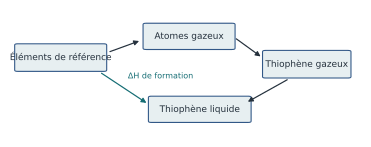

### Question 14 — Portée de la comparaison

> [!INDICATION]
> Comparer d’abord les deux nombres effectivement calculés, puis tester leur cohérence avec la donnée du début de l’épreuve.

#### Solution

L’estimation localisée dépasse la valeur issue de la combustion de **46,8 kJ·mol⁻¹**. Des énergies de liaison moyennes ignorent l’environnement précis et la délocalisation du système aromatique ; la calorimétrie concerne directement la molécule réelle. La valeur de Q12 est donc celle qui provient de l’expérience décrite et, des deux nombres, la plus proche de celui du tableau 1. Ni 387,2 ni 434 ne reproduisent cependant ses 80 kJ·mol⁻¹. La différence ne donne pas une mesure fiable de l’énergie de résonance en présence de cette incohérence.

### Question 15 — Comparer avec le benzène

> [!INDICATION]
> Préciser le modèle qui donne un sens à l’écart énergétique.

#### Solution

Dans la comparaison proposée, l’écart du benzène (170 kJ·mol⁻¹) dépasse celui déduit pour le thiophène (environ 47 kJ·mol⁻¹). Le bilan relatif suggère une stabilisation par délocalisation plus marquée pour le benzène par rapport aux structures localisées choisies. Les deux cycles sont aromatiques. Les énergies moyennes de liaison et l’incohérence numérique de Q12 limitent la portée quantitative de ce classement.

## II. États électroniques, spectres et corrosion

### Question 16 — Conducteur, semi-conducteur et isolant

> [!INDICATION]
> Identifier une bande accessible à des électrons mobiles et l’énergie nécessaire pour y créer des porteurs.

#### Solution

Dans un métal, une bande est partiellement occupée, ou deux bandes se recouvrent au niveau de Fermi. Dans un semi-conducteur intrinsèque, la bande de valence pleine à 0 K est séparée de la bande de conduction vide par un intervalle interdit $E_g$ assez petit pour créer des paires électron–trou par excitation thermique ou optique. Dans un isolant usuel, l’intervalle est grand devant les énergies accessibles dans les conditions considérées et les porteurs sont rares.

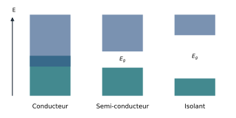

### Question 17 — Configuration du soufre

> [!INDICATION]
> Répartir les seize électrons en partant des plus bas niveaux.

#### Solution

Au fondamental, le soufre ($Z=16$) a pour configuration $1s^22s^22p^63s^23p^4=[\mathrm{Ne}]3s^23p^4$. Les occupations des trois orbitales de la sous-couche 3p sont $2,1,1$ dans un choix d’axes approprié ; la couche de valence porte six électrons.

### Question 18 — Principes de remplissage

> [!INDICATION]
> Distinguer ordre énergétique, occupation d’une même orbitale et répartition dans une sous-couche dégénérée.

#### Solution

Le principe de construction remplit par énergie croissante. La règle empirique de **Klechkowski** classe les sous-couches par $n+\ell$ croissant, puis par $n$ croissant à égalité. Le principe de **Pauli** interdit à deux électrons d’avoir les quatre mêmes nombres quantiques : deux au plus par orbitale, de spins opposés. La règle de **Hund** occupe d’abord les orbitales dégénérées séparément avec des spins parallèles.

### Question 19 — Lewis et géométrie

> [!INDICATION]
> Compter les domaines électroniques autour de S et distinguer géométrie locale et plan du cycle.

#### Solution

Le thiophène est un cycle à cinq sommets, quatre CH et un S. Une représentation de Lewis comporte deux doubles liaisons C=C, deux liaisons simples C–S et deux doublets libres sur S. Un doublet de S contribue aux six électrons π sur le cycle plan. Au sens de la VSEPR locale, S est **AX₂E₂**, avec un arrangement électronique approximativement tétraédrique et une géométrie C–S–C coudée. Le pentagone conjugué contraint l’angle, et la VSEPR n’établit pas à elle seule la planéité du système π.

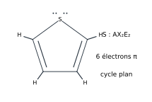

### Question 20 — Construire le système π du butadiène

> [!INDICATION]
> Numéroter les quatre C le long de la chaîne. En montant en énergie, le nombre de changements de phase augmente.

#### Solution

Sur les lobes d’une même face, les phases des quatre OM du butadiène sont successivement $++++$, $++--$, $+--+$ et $+-+-$. Un changement global de tous les signes représente la même orbitale. Les deux premières se forment en combinant les orbitales π liantes des deux fragments éthylène, les deux suivantes à partir de leurs orbitales π antiliantes. Le nombre de nœuds entre carbones passe de 0 à 3. Les quatre électrons occupent les deux OM inférieures par paires.

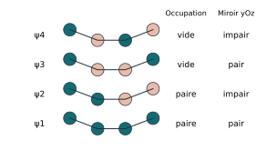

### Question 21 — Appliquer la symétrie du plan yOz

> [!INDICATION]
> Le miroir échange les deux extrémités de la chaîne. Il laisse invariant le caractère du lobe de S situé du côté +z.

#### Solution

Les orbitales 1 et 3 du butadiène sont symétriques par échange gauche–droite, les orbitales 2 et 4 antisymétriques. L’orbitale $3p_z$ du soufre, portée par un centre situé dans le plan $yOz$, est symétrique par cette réflexion. Elle peut interagir avec les deux OM **1 et 3**, si leur recouvrement est non nul. Avec 2 et 4 les contributions s’annulent par symétrie.

### Question 22 — Compléter les cinq orbitales du cycle

> [!INDICATION]
> Deux niveaux gardent leur énergie dans la construction de l’annexe. Les trois autres appartiennent au bloc de symétrie de l’orbitale du soufre.

#### Solution

Le mélange des OM 1 et 3 du butadiène avec $3p_z$(S) donne trois combinaisons de symétrie paire, aux rangs **1, 2 et 4** du thiophène. Les OM impaires du butadiène se retrouvent aux rangs **3 et 5**, avec un coefficient nul sur S. Sur l’annexe, ajouter en bas l’orbitale dont les cinq lobes de la face supérieure sont de même phase. En haut, ajouter l’alternance $+-+-$ sur les quatre C de la chaîne et un nœud sur S. Relier par pointillés les niveaux des deux blocs de symétrie aux fragments correspondants. Le doublet $p_z$ de S complète les quatre électrons du butadiène : les niveaux 1, 2 et 3 contiennent chacun **deux électrons**.

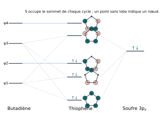

### Question 23 — Orbitales frontières du thiophène

> [!INDICATION]
> Comparer les phases des lobes qui se font face sur les deux liaisons formées entre S et la chaîne.

#### Solution

La HO, le niveau 3 de l’annexe, provient de l’OM de profil $++--$ sur la chaîne, soit le deuxième **niveau** du butadiène, impair par réflexion. Son coefficient sur S est nul ; elle est **non liante vis-à-vis des liaisons S–C**. La BV, niveau 4, oppose la phase de S à celles des deux C adjacents : elle est **antiliante** pour cette interaction.

### Question 24 — Construire les dix orbitales du dimère

> [!INDICATION]
> Prendre deux exemplaires de chaque OM du monomère et comparer les phases sur les deux atomes α qui sont reliés.

#### Solution

Notons $u_i^A,u_i^B$ les deux orbitales équivalentes des cycles A et B, le recouvrement étant négligé dans la normalisation. Choisissons leur phase pour que les lobes qui se font face aux carbones α soient de même signe. Pour chaque $i=1,\dots,5$, former $u_i^+=(u_i^A+u_i^B)/\sqrt2$ (combinaison en phase, énergie abaissée) et $u_i^-=(u_i^A-u_i^B)/\sqrt2$ (hors phase, énergie relevée). Le coefficient sur chaque autre atome conserve le signe relatif de l’OM du monomère, ou s’inverse sur tout le second cycle dans la combinaison $-$. L’éclatement est faible si les coefficients α sont faibles ; un nœud exact le supprimerait dans ce modèle à une interaction. En l’absence de croisement entre doublets, les **six OM des paires 1, 2 et 3** sont occupées par douze électrons, les quatre OM des paires 4 et 5 restantes sont vides.

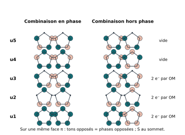

### Question 25 — Orbitales frontières du dimère

> [!INDICATION]
> Repérer la plus haute des deux combinaisons occupées et la plus basse des deux vacantes.

#### Solution

Autour de la liaison intercyclique, la **HO** du dimère est la combinaison **antiliante** des deux HO des monomères ($u_3^-$). La **BV** est la combinaison **liante** des deux BV ($u_4^+$). Le qualificatif se rapporte au contact α–α créé entre les cycles.

### Question 26 — Effet de la conjugaison

> [!INDICATION]
> Observer séparément le déplacement de la HO et celui de la BV.

#### Solution

La combinaison antiliante relève la HO du dimère par rapport à la HO du monomère ; la combinaison liante abaisse sa BV. L’écart HO–BV **diminue**. La délocalisation sur deux cycles fournit davantage de niveaux proches et tend à déplacer les transitions π–π* vers de plus grandes longueurs d’onde. L’effet suppose un recouvrement intercyclique appréciable.

### Question 27 — Attribuer les couleurs

> [!INDICATION]
> Passer de la lumière absorbée à la lumière transmise ou réfléchie.

#### Solution

**P1 est rouge**, son maximum vers 500 nm ôtant surtout le bleu-vert. **P3 est bleu**, son absorption vers 615 nm ôtant la partie orange-rouge. **P2 est vert** dans les trois possibilités proposées : ses bandes vers 380 et 760 nm encadrent la région centrale restante. Les maxima seuls ne suffisent pas à reconstituer une teinte exacte ; la largeur et l’intensité des bandes interviennent aussi.

### Question 28 — Lire la spectroélectrochimie

> [!INDICATION]
> Suivre deux régions du spectre lorsque le potentiel passe de −0,9 à +1,0 V.

#### Solution

À bas potentiel, P3 présente une bande intense vers **610–620 nm** ($A$ voisine de 1,6 au maximum). En augmentant le potentiel, cette bande décroît, tandis que l’absorption se développe dans le proche infrarouge et dépasse 1 vers 1 500 nm aux potentiels les plus élevés. Les photographies montrent une perte de la coloration bleue intense. L’oxydation modifie l’occupation des niveaux π et permet de nouvelles transitions électroniques, compatibles avec la formation de porteurs de charge sur le polymère. La couleur est ainsi contrôlée par l’état d’oxydation.

### Question 29 — Mesurer simultanément potentiel et absorption

> [!INDICATION]
> Séparer le trajet optique du circuit de mesure du potentiel.

#### Solution

Un film de P3 déposé sur une électrode de travail transparente se trouve dans une cuve optique avec un électrolyte. Un potentiostat contrôle le potentiel de travail par rapport à une référence ; une contre-électrode ferme le circuit, hors du faisceau si possible. On enregistre l’absorbance dans le visible et le proche infrarouge à différents potentiels stabilisés, avec un blanc comportant les mêmes supports et électrolyte. Les variations de spectre peuvent alors être associées aux variations d’état d’oxydation.

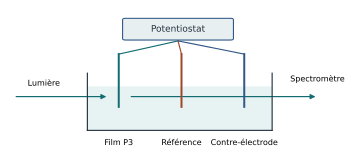

### Question 30 — Origine de la coloration du monomère

> [!INDICATION]
> Comparer la conjugaison et la volatilité des espèces susceptibles d’apparaître pendant le stockage.

#### Solution

Une faible fraction d’oligomères ou de produits d’oxydation conjugués peut donner la couleur brune. La couleur ne suffit pas à identifier une espèce pure. Les constituants de masse élevée sont beaucoup moins volatils que le monomère ; celui-ci peut donc être recueilli incolore en tête de distillation. On **purifie le monomère restant** : la distillation ne reconvertit pas les oligomères en EDOT et ne peut restaurer la quantité initiale.

### Question 31 — Distillation sous pression réduite

> [!INDICATION]
> Suivre la vapeur, le liquide condensé, la mesure de température et la ligne de vide.

#### Solution

Un ballon contenant le mélange est chauffé et agité. À sa sortie, la tête de distillation porte le thermomètre dans le trajet de vapeur, à hauteur de l’entrée du réfrigérant. La vapeur se condense puis s’écoule vers le ballon récepteur. Le réfrigérant reçoit l’eau en bas et l’évacue en haut ; un adaptateur relie le récepteur à un manomètre et, via un piège, à la source de vide. L’abaissement de pression permet de distiller le monomère à la température donnée.

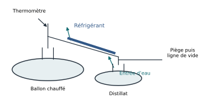

### Question 32 — Interpréter mmHg

> [!INDICATION]
> Relier la hauteur de liquide à une différence de pression hydrostatique.

#### Solution

Le millimètre de mercure est la pression correspondant à une colonne de mercure de 1 mm dans les conditions conventionnelles. $1\ \mathrm{mmHg}\simeq133,3$ Pa et $760\ \mathrm{mmHg}\simeq1$ atm. Les 10 mmHg cités correspondent à environ $1,33\times10^3$ Pa, soit 13,3 mbar de pression absolue.

### Question 33 — Bilan de corrosion

> [!INDICATION]
> Combiner l’oxydation du fer en Fe(II) et la réduction de deux protons.

#### Solution

$\mathrm{Fe(s)\to Fe^{2+}(aq)+2e^-}$ et $\mathrm{2H^+(aq)+2e^-\to H_2(g)}$ donnent $\mathrm{Fe(s)+2H^+(aq)\to Fe^{2+}(aq)+H_2(g)}$.

### Question 34 — Équilibre des courants partiels

> [!INDICATION]
> Le métal en circuit ouvert ne fournit aucun courant macroscopique vers l’extérieur.

#### Solution

Avec la convention algébrique, $i_a+i_c=0$ au potentiel de corrosion, soit $i_a=|i_c|$. Pour des densités rapportées à **la même aire géométrique** $S$, $j_a=-j_c$ et $j_{\rm corr}=j_a=|j_c|$. Si les surfaces actives anodique et cathodique sont comptées séparément, c’est $S_a j_a=-S_c j_c$ qui demeure vrai.

### Question 35 — Influence du matériau

> [!INDICATION]
> Un potentiel d’équilibre d’oxydoréduction et une courbe de polarisation ne portent pas la même information.

#### Solution

La droite cathodique est une relation de **cinétique interfaciale**. Sa pente et son ordonnée dépendent de l’activité catalytique, de l’état de surface, du milieu et du domaine de courant ; elles peuvent changer avec le métal. Le potentiel thermodynamique du couple $\mathrm{H^+/H_2}$ dépend, lui, des activités et de la pression de dihydrogène.

### Question 36 — Intersection des droites de Tafel

> [!INDICATION]
> Les deux expressions de E s’appliquent à une même valeur positive de $|j|$.

#### Solution

Avec $L=\log_{10}(j_{\rm corr}/[1\,\mathrm{A\,cm^{-2}}])$, $0,0750L-0,0348=-0,0780L-0,476$. Il vient $L=-2,884$, $j_{\rm corr}=\mathbf{1,31\times10^{-3}}$ A·cm⁻² et $E_{\rm corr}=\mathbf{-0,251}$ V/ESH.

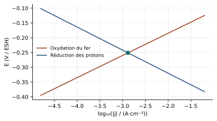

### Question 37 — Vitesse de perte d’épaisseur

> [!INDICATION]
> Relier la masse de Fe consommée aux deux moles d’électrons cédées par mole.

#### Solution

Par unité de surface, le flux molaire de fer oxydé est $j_{\rm corr}/(2F)$. La masse perdue divisée par la masse volumique donne le volume, puis le volume par surface donne l’épaisseur : $v_{\rm corr}=M_{\rm Fe}j_{\rm corr}/(2F\rho_{\rm Fe})$ dans un système d’unités cohérent.

### Question 38 — Application numérique

> [!INDICATION]
> Convertir A·cm⁻² en A·m⁻² avant d’utiliser les unités SI.

#### Solution

$1,307\times10^{-3}\ \mathrm{A\,cm^{-2}}=13,07\ \mathrm{A\,m^{-2}}$. Avec $M=0,0558$ kg·mol⁻¹, $\rho=7874$ kg·m⁻³ et $F=96490$ C·mol⁻¹, $v_{\rm corr}\simeq4,80\times10^{-10}$ m·s⁻¹, soit **$1,51\times10^4$ µm·an⁻¹** (environ 15 mm par an), si les conditions et la vitesse restent constantes.

### Question 39 — Potentiel de l’électrode au calomel

> [!INDICATION]
> Écrire la demi-équation et identifier la seule activité dissoute qui entre dans Nernst.

#### Solution

L’ECS comporte la phase Hg(l), du calomel $\mathrm{Hg_2Cl_2(s)}$ et une solution de KCl saturée. La demi-équation est $\mathrm{Hg_2Cl_2(s)+2e^-\rightleftharpoons2Hg(l)+2Cl^-(aq)}$. Les activités du solide et du liquide purs valent 1 ; le potentiel dépend de $-RT\ln a_{\rm Cl^-}/F$. La saturation maintient l’activité du chlorure pratiquement constante à température fixée. Mesurée à courant négligeable, l’ECS fournit ici une référence à $+0,244$ V/ESH à 25 °C.

### Question 40 — Mesurer le potentiel et le courant de corrosion

> [!INDICATION]
> Identifier où passe le courant imposé lors d’un tracé de polarisation.

#### Solution

Un montage à trois électrodes associe la plaque connue comme électrode de travail, l’ECS comme référence et une contre-électrode inerte. Le potentiostat mesure ou impose $E_{\rm travail}-E_{\rm ECS}$ ; le courant passe entre travail et contre-électrode. Le potentiel à circuit ouvert après stabilisation donne $E_{\rm corr}$. On peut extrapoler les deux branches linéaires de Tafel dans le plan $E,\log|j|$ ; leur intersection donne $E_{\rm corr}$ et $j_{\rm corr}$. Le seul courant extérieur nul en circuit ouvert ne donne pas la valeur du courant partiel de corrosion.

### Question 41 — Évaluer le revêtement

> [!INDICATION]
> Comparer les densités de courant à la même échelle plutôt que le seul signe du déplacement du potentiel.

#### Solution

Le dépôt de PEDOT fait passer $j_{\rm corr}$ de 0,96 à **0,48 mA·cm⁻²**. Dans l’essai, cela correspond à une attaque environ deux fois plus lente et à une efficacité relative $1-0,48/0,96=50\,\%$. Le potentiel passe de 595 à 635 mV/ECS dans le tableau. La baisse du courant fournit l’argument cinétique pour retenir la plaque couverte de PEDOT.

## III. Ligand thiophénique et complexe de ruthénium

### Question 42 — Régiosélectivité de la substitution

> [!INDICATION]
> Comparer les délocalisations possibles de la charge dans les deux complexes σ de la figure 6.

#### Solution

Numérotons S en 1 et les quatre C de 2 à 5. Après attaque en α sur C2, le carbone C2 porte à la fois H et Br. La charge du complexe σ peut se répartir sur C3, sur C5, puis sur S par donation d’un doublet. Après attaque en β sur C3, les principales formes placent la charge sur C2 ou sur S ; la délocalisation est moins étendue. Dans l’étape de formation électrophile du complexe σ, cette meilleure stabilisation favorise la substitution en α. La perte ultérieure de H⁺ rétablit l’aromaticité dans les deux cas.

### Question 43 — Limites de la manipulation directe du dibrome

> [!INDICATION]
> Envisager à la fois le danger pour l’opérateur et la sélectivité de la transformation.

#### Solution

Le dibrome est volatil, très corrosif et dangereux par inhalation. Le manier directement accroît le risque d’exposition. Par ailleurs le thiophène est riche en électrons : un excès de bromant peut favoriser les substitutions multiples et réduire la sélectivité pour le monobromé. Éviter un stock directement manipulé et limiter l’accumulation de l’électrophile constituent deux motivations cohérentes avec le choix décrit.

### Question 44 — Identifier l’intermédiaire organomagnésien

> [!INDICATION]
> Examiner la liaison C–Br qui était présente avant l’intervention du magnésium.

#### Solution

Le composé 3 est le **bromure de thiophén-2-ylmagnésium**. Le cycle thiophène reste intact, son carbone 2 portant désormais le groupe $\mathrm{-MgBr}$. Sa formule condensée est $\mathrm{(2{-}C_4H_3S)MgBr}$. C’est un **organomagnésien mixte**, ou réactif de Grignard.

### Question 45 — Trois comportements d’un organomagnésien

> [!INDICATION]
> Partir de la polarisation de la liaison C–Mg et distinguer des partenaires de réaction différents.

#### Solution

Le carbone organomagnésien a un caractère nucléophile et basique. Il peut (1) capter un proton d’un donneur protique pour donner le thiophène correspondant, (2) s’additionner à un carbonyle pour donner un alcoolate puis un alcool après hydrolyse, ou (3) transférer son groupe organique à un métal de transition qui catalyse un **couplage C–C** avec un halogénure organique. L’addition à $\mathrm{CO_2}$, suivie d’une hydrolyse, est un autre exemple de fonctionnalisation par un électrophile.

### Question 46 — Montage de formation du réactif de Grignard

> [!INDICATION]
> Identifier le rôle de la verrerie sèche, de l’atmosphère et de l’addition maîtrisée.

#### Solution

Le schéma comporte un ballon agité avec le magnésium, une ampoule d’addition et un réfrigérant vertical renvoyant le condensat au ballon. La verrerie et le solvant éthéré doivent être secs : l’eau protonerait le réactif formé. Une atmosphère sèche et inerte limite son contact avec l’humidité, $\mathrm{O_2}$ et $\mathrm{CO_2}$ de l’air, qui peuvent le consommer. L’addition progressive sous agitation et la possibilité de modérer l’échauffement contrôlent une formation exothermique. Le montage reste en communication avec la ligne d’atmosphère, sans être fermé hermétiquement.

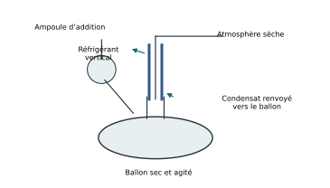

### Question 47 — Rôle du complexe de nickel

> [!INDICATION]
> Quel atome assure la liaison entre le fragment aromatique halogéné et le fragment organomagnésien ?

#### Solution

$\mathrm{NiCl_2(dppp)}$ est le **précurseur d’un catalyseur de couplage**. Le nickel facilite la formation de la liaison C–C entre le groupe thiophén-2-yle et le fragment pyridyle, dans un couplage de type Kumada. Le cycle catalytique peut s’interpréter par activation de la liaison aryle–halogène, transmétallation puis élimination réductrice. Le ligand diphosphine stabilise les espèces du nickel.

### Question 48 — Denticité du ligand

> [!INDICATION]
> Examiner le ligand 4, puis identifier les deux atomes qui se lient effectivement au Ru dans 5.

#### Solution

Le 2-(thiophén-2-yl)pyridine est **cyclométallant et bidentate C,N** dans le complexe dessiné : N de la pyridine donne un doublet et le carbone du thiophène portant initialement H forme la liaison Ru–C après métallation. Les deux liaisons ferment un chélate. Le ligand libre est neutre, puis le ligand cyclométallé a le caractère global d’un ligand monoanionique. La figure ne dessine pas de liaison Ru–S.

### Question 49 — Orbitales d dans le champ octaédrique

> [!INDICATION]
> Orienter les axes vers les six ligands et distinguer lobes axiaux et interaxiaux.

#### Solution

Les cinq orbitales $d$ sont $d_{xy},d_{xz},d_{yz}$, dont les quatre lobes s’étendent entre les deux axes désignés, $d_{x^2-y^2}$ à quatre lobes orientés le long de x et y, et $d_{z^2}$ à deux lobes le long de z et un anneau dans le plan xy. Dans le modèle octaédrique, les trois premières forment le triplet **$t_{2g}$**, inférieur ; les deux dernières forment le doublet **$e_g$**, supérieur de $\Delta_o$. Ru est dans le groupe 8, et Ru(II) est **$4d^6$**. Il faut placer six électrons dans les niveaux d.

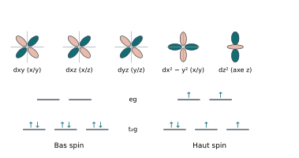

### Question 50 — Magnétisme du Ru(II)

> [!INDICATION]
> Comparer l’énergie de mise en paire et l’éclatement du champ.

#### Solution

Si $\Delta_o$ dépasse le coût d’appariement, l’état fondamental est $t_{2g}^6e_g^0$, trois paires, **diamagnétique**. Si le champ est assez faible, $t_{2g}^4e_g^2$ porte quatre électrons célibataires et serait **paramagnétique**. Les ions 4d, en particulier Ru(II) avec ces ligands coordinants, favorisent usuellement le bas spin. Le décompte $d^6$ seul ne prouve pas le résultat magnétique.

### Question 51 — Rendement global

> [!INDICATION]
> Le premier pourcentage porte déjà sur trois étapes.

#### Solution

Les conversions successives du schéma donnent $\eta=0,83\times0,45\times0,63\times0,83=0,1953$, soit **19,5 %** au total sur la base des rendements donnés. Le premier facteur 0,83 intervient une seule fois pour le groupe d’étapes 1 à 3.

## IV. Cinétique de substitution

### Question 52 — Ordres et constante de vitesse

> [!INDICATION]
> Écrire une loi de vitesse expérimentale dans un domaine donné.

#### Solution

Pour $v=k[A]^a[B]^b$, $a$ et $b$ sont les ordres partiels, et $a+b$ l’ordre global. Ils expriment la dépendance mesurée de la vitesse aux concentrations et ne sont pas nécessairement des entiers ni les coefficients stœchiométriques. À température et milieu fixés, $k$ est le coefficient de proportionnalité. Lorsque $v$ est en mol·L⁻¹·s⁻¹, l’unité de $k$ est $(\mathrm{mol\,L^{-1}})^{1-a-b}\,\mathrm{s^{-1}}$.

### Question 53 — Tester l’ordre global sans séparer les ordres

> [!INDICATION]
> Choisir un suivi où, par stœchiométrie, les concentrations des deux réactifs restent égales.

#### Solution

Pour des concentrations initiales égales $c_0$ et une stœchiométrie 1:1, $[\mathrm{ThH}]=[\mathrm{Br_2}]=c(t)$. Si $a+b=2$, $-\mathrm dc/\mathrm dt=kc^2$, donc $1/c(t)=1/c_0+kt$, ou $c(t)=c_0/(1+kc_0t)$. Un tracé linéaire de $1/c$ contre $t$ avec pente cohérente pour plusieurs $c_0$ soutient l’ordre global deux. Cet essai ne sépare pas les deux ordres partiels.

### Question 54 — Ordre partiel en thiophène

> [!INDICATION]
> Quand un réactif est en large excès, sa concentration est pratiquement constante pendant un essai, mais peut varier d’un essai à l’autre.

#### Solution

On a $k_{\rm app}=k[\mathrm{ThH}]^a$ lorsque le thiophène est en excès. Le tracé de $\log k_{\rm app}$ en fonction de $\log[\mathrm{ThH}]$ a pour pente $a$. La valeur donnée **0,9643**, avec $R^2=0,9918$, est proche de 1 et soutient un ordre partiel un en thiophène. Le degré de précision sur la pente n’est pas fourni.

### Question 55 — Ordre partiel en dibrome

> [!INDICATION]
> À concentration fixée de thiophène, la pente logarithmique des vitesses initiales isole l’exposant du second réactif.

#### Solution

$\log v_0=\log(k[\mathrm{ThH}]_0^a)+b\log[\mathrm{Br_2}]_0$. On lit **$b=1,2095$**, avec $R^2=0,9942$. La tendance est voisine d’un ordre un mais l’écart d’environ 0,21 est visible. Le bon coefficient de détermination confirme la linéarité du tracé ; il ne teste pas à lui seul l’hypothèse statistique $b=1$. Il faudrait notamment une incertitude sur la pente ou davantage de mesures.

### Question 56 — Prééquilibre rapide

> [!INDICATION]
> Distinguer constante d’association exprimée en concentrations et constante thermodynamique sans dimension.

#### Solution

Notons $A=\mathrm{ThH}$, $B=\mathrm{Br_2}$ et $I$ l’adduit. À quasi-équilibre de la première étape, $k_1[A][B]\simeq k_{-1}[I]$. Ainsi $[I]\simeq(k_1/k_{-1})[A][B]$. En solution idéale avec concentration standard $c^\circ$, $K_1^\circ=a_I/(a_Aa_B)\simeq c^\circ k_1/k_{-1}$. La thermodynamique donne aussi $\Delta_rG_1^\circ=-RT\ln K_1^\circ$.

### Question 57 — Approximation des états quasi stationnaires

> [!INDICATION]
> Écrire explicitement les deux voies qui consomment l’adduit, puis comparer les échelles de temps.

#### Solution

L’AEQS consiste à négliger, après un court transitoire, la vitesse nette d’accumulation d’un intermédiaire devant ses flux de formation et de disparition. Ici $\mathrm d[I]/\mathrm dt=k_1[A][B]-(k_{-1}+k_2)[I]$. Si la relaxation de l’adduit est rapide et son accumulation faible à l’échelle de la consommation des réactifs, $[I]\simeq k_1[A][B]/(k_{-1}+k_2)$. Le mécanisme signale que le retour est rapide et que l’étape 2 est lente. Dans la limite $k_2\ll k_{-1}$, l’expression retrouve celle de Q56. La qualification de « prééquilibre » ne suffit pas à rendre $[I]$ constant pendant toute l’expérience.

### Question 58 — Étape cinétiquement déterminante

> [!INDICATION]
> Rapprocher les qualificatifs rapide et lent des trois étapes successives.

#### Solution

Le schéma indique que la conversion de l’adduit en complexe σ et bromure (étape 2) est lente, tandis que le réarrangement final avec perte d’un proton est rapide. On peut donc considérer que le **flux de formation du produit suit la deuxième étape**, une fois le court transitoire passé. Cette hypothèse permet d’écrire $v\simeq k_2[I]$.

### Question 59 — Loi de vitesse résultante

> [!INDICATION]
> Éliminer la concentration non directement mesurée de l’adduit.

#### Solution

Le prééquilibre suivi de l’étape lente donne $v\simeq(k_1 k_2/k_{-1})[\mathrm{ThH}][\mathrm{Br_2}]$. Avec la forme AEQS non simplifiée, le coefficient apparent est $k_1 k_2/(k_{-1}+k_2)$. La loi prévoit un ordre un pour chaque réactif et un ordre deux au total, cohérents en première approximation avec les graphes.

### Question 60 — Loi d’Arrhenius

> [!INDICATION]
> Passer au logarithme naturel et choisir la température absolue.

#### Solution

$k(T)=A\exp[-E_a/(RT)]$, où $A$ est le facteur préexponentiel (même unité que $k$), $E_a$ l’énergie d’activation (J·mol⁻¹), $R$ la constante des gaz et $T$ la température en kelvins. Pour $A$ et $E_a$ sensiblement constants, la pente de $\ln k$ en fonction de $1/T$ vaut $-E_a/R$.

### Question 61 — Énergies d’activation

> [!INDICATION]
> Faire une régression sur les quatre températures pour chaque colonne du tableau 7.

#### Solution

Convertir 18, 26, 34 et 42 °C en 291,15, 299,15, 307,15 et 315,15 K. Ajuster $y=\ln k$ par $a(1/T)+b$ et prendre $E_a=-Ra$. Dans l’ordre des colonnes : **37,4 kJ·mol⁻¹** pour le thiophène dans AcOH glacial ; **32,0 kJ·mol⁻¹** pour le thiophène dans AcOH à 15 % ; **51,3 kJ·mol⁻¹** pour le 3-bromothiophène dans AcOH à 15 % ; **19,7 kJ·mol⁻¹** pour le 3-méthylthiophène dans AcOH glacial. Une détermination avec les seules températures extrêmes fournit des valeurs voisines.

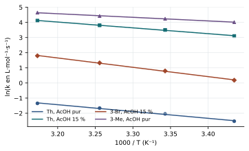

### Question 62 — Effet des substituants

> [!INDICATION]
> N’effectuer chaque comparaison qu’à solvant et température identiques.

#### Solution

Dans l’acide acétique glacial à 18 °C, le rapport $k_{\rm Me}/k_{\rm H}=55,5/0,08\simeq690$ : le groupe méthyle enrichit le cycle (effet inductif donneur et hyperconjugaison) et stabilise le développement du caractère cationique dans la substitution électrophile. Dans le milieu aqueux acétique, $k_{\rm Br}/k_{\rm H}=1,20/22,23\simeq0,054$ : le brome désactive globalement le cycle, son effet inductif attracteur dominant ici son effet donneur par mésomérie. Les valeurs d’activation suivent le même sens dans chacune de ces comparaisons.

### Question 63 — Effet du solvant

> [!INDICATION]
> Comparer une même molécule à température fixée et identifier à quel moment les charges se séparent.

#### Solution

À 18 °C, la valeur passe de 0,08 dans AcOH glacial à 22,23 L·mol⁻¹·s⁻¹ dans AcOH aqueux à 15 %, soit un facteur proche de **280**. Le milieu plus polaire et hydratant peut stabiliser la séparation des charges développées dans l’étape lente, vers le complexe σ cationique et le bromure. Une stabilisation de l’état de transition par rapport aux réactifs diminue la barrière libre. La spéciation et la solvatation des réactifs peuvent aussi varier ; les seules vitesses ne distinguent pas ces contributions.
