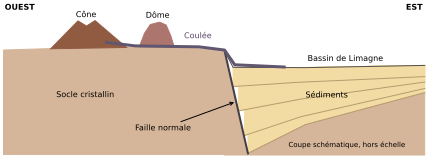
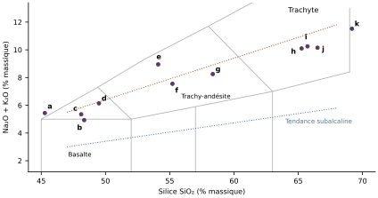
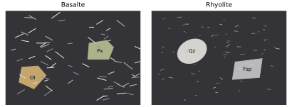
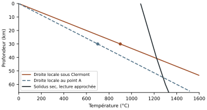

# ENS de Lyon, second concours 2023 — Géosciences · Corrigé brut

*Corrigé rédigé par IA, non officiel. Signalez toute erreur.*

**Rédaction** · GPT-6.2 Astra Ultra · vitesse non renseignée

Les lettres des échantillons correspondent au tableau 1 de l’épreuve. Les âges en années BP sont comptés avant 1950.

### Question 1 — Coupe ouest-est de la chaîne et du bassin

De l'ouest vers l'est, le plateau des Dômes porte un socle cristallin ancien, les cônes et les dômes de la chaîne des Puys, leurs coulées et des nappes pyroclastiques. Une coupe passant par le Pariou et le secteur de Clermont peut suivre vers l'est la coulée canalisée dans une vallée. À la bordure de la Limagne une faille normale de direction approximative nord-sud abaisse le compartiment oriental. Les sédiments cénozoïques s'y épaississent en direction de la faille et reposent sur le socle. Ils affleurent sous des alluvions ou des coulées locales. Le plateau de Gergovie, plus au sud, fournit ailleurs un témoin de coulée ancienne en relief inversé. La carte ne donne ni le pendage profond exact de la faille ni l'épaisseur sur le tracé choisi. Les 2,5 km cités à Riom concernent une autre latitude.

### Question 2 — Analyses sur le diagramme silice-alcalins

Les couples $(\mathrm{SiO_2},\mathrm{Na_2O}+\mathrm{K_2O})$ en pourcentages massiques sont $a=(45{,}28;5{,}44)$, $b=(48{,}34;4{,}93)$, $c=(48{,}11;5{,}35)$, $d=(49{,}49;6{,}14)$, $e=(54{,}10;8{,}95)$, $f=(55{,}21;7{,}55)$, $g=(58{,}35;8{,}25)$, $h=(65{,}26;10{,}10)$, $i=(65{,}72;10{,}25)$, $j=(66{,}50;10{,}15)$ et $k=(69{,}18;11{,}52)$. La série à forte teneur en alcalins passe des termes basaltiques aux trachytes via des termes intermédiaires. L'autre tendance matérialise une série subalcaline, de type basalte–andésite–dacite. Ce seul diagramme ne distingue pas de façon sûre les séries tholéiitique et calco-alcaline. La chaîne des Puys suit la **série alcaline**, identification confirmée dans le rapport du jury. Un échantillon près d'une limite de champ, comme $b$, ne suffit pas à classer la série entière.

### Question 3 — Évolution chimique et chronologie

Dans les grands traits, les éruptions de 32 à 30 ka BP donnent les termes les plus pauvres en silice à Lemptégy 1, au Grand Sarcoui, aux Gouttes et aux Goules. À Lemptégy, l'unité $f$ (environ 30 ka) recouvre $c$ (32 ka). Elle est déjà plus siliceuse et plus alcaline. Les laves de la Nugère (14 ka), du Sarcoui (12,8 ka), du Dôme (11 ka) et de Chopine (9,5 ka) comprennent des termes plus différenciés. Globalement la silice et les alcalins augmentent tandis que MgO et CaO diminuent. La cristallisation fractionnée de phases telles qu'olivine, pyroxène et plagioclase calcique peut produire cette évolution. L'ordre n'est pas universel à l'échelle de la chaîne. Pariou et Chopine, tous deux vers 9,5 ka, ont des compositions bien distinctes. Sur le terrain, les dépôts $j$ reposent à leur tour au-dessus de $f$ et de son niveau d'altération.

### Question 4 — Lames minces en lumière polarisée analysée

Dans un basalte, dessiner des microlites allongés de plagioclase, éventuellement maclés, parmi des cristaux plus gros d'olivine et de clinopyroxène. La pâte rapidement refroidie peut contenir du verre qui reste sombre en LPA. Dans une rhyolite, dessiner une mésostase vitreuse ou finement cristallisée avec quelques quartz, souvent arrondis ou corrodés, et des feldspaths, notamment alcalins. Quartz et feldspaths donnent souvent des teintes de polarisation grises à blanches du premier ordre. Il existe aussi des rhyolites peu porphyriques. Au grossissement demandé, indiquer les principales formes et la taille relative des cristaux, sans attribuer une échelle non fournie.

### Question 5 — Deux types d’édifices

Les édifices tels que Pariou sont des cônes de scories à cratère, souvent associés à des coulées. Un magma basaltique ou intermédiaire relativement fluide dégaze par bouffées stromboliennes et peut s'épancher. Ces cônes dominent la population du panorama, environ 90 %. Au Dôme ou à Chopine, une lave trachytique plus riche en silice et plus visqueuse construit un dôme ou une aiguille. La surpression des gaz ou l'effondrement du dôme peut engendrer des explosions, des brèches et des courants pyroclastiques. Stromboli en Italie et le Soufrière Hills à Montserrat illustrent respectivement l'activité strombolienne et la croissance explosive de dômes. La différenciation de liquides issus de la fusion partielle du manteau et leurs temps de résidence distincts dans la croûte permettent à ces deux styles de coexister dans une même province. Degré de fusion, teneur en volatils et interaction avec l'encaissant peuvent aussi jouer.

### Question 6 — Signification du niveau jaune

Le niveau poreux est un **paléosol**. Sa richesse en argiles, eau et oxydes de fer et d'aluminium, avec des grains résiduels et de faibles teneurs en bases mobiles, traduit une altération près de la surface. Il enregistre une période d'exposition et de pédogenèse après $f$ (environ 30 ka BP) et avant le dépôt $j$ (environ 9,7 ka BP, question 8). Ces deux limites encadrent la formation du sol, dont la durée propre est inconnue.

### Question 7 — Loi de décroissance du carbone 14

La probabilité de désintégration par atome et par unité de temps vaut $\lambda$. Elle donne $dN/dt=-\lambda N$ puis $N(t)=N_0e^{-\lambda t}$. À la demi-vie $T$, $N(T)=N_0/2$, d'où $\lambda=\ln2/T=1{,}2097\times10^{-4}\ \mathrm{an}^{-1}$ pour $T=5730$ ans. L'inversion livre $t=\ln(N_0/N_t)/\lambda$. L'activité $A=\lambda N$ conduit au même rapport pour des masses de carbone comparables.

### Question 8 — Âge du bois et provenance du dépôt supérieur

Le rapport d'activités donne $t=(5730/\ln2)\ln(13{,}56/4{,}2)=9\,689$ ans BP. Les bornes $4{,}3$ et $4{,}1$ dpm par gramme donnent respectivement 9 494 et 9 888 ans BP, soit environ $9{,}69\pm0{,}20$ ka BP. C'est l'âge radiocarbone non calibré calculé avec les données de l'énoncé. Du bois tué ou carbonisé lors de la mise en place date approximativement l'événement. Un bois antérieur remanié donnerait une borne plus ancienne. Les bombes, les brèches et l'orientation commune du bois évoquent un courant pyroclastique. Le Puy Chopine se situe au nord-nord-est de Lemptégy sur la carte, dans une direction compatible avec l'alignement N25, qui à lui seul ne donne pas le sens du transport. Son âge (9,5 ka) et sa composition trachytique sont compatibles avec $j$, trachytique lui aussi. Le rapport identifie cette éruption comme l'origine attendue.

### Question 9 — Origine et datation des enclaves

Une enclave grenue riche en olivine est compatible avec une péridotite du manteau supérieur, ou avec un cumulat mafique à distinguer pétrographiquement. Un bloc grenu riche en quartz peut appartenir au socle granitique ou gneissique traversé. Leur texture indique une cristallisation ou recristallisation profonde antérieure à leur transport par la lave. Le carbone 14 date la fin des échanges d'un réservoir de carbone récent et convient mal à ces roches silicatées anciennes. Pour un granite à zircons, U-Pb peut dater la cristallisation. Pour une péridotite, on peut étudier Re-Os sur phases appropriées pour contraindre un épisode d'extraction ou d'évolution mantellique. La datation K-Ar ou Ar-Ar de la lave encaissante renseigne sur sa mise en place si elle contient assez de potassium.

### Question 10 — Épaisseur du remplissage

En sismique réflexion, une source en surface émet une impulsion et les capteurs enregistrent les échos sur les interfaces où l'impédance acoustique change. On suit le réflecteur du toit du socle sous les sédiments. Pour un trajet vertical et une vitesse moyenne $\bar v$, la profondeur vaut $h=\bar v\Delta t/2$ car l'onde parcourt l'épaisseur deux fois. Avec une vitesse illustrative de $2{,}5\ \mathrm{km\,s^{-1}}$, un temps double de 2,0 s correspond à 2,5 km. En pratique les vitesses et pendages sont contraints par les profils et si possible par des forages.

### Question 11 — Environnement de la Limagne

Les calcaires et marnes à stromatolites, les argiles à plantes et les gastéropodes d'eau douce des séries oligocènes et miocènes indiquent des milieux continentaux lacustres peu profonds ou palustres. Les sables fluviatiles quartzo-feldspathiques témoignent d'apports de rivières. Le dyke basaltique recoupe les couches et redresse ou métamorphise localement le calcaire. Il est plus jeune que les terrains traversés. Une coulée basaltique d'environ 16 Ma protège le sommet de Gergovie. L'érosion différentielle dégage ensuite le plateau, qui domine aujourd'hui la plaine de quelque 300 m.

### Question 12 — Amincissement et profondeur de fusion

Les isobathes de la figure 6 indiquent un Moho à environ 26 km dans le secteur de Clermont, contre environ 32 km au point A. Elles révèlent une croûte amincie sous le rift. À 30 km, les 900 °C sous Clermont dépassent de 200 °C la température au point A. L'anomalie est compatible avec l'amincissement lithosphérique et la remontée de manteau chaud. Pour une estimation graphique, on trace depuis la surface la droite passant par $(900\,°\mathrm C,30\,\mathrm{km})$. Le gradient moyen de $30\,°\mathrm C/\mathrm{km}$ rencontre le solidus sec de la péridotite de l'annexe vers **40 à 45 km** et environ $1\,200$ à $1\,300\,°\mathrm C$. Cet ordre de grandeur concerne le début possible de fusion mantellique. La profondeur exacte dépend du géotherme profond, de la teneur en eau et de la composition. Le Moho est une discontinuité distincte de ce seuil thermique.

### Question 13 — Histoire de la région

Un socle cristallin paléozoïque hérité de la chaîne varisque forme le substratum. Au Cénozoïque, l'extension ouest-européenne étire la lithosphère. La faille normale de la Limagne abaisse le bassin oriental par rapport au plateau des Dômes. La subsidence ménage l'espace de dépôt d'une série qui atteint localement 2,5 km. À l'Oligocène et au début du Miocène alternent lacs d'eau douce, marécages et apports fluviatiles. Des intrusions et épanchements basaltiques traversent ou recouvrent ces terrains. Gergovie conserve une coulée d'environ 16 Ma. L'érosion creuse les terrains voisins et laisse cette coulée en relief. Au Quaternaire, la remontée du manteau chaud entraîne une décompression qui peut le faire fondre partiellement. Les liquides empruntent les fractures, entraînent des enclaves et se différencient avant les éruptions. Les édifices alignés sur le plateau associent cônes à coulées et dômes. À Lemptégy, les formations de 32 puis 30 ka sont altérées à l'air libre, puis recouvertes vers 9,7 ka par les produits trachytiques de Chopine. Les alluvions et l'érosion continuent de modeler le paysage.

[Sujet officiel](https://banques-ecoles.fr/cms/wp-content/uploads/2023/10/2c2023_ST.pdf) · [Rapport du jury](https://banques-ecoles.fr/cms/wp-content/uploads/2023/10/23_2CC_rap_eST.pdf)
