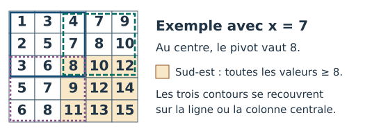
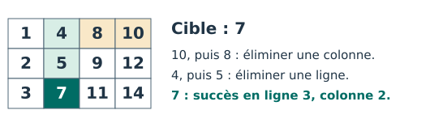
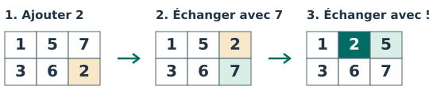
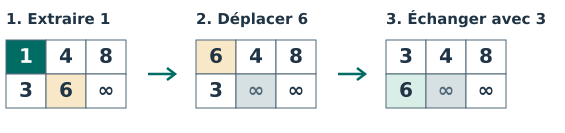
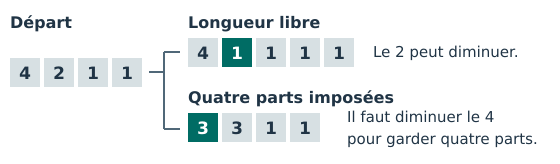

# ENS de Lyon — Second concours · Informatique 2023 · Corrigé brut

*Corrigé rédigé par IA, non officiel.*

**Rédaction** · GPT-6.2 Astra Ultra · vitesse non renseignée

**Révision** · GPT-6.2 Astra Ultra · vitesse non renseignée · 26 novembre 2026

Les algorithmes sont en pseudo-code, avec des indices commençant à 1 et des bornes incluses. Chaque lecture de case, comparaison ou échange coûte un temps constant. La croissance vaut sur toutes les lignes et toutes les colonnes, conformément à l’hypothèse en toutes lettres.

## Partie I — Recherche dans une matrice partiellement ordonnée

### Question I.1

```text
pour i de 1 à m :
    pour j de 1 à n :
        si A[i,j] = x : renvoyer (i,j)
renvoyer absent
```

Les couples parcourus sont exactement les indices de la matrice. Le premier succès donne une occurrence. Si $x$ est absent, les $mn$ cases sont testées. La complexité dans le pire cas est **$\Theta(mn)$ en temps et $O(1)$ en espace auxiliaire**.

### Question I.2

#### 1. Recherche dichotomique

Pour une suite croissante $B$ de longueur $k$, on maintient un intervalle fermé contenant toutes les occurrences encore possibles.

```text
dicho(B, k, x) :
    g, d ← 1, k
    tant que g ≤ d :
        h ← g + (d - g) div 2
        si B[h] = x : renvoyer h
        si B[h] < x : g ← h + 1
        sinon : d ← h - 1
    renvoyer absent
```

Si $B[h]<x$, tout indice au plus égal à $h$ est exclu. Si $B[h]>x$, tout indice au moins égal à $h$ est exclu. L’intervalle vide certifie donc l’absence. Chaque échec réduit la longueur à la moitié au plus. On effectue au plus $1+\lfloor\log_2 k\rfloor$ sondages, soit **$O(\log(k+1))$**, donc $O(\log k)$ lorsque $k$ grandit.

#### 2. Choix de la direction

Lancer cette recherche sur chaque ligne, en donnant accès à $B[j]=A[i,j]$ sans copier la ligne, coûte $O(m\log(n+1))$. Par colonnes, avec $B[i]=A[i,j]$, le coût est $O(n\log(m+1))$. On s’arrête au premier succès. **On parcourt les lignes si $m\le n$, les colonnes sinon** pour obtenir la meilleure de ces bornes. En effet, $\log(1+t)/t$ est la moyenne sur $[0,t]$ de la fonction décroissante $u\mapsto 1/(1+u)$ et décroît avec $t$ (logarithme naturel). Les deux choix coïncident en coût pour une matrice carrée.

### Question I.3

#### 1. Quadrant éliminé

Dans le bloc carré de centre $(u,v)$, soit $y=A[u,v]$. Au nord-ouest, les valeurs sont $\le y$, y compris sur les demi-axes correspondants. Au sud-est, elles sont $\ge y$. Si $x<y$, on écarte le sud-est. Si $x>y$, on écarte le nord-ouest. Les autres quadrants couvrent toutes les occurrences possibles.

#### 2. Récursion

On représente un carré par son coin supérieur gauche $(i,j)$ et la différence $d$ entre ses indices extrêmes. Sa taille vaut $d+1$. L’appel initial est `chercher(1, 1, n-1)`. Les quadrants partagent leurs bords centraux.

```text
chercher(i, j, d) :
    si d = 1 :
        tester les quatre cases du carré de coin (i,j)
        renvoyer les indices d'un succès, ou absent
    h ← d div 2
    u, v ← i + h, j + h
    si x = A[u,v] : renvoyer (u,v)
    coins ← [(i,v), (u,j)]
    si x < A[u,v] : ajouter (i,j) à coins
    sinon : ajouter (u,v) à coins
    pour chaque (a,b) dans coins :
        résultat ← chercher(a, b, h)
        si résultat est différent de absent : renvoyer résultat
    renvoyer absent
```

Pour $d=1$ on teste le carré entier. Pour $d\ge2$, chacun des trois appels porte sur un carré de côté $d/2+1$, et leur réunion contient chaque solution possible. L’induction sur l’exposant de $d$ établit le résultat. Le recouvrement peut faire tester une case plusieurs fois.



#### 3. Coût

Comptons une comparaison à trois issues par pivot et une par case à la base. On a $c_0=4$. Si $x$ est absent, chaque nœud interne engendre trois appels de taille $2^{q-1}+1$. Ce cas réalise le maximum, par exemple avec $x=0$ dans une matrice d’entiers positifs. Ainsi **$c_q=1+3c_{q-1}$**. Avec un décompte de toutes les opérations élémentaires, le terme local est $O(1)$ et l’ordre de grandeur est identique.

#### 4. Résolution

Avec $c'_q=c_q+\tfrac12$, on obtient $c'_q=3c'_{q-1}$, d’où $c_q=(c_0+\tfrac12)3^q-\tfrac12$. Puisque $2^p=n-1$, $3^p=(n-1)^{\log_2 3}$. Le coût est **$\Theta(n^{\log_2 3})$**, avec $\log_2 3\simeq1{,}585$.

#### 5. Taille arbitraire

Traiter $n=1$ par un test. Pour $n\ge2$, choisir $s=2^{\lceil\log_2(n-1)\rceil}+1$. Prolonger virtuellement la matrice jusqu’au côté $s$ par des valeurs $+\infty$ à droite et en bas. Chaque lecture teste les bornes réelles en temps constant. L’ordre est conservé et $x$, fini, ne peut être trouvé dans le prolongement. Comme $n\le s<2n$, le coût reste **$O(n^{\log_2 3})$**.

### Question I.4

#### 1. Recherche depuis le coin supérieur droit

Les candidats encore possibles occupent le rectangle formé des lignes $i,\ldots,m$ et des colonnes $1,\ldots,j$. Si $A[i,j]>x$, toute la colonne $j$ de ce rectangle est trop grande. Si $A[i,j]<x$, toute sa ligne $i$ est trop petite.

```text
i, j ← 1, n
tant que i ≤ m et j ≥ 1 :
    si A[i,j] = x : renvoyer (i,j)
    si A[i,j] > x : j ← j - 1
    sinon : i ← i + 1
renvoyer absent
```

À la sortie, le rectangle est vide ou une occurrence a été renvoyée. Les inégalités d’exclusion sont strictes, ce qui autorise les doublons.



#### 2. Complexité

Chaque déplacement va d’une case à gauche ou d’une case vers le bas. Avant la dernière case visitée, il y a au plus $n-1$ déplacements à gauche et $m-1$ vers le bas. D’où **au plus $m+n-1$ cases examinées**, un temps $O(m+n)$ et un espace auxiliaire $O(1)$.

## Partie II — Tri avec une matrice partiellement ordonnée

Pour le rang $r$ en lecture ligne par ligne, on note $\operatorname{pos}(r)=(1+\lfloor(r-1)/n\rfloor,1+((r-1)\bmod n))$. Les cases de rang supérieur à $k$ valent $+\infty$.

### Question II.1

Inscrire $x$ dans la case de rang $k+1$. Ses voisins inférieurs et droits, s’ils existent, sont vides. Une violation ne peut concerner que le voisin du haut ou celui de gauche. On remonte en choisissant le **plus grand des deux prédécesseurs**.

```text
insérer(A, k, x) :
    (i,j) ← pos(k+1)
    A[i,j] ← x
    tant que vrai :
        P ← voisins existants parmi (i-1,j) et (i,j-1)
        si P est vide : sortir de la boucle
        (a,b) ← un indice de P de valeur maximale
        si A[a,b] ≤ x : sortir de la boucle
        échanger A[a,b] et A[i,j]
        (i,j) ← (a,b)
    renvoyer k+1
```

Pour justifier les échanges, imaginons que $x$ laisse momentanément un trou à sa place. Toutes les comparaisons entre cases remplies sont satisfaites, et chaque prédécesseur du trou vaut au plus chacun de ses successeurs. Au départ ses successeurs valent $+\infty$. Placer le plus grand prédécesseur dans le trou respecte donc les deux ordres. Le nouveau trou a pour prédécesseurs des valeurs au plus égales à celle que l’on vient de déplacer, et ses successeurs sont au moins aussi grands. En outre, tous ses successeurs valent au moins $x$. À l’arrêt, on peut y remettre $x$. Seules les $k+1$ premières cases participent. À chaque échange $i+j$ diminue de 1, donc le temps est **$O(m+n)$** et l’espace auxiliaire $O(1)$.



### Question II.2

Le minimum est $A[1,1]$. Pour le retirer en conservant un préfixe de $k-1$ cases significatives, **enlever d’abord la valeur $t$ de rang $k$**, libérer cette case, puis replacer $t$ au sommet et le faire descendre.

```text
extraire(A, k) :
    minimum ← A[1,1]
    (a,b) ← pos(k)
    t ← A[a,b]
    A[a,b] ← infini
    si k = 1 : renvoyer (minimum, 0)
    (i,j) ← (1,1)
    A[i,j] ← t
    tant que vrai :
        S ← voisins existants parmi (i+1,j) et (i,j+1)
        si S est vide : sortir de la boucle
        (a,b) ← un indice de S de valeur minimale
        si A[a,b] ≥ t : sortir de la boucle
        échanger A[a,b] et A[i,j]
        (i,j) ← (a,b)
    renvoyer (minimum, k-1)
```

La case de rang $k$ est un coin extérieur du préfixe. La remplacer par $+\infty$ respecte l’ordre avec ses voisins. En retirant provisoirement $t$ de sa nouvelle position, le trou est d’abord en haut à gauche. Le plus petit successeur peut le combler : il est inférieur ou égal à l’autre successeur et supérieur ou égal aux prédécesseurs du trou. Ses anciens prédécesseurs sont au plus égaux à sa valeur, ses anciens successeurs au moins égaux. Au nouveau trou, chaque prédécesseur vaut donc au plus chaque successeur et au plus $t$. Ces propriétés se conservent à chaque déplacement. Lorsque les successeurs valent tous au moins $t$, on peut déposer $t$. Chaque échange augmente $i+j$ de 1 et porte sur une valeur finie. La dernière case libérée reste vide. Le coût est **$O(m+n)$ en temps et $O(1)$ en espace auxiliaire**.



### Question II.3

```text
k ← 0
pour chaque valeur x de la liste à trier :
    k ← insérer(A, k, x)
pour h de 1 à p :
    (liste[h], k) ← extraire(A, k)
```

Les $p$ insertions conservent le multiensemble des données. Chaque extraction fournit un minimum du multiensemble restant et le supprime exactement une fois. La liste de sortie est donc croissante avec les bonnes multiplicités. Le coût des opérations sur une matrice vide disponible est **$O(p(m+n))$**. Si l’on remplit physiquement une nouvelle matrice d’infinis, ajouter $\Theta(mn)$ d’initialisation. On peut éviter ce remplissage en réservant seulement $p$ cases, en utilisant le rang pour les adresser et en lisant $+\infty$ au-delà du préfixe actif. Avec $m=n=\lceil\sqrt p\rceil$ pour $p\ge1$, on obtient $O(p^{3/2})$.

## Partie III — Partitions d’un entier

On compare deux partitions de même somme à leur première différence. La plus grande part à cet indice apparaît la première dans l’ordre du sujet. Une partition ne peut être le préfixe strict d’une autre de même somme.

Le premier indice de différence appartient à $\{1,\ldots,\min(k,k^{\prime})\}$, où $k$ et $k^{\prime}$ désignent les deux longueurs. La borne 0 imprimée dans la définition du sujet ne désigne aucune part. Ainsi $(3,1,1)$ précède $(2,2,1)$ dès la première comparaison.

### Question III.1

#### 1. Partitions de 7

Dans chaque ligne, la première part est fixée. Lire les lignes de haut en bas et chaque ligne de gauche à droite.

| Première part | Partitions de 7, dans l’ordre demandé |
|---|---|
| 7 | $(7)$ |
| 6 | $(6,1)$ |
| 5 | $(5,2)$, $(5,1,1)$ |
| 4 | $(4,3)$, $(4,2,1)$, $(4,1,1,1)$ |
| 3 | $(3,3,1)$, $(3,2,2)$, $(3,2,1,1)$, $(3,1,1,1,1)$ |
| 2 | $(2,2,2,1)$, $(2,2,1,1,1)$, $(2,1,1,1,1,1)$ |
| 1 | $(1,1,1,1,1,1,1)$ |

Pour chaque première part $u$, on complète $7-u$ avec des parts au plus égales à $u$, par valeurs décroissantes de la part suivante. Cela épuise les possibilités et donne **15 partitions**.

#### 2. Dernière partition

Toute partition qui comporte une part $\ge2$ commence par une part $\ge2$ et précède $(1,\ldots,1)$. La dernière est donc **la suite de $n$ uns**.

#### 3. Successeur

Soit $i$ le dernier indice tel que $p_i>1$ et $t=k-i$ le nombre de uns qui suivent. Conserver le préfixe jusqu’à $i-1$, poser $b=p_i-1$ et partager $R=t+1$ en parts au plus égales à $b$. Pour $R=hb+r$ avec $0\le r<b$, **écrire après le premier $b$ encore $h$ parts égales à $b$, puis $r$ s’il est positif**. La somme est conservée. À préfixe fixé jusqu’à $i$, le suffixe initial ne contient que des uns et arrive en dernier pour sa somme. La modification la plus tardive possible intervient donc à $i$. Le choix $b$ est la plus petite diminution. Prendre ensuite à chaque étape la plus grande part encore admissible donne la première continuation de cette somme et donc le successeur immédiat.

#### 4. Tableau complété par des infinis

Si la partition est la dernière, le code signale l’absence de successeur et laisse le tableau intact.

```text
suivante(B, n) :
    k ← n
    tant que B[k] = infini : k ← k - 1
    i ← k
    tant que i ≥ 1 et alors B[i] = 1 : i ← i - 1
    si i = 0 : renvoyer faux
    b ← B[i] - 1
    R ← k - i + 1
    B[i] ← b
    j ← i
    tant que R > 0 :
        j ← j + 1
        B[j] ← min(b, R)
        R ← R - B[j]
    pour h de j+1 à n : B[h] ← infini
    renvoyer vrai
```

La condition « et alors » utilise l’évaluation de gauche à droite avec court-circuit. Pour $n\ge1$, la première boucle rencontre toujours une valeur finie. La nouvelle partition a au plus $n$ parts positives. Réinitialiser la fin efface d’éventuels anciens termes finis. Le temps est $O(n)$ et l’espace auxiliaire $O(1)$.

### Question III.2

#### 1. Dernière partition de longueur $k$

Écrire $n=ak+r$ avec $0\le r<k$. La réponse est **$r$ parts $a+1$, puis $k-r$ parts $a$**. Pour le voir, dès que la première part dépasse la dernière d’au moins 2, diminuer de 1 la dernière occurrence de la plus grande valeur et augmenter de 1 la première occurrence de la plus petite. Le résultat reste décroissant au sens large, y compris si les deux parts deviennent égales. Il vient strictement après le précédent. Ainsi la dernière partition, qui existe dans cet ensemble fini, a un écart extrême au plus égal à 1. La somme et la longueur imposent alors la forme indiquée.

#### 2. Successeur de longueur fixée

Pour une partition différente de la dernière, il existe un **plus grand indice $i$ tel que $p_i\ge p_k+2$**. Garder les parts précédentes et poser $b=p_i-1$ à l’indice $i$. Il reste à répartir $S=1+\sum_{j=i+1}^k p_j$ en $l=k-i$ parts positives au plus égales à $b$.

Les anciennes parts du suffixe sont toutes $\le p_k+1\le b$, et la dernière est strictement inférieure à $b$. On a donc $l\le S\le lb$. À chaque place, s’il reste $s$ unités et $h$ places, **prendre $v=\min(b,s-h+1)$**, puis remplacer $(b,s,h)$ par $(v,s-v,h-1)$. Si $v=b$, le reste est compris entre $h-1$ et $(h-1)b$. Si $v=s-h+1<b$, il reste exactement $h-1$ uns. Ce choix est donc réalisable et maximal.

Pourquoi est-ce le successeur immédiat ? À tout indice $j>i$, les parts suivantes sont au moins égales à $p_k\ge p_j-1$. Diminuer $p_j$ en gardant le préfixe imposerait à toutes ces parts un plafond au plus égal à $p_j-1$ tout en augmentant leur somme. C’est impossible, y compris si $j=k$. À l’indice $i$, la diminution de 1 est réalisable et minimale. Le remplissage maximal décrit ci-dessus fournit ensuite le premier suffixe admissible dans l’ordre demandé.



#### 3. Récurrence

Pour $n\ge2$ et $1\le k\le n$, séparer deux familles. Si la dernière part vaut 1, la supprimer donne une partition de $n-1$ en $k-1$ parts. L’inverse consiste à ajouter un 1 à la fin. Si toutes les parts valent au moins 2, soustraire 1 à chacune donne une partition de $n-k$ en $k$ parts. Ajouter 1 à chacune réalise l’inverse. Les deux bijections donnent

$$
\boxed{p_k(n)=p_{k-1}(n-1)+p_k(n-k).}
$$

Pour la somme nulle et $k>0$, on compte zéro partition. **Au cas $n=k=1$**, la convention imprimée $p_0(0)=0$ donnerait $1=0$. On initialise donc $p_1(1)=1$ séparément, ou l’on compte la partition vide en posant exceptionnellement $p_0(0)=1$ pour étendre la récurrence à ce cas.

#### 4. Inégalité

Pour $n\ge3$, la somme sur $k$ des premiers termes de la récurrence est $p(n-1)$. Pour $k\ge2$, $p_k(n-k)\le p_k(n-2)$ : ajouter $k-2$ à la première part injecte les partitions comptées à gauche dans celles de droite. Pour $k=1$, $p_1(n-1)=p_1(n-2)=1$. En sommant,

$$
p(n)=p(n-1)+\sum_{k=1}^n p_k(n-k)\le \boxed{p(n-1)+p(n-2)}.
$$

#### 5. Majoration

Pour $\varphi=(1+\sqrt5)/2$, on a $\varphi^2=\varphi+1$. Avec $p(1)=1\le\varphi$ et $p(2)=2\le\varphi^2$, l’inégalité précédente et une récurrence forte donnent $p(n)\le\varphi^{n-1}+\varphi^{n-2}=\varphi^n$ pour $n\ge3$. Ainsi **$p(n)=O(\varphi^n)$**.
