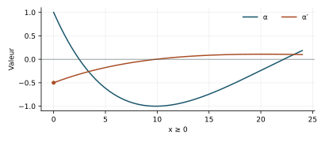
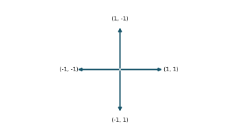

# ENS de Lyon, second concours — Mathématiques 2023 · Corrigé guidé

*Corrigé rédigé par IA, non officiel. Signalez toute erreur.*

**Rédaction** · GPT-6.2 Astra Ultra · vitesse non renseignée

**Révision** · GPT-6.2 Astra Ultra · vitesse non renseignée · 26 novembre 2026

Les trois exercices, indépendants, traitent d’estimations de dérivées, des retours d’une marche aléatoire et de la commutation des exponentielles matricielles.

## Exercice 1 · Deux estimations de dérivées

### Question 1

> [!INDICATION]
> Diviser le développement du sinus avant de traiter la valeur en zéro.

#### Solution

Pour $x\ne0$, la série du sinus donne $\operatorname{sinc}(x)=\sum_{k\ge0}(-1)^kx^{2k}/(2k+1)!$. De rayon infini, elle prend la valeur un en zéro. Elle représente donc sinc sur tout $\mathbb R$.

### Question 2a

> [!INDICATION]
> Remarquer que seules les puissances paires figurent dans le cosinus.

#### Solution

Pour $x\ge0$, $\cos\sqrt x=\sum_{k\ge0}(-1)^kx^k/(2k)!$. Le rapport des modules des termes successifs tend vers zéro pour tout $x\ne0$, donc la série définit un prolongement sur $\mathbb R$. Les coefficients d’un autre prolongement de ce type seraient fixés par les dérivées à droite en zéro, identiques à celles de cette série. L’unicité du développement donne l’unicité du prolongement.

### Question 2b

> [!INDICATION]
> Reprendre la même série pour les réels négatifs.

#### Solution

Pour $x\le0$, on a $(-1)^kx^k=(-x)^k$, donc la somme vaut $\cosh\sqrt{-x}$. Pour $x\ge0$ elle vaut $\cos\sqrt x$. Les deux valeurs en zéro sont un.

### Question 3

> [!INDICATION]
> Écrire sinc comme une intégrale puis dériver sous le signe intégral.

#### Solution

Pour $x\ne0$, $\int_0^1\cos(tx)\,dt=\sin(x)/x$ et la formule vaut aussi en zéro. La dérivée d’ordre $n$ de l’intégrande est $t^n\cos(tx+n\pi/2)$, majorée uniformément en $x$ par $t^n$ intégrable sur $[0,1]$. Par dérivation sous l’intégrale à chaque ordre,
$$|\operatorname{sinc}^{(n)}(x)|\le\int_0^1t^n\,dt=1/(n+1).$$

### Question 4

> [!INDICATION]
> Identifier coefficient par coefficient l’équation différentielle.

#### Solution

Pour $f(x)=\sum_{k\ge0}a_k x^k$, le coefficient de $x^k$ dans $4xf''+2f'+f$ vaut $(2k+2)(2k+1)a_{k+1}+a_k$. Avec $a_0=1$, l’annulation donne par récurrence $a_k=(-1)^k/(2k)!$. Réciproquement les coefficients de $\alpha$ satisfont toutes ces relations sur leur rayon infini. L’existence et l’unicité suivent.

### Question 5

> [!INDICATION]
> Dériver l’équation précédente n − 1 fois avec la formule de Leibniz.

#### Solution

Dans la dérivée d’ordre $n-1$ de $x\alpha''$, seuls les ordres zéro et un du facteur $x$ contribuent. Il vient $x\alpha^{(n+1)}+(n-1)\alpha^{(n)}$. Avec les deux autres termes, on obtient $4x\alpha^{(n+1)}+(4n-2)\alpha^{(n)}+\alpha^{(n-1)}=0$ pour $n\ge1$ et tout réel $x$.

### Question 6

> [!INDICATION]
> Prouver que les dérivées positives tendent vers zéro à l’infini, puis revenir à un intervalle compact.

#### Solution

La fonction $\alpha$ est bornée sur $\mathbb R_+$ et $\alpha'(x)=-\sin(\sqrt x)/(2\sqrt x)\to0$ en $+\infty$. La relation de 5 montre par récurrence que toutes les dérivées d’ordre $n\ge1$ tendent vers zéro : si les deux termes d’ordres $n$ et $n-1$ sont bornés, la dérivée d’ordre $n+1$ est leur combinaison divisée par $4x$. Or $|\alpha^{(n)}(0)|=n!/(2n)!>0$. Au-delà d’un $R$ assez grand la valeur absolue est plus petite que celle en zéro. Le maximum global est donc atteint sur le compact $[0,R]$ en un certain $x_n$.

### Question 7

> [!INDICATION]
> Si le maximum non nul est intérieur, annuler la dérivée suivante dans la relation de la question 5.

#### Solution

Pour $n=0$, $\sup_{x\ge0}|\alpha(x)|=1$. Supposons le résultat établi au rang $n-1$ avec $n\ge1$. Au point $x_n$ de 6, si $x_n=0$ la valeur voulue vient du coefficient de la série. Si $x_n>0$, le maximum absolu est non nul, donc $\alpha^{(n+1)}(x_n)=0$. Par 5,
$$|\alpha^{(n)}(x_n)|\le\frac{\sup_{x\ge0}|\alpha^{(n-1)}(x)|}{4n-2}
=\frac{(n-1)!}{(4n-2)(2n-2)!}=\frac{n!}{(2n)!}.$$
La borne opposée est la valeur absolue en zéro. La récurrence établit l’identité de Smirnov.

## Exercice 2 · Un théorème de Pólya

### Question 1

> [!INDICATION]
> Traduire l’intersection de réunions en une propriété des temps de retour.

#### Solution

Pour $\omega\in A$ et pour tout entier $n\ge1$, il existe $k\ge n$ tel que $S_k(\omega)=0$. L’ensemble des temps de passage en zéro est donc non borné, ce qui pour une partie de $\mathbb N$ équivaut à être infini.

### Question 2

> [!INDICATION]
> Majorer chaque événement de retour tardif par la queue de la série.

#### Solution

Pour tout $n$, $A\subset\bigcup_{k\ge n}\{S_k=0\}$. Donc $0\le\mathbb P(A)\le\sum_{k\ge n}\mathbb P(S_k=0)$. Lorsque la série converge, cette queue tend vers zéro. Aucune indépendance des événements de retour n’est requise.

### Question 3a

> [!INDICATION]
> Nier l’existence de retours arbitrairement tardifs.

#### Solution

Pour $\omega\in B=A^c$, l’ensemble des temps de passage en zéro est fini. Il contient $0$ puisque $S_0=0$. Il a donc un dernier élément, éventuellement zéro.

### Question 3b

> [!INDICATION]
> Classer les trajectoires de B par leur dernier passage à l’origine.

#### Solution

L’événement $B_n$ signifie que le dernier passage est exactement au temps $n$. On a donc $B=\bigsqcup_{n\ge0}B_n$. L’indice zéro est nécessaire pour les trajectoires qui ne reviennent jamais après leur départ.

### Question 3c

> [!INDICATION]
> Séparer les incréments antérieurs du processus des incréments futurs.

#### Solution

Sur $\{S_n=0\}$, $S_{n+i}=\varepsilon_{n+1}+\cdots+\varepsilon_{n+i}$. L’absence de retour aux temps $n+1,\ldots,n+m$ dépend de ces seuls incréments futurs et est indépendante de $\{S_n=0\}$. Leur loi commune est la même que celle des $m$ premiers pas. En faisant décroître ces événements quand $m\to\infty$ et en utilisant la continuité des probabilités, on obtient
$$\mathbb P(B_n)=\mathbb P(S_n=0)\,\alpha,\qquad \alpha=\mathbb P(\forall i\ge1,\ S_i\ne0),$$
indépendante de $n$.

### Question 3d

> [!INDICATION]
> Utiliser les sommes partielles avant de faire tendre leur taille vers l’infini.

#### Solution

Par disjonction, $\alpha\sum_{n=0}^m\mathbb P(S_n=0)\le1$ pour tout $m$. La divergence de la série force $\alpha=0$. Alors chaque $B_n$ a probabilité nulle et leur réunion dénombrable aussi. Ainsi $\mathbb P(A)=1$.

### Question 4a

> [!INDICATION]
> Compter les mots avec autant de pas positifs que négatifs.

#### Solution

Un retour est impossible en un nombre impair de pas. En $2n$ pas, il exige $n$ pas de chaque signe. Donc $\mathbb P(S_{2n+1}=0)=0$ et $\mathbb P(S_{2n}=0)=\binom{2n}n/4^n\sim1/\sqrt{\pi n}$ par Stirling. La série diverge et par 3d la marche est récurrente.

### Question 4b

> [!INDICATION]
> Transformer chaque pas cardinal en une paire de signes indépendants.

#### Solution

Le changement $(x,y)\mapsto(x+y,x-y)$ est inversible et transforme les quatre pas équiprobables en $(1,1),(-1,-1),(1,-1),(-1,1)$. Les deux signes d’un pas sont donc indépendants et les paires sont indépendantes d’un temps à l’autre. Les deux coordonnées transformées sont des marches simples indépendantes. Le retour est impossible à temps impair et
$$\mathbb P(S_{2n}=0)=\left(\binom{2n}n4^{-n}\right)^2\sim\frac1{\pi n}.$$
La série harmonique diverge, donc la marche plane est récurrente.

## Exercice 3 · Exponentielle matricielle

### Question 1

> [!INDICATION]
> Utiliser une base propre et exponentier les valeurs propres.

#### Solution

Si $A=S\operatorname{Diag}(\lambda_j)S^{-1}$ avec $\lambda_j\in2i\pi\mathbb Z$, la série donne $e^A=S\operatorname{Diag}(e^{\lambda_j})S^{-1}=I_n$.

### Question 2

> [!INDICATION]
> Employer le binôme pour des matrices qui commutent, et justifier le regroupement par degré total.

#### Solution

Les séries de $e^A,e^B$ convergent absolument pour une norme matricielle sous-multiplicative. On peut donc les multiplier et regrouper dans le produit les termes avec $j+k=m$. Si $AB=BA$, le binôme donne $\sum_{j+k=m}A^jB^k/(j!k!)=(A+B)^m/m!$. En sommant, on obtient $e^Ae^B=e^{A+B}$.

### Question 3

> [!INDICATION]
> Lire les valeurs propres distinctes avant de multiplier les matrices dans les deux ordres.

#### Solution

Posons $c=2i\pi$. Les matrices $A=\bigl(\begin{smallmatrix}0&1\\0&c\end{smallmatrix}\bigr)$ et $B=\bigl(\begin{smallmatrix}-c&-1\\0&0\end{smallmatrix}\bigr)$ ont chacune deux valeurs propres distinctes dans $2i\pi\mathbb Z$ et sont diagonalisables. Par 1, $e^A=e^B=I_2$. Comme $A+B=\operatorname{Diag}(-c,c)$, $e^{A+B}=I_2$. Pourtant $AB=0$ et $BA=\bigl(\begin{smallmatrix}0&-2c\\0&0\end{smallmatrix}\bigr)\ne0$. L’égalité exponentielle à un seul paramètre $t=1$ n’impose donc pas la commutation.

### Question 4a

> [!INDICATION]
> Dans la dérivée seconde du produit, conserver l’ordre des facteurs.

#### Solution

La dérivation de $e^{tM}$ donne $Me^{tM}$. Ainsi $f''(0)=(A+B)^2=A^2+AB+BA+B^2$. Pour le produit, le terme croisé vaut deux fois $AB$ à zéro et $g''(0)=A^2+2AB+B^2$.

### Question 4b

> [!INDICATION]
> Comparer les deux dérivées au même point.

#### Solution

L’égalité des fonctions pour tout $t$ entraîne celle de leurs dérivées secondes en zéro. Les formules de 4a laissent $AB+BA=2AB$, soit $AB=BA$.

### Question 5

> [!INDICATION]
> Factoriser le terme constant retranché et utiliser la nilpotence de N.

#### Solution

On a $N^n=0$ pour une matrice nilpotente de taille $n$. L’exponentielle est donc une somme finie et $e^N-I_n=NH(N)$ pour un polynôme $H$ (la série tronquée à partir de l’ordre un). Comme les facteurs commutent, $(e^N-I_n)^n=N^nH(N)^n=0$.

### Question 6a

> [!INDICATION]
> Dériver le logarithme tronqué en notant que toutes les matrices commutent.

#### Solution

Posons $Y=e^{tN}-I_n$, qui vérifie $Y^n=0$ par 5. On a $Y'=Ne^{tN}$ et $Y,Y'$ commutent, car ce sont des polynômes en $N$. Ainsi
$$X'(t)=\left(\sum_{j=0}^{n-1}(-Y)^j\right)Y'
=(I_n+Y)^{-1}N(I_n+Y)=N.$$
La somme finie est l’inverse indiqué par l’identité géométrique et la nilpotence de $Y$.

### Question 6b

> [!INDICATION]
> Utiliser la valeur initiale du logarithme tronqué.

#### Solution

On a $X(0)=0$ et $X'=N$ constamment, donc $X(t)=tN$. Pour $t=1$ on lit
$$N=\sum_{k=1}^n\frac{(-1)^{k-1}}{k}(e^N-I_n)^k.$$

### Question 6c

> [!INDICATION]
> Interpréter la somme comme un polynôme en l’exponentielle.

#### Solution

Pour cette taille $n$ fixée, prenons $P(X)=\sum_{k=1}^n(-1)^{k-1}(X-1)^k/k$. Par 6b, $P(e^N)=N$ pour toute matrice nilpotente de taille $n$. Les coefficients dépendent seulement de $n$.

### Question 6d

> [!INDICATION]
> Extraire la partie scalaire de l’exponentielle puis la réintroduire dans le polynôme.

#### Solution

Si $M=\lambda I_n+N$, la commutation avec la matrice scalaire donne $e^M=e^\lambda e^N$ par 2. Ainsi $M=Q_\lambda(e^M)$ avec $Q_\lambda(X)=\lambda+P(e^{-\lambda}X)$, indépendant de $N$.

### Question 7a

> [!INDICATION]
> Appliquer le lemme des noyaux au polynôme caractéristique.

#### Solution

Par Cayley–Hamilton, $\prod_k(M-\lambda_k I_n)^{\alpha_k}=0$. Les polynômes $(X-\lambda_k)^{\alpha_k}$ sont deux à deux premiers entre eux. Le lemme de décomposition des noyaux donne donc $\mathbb C^n=\bigoplus_k E_k$ avec $E_k=\ker(M-\lambda_k I_n)^{\alpha_k}$.

### Question 7b

> [!INDICATION]
> Restreindre au sous-espace caractéristique et conserver le bon ordre de nilpotence.

#### Solution

Sur l’espace stable $E_k$, $M=\lambda_k I+N_k$ avec $N_k^{\alpha_k}=0$. Donc $e^M-e^{\lambda_k}I=e^{\lambda_k}N_k H_k(N_k)$ sur ce sous-espace comme en 5. Sa puissance $\alpha_k$ s’y annule. Ainsi $E_k\subset D_k=\ker(e^M-e^{\lambda_k}I_n)^{\alpha_k}$.

### Question 7c

> [!INDICATION]
> Vérifier la somme directe grâce à la condition de non-résonance, puis utiliser les inclusions.

#### Solution

La condition sur les différences $\lambda_j-\lambda_k$ assure que les nombres $e^{\lambda_k}$ sont distincts. Les noyaux $D_k$ forment donc une somme directe par le lemme des noyaux appliqué aux polynômes premiers entre eux $(X-e^{\lambda_k})^{\alpha_k}$. Par 7a–b leur somme contient toute la somme des $E_k$, donc tout $\mathbb C^n$. Les inclusions $E_k\subset D_k$ et l’égalité de la somme de leurs dimensions à $n$ imposent $E_k=D_k$ pour chaque $k$.

### Question 7d

> [!INDICATION]
> Sur chaque espace caractéristique, exprimer M en fonction de l’exponentielle par 6d.

#### Solution

Si $A$ commute avec $e^M$, elle commute avec chacune des puissances définissant $D_k$ et préserve donc $D_k=E_k$. La restriction $M_k$ de $M$ à $E_k$ est une matrice scalaire plus une nilpotente. Sa propre exponentielle est la restriction de $e^M$, par la série. D’après 6d, $M_k$ est un polynôme en cette exponentielle, donc commute avec la restriction de $A$. L’égalité sur tous les termes de la somme directe donne $AM=MA$.

### Question 8a

> [!INDICATION]
> Faire passer B à travers les puissances de AB.

#### Solution

Par associativité $B(AB)^j=(BA)^jB$ pour tout $j\ge0$. En sommant la série exponentielle on obtient $Be^{AB}=e^{BA}B=e^{AB}B$ grâce à l’hypothèse.

### Question 8b

> [!INDICATION]
> Appliquer le lemme du commutant puis utiliser l’inversibilité au bon endroit.

#### Solution

La non-résonance est supposée pour les valeurs propres de $M=AB$. D’après 7d et 8a, $B$ commute avec $AB$, donc $BAB=ABB$. La multiplication à droite par $B^{-1}$ donne $BA=AB$.

### Question 9

> [!INDICATION]
> Identifier les deux produits diagonaux et l’hypothèse spectrale de 8.

#### Solution

Avec $c=2i\pi$, les produits sont $AB=\operatorname{Diag}(0,c)$ et $BA=\operatorname{Diag}(c,0)$. Ils diffèrent mais leurs exponentielles valent toutes deux $I_2$. La différence entre les deux valeurs propres vaut $2i\pi$ à un signe près, en violation de la condition de non-résonance. Les matrices $A,B$ de cet exemple sont également singulières. L’égalité des exponentielles de produits ne suffit donc pas à elle seule à conclure à la commutation.

On peut isoler le rôle de la résonance avec deux facteurs inversibles. Posons $C=\operatorname{Diag}(1,1+2i\pi)$, choisissons $B$ qui échange les deux vecteurs de la base canonique et prenons $A=CB$. Alors $B^2=I_2$, donc $AB=C$ et $BA=BCB=\operatorname{Diag}(1+2i\pi,1)$. Ces deux produits sont distincts et ont tous deux pour exponentielle $eI_2$.
