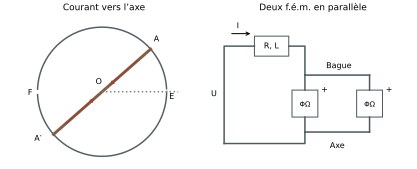
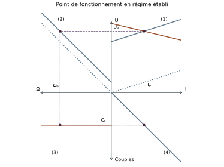
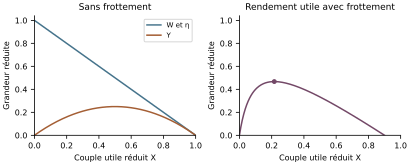

# ENS de Lyon, second concours 2023 — Physique · Corrigé brut

*Corrigé rédigé par IA, non officiel. Signalez toute erreur.*

**Rédaction** · GPT-6.2 Astra Ultra · vitesse non renseignée

Le questionnaire compte pour 20 % de la note selon le jury. Le problème étudie un convertisseur à courant continu puis une voiture électrique en prise directe avec ses roues.

## A — Questionnaire de physique

### Question A1 — Inductance

L'unité SI est le henry, $1\ \mathrm H=1\ \mathrm{V\,s\,A^{-1}}$.

### Question A2 — Diagramme de Bode

Ce diagramme donne le gain en décibels et la phase d'une fonction de transfert harmonique en fonction de la fréquence, sur un axe logarithmique. Il permet par exemple de lire la fréquence de coupure d'un filtre.

### Question A3 — Équation de Maxwell-Gauss

$\nabla\cdot\mathbf E=\rho/\varepsilon_0$ et $\displaystyle\oint_{\partial V}\mathbf E\cdot d\mathbf S=Q_{\rm int}/\varepsilon_0$, avec la normale sortante.

### Question A4 — Équation de Schrödinger

Dans le cas général dépendant du temps, $i\hbar\,d|\psi(t)\rangle/dt=\widehat H(t)|\psi(t)\rangle$. Pour une particule non relativiste dans un potentiel scalaire, $\widehat H=-\hbar^2\Delta/(2m)+V(\mathbf r,t)$ en représentation position.

### Question A5 — Nombre de Reynolds

$\mathrm{Re}=\rho VL/\mu=VL/\nu$. Il compare les ordres de grandeur des effets inertiels et visqueux.

### Question A6 — Force de Lorentz

Une particule de charge $q$ et de vitesse $\mathbf v$ reçoit $\mathbf F=q(\mathbf E+\mathbf v\times\mathbf B)$.

### Question A7 — Enthalpie de fusion

C'est la variation d'enthalpie lors du passage du solide au liquide à la température de fusion et à la pression considérée. L'enthalpie massique de fusion est exprimée en $\mathrm{J\,kg^{-1}}$, la molaire en $\mathrm{J\,mol^{-1}}$.

### Question A8 — Moment cinétique

Par rapport à un point $O$, $\mathbf L_O=\overrightarrow{OM}\times\mathbf p$, avec $\mathbf p=m\mathbf v$ en mécanique classique.

### Question A9 — Interféromètre de Michelson

Le déplacement d'un miroir de $d$ fait varier la différence de marche de $2d$ en incidence normale. Compter les franges permet ainsi de mesurer un déplacement ou une longueur d'onde.

### Question A10 — Milieu dispersif

Un milieu est dispersif si la vitesse de phase $v_\varphi=\omega/k$ dépend de la fréquence. Les composantes spectrales d'un paquet peuvent alors se déphaser au cours de la propagation.

## B — Convertisseur à courant continu

### Question B1 — Variables du convertisseur

Le point $P$ comporte quatre grandeurs algébriques, la tension $U$, le courant $I$, la vitesse angulaire $\Omega$ et le couple extérieur $C$. En régime permanent, quatre relations indépendantes sont nécessaires pour déterminer ces quatre inconnues. En transitoire il faut de plus donner les conditions initiales des deux stockages d'énergie.

### Question B2 — Fonctionnement en générateur

La puissance mécanique reçue est $C\Omega>0$ et le port électrique fournit une puissance à l'extérieur, $UI<0$. Dans la limite stationnaire sans pertes, $C\Omega=-UI$. Une rotation négative convient aussi si le signe du couple s'inverse.

### Question B3 — Fonctionnement en moteur

Le port électrique absorbe $UI>0$ et fournit de la puissance mécanique, $C\Omega<0$. Dans la limite étudiée, $UI=-C\Omega$. Pour $\Omega>0$, le couple extérieur appliqué au rotor est résistant.

### Question B4 — Orientation de la f.é.m.

À distance $r$ de l'axe, $\mathbf v=\Omega r\mathbf e_\theta$ et $\mathbf v\times\mathbf B=\Omega rB\mathbf e_r$. Pour $\Omega>0$, les charges positives sont entraînées de l'axe vers le bord de chaque tige. L'extrémité $A$ et l'extrémité $A'$ se trouvent au potentiel le plus élevé à vide. Le sens radial local est propre à chaque bras.

### Question B5 — Signe du couple de Laplace

Le courant positif dessiné rejoint la bague en $E$, se partage puis parcourt chaque bras de la périphérie vers $O$. Ainsi $d\boldsymbol\ell$ orienté selon le courant pointe selon $-\mathbf e_r$ et $d\boldsymbol\ell\times\mathbf B$ selon $+\mathbf e_\theta$. Le moment autour de $Oz$ est positif pour chacun des bras.

## Étude électrique

### Question B6 — Flux dans la branche a

Orientons la maille suivant $E\to A\to O\to E$, le dernier trajet représentant la projection du retour fixe. Pour $0<\theta<\pi$ elle borde le secteur de surface $a^2\theta/2$ orienté selon $+z$. À une constante de flux fixe près, $\varphi_a=Ba^2\theta/2=\Phi\theta$.

### Question B7 — Flux dans la branche b

Pour rejoindre $A'$ sans traverser la coupure $F$, on suit de $E$ vers $A'$ l'arc inférieur dans le sens horaire. Le secteur est orienté selon $-z$ et son angle géométrique vaut $\pi-\theta$. Ainsi $\varphi_b=-\Phi(\pi-\theta)=\Phi(\theta-\pi)$ avec la même convention. Les deux flux ont la même dérivée.

### Question B8 — Forces électromotrices

Dans le sens du courant des mailles, la loi de Faraday donne $e_a=-d\varphi_a/dt=-\Phi\Omega$ et $e_b=-d\varphi_b/dt=-\Phi\Omega$. Leur valeur absolue vaut aussi $\int_0^a B\Omega r\,dr=\Phi\Omega$ pour $\Omega>0$. La f.é.m. motrice des charges est donc dirigée de l'axe vers chaque pointe.

### Question B9 — Circuit équivalent

Les deux bras sont en parallèle entre l'axe et la bague. Dans chacun, la source induite présente son pôle positif côté bague pour $\Omega>0$. Les deux branches portent $I/2$ et ont une tension identique. Le circuit équivalent comporte donc une seule contre-f.é.m. de module algébrique $\Phi\Omega$, en série avec $R$ et $L$ équivalents et le dipôle d'alimentation. Les deux f.é.m. en parallèle ne s'additionnent pas.

### Question B10 — Équation électrique

La loi des mailles dans le sens de $I$ s'écrit $U-\Phi\Omega-RI-L\dot I=0$, d'où $U=\Phi\Omega+RI+L\dot I$. À vide et en régime établi, la tension dépend de la vitesse de rotation.

## Étude mécanique

### Question B11 — Moment d’inertie

Une tige uniforme de longueur $a$ et de masse $m$ donne $\int_0^a r^2(m/a)\,dr=ma^2/3$. Les deux tiges contribuent, donc $J=2ma^2/3$ en $\mathrm{kg\,m^2}$.

### Question B12 — Couple électromagnétique

Sur un bras, la composante autour de $Oz$ est $\int_0^a r(I/2)B\,dr=IBa^2/4$. La somme donne $C_{\rm EM}=IBa^2/2=\Phi I$, orienté selon $+z$ pour un courant positif.

### Question B13 — Équation mécanique

Le théorème du moment cinétique sur l'axe fixe donne $J\dot\Omega=C+C_{\rm EM}=C+\Phi I$. Le couple $C$ est celui appliqué par le milieu extérieur.

## Échanges énergétiques

### Question B14 — Relations de fermeture

Les deux équations propres sont $U=\Phi\Omega+RI+L\dot I$ et $J\dot\Omega=C+\Phi I$. Il faut la loi du dipôle extérieur, par exemple $F_e(U,I,t)=0$, et celle de la charge mécanique, $F_m(C,\Omega,t)=0$, avec des dérivées si ces éléments possèdent leur propre dynamique. Une source à résistance interne et une charge à couple constant fournissent les deux exemples du sujet.

### Question B15 — Bilan de puissance

Multiplier l'équation électrique par $I$ et l'équation mécanique par $\Omega$. Le terme $\Phi I\Omega$ est la puissance échangée entre les ports. En l'éliminant, on obtient
$$UI+C\Omega=\frac{d}{dt}\left(\frac12LI^2+\frac12J\Omega^2\right)+RI^2.$$
Les puissances reçues modifient les énergies magnétique et cinétique et alimentent l'échauffement ohmique. En régime permanent sans résistance les deux puissances des ports sont opposées.

### Question B16 — Échauffement et évacuation de chaleur

Soit $\dot Q_{\rm reçu}$ le flux thermique algébrique entrant. Le premier principe donne $C_c\dot T+d(LI^2/2+J\Omega^2/2)/dt=UI+C\Omega+\dot Q_{\rm reçu}$. Par la question 15, $C_c\dot T=RI^2+\dot Q_{\rm reçu}$. En régime thermiquement permanent la chaleur évacuée par unité de temps vaut $RI^2$. Un moteur en régime mécanique établi peut encore s'échauffer si la température n'est pas stabilisée.

## Fonctionnement en moteur

### Question B17 — Équations du point moteur

Pour $C=-C_r$ en régime établi, les trois relations sont $U=\Phi\Omega+RI$, $C_r=\Phi I$ et $U=U_0-rI$. Le couple imposé $C_r$ constitue la quatrième condition.

### Question B18 — Droite du couple imposé

Dans le quadrant 3, $\Omega$ croît vers la gauche et $C_r$ vers le bas. Pour $C_r$ donné, tracer l'horizontale située à la cote $C_r$ sous l'origine. Elle représente tous les régimes de vitesse de la charge à couple constant.

### Question B19 — Droite du couple électromagnétique

Dans le quadrant 4, $I$ croît vers la droite et $C_{\rm EM}$ vers le bas. La loi $C_{\rm EM}=\Phi I$ est représentée par une droite issue de l'origine et descendant vers la droite.

### Question B20 — Lecture du courant

Prolonger l'horizontale $C_r$ dans le quadrant 4 jusqu'à la droite du couple électromagnétique. La verticale issue de l'intersection lit sur l'axe horizontal $I_P=C_r/\Phi$. Cet emplacement fixe la colonne de courant à utiliser dans le quadrant 1.

### Question B21 — Tension à vitesse fixée

Dans le quadrant 1, $U=RI+\Phi\Omega$ donne une famille de droites croissantes de pente $R$. La droite de rotor bloqué passe par l'origine. Les droites de vitesse positive lui sont parallèles avec ordonnée à l'origine $\Phi\Omega$.

### Question B22 — Droite du générateur

Dans le même quadrant tracer $U=U_0-rI$, droite décroissante reliant $(0,U_0)$ et $(U_0/r,0)$. Le courant réel se lit avec le convertisseur connecté.

### Question B23 — Tension à courant fixé

Dans le quadrant 2, $U=\Phi\Omega+RI$ augmente quand on va vers la gauche. Pour $I=0$, la droite passe par l'origine. Pour $I>0$ sa hauteur à $\Omega=0$ vaut $RI$ et sa pente vis-à-vis de la coordonnée physique $\Omega$ est toujours $\Phi$.

### Question B24 — Construction du point de fonctionnement

Le quadrant 4 fixe $I_P=C_r/\Phi$. Dans le quadrant 1, sa verticale rencontre la droite de la source à $U_P=U_0-rI_P$. Reporter cette hauteur dans le quadrant 2 jusqu'à la droite du moteur pour $I=I_P$. On lit alors
$$\Omega_P=\frac{U_P-RI_P}{\Phi}=\frac{U_0}{\Phi}-\frac{(R+r)C_r}{\Phi^2}.$$
Le report vertical vers le quadrant 3 retrouve la droite de charge. Le schéma ci-dessous suit ces quatre intersections pour un exemple sans dimension.

### Question B25 — Rendement lu sur le diagramme

La puissance idéale de source est $U_0I_P$, celle reçue par la charge est $C_r\Omega_P$. Le quotient des aires des rectangles associés donne $\eta=C_r\Omega_P/(U_0I_P)=\Phi\Omega_P/U_0=1-(R+r)I_P/U_0$ pour $I_P>0$. La limite à vide vaut 1 dans le modèle sans frottement. À vide strict les deux puissances sont nulles.

### Question B26 — Couple de blocage

À vitesse nulle, le courant établi est $I_{\rm bloc}=U_0/(R+r)$, intersection de la droite du générateur et de la droite $\Omega=0$. D'où $C_r^\star=\Phi U_0/(R+r)$. À cette limite, la puissance utile et le rendement sont nuls. Au-delà, la solution algébrique du modèle à couple extérieur constant donne $\Omega_P<0$. Une charge retenue peut rester bloquée. Si une masse suspendue entraîne le rotor, elle peut repartir en sens inverse. Aucune marche motrice établie à vitesse positive n'est possible pour ce couple.

### Question B27 — Démarrage et inductance

Le diagramme stationnaire fournit, à $\Omega=0$, le **courant de démarrage à rotor immobile après établissement électrique**, $I_{\rm bloc}=U_0/(R+r)$, souvent grand. À l'instant mathématique $t=0^+$, si $L>0$ et que le moteur était au repos et hors tension, le courant est continu et $I(0^+)=0$. Sa pente initiale est $\dot I(0^+)=U_0/L$. Tant que le rotor reste pratiquement immobile, $I(t)\simeq I_{\rm bloc}(1-e^{-(R+r)t/L})$. Confondre les deux valeurs reviendrait à négliger le temps électrique $L/(R+r)$.

## Véhicule électrique

### Question B28 — Vitesse réduite

Posons $R'=R+r$, $C_r^\star=U_0\Phi/R'$, $\Omega^\star=U_0/\Phi$ et $X=C_r/C_r^\star$. En remplaçant $I=C_r/\Phi$ dans la maille complète $U_0=\Phi\Omega+R'I$, on trouve $\Omega=\Omega^\star(1-X)$.

### Question B29 — Puissance mécanique fournie

Comme $C_r^\star\Omega^\star=U_0^2/R'=P^\star$, la puissance vaut $P_{\rm méca}^{f}=C_r\Omega=P^\star X(1-X)$.

### Question B30 — Rendement de conversion

Avec $I=(U_0/R')X$, la puissance fournie par la source idéale vaut $P^\star X$. Pour $0<X\le1$, $\eta=1-X$. En régime moteur avec vitesse et puissance strictement positives, $0<X<1$.

### Question B31 — Courbes réduites

$W=\Omega/\Omega^\star$ et $\eta$ se superposent sur la droite $1-X$. La courbe $Y=P_{\rm méca}^{f}/P^\star=X(1-X)$ est une parabole nulle aux deux extrémités, maximale à $X=1/2$ avec $Y=1/4$. Le rendement y vaut $1/2$. Le meilleur rendement limite est donc obtenu quand la puissance tend vers zéro, ce qui le distingue du point de puissance maximale.

### Question B32 — Couple de frottement constant

Posons $f=X_f=0{,}10$. Le courant est proportionnel à $X+f$, la vitesse réduite vaut $1-X-f$ et seule la puissance $C_r\Omega$ est utile. On trouve
$$\eta_f=\frac{X(1-X-f)}{X+f}=\frac{X}{X+f}-X,\qquad 0\le X\le1-f.$$
La courbe part de zéro, atteint son maximum pour $X=\sqrt f-f\simeq0{,}216$ puis revient à zéro au blocage $X=0{,}9$. Le rendement maximal vaut $(1-\sqrt f)^2\simeq0{,}468$. Le courant à vide compense déjà le frottement.

### Question B33 — Couple et courant en côte

Sans pertes mécaniques, la force de traction équilibre $Mg\sin\alpha$. Le couple transmis aux roues en prise directe vaut $C_r=Mg(D/2)\sin\alpha$. Avec $M=1500\ \mathrm{kg}$, $g=10\ \mathrm{m\,s^{-2}}$, $D=0{,}6\ \mathrm m$ et $\alpha=6^\circ$, il vient $C_r=470{,}4\ \mathrm{N\,m}$ et $I=C_r/\Phi=117{,}6\ \mathrm A$.

### Question B34 — Tension réglée

Le roulement sans glissement impose $\Omega=2V/D=64{,}81\ \mathrm{rad\,s^{-1}}$ pour $V=70/3{,}6=19{,}44\ \mathrm{m\,s^{-1}}$. La maille donne $U_0=\Phi\Omega+R'I=259{,}26+117{,}59=376{,}85\ \mathrm V$, dans la plage accessible jusqu'à 400 V.

### Question B35 — Rendement et autonomie

La puissance gravitationnelle utile est $P_u=MgV\sin\alpha\simeq30{,}49\ \mathrm{kW}$. La source réglée délivre $U_0I\simeq44{,}32\ \mathrm{kW}$, d'où $\eta\simeq0{,}688$. Dans le modèle de réglage idéal du sujet, les $50\ \mathrm{kWh}$ disponibles donnent $T=50/44{,}32=1{,}128$ h, soit environ **1 h 08 min**. Le courant utilisé est celui du port réglé. Un convertisseur idéal alimenté sous 400 V appellerait en amont $44{,}32\ \mathrm{kW}/400\ \mathrm V$, avant toutes pertes supplémentaires.

### Question B36 — Force et couple de traînée

Le module de la force de traînée vaut $F_T=\rho_a C_x S V^2/2=141{,}8\ \mathrm N$, sa direction est opposée à la vitesse. Le couple résistant correspondant vaut $C_{rT}=F_TD/2=42{,}5\ \mathrm{N\,m}$.

### Question B37 — Puissance perdue dans l’air

$P_{\rm méca,T}=F_TV=\rho_aC_xSV^3/2\simeq2{,}76\ \mathrm{kW}$. Elle représente $2{,}76/30{,}49=9{,}0\,\%$ de la puissance utile gravitationnelle. À vitesse plus élevée la traînée croît rapidement.

### Question B38 — Rendement utile avec traînée

Pour garder la même vitesse, $I'=(C_r+C_{rT})/\Phi=128{,}23\ \mathrm A$ et $U_0'=\Phi\Omega+R'I'=387{,}49\ \mathrm V$, encore sous 400 V. La source fournit environ $49{,}69\ \mathrm{kW}$. La fraction consacrée à la montée est $\eta_f=P_u/(U_0'I')\simeq0{,}614$, contre $0{,}688$ sans traînée. Le bilan donne bien $49{,}69\simeq30{,}49+2{,}76+16{,}44$ en kilowatts, le dernier terme étant $R'I'^2$. Si l'on comptait aussi le travail contre l'air dans la puissance mécanique en sortie d'arbre, on obtiendrait $0{,}669$. Le rendement utile demandé retranche cette dépense aérodynamique.

[Sujet officiel](https://banques-ecoles.fr/cms/wp-content/uploads/2023/06/23_2c_sujet_physique.pdf) · [Rapport du jury](https://banques-ecoles.fr/cms/wp-content/uploads/2023/10/23_2CC_rap_ePhy.pdf)
