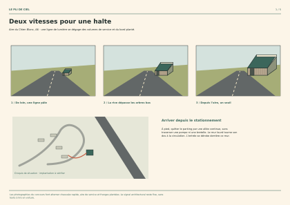
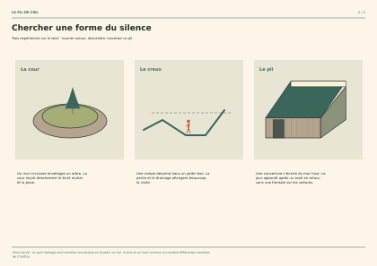
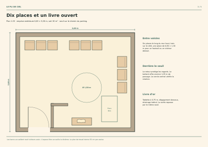
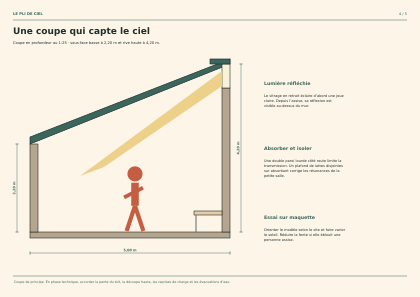
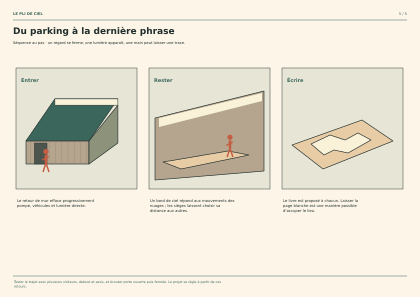

# ENS Paris-Saclay — Design d'espace 2023 · Corrigé brut

*Corrigé rédigé par IA, non officiel.*

**Rédaction** · GPT-6.2 Astra Ultra · vitesse non renseignée

Le pli de ciel est un lieu de recueillement de 30 m² sur l’aire du Chien Blanc. Une rive claire donne un repère depuis l’A6. À pied, un seuil en retour conduit à une salle ouverte à dix visiteurs et au livre d’or. Les 5 planches numérotées et anonymes sont au format 420 × 297 mm. Les échelles indiquées valent pour une planche seule imprimée sur A3 à 100 %.

## Planche 1 — Deux vitesses pour une halte

Sur le plan de l’aire du Chien Blanc, l’A6 longe un ensemble de poches de desserte, de parking et de bâtiments. Les vues photographiques font voir l’autoroute, la station et les bordures plantées. Le bâtiment s’installe par hypothèse à la lisière d’une poche de stationnement, sur un chemin continu libre de circulation automobile. À 110 km/h, 100 m s’écoulent en 3,3 secondes. Le voyageur perçoit donc une silhouette stable, une rive claire au-dessus d’un socle sombre. À pied, 100 m prennent plus d’une minute. On distingue alors le grain des parois, le recul du seuil et l’entrée sous le pli. L’implantation exacte, les hauteurs végétales et les dégagements réglementaires sont à relever sur place.

## Planche 2 — Chercher une forme du silence

Le lieu reçoit toute personne, seule ou accompagnée. Aucune cérémonie ne commande une direction sacrée ou une place privilégiée. La cour rendrait la saison très présente mais laisserait arriver ensemble les sons de la route et le regard des passants. Le creux protège davantage, au prix d’un long chemin et de terrassements. Le pli retenu abrite un intérieur de plain-pied. Les assises se longent sans se faire face comme un public. Chacun peut rester debout, se retirer dans un angle ou écrire avant de repartir. Le rapport 2023 demande que les percepts et les postures produisent effectivement l’ambiance annoncée. Un modèle d’éclairage et une écoute sur place permettent d’éprouver ce choix.

## Planche 3 — Dix places et un livre ouvert

Deux rangées de places évitent l’organisation en amphithéâtre. Avec des murs de principe de 20 cm, la salle et son seuil disposent de 5,60 × 4,60 m à l’intérieur de l’enveloppe de 30 m². Six places sont disposées côté mur haut, trois autres à l’est et une surface de 80 × 130 cm accueille une personne en fauteuil. La rotation se fait dans le cercle de 1,50 m. La tablette du livre d’or, à 75 cm, se trouve à l’écart du passage d’entrée. Le lecteur peut écrire puis repartir sans traverser un groupe. Le projet réserve un accès de plain-pied depuis le stationnement. Les efforts d’ouverture et tous les dégagements seraient contrôlés dans une étude d’exécution.

## Planche 4 — Une coupe qui capte le ciel

Le toit bas à l’entrée amplifie l’effet de hauteur vers la rive d’environ 4,20 m, dont 60 cm de claire-voie. Des portiques en bois portent la toiture et s’appuient sur des murs pleins. Le mur côté autoroute participe à l’isolement. Une paroi continue et étanche à l’air limite les transmissions. Les lattes intérieures sur absorbant et la sous-face bois règlent la réverbération. Les deux objectifs acoustiques demandent des mesures distinctes. L’air neuf se prend côté calme, avec traversée traitée acoustiquement. Le vitrage en retrait attire le regard par réflexion diffuse. La couverture se vide côté bas, loin de l’entrée. Le projet exige une étude de structure et de sécurité pour un local ouvert au public.

## Planche 5 — Du parking à la dernière phrase

Le déplacement commence sur l’asphalte. Un sol minéral mat, stable et sans ressaut conduit sous le toit. Le regard cesse de suivre le flux routier alors que la main trouve une paroi plus douce. Le bruissement de l’aire demeure perceptible devant la porte et s’atténue une fois celle-ci fermée. La lumière glisse au-dessus des épaules. Une personne peut s’asseoir ou rester debout dans une zone dégagée. Le livre permet de laisser une pensée libre. Pour l’entretien, prévoir un remplacement simple des pages, une vérification des assises et le nettoyage des écrans lumineux. À la soutenance, comparer les essais en maquette et les mesures de bruit avant de fixer le jeu exact du seuil et de la claire-voie.

[Énoncé et annexes du concours](https://ens-paris-saclay.fr/sites/default/files/CONCOURS/ANNALES_1C/1C_Design/Sujet%20design%20d%27espace%202023.pdf) · [Rapport du jury](https://ens-paris-saclay.fr/sites/default/files/CONCOURS/ANNALES_1C/1C_Design/2023_Design_rapport_oral_Projet.pdf)
