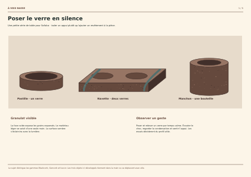
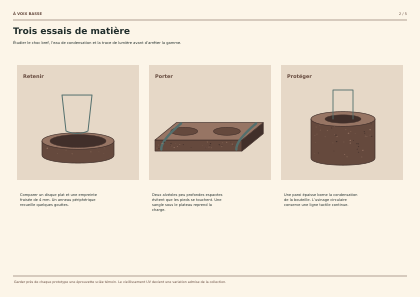
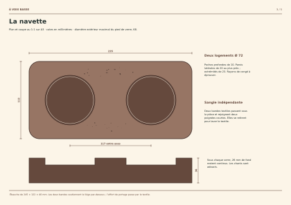
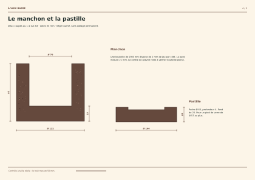
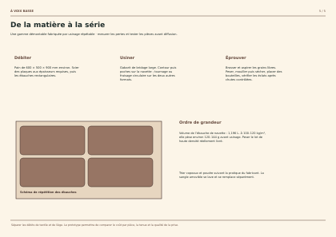

# ENS Paris-Saclay — Design de produit 2023 · Corrigé guidé

*Corrigé rédigé par IA, non officiel.*

**Rédaction** · GPT-6.2 Astra Ultra · vitesse non renseignée

À voix basse propose à Sofalca trois objets de table en liège noir usiné. Une pastille, une navette et un manchon amortissent les contacts et se déplacent d’un geste. Les 5 planches numérotées et anonymes sont au format 420 × 297 mm. Les échelles indiquées valent pour une planche seule imprimée sur A3 à 100 %.

## Planche 1 — Poser le verre en silence

> [!INDICATION]
> Décrire un seul contact entre verre et table, puis chercher trois manières de le modifier avec le liège.

À voix basse réunit une pastille sous-verre épaisse, une navette pour apporter deux verres et un manchon de bouteille. Les trois objets mobilisent la légèreté, la faible conductivité thermique et le contact amorti du liège noir haute densité. Le projet vise des tables de lecture, des salles de réunion ou une maison. Les photos du sujet montrent le bloc expansé, sa granulation, le tour du mobilier et le fraisage mural. Les dimensions des objets se situent à l’échelle du geste. Aucun ne nécessite une ébauche de plus de 40 cm par côté. La matière reste extérieure aux aliments et aux boissons.

## Planche 2 — Trois essais de matière

> [!INDICATION]
> Comparer un disque de bois et un disque de liège avec le même verre rempli et le même geste. Consigner les observations.

L’échantillon fourni est une texture montrée à l’échelle 1/2. Une couche mince en porte-à-faux se désagrégerait facilement. Les trois volumes gardent normalement 20 mm de matière dans les zones sollicitées, ou reçoivent un support indépendant. L’enfoncement et le bruit s’évaluent avec le même verre et sur la même table. Laisser un échantillon à la fenêtre et en masquer une moitié pour comparer la patine des deux faces exposée et protégée. Pour une table, préférer une patine franche à un traitement dont l’efficacité UV décroît. Vérifier l’entretien à l’éponge et le séchage avant de retenir une finition. Le jury demande d’examiner la matière et les situations de geste au-delà du simple catalogue de propriétés.

## Planche 3 — La navette

> [!INDICATION]
> Soustraire deux fois le rayon des logements et vérifier chaque épaisseur. Peser ensuite les deux verres pleins.

Une planche de liège de 245 × 122 × 40 mm donne une navette finie de 235 × 112 × 36 mm. La fraise réalise deux poches de 72 mm sur 10 mm de profondeur. Il reste 26 mm en fond et 20 mm de matière entre une poche et le chant long. Les axes sont séparés de 117 mm, soit 45 mm de matière entre les poches. Les deux boucles de sangle passent sous le fond, l’une près de chaque extrémité. Une liaison textile sous la pièce maintient leur écartement. En service, porter la navette avec les deux poignées, essayer les à-coups et les inclinaisons avec de l’eau froide. Les empreintes conviennent à une famille définie de pieds de verre, à tester sur gabarit.

## Planche 4 — Le manchon et la pastille

> [!INDICATION]
> Reporter l’épaisseur au point le plus mince. Vérifier la dimension du récipient qui entre et sort effectivement.

Le manchon provient d’un bloc de 120 × 120 × 100 mm. Son diamètre fini de 112 mm et son évidement de 70 mm donnent 21 mm de paroi. Le fond de 25 mm laisse 70 mm de profondeur. L’objet est calculé pour une bouteille de diamètre inférieur ou égal à 66 mm. Il limite le contact de la bouteille avec la table et se saisit par les flancs. Une bouteille haute peut basculer si on la heurte. Le prototype doit faire l’objet d’essais de stabilité avant vente. La pastille, finie à 100 mm de diamètre sur 24 mm, présente une poche de 60 mm sur 4 mm. Sa bordure fait 20 mm de large, son fond 20 mm. Ce format reçoit les verres à pied étroit et se déplace plus facilement qu’un simple dessous de verre mince.

## Planche 5 — De la matière à la série

> [!INDICATION]
> Vérifier les unités de volume et de masse puis distinguer matière brute, pièce achevée et charge utile.

Pour l’ébauche de navette, le volume est 0,245 × 0,122 × 0,040 = 0,0011956 m³, soit 1,196 L. Dans l’intervalle de masse volumique de 100 à 120 kg/m³ indiqué dans le sujet, la masse brute est de 120 à 143,5 g. Le bloc pour le manchon et celui de la pastille restent eux aussi bien en dessous du cube maximal. Répéter le débit sur une plaque en réservant trait de scie et surcote. Un maintien réparti évite de comprimer les grains localement pendant le fraisage. Les rebuts propres rejoignent les filières de valorisation mentionnées dans l’énoncé. Pour une petite présérie, mesurer le temps d’usinage, la proportion de chants ébréchés, la tenue de la sangle et l’évolution de teinte. Cette fiche de résultat renseigne le fabricant sur l’intérêt d’une nouvelle gamme à côté de ses trois marques.

[Énoncé et annexes du concours](https://ens-paris-saclay.fr/sites/default/files/CONCOURS/ANNALES_1C/1C_Design/maquette-sujet-projet-design-objet.pdf) · [Rapport du jury](https://ens-paris-saclay.fr/sites/default/files/CONCOURS/ANNALES_1C/1C_Design/2023_Design_rapport_oral_Projet.pdf)
