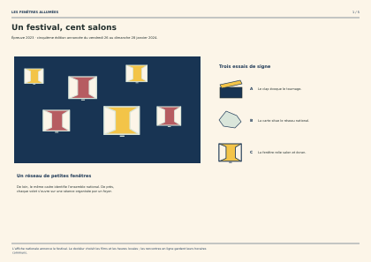
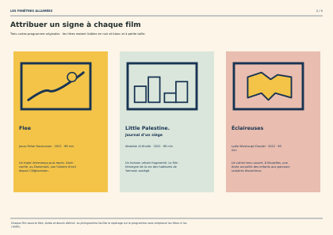
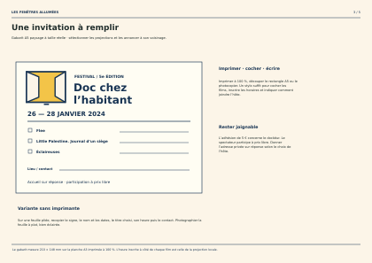
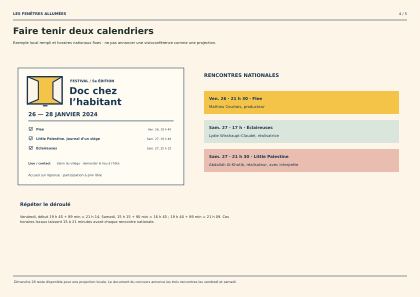
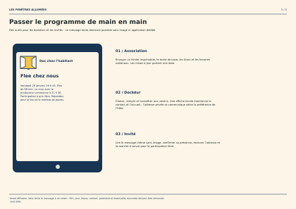

# ENS Paris-Saclay — Design graphique 2023 · Corrigé guidé

*Corrigé rédigé par IA, non officiel.*

**Rédaction** · GPT-6.2 Astra Ultra · vitesse non renseignée

Les fenêtres allumées donne aux dockëurs un signe, une invitation et un protocole réalisables avec une feuille et un téléphone. La cinquième édition de janvier 2024 figure dans le sujet distribué en 2023. Les 5 planches numérotées et anonymes sont au format 420 × 297 mm. Les échelles indiquées valent pour une planche seule imprimée sur A3 à 100 %.

## Planche 1 — Un festival, cent salons

> [!INDICATION]
> Relever ce qui est identique dans tous les foyers puis ce que chacun doit pouvoir modifier.

Les annexes montrent les images et affiches des trois films, la carte des dockëurs de 2023 et une véritable projection dans un salon. La diversité visuelle des œuvres doit rester lisible. Le couple à l’origine de l’association invitait des amis et voisins autour d’un buffet. En devenant national, le festival garde une organisation locale, avec un, deux ou trois films et des horaires de projection choisis. Le clap mettrait l’accent sur la fabrication des films. La carte sert à trouver un lieu mais donne peu envie d’entrer dans un salon. Deux volets ouverts réunissent l’image domestique et le cadre de projection. Chaque hôte peut dessiner ce signe au trait.

## Planche 2 — Attribuer un signe à chaque film

> [!INDICATION]
> Recopier titre, durée et crédit depuis l’annexe 1, puis vérifier que les films se distinguent sans couleur.

Les affiches distribuées par le concours possèdent chacune leur identité. Le kit utilise trois signes originaux au trait sur les petits formats. Le trajet de Flee évoque un récit d’exil confié à un ami. La ligne de bâtiments de Little Palestine. Journal d’un siège renvoie à la chronique de Yarmouk. Le cahier ouvert d’Éclaireuses rattache la séance au lieu scolaire de Bruxelles. Le titre complet, le cinéaste et la durée accompagnent toujours le choix. Un kit qui utiliserait les véritables photogrammes ou affiches devrait disposer des fichiers et des autorisations de diffusion correspondantes. Les dessins proposés fonctionnent sur une imprimante domestique monochrome.

## Planche 3 — Une invitation à remplir

> [!INDICATION]
> Essayer une session ne comportant qu’un film. Un invité doit pouvoir identifier immédiatement la date, l’heure, le lieu et le tarif.

L’association livre ce gabarit tel quel au dockëur. Celui-ci coche uniquement les films retenus et remplit à droite le jour et l’heure de chaque projection. Au bas du carton il indique le lieu public, un point de rendez-vous, ou un contact pour recevoir l’adresse privée. Repasser au noir et blanc et contrôler les cases sur une photocopie. Le même carton peut être photographié puis envoyé à une liste de voisins. Les organisateurs règlent une adhésion de 5 euros, les spectateurs participent à prix libre pour les droits de diffusion via HelloAsso. Le carton public garde l’information directement utile au spectateur.

## Planche 4 — Faire tenir deux calendriers

> [!INDICATION]
> Additionner les durées des films à chaque horaire dans la fenêtre locale. Reprendre les rencontres nationales sans déplacer leur heure.

Le modèle rempli retient trois séances à titre d’exemple. Flee débute vendredi à 19 h 45 et se termine à 21 h 14. Éclaireuses se termine samedi à 16 h 45 et Little Palestine à 21 h 09. Les rencontres communes suivent respectivement à 21 h 30, 17 h et 21 h 30, avec les intervenants précisés sur la planche. L’annexe transcrit le nom du réalisateur de Little Palestine de deux façons. La fiche du film donne Abdallah Al-Khatib, repris ici pour les crédits et pour la rencontre avec interprète. N’ajouter un lien de visioconférence qu’après sa réception de l’association. Un dockëur peut programmer uniquement Flee, annoncer les autres visioconférences comme optionnelles ou rediffuser un film le dimanche dans les conditions convenues.

## Planche 5 — Passer le programme de main en main

> [!INDICATION]
> Demander à quelqu’un de relayer le programme sans logiciel de mise en page et, une seconde fois, sans joindre d’image.

Le carton sert aux commerces de proximité et aux échanges de voisinage. Une photographie permet son transfert. Le message texte sert aux destinataires qui lisent sur petit écran ou avec une synthèse vocale. Exemple à copier puis adapter : « Festival Doc chez l’habitant, vendredi 26 janvier à 19 h 45. Nous projetons Flee, 89 minutes. Rencontre en ligne à 21 h 30 avec Mathieu Courtois. Participation à prix libre. Répondez à ce message pour réserver et connaître le lieu. » L’association envoie les consignes relatives aux droits et au versement sur HelloAsso aux organisateurs. Une nouvelle séance se crée en changeant les trois données variables — film, horaire, contact — et en revérifiant les rencontres. Cette manipulation peut se tester avec un voisin néophyte avant d’élargir la diffusion.

[Énoncé et annexes du concours](https://ens-paris-saclay.fr/sites/default/files/CONCOURS/ANNALES_1C/1C_Design/2023_Sujet_1A_Design_projet_graphique.pdf) · [Rapport du jury](https://ens-paris-saclay.fr/sites/default/files/CONCOURS/ANNALES_1C/1C_Design/2023_Design_rapport_oral_Projet.pdf)
