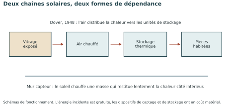

# Après les combustibles fossiles, quelle architecture ? · Paris-Saclay 2023 · Corrigé brut

*Corrigé rédigé par IA, non officiel. Signalez toute erreur.*

**Rédaction** · GPT-6.2 Astra Ultra · vitesse non renseignée

Le sujet cite David Wright, *Natural Solar Architecture* (1978), traduit en 1979. La feuille imprimée porte le programme 1900–1980 de l’année précédente. Le rapport indique que le jury a admis les deux cadrages, y compris le programme 1907–1985 sur la matérialité des productions industrielles. Les exemples ci-dessous se situent dans leur période commune.

## Introduction

Pourquoi une maison devrait-elle continuer à brûler du combustible quand le soleil frappe déjà sa façade ? À la fin des années 1970, David Wright propose de retrouver des rapports directs à l’énergie que l’industrialisation a relégués à l’arrière-plan. L’architecte américain écrit après le premier choc pétrolier. Il dramatise une bifurcation historique, puis refuse lui-même le simple retour à un « état primitif ». L’intérêt de ce double mouvement est de mettre à l’épreuve deux évidences. La société d’avant l’industrie aurait-elle reçu gratuitement de la nature les travaux qui « se faisaient » ? L’équipement industriel ne pourrait-il servir qu’à perpétuer une dépendance fossile ? Les dispositifs qui captent, convertissent et stockent l’énergie permettent de discuter concrètement cette périodisation.

## I. Un flux dit naturel ne met pas le travail et les matériaux hors jeu

Sur la façade vitrée de la maison solaire de Dover, dans le Massachusetts, le soleil chauffe de l’air. Il faut toutefois organiser le trajet de cet air vers une réserve de chaleur, puis du stockage vers les pièces au moment où l’on en a besoin. La maison dessinée par Eleanor Raymond, dont le système expérimental est mis au point par Mária Telkes avec le soutien financier d’Amelia Peabody, est occupée à partir de 1948. L’usage de sels pour emmagasiner puis restituer la chaleur exploite un changement d’état. Le dispositif suppose des récipients, des conduits et des ventilateurs. Il rencontre ensuite des difficultés de stockage et de tenue des matériaux. Le rayonnement incident n’en continue pas moins. Cet écart indique ce que la source et le système ont chacun en propre.

La figure suit le trajet de la chaleur et permet de localiser l’erreur d’une histoire trop simple. Une ressource disponible n’est pas encore une chaleur disponible au moment voulu pour un habitant. Un moulin dépendait lui aussi d’un site, d’un bâti, de pièces à entretenir et du savoir du meunier. Quant aux « hommes » qui s’appuyaient sur eux-mêmes, les mots de Wright effacent la répartition du labeur entre travailleurs, domestiques ou personnes contraintes. Les énergies antérieures à la généralisation du pétrole ont une histoire matérielle et sociale. On peut réapprendre un principe de captage sans idéaliser la vie de ceux qui l’ont mis en œuvre.

## II. L’industrie transforme la visibilité de l’énergie et le partage du confort

Au début du XXe siècle, Peter Behrens dessine pour AEG des bouilloires électriques déclinées dès 1909 en plusieurs corps et finitions. On peut porter jusqu’à la table un récipient dont la chaleur ne vient plus d’un foyer dans la pièce. La prise de courant, le fil et la résistance substituent au feu visible une énergie fournie par un réseau. La variation des formes et des surfaces acclimate cet équipement à des intérieurs différents. Le geste domestique se simplifie. En revanche, le matériau de la résistance et du corps, la centrale de production et le réseau de distribution représentent des dépenses qui sortent en grande partie du champ du regard.

Wright rassemble le moteur à vapeur, l’électricité et les dérivés du pétrole dans une même rupture. L’histoire de l’objet oblige à dissocier un combustible, un convertisseur et un vecteur d’énergie. L’électricité d’une bouilloire peut provenir de sources différentes. Son adoption modifie la vie des personnes raccordées et suffisamment aisées pour s’équiper, tandis que d’autres continuent à utiliser les anciens foyers. La périodisation par deux âges successifs ne décrit ni ces coexistences, ni les avantages réels de l’équipement. Elle éclaire en revanche une disposition culturelle acquise. Une fois le réseau incorporé au logement, l’effort qui se trouve derrière la prise semble presque immatériel.

## III. Une technique solaire peut redistribuer la dépendance et le travail du projet

À Odeillo, dans les Pyrénées-Orientales, les expériences de Félix Trombe et de l’architecte Jacques Michel au cours des années 1960 mettent le stockage dans la matière même d’un mur. Un vitrage précède une surface sombre et massive exposée au soleil. La masse se réchauffe, puis restitue vers l’intérieur une partie de la chaleur avec un décalage temporel. Certaines variantes font également circuler l’air par des ouvertures. L’épaisseur, l’orientation et la ventilation deviennent des variables du projet architectural. Comparée à Dover, la chaîne de conversion ne repose plus sur la même combinaison de ventilateurs, de récipients et de sels. Le mur participe à la fois de l’enveloppe et du stockage.

Une telle solution reste tributaire de la fabrication du vitrage, du coût de la maçonnerie, du site et de la succession des saisons. Pendant une période de faible ensoleillement, les besoins peuvent excéder la chaleur reçue. Une paroi conçue pour l’hiver peut demander une occultation ou une ventilation en été. Évaluer le projet nécessite donc de compter les matériaux, de suivre les transferts dans le temps et de demander quels réglages les habitants peuvent effectuer. L’architecture solaire rend ainsi crédible une troisième voie que Wright cherche encore à nommer. L’industrie et les sciences des matériaux peuvent servir à réduire une consommation d’usage, mais le bénéfice doit être établi pour chaque construction et chaque durée de vie.

## Conclusion

Wright donne une direction à la critique de la dépendance fossile, mais sa peinture de deux âges masque les coexistences techniques et le travail de ceux qui font fonctionner les dispositifs. Les maisons solaires du XXe siècle rendent intelligible un autre choix historique. On peut reprendre l’attention au site et au cycle des jours tout en travaillant avec le verre industriel, les essais de matériaux et la conception architecturale moderne. Le critère est ce que devient la dépendance, de la fabrication à l’entretien et à l’usage.
