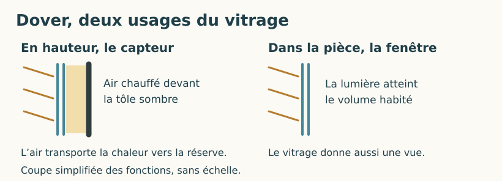
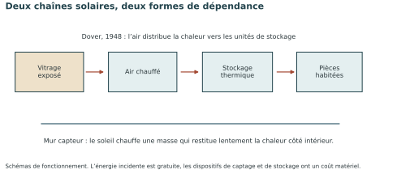

# Après les combustibles fossiles, quelle architecture ? · Paris-Saclay 2023 · Corrigé guidé

*Corrigé rédigé par IA, non officiel. Signalez toute erreur.*

**Rédaction** · GPT-6.2 Astra Ultra · vitesse non renseignée

**Révision (tour 1)** · GPT-6.2 Astra Ultra · vitesse non renseignée · 26 novembre 2026

## Sujet de la session

Design : de l’objet à l’environnement (1900-1980).

« Avant l’âge des combustibles fossiles et de la Révolution Industrielle, les hommes dépendaient du feu, du soleil, du vent, de l’eau, des animaux et d’eux-mêmes pour effectuer leurs travaux… et les choses se faisaient. Avec l’arrivée du pétrole et de ses dérivés, du moteur à vapeur, de l’électricité et du reste, les gens profitèrent aussitôt de ces nouveaux moyens mis à disposition. […] Ainsi, de nombreuses choses tombèrent dans l’oubli. […] Manifestement, si nous voulons survivre, nous devons quitter la route que nous avons empruntée depuis la Révolution Industrielle. Par ailleurs, retourner à l’état primitif ne paraît guère attrayant. »

David Wright, Soleil, Nature, Architecture, 1979, Roquevaire : Parenthèses. trad. de l’anglais : Natural Solar Architecture, 1978.

Vous analyserez et discuterez cet extrait de l’architecte David Wright en vous appuyant sur votre connaissance du programme et selon un propos argumenté.

Le rapport explique la reprise, sur le sujet, du programme précédent. Le jury a admis aussi le programme annoncé pour 2023, « Matérialité et immatérialité des productions industrielles : du Deutscher Werkbund à l’exposition « Les Immatériaux » (1907-1985) ». Les exemples développés appartiennent à la période commune.

[Feuillet officiel, p. 2](https://ens-paris-saclay.fr/sites/default/files/CONCOURS/ANNALES_1C/1C_Design/2023_Sujet_ecrit_HistDeLart_Design.pdf#page=2) · [Rapport écrit du jury](https://ens-paris-saclay.fr/sites/default/files/CONCOURS/ANNALES_1C/1C_Design/2023_Design_rapport_ecrit_Dissertation_Histoire.pdf)

## Introduction

> [!INDICATION]
> Relever le changement entre le début et la fin de la citation. Wright souhaite-t-il réellement revenir à l’époque qu’il décrit ?

À la fin des années 1970, après le premier choc pétrolier, David Wright invite à reprendre un chemin abandonné. Son énumération place côte à côte un combustible, une machine et un réseau. La répétition de « nous » engage ensuite l’architecte et ses lecteurs dans le même avenir. Il faut changer de route pour survivre, alors que le point de départ qu’il imagine lui paraît lui-même inhabitable. Comment retrouver des savoirs énergétiques délaissés en conservant les moyens industriels qui les rendent à nouveau praticables ? La bouilloire électrique permet de préciser ce qui change avec le réseau. La maison de Dover rend ensuite visible le travail que demande la captation du soleil. Le mur solaire permettra enfin de juger ce que la réorganisation d’un bâtiment fait gagner et ce dont elle le laisse dépendant.

## I. L’industrie transforme la visibilité de l’énergie et le partage du confort

> [!INDICATION]
> Comparer un geste domestique à la chaîne de production qui l’autorise.

Au début du XXe siècle, Peter Behrens dessine pour AEG des bouilloires électriques déclinées dès 1909 en plusieurs corps et finitions. On peut porter jusqu’à la table un récipient dont la chaleur ne vient plus d’un foyer dans la pièce. La prise de courant, le fil et la résistance substituent au feu visible une énergie fournie par un réseau. La variation des formes et des surfaces acclimate cet équipement à des intérieurs différents. Le geste domestique se simplifie. En revanche, le matériau de la résistance et du corps, la centrale de production et le réseau de distribution représentent des dépenses qui sortent en grande partie du champ du regard.

Wright rassemble le moteur à vapeur, l’électricité et les dérivés du pétrole dans une même rupture. L’histoire de l’objet oblige à dissocier un combustible, un convertisseur et un vecteur d’énergie. L’électricité d’une bouilloire peut provenir de sources différentes. Son adoption modifie la vie des personnes raccordées et suffisamment aisées pour s’équiper, tandis que d’autres continuent à utiliser les anciens foyers. La périodisation par deux âges successifs ne décrit ni ces coexistences, ni les avantages réels de l’équipement. Elle éclaire en revanche une disposition culturelle acquise. Une fois le réseau incorporé au logement, l’effort qui se trouve derrière la prise semble presque immatériel.

## II. Un flux dit naturel ne met pas le travail et les matériaux hors jeu

> [!INDICATION]
> Sur la figure, supprimer mentalement le vitrage, le stockage, puis la distribution. Dans quel cas la source d’énergie disparaît-elle ?

Sur la façade vitrée de la maison solaire de Dover, dans le Massachusetts, le soleil chauffe de l’air. Il faut toutefois organiser le trajet de cet air vers une réserve de chaleur, puis du stockage vers les pièces au moment où l’on en a besoin. La maison dessinée par Eleanor Raymond, dont le système expérimental est mis au point par Mária Telkes avec le soutien financier d’Amelia Peabody, est occupée à partir de 1948. L’usage de sels pour emmagasiner puis restituer la chaleur exploite un changement d’état. Le dispositif suppose des récipients, des conduits et des ventilateurs. Il rencontre ensuite des difficultés de stockage et de tenue des matériaux. Le rayonnement incident n’en continue pas moins. Cet écart indique ce que la source et le système ont chacun en propre.

Les dessins d’Eleanor Raymond permettent de distinguer deux surfaces qui, sur une photographie, pourraient toutes deux passer pour des fenêtres. En hauteur, un double vitrage ferme l’étroite lame d’air placée devant une tôle sombre. Plus bas, les fenêtres des pièces exposées au sud procurent lumière, vue et apport solaire direct. L’allongement et le rétrécissement du plan, entre l’étude de février et celle d’août 1948, dégagent la façade sud pour les pièces de séjour et rejettent la circulation au nord. L’expérience énergétique travaille donc la proportion et la distribution de l’habitation aussi bien que sa machinerie.

La seconde figure suit le trajet de la chaleur et permet de localiser l’erreur d’une histoire trop simple. Une ressource disponible n’est pas encore une chaleur disponible au moment voulu pour un habitant. Un moulin dépendait lui aussi d’un site, d’un bâti, de pièces à entretenir et du savoir du meunier. Quant aux « hommes » qui s’appuyaient sur eux-mêmes, les mots de Wright effacent la répartition du labeur entre travailleurs, domestiques ou personnes contraintes. Les énergies antérieures à la généralisation du pétrole ont une histoire matérielle et sociale. On peut réapprendre un principe de captage sans idéaliser la vie de ceux qui l’ont mis en œuvre.

## III. Une technique solaire peut redistribuer la dépendance et le travail du projet

> [!INDICATION]
> Comparer sur la figure une réserve de sels et une masse maçonnée. Que faut-il fabriquer dans chaque cas ?

À Odeillo, dans les Pyrénées-Orientales, les expériences de Félix Trombe et de l’architecte Jacques Michel au cours des années 1960 mettent le stockage dans la matière même d’un mur. Un vitrage précède une surface sombre et massive exposée au soleil. La masse se réchauffe, puis restitue vers l’intérieur une partie de la chaleur avec un décalage temporel. Certaines variantes font également circuler l’air par des ouvertures. L’épaisseur, l’orientation et la ventilation deviennent des variables du projet architectural. Comparée à Dover, la chaîne de conversion ne repose plus sur la même combinaison de ventilateurs, de récipients et de sels. Le mur participe à la fois de l’enveloppe et du stockage.

Une telle solution reste tributaire de la fabrication du vitrage, du coût de la maçonnerie, du site et de la succession des saisons. Pendant une période de faible ensoleillement, les besoins peuvent excéder la chaleur reçue. Une paroi conçue pour l’hiver peut demander une occultation ou une ventilation en été. Évaluer le projet nécessite donc de compter les matériaux, de suivre les transferts dans le temps et de demander quels réglages les habitants peuvent effectuer. L’architecture solaire rend ainsi crédible une troisième voie que Wright cherche encore à nommer. L’industrie et les sciences des matériaux peuvent servir à réduire une consommation d’usage, mais le bénéfice doit être établi pour chaque construction et chaque durée de vie.

Le livre que Wright publie en 1978 donne une dernière portée au mot « oubli ». Retrouver un savoir exige de le rendre transmissible. La publication et sa traduction française de 1979 mettent les méthodes solaires à la disposition d’autres concepteurs grâce aux moyens de l’imprimerie et de la diffusion. Une part de l’infrastructure moderne sert donc à contester l’usage que la modernité a fait de l’énergie. Le véritable choix historique porte sur ce que l’on conserve, sur qui pourra s’en servir et sur les ressources qu’exigera cette transmission.

## Conclusion

Wright donne une direction à la critique de la dépendance fossile, mais sa peinture de deux âges masque les coexistences techniques et le travail de ceux qui font fonctionner les dispositifs. Les maisons solaires du XXe siècle rendent intelligible un autre choix historique. On peut reprendre l’attention au site et au cycle des jours tout en travaillant avec le verre industriel, les essais de matériaux et la conception architecturale moderne. Le critère est ce que devient la dépendance, de la fabrication à l’entretien et à l’usage.

## Vérifier sa démonstration

Comparer les verbes de Wright « dépendaient », « profitèrent » et « devons ». Appuyer la description des deux premiers sur un objet daté. Pour juger le troisième, formuler un critère observable, par exemple le besoin de chauffage d’appoint pendant plusieurs journées sans soleil. De la description historique à la prescription, la nature de l’argument change.

[Dessins de la maison de Dover et analyse de D. A. Barber, p. 73–75](https://www.design.upenn.edu/sites/default/files/14BarberD_WSEP_GR51.pdf)
