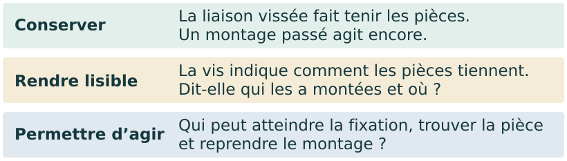

# ENS Paris-Saclay · Design — Philosophie de l’art 2023 · Corrigé guidé

*Corrigé rédigé par IA, non officiel. Signalez toute erreur.*

**Rédaction** · GPT-6.2 Astra Ultra · vitesse non renseignée · 26 novembre 2026

**Autocontrôle** · GPT-6.2 Astra Ultra · vitesse non renseignée · 26 novembre 2026

**Question du sujet.** « Peut-on dire de même que l’objet du design enveloppe sa genèse ? » Le feuillet donne la référence à Gilbert Simondon, *Du mode d’existence des objets techniques*, Paris, Aubier, 1958, p. 22. Épreuve de quatre heures du 11 avril 2023. [Sujet officiel, p. 1](https://ens-paris-saclay.fr/sites/default/files/CONCOURS/ANNALES_1C/1C_Design/2023_Sujet_ecrit_Philo_Design.pdf) · [Rapport du jury](https://ens-paris-saclay.fr/sites/default/files/CONCOURS/ANNALES_1C/1C_Design/2023_Design_rapport_ecrit_Dissertation_Philo.pdf) · [Notice inter-ENS, p. 38](https://ens-paris-saclay.fr/sites/default/files/CONCOURS/CONCOURS_2023/2023_Notice_interENS.pdf#page=38)

## Ce qu’on reçoit avec une chaise

> [!INDICATION]
> Relire les deux phrases du feuillet ensemble. La première situe la genèse dans l’être de l’objet technique. La seconde demande si « de même » vaut pour l’objet du design et introduit le verbe « enveloppe ». Au brouillon, essayez successivement « provient de », « conserve » et « rend accessible ». Chacune de ces substitutions engage une thèse différente. L’introduction doit expliquer pourquoi choisir entre elles change la réponse.

Au café, je tire une chaise et m’assieds. Je peux la reconnaître, m’en servir et même la préférer à une autre sans savoir comment on lui a donné cette courbure. Pourtant, si le dossier se desserre, la manière dont il a été assemblé reprend soudain de l’importance. Une vis se resserre. Une courbe découpée dans une seule plaque demanderait une tout autre intervention. Ce qui s’est passé avant que la chaise me parvienne règle encore ce que je peux faire avec elle. En quel sens ce passé appartient-il à l’objet ?

Lorsqu’il écrit que « la genèse de l’objet technique fait partie de son être », Simondon invite à partir de la formation de l’objet pour comprendre son individualité. Le sujet propose un déplacement décisif. Que change le passage de l’objet technique à l’objet du design, et du verbe « faire partie » au verbe « envelopper » ? Une chose peut porter les effets de sa formation tout en la rendant illisible. Une autre peut livrer les opérations de sa fabrication et permettre à quelqu’un de les poursuivre. Pour transférer l’idée de Simondon au design, il faut donc demander ce que l’objet conserve, pour qui cette présence peut devenir sensible et à quelles conditions elle ouvre un avenir.

## La forme présente conserve des opérations

> [!INDICATION]
> Comparer deux changements apportés à une même tasse. Que se passe-t-il si l’on change le jour de sa vente ? Et si l’on change la cuisson ? Formulez le critère qui permet de trier ses antécédents avant de l’appliquer au cintrage et au montage de la chaise. Le nombre de sièges transportés n’a sa place que si vous expliquez ce qu’il révèle de la conception.

Il existe une façon très pauvre de donner raison à Simondon. Tout objet vient de quelque part, donc tout objet a une genèse. Par ce raisonnement, la tasse qui se trouve sur ma table aurait pour caractères essentiels aussi bien la cuisson de sa pâte que le mardi où je l’ai achetée. Or deux tasses cuites de la même manière peuvent avoir été vendues à des dates différentes sans que leur résistance ou leur usage change. En revanche, faire varier le régime de cuisson peut modifier leur porosité. La proposition de Simondon exige de distinguer les événements qui sont arrivés à l’objet et les opérations qui contribuent encore à définir de quoi il est capable.

L’unité pertinente n’est pas toujours l’exemplaire sorti hier d’un atelier. Pour comprendre une invention, on doit parfois suivre une lignée de solutions à un problème de fonctionnement. Une modification devient décisive lorsque plusieurs exigences, précédemment traitées séparément, trouvent un accord dans un même élément. Ce principe éclaire ce que Simondon nomme la concrétisation. Une vue en coupe et la liste des matériaux peuvent donner un inventaire très exact du dernier état sans faire saisir pourquoi ses éléments vont ensemble. Reconstruire les problèmes auxquels cet état apporte une solution fait comprendre une unité que l’inventaire seul laissait échapper.

La chaise nº 14 de Michael Thonet, lancée en 1859, permet d’éprouver cette idée dans le design. Le cintrage du bois massif donne leur courbe à certaines pièces de hêtre. Six éléments principaux peuvent voyager démontés, puis être assemblés à destination. Trente-six chaises démontées tiennent ainsi dans une caisse d’un mètre cube. Le nombre intéresse le philosophe parce qu’il désigne autre chose qu’un bon résultat commercial. Un choix qui se lit dans le contour d’un dossier a rendu possible un certain partage du travail entre l’atelier, le transport et le lieu du montage. Les vis de la chaise montée conservent matériellement cette répartition des opérations. « Envelopper » signifie ici que des relations déployées successivement se trouvent réunies dans une forme présente. [Documentation de Thonet](https://www.thonet.de/en/magazine/history-brand/detail/225-years-of-michael-thonet)

## Une genèse peut agir sans devenir lisible

> [!INDICATION]
> Distinguer deux prétentions. Assis sur une chaise, puis-je retrouver son histoire à son seul aspect ? Même si je l’ignore, son assemblage règle-t-il encore mes interventions ? Pour passer au design de service, gardez constant l’écran présenté et faites varier seulement le droit de modifier la réservation. Vous pourrez nommer exactement la différence produite.

Il ne suit pas de là qu’en regardant la chaise on peut remonter de façon certaine à son origine. Une coque moulée pourrait imiter les courbes du bois cintré. Le coup d’œil qui identifierait une silhouette familière confondrait deux organisations différentes. Inversement, un siège authentique peut parvenir déjà monté à quelqu’un qui ignore qu’il a voyagé en pièces. La capacité de le dévisser existe même si personne ne pense à s’en servir. La différence entre la présence d’une opération dans son résultat et sa visibilité impose donc une première limite à l’analogie. La forme conserve une part de son histoire, mais la ressemblance d’une forme avec une autre n’en constitue jamais à elle seule la preuve.

La difficulté est plus profonde encore pour le design. Ce que l’on cherche à former peut être une situation d’usage. Imaginons deux services de rendez-vous affichant le même créneau disponible sur un écran. Dans le premier, seul un agent peut rectifier l’heure une fois le créneau réservé. Dans le second, la personne qui a réservé peut le déplacer elle-même. Visuellement, l’objet présenté au public peut être identique. Pourtant, un choix de conception engage déjà le temps de la personne, son autonomie et le travail futur de l’agent. Le design a ici pour objet une relation entre personnes qui s’exerce à travers une règle. Pour retrouver ce qui, dans cette règle, continue d’agir, il faut suivre une demande de modification jusqu’à son terme. Le seul examen des composants de l’écran indiquerait fort peu de chose.

Faut-il alors englober dans l’objet tout le monde social qui l’a rendu possible ? On perdrait le moyen de distinguer cette règle d’un accident de son histoire. Le nom de la salle où l’équipe a dessiné le premier écran peut se perdre sans rien changer au service. Le pouvoir de reprendre un rendez-vous, lui, disparaît si l’on modifie les droits associés à la réservation. La question décisive n’est donc pas de dresser les archives complètes du projet. Elle est de savoir quelles décisions continuent de distribuer des facultés d’agir. Une institution peut là encore dissimuler ces décisions en présentant à ses usagers une procédure historiquement choisie comme la seule marche possible des choses.

## Quand la genèse peut reprendre

> [!INDICATION]
> Testez l’objection de l’usager qui possède le plan et ne dispose pas d’atelier. Qui sait ce qu’il faudrait faire ? Qui peut matériellement le faire ? Qui en a le droit ? Répondez en repartant de l’exemple choisi. La disponibilité d’une information, celle d’une pièce et celle d’un pouvoir de décision sont trois conditions distinctes.

Une décision de design peut aussi consister à rendre la fabrication à nouveau praticable. En 1974, Enzo Mari met à disposition les plans de meubles de son projet *Autoprogettazione*. Prenons sa *Sedia 1*. Posséder une chaise achevée et construire une chaise à partir de ce plan donnent deux rapports différents à un siège de même dessin. En assemblant les planches, celui qui travaille découvre pourquoi leur rencontre a telle position et quelles pièces contribuent à la stabilité. S’il envisage un autre assemblage, il peut en évaluer les conséquences au regard du problème qu’il vient de rencontrer. Le plan distribué fait donc partie de l’objet du design si l’on entend par là aussi la situation d’apprentissage que Mari propose. L’écarter comme un simple papier d’emballage priverait le projet d’une de ses fins. [Notice de la Sedia 1, Centre national des arts plastiques](https://collection.cnap.fr/artwork/enzo-mari-sedia-1-140000000834564)

Il serait pourtant excessif de conclure que pouvoir refaire l’objet suffit pour être libre de le transformer. Un plan parfaitement intelligible ne donne ni le temps d’apprendre ni un lieu où travailler. Un montage peut être accessible à l’artisan et rester impraticable pour l’usager qui en a besoin. Inversement, un service peut permettre une modification sans soumettre son usager à une leçon sur son fonctionnement interne. L’enjeu est de régler la répartition du savoir et de l’initiative sur la nature de l’usage. Pour une chaise, c’est parfois donner accès à une liaison que l’on pourra reprendre. Pour le rendez-vous, c’est laisser à la personne un droit effectif de modifier son choix, avec un interlocuteur lorsque la règle échoue. Le devenir de l’objet relève alors aussi des personnes autorisées à le poursuivre.

Ce déplacement a une conséquence écologique précise. Rendre une liaison accessible peut permettre de remplacer un élément usé en conservant les autres. Mais le bénéfice reste virtuel si aucune pièce compatible n’est disponible, ou si son remplacement impose plus de ressources que la solution concurrente. Autrement dit, l’ouverture inscrite dans la conception ne produit ses effets qu’au cours d’une histoire dont le designer ne dispose pas seul. On ne peut pas prescrire chaque usage futur sans supprimer précisément l’initiative que l’on voulait ménager. On peut en revanche éviter de la rendre impossible dès le premier assemblage. C’est en ce sens limité que la genèse d’un objet peut devenir une responsabilité présente envers ses usages à venir.

## Jusqu’où tenir l’analogie ?

> [!INDICATION]
> Dans la conclusion, accordez à l’analogie son résultat le plus solide, puis donnez-en la condition. L’expression « objet du design » couvre aussi une organisation d’usage. Le rapport du jury valorise la prise en compte de cette extension et explique comment l’étude littérale d’une enveloppe matérielle a fait perdre de vue le problème à certaines copies.

L’objet du design enveloppe sa genèse dans la mesure où certaines opérations formatrices restent à l’œuvre dans ce qu’il permet ou empêche aujourd’hui. Elles peuvent se maintenir dans la courbe et la fixation d’un dossier, dans un droit accordé à un usager ou dans un plan remis avec une invitation à construire. Irréductible à une suite de dates, cette présence ne promet ni une histoire entièrement lisible ni une capacité de reprise également partagée. La question ouverte par Simondon change ainsi de portée dans le design. En comprenant d’où vient une organisation technique, on saisit mieux son individualité. En demandant qui pourra encore agir sur l’organisation reçue, on fait aussi apparaître le choix politique et pratique dont le projet répond.
