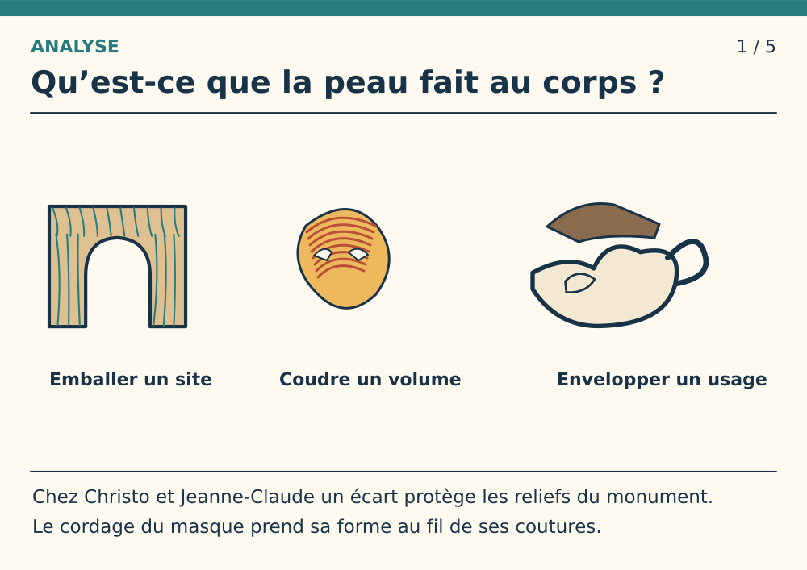
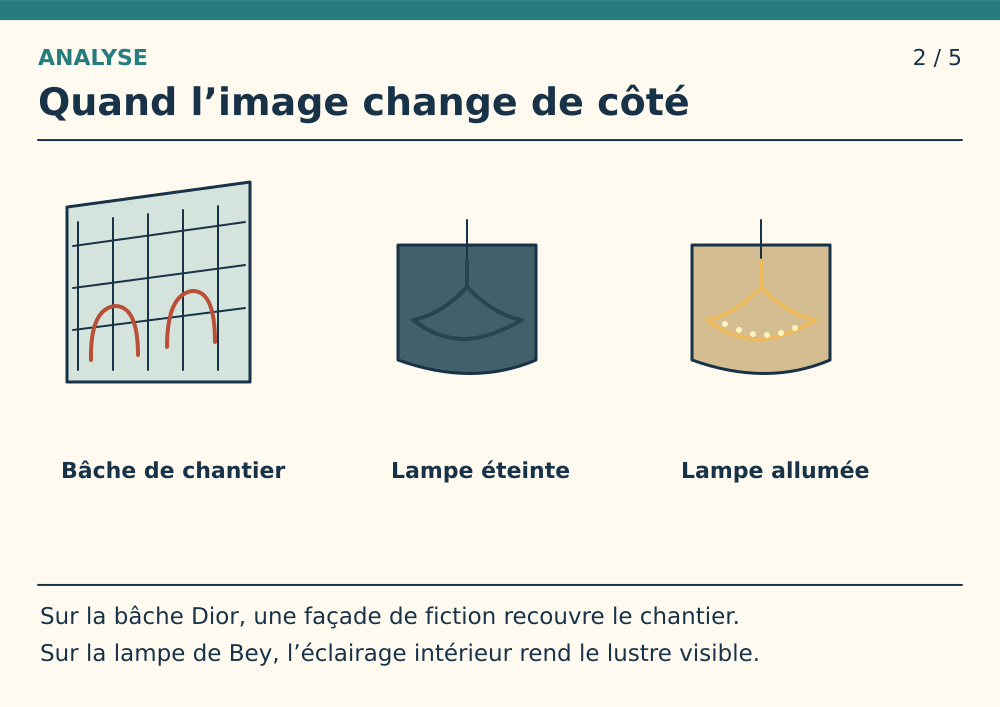
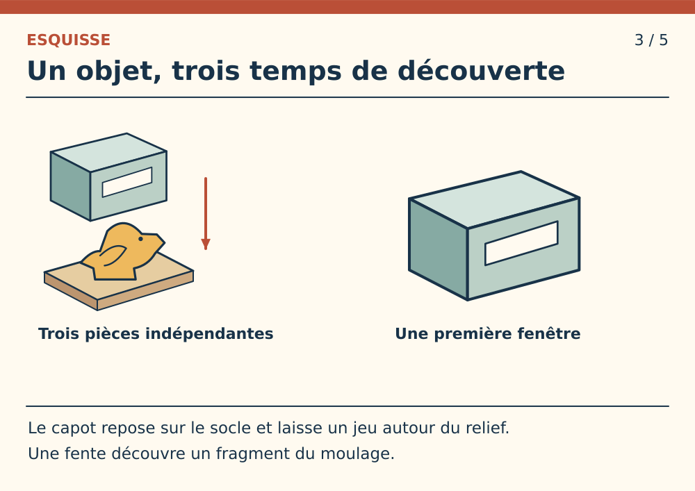
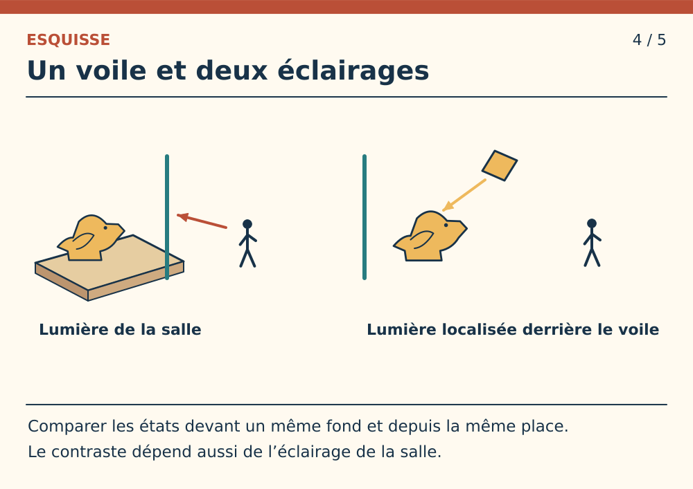
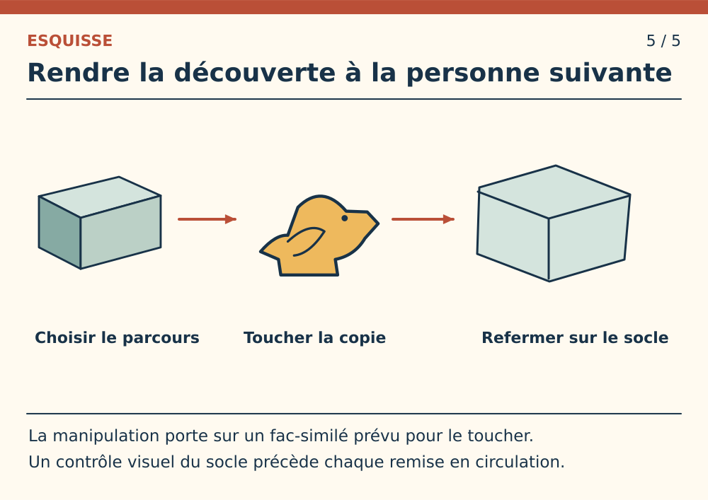

# ENS Paris-Saclay · Design 2023 · Techno-design · Corrigé brut

*Corrigé rédigé par IA, non officiel.*

**Lecture du rapport du jury** · GPT-6.2 Astra Ultra · vitesse non renseignée

**Rédaction** · GPT-6.2 Astra Ultra · vitesse non renseignée

**Révision (tour 1)** · GPT-6.2 Astra Ultra · vitesse non renseignée

## Couvrir pour choisir ce que l’on montre

Les pièces jouent sur l’écart entre ce qui existe sous une peau et ce que l’œil en saisit. Dans un petit musée itinérant, cette différence pourrait devenir un choix du visiteur et un moyen de protéger des reproductions empruntées. Cinq A3 paginés composent la proposition.

### Analyse 1 · Qu’est-ce que la peau fait au corps ?

À Paris, l’Arc de triomphe empaqueté, conçu en 1961 et réalisé en 2021, associe des lés de polypropylène cousus, une face bleue et une face argentée. Les structures de protection ménagent un écart avec les ornements. Le drapé révèle les masses en suspendant la lecture de leurs détails. Les *Masks* de Bertjan Pot se construisent à partir de cordages cousus entre eux. La continuité de couture produit ici un corps en volume. *High Tea Pot* de Wieki Somers (2003) rapproche la porcelaine crânienne, le couvre-théière en fourrure de raton laveur, l’inox et le cuir. Couvrir le récipient modifie à la fois sa relation à la chaleur et le jugement porté sur l’animal devenu matière d’usage. Les trois pièces mettent donc le visiteur à trois distances différentes d’un corps.

### Analyse 2 · Quand l’image change de côté

Sur les Champs-Élysées, l’habillage du chantier Dior associe bâche PVC imprimée et appendices en relief. L’enveloppe temporaire donne une adresse de marque à une activité qu’elle occulte. Le rapport évoque Cartier, tandis que la planche du sujet légende et montre Dior. J’attribue l’exemple au document de l’épreuve. Dans *Light Shade Shade* de Jurgen Bey (1999), le cylindre semi-transparent paraît miroir dans certaines conditions. Avec le lustre allumé, la lumière relative de l’intérieur fait apparaître son verre ciselé. L’observateur reste devant la même enveloppe. Dans *L’Énigme d’Isidore Ducasse* de Man Ray (1920), le paquet ficelé mobilise de même le désir d’identifier un objet caché. Je cherche à donner ce pouvoir de révélation au visiteur d’un petit musée itinérant.

### Esquisse 3 · Un objet, trois temps de découverte

Première piste. Une médiathèque accueille temporairement des reproductions tactiles prêtées par un petit musée. Un oiseau moulé dans une matière lavable repose sur un socle. Le capot vient en butée sur le socle et ménage un jeu autour du bec. Une fente montre un fragment avant de découvrir le volume entier. Comparer une fente verticale et une horizontale devant la même reproduction. Je demande aux visiteurs de décrire ce qu’ils ont réellement vu puis ce qu’ils en ont supposé. Si tous identifient l’oiseau par un seul détail, je décale la fenêtre.

### Esquisse 4 · Un voile et deux éclairages

Deuxième piste. Un voile gris tendu dans un cadre pivote devant une reproduction sans la toucher. Une petite source déjà intégrée au module d’exposition éclaire l’objet sur demande. Dans l’essai sur maquette, je conserve la même distance et varie seulement l’éclairage intérieur, puis j’inverse les conditions en éclairant la face avant. Je note quand la silhouette, puis un détail de surface, deviennent discernables. Si un reflet empêche la lecture en permanence, un volet opaque coulissant assure une révélation mécanique sans consommation en attente.

### Esquisse 5 · Rendre la découverte à la personne suivante

Troisième piste. Une housse cousue en panneaux de textile récupérable se retourne pour devenir petite nappe de manipulation. La personne peut toucher immédiatement la copie ou choisir la découverte progressive. Le médiateur replace ensuite l’objet dans une empreinte repérée. Deux housses d’essai seront comparées, l’une continue et l’autre à panneau remplaçable. Sont relevés le temps du changement, les inversions de montage, les contacts accidentels avec le bec et le nombre de pièces à laver. Une housse qui masque une pièce manquante lors du rangement échoue même si son effet de surprise plaît.

## Sources

Les sept pages du fascicule sont présentes. La quatrième notice iconographique désigne Dior. La mention de Cartier dans le rapport est signalée dans l’analyse pour conserver l’attribution du sujet.

[Fascicule officiel](https://ens-paris-saclay.fr/sites/default/files/CONCOURS/ANNALES_1C/1C_Design/2023_Sujet_ecrit_TechnoDesign.pdf) · [Rapport du jury](https://ens-paris-saclay.fr/sites/default/files/CONCOURS/ANNALES_1C/1C_Design/2023_Design_rapport_ecrit_Techno_Design.pdf)
