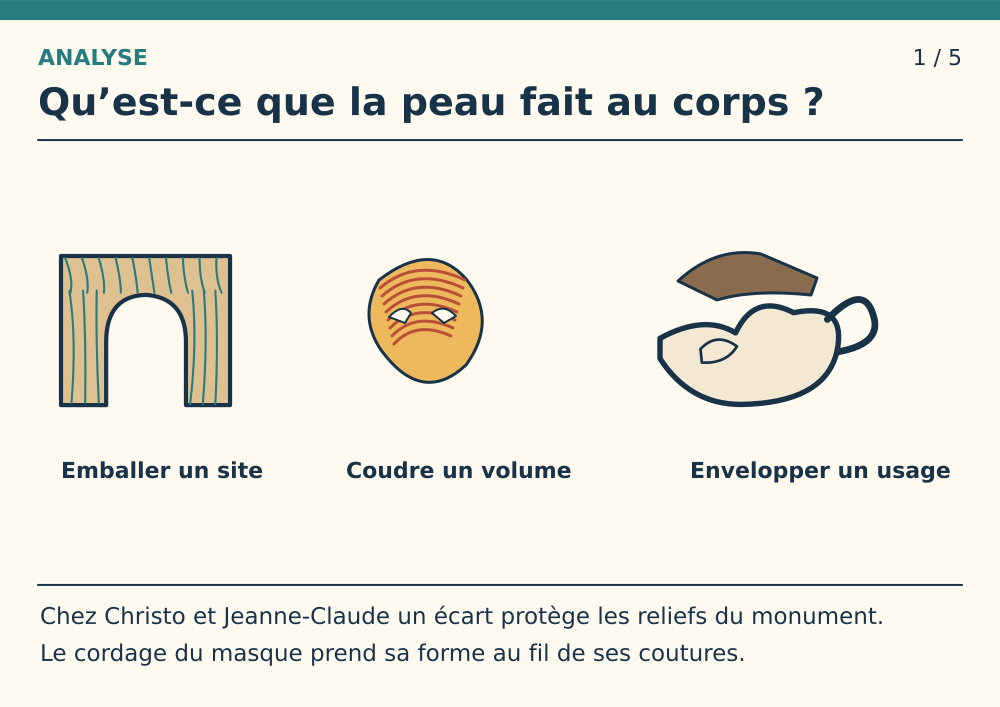
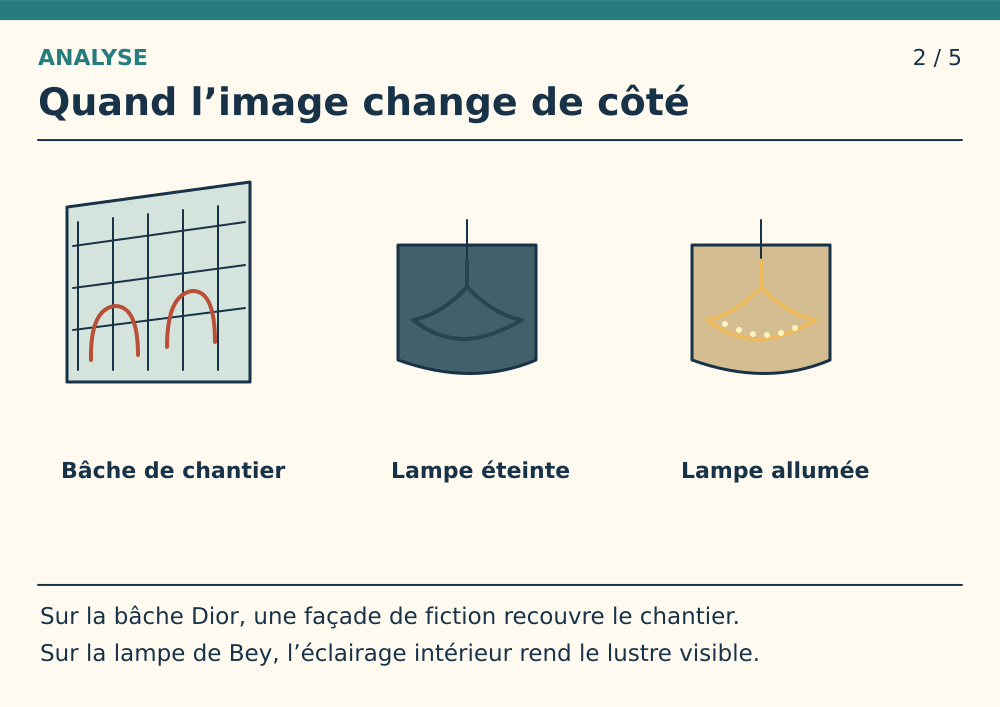
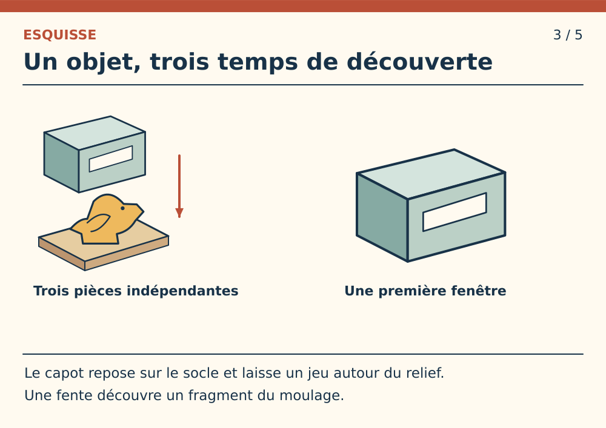
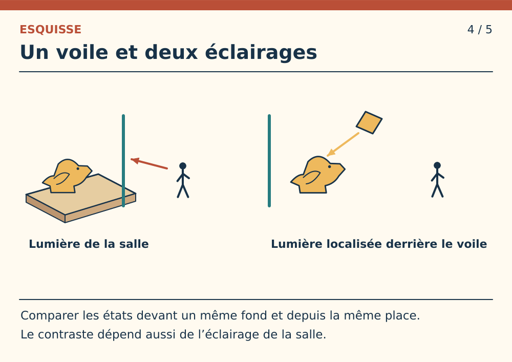
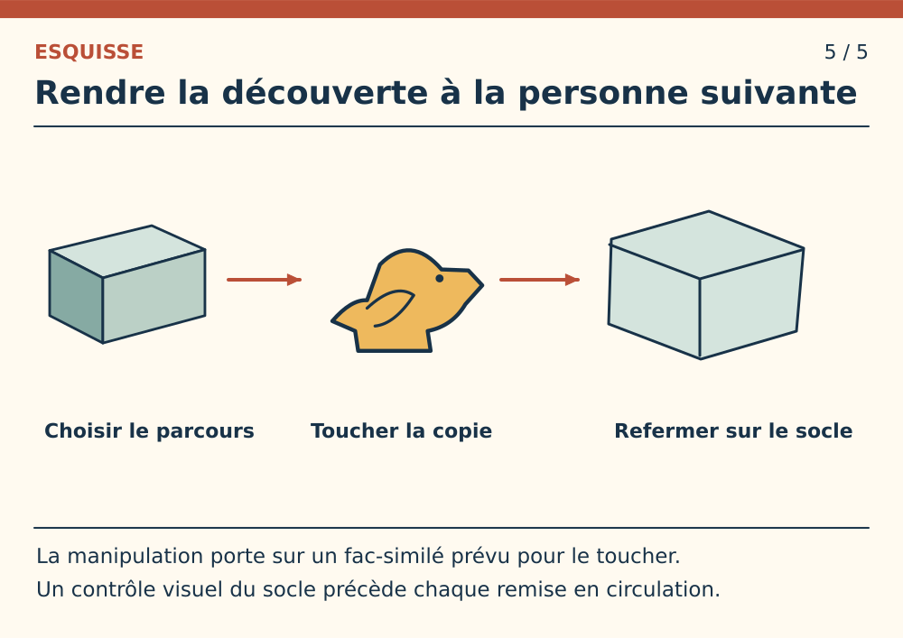

# ENS Paris-Saclay · Design 2023 · Techno-design · Corrigé guidé

*Corrigé rédigé par IA, non officiel.*

**Lecture du rapport du jury** · GPT-6.2 Astra Ultra · vitesse non renseignée

**Rédaction** · GPT-6.2 Astra Ultra · vitesse non renseignée

**Révision (tour 1)** · GPT-6.2 Astra Ultra · vitesse non renseignée

## Couvrir pour choisir ce que l’on montre

L’épreuve dure huit heures et autorise quatre A3 d’analyse et six d’esquisse au maximum. Le jury attend un angle personnel, des références qui l’éprouvent et une situation à l’échelle du projet. Organiser les coupes autour d’une question précise : où finit la peau et où commence ce qu’elle fait voir ?

### Analyse 1 · Qu’est-ce que la peau fait au corps ?

Dessiner séparément ce qui est enveloppé, ce qui protège et ce qui prend forme par la couture.

Sur le monument, faire apparaître l’intervalle là où le textile pourrait frotter. Pour le masque, retirer le visage imaginaire du schéma et vérifier que l’objet cousu conserve une géométrie propre. Pour la théière, comparer l’ensemble couvert et découvert sans inventer de mesure thermique.

### Analyse 2 · Quand l’image change de côté

Comment distinguer une image ajoutée et l’apparition du contenu véritable ?

Dans la façade, placer l’image au niveau de la bâche. Dans la lampe, prolonger une ligne de regard du spectateur jusqu’au lustre derrière le cylindre. Ces coupes fondent une question pratique : le visiteur pourra-t-il choisir quand et comment regarder ?

### Esquisse 3 · Un objet, trois temps de découverte

Où l’enveloppe touche-t-elle le support ? Quel fragment permet-elle réellement d’apercevoir ?

Tester avec un simple gabarit avant de placer la reproduction. Le jeu protège les parties saillantes lorsque le capot descend. Une encoche large sert de poignée et distingue le geste de levée du geste d’exploration tactile.

### Esquisse 4 · Un voile et deux éclairages

Quel témoin permet d’attribuer la révélation à la lumière et non au changement de place du spectateur ?

Marquer un point de vue, puis photographier ou dessiner trois états depuis cette place. Préciser l’éclairement extérieur quand on compare les relevés. Le volet coulissant sert de deuxième hypothèse matérielle lorsque l’étape lumineuse n’apporte aucune différence lisible.

### Esquisse 5 · Rendre la découverte à la personne suivante

Comment vérifier que le dernier geste prépare vraiment la première visite suivante ?

Faire ranger le dispositif par une personne qui n’a pas lu la notice, puis le faire ouvrir par une autre. Un objet retourné, un socle mal aligné ou une housse qui frotte sont trois observations différentes. Modifier pour chacune la pièce qui commande le geste.

## Sources

Les sept pages du fascicule sont présentes. La quatrième notice iconographique désigne Dior. La mention de Cartier dans le rapport est signalée dans l’analyse pour conserver l’attribution du sujet.

[Fascicule officiel](https://ens-paris-saclay.fr/sites/default/files/CONCOURS/ANNALES_1C/1C_Design/2023_Sujet_ecrit_TechnoDesign.pdf) · [Rapport du jury](https://ens-paris-saclay.fr/sites/default/files/CONCOURS/ANNALES_1C/1C_Design/2023_Design_rapport_ecrit_Techno_Design.pdf)
