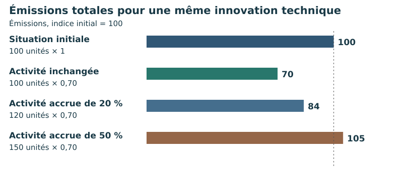

# ENS Paris-Saclay · Analyse macroéconomique 2023 — corrigé brut

*Corrigé rédigé par IA, non officiel. Signalez toute erreur.*

**Rédaction** · GPT-6.2 Astra Ultra · vitesse non renseignée · 26 novembre 2026

## Sujet

L’innovation est-elle nécessaire pour résoudre la crise écologique ?

## Dissertation

En mars 2023, le rapport de synthèse du GIEC rapproche deux constats. Le coût de plusieurs techniques bas-carbone a diminué et de nombreuses options de réduction des émissions sont déjà disponibles. Pourtant, la poursuite des émissions accroît les risques liés au réchauffement. La distance entre ce qu’une société sait faire et ce qu’elle fait effectivement est au cœur du sujet. Si une baisse des coûts ou une découverte suffisait à résoudre la crise écologique, cette distance serait difficile à expliquer.

L’innovation est la mise en usage d’un produit, d’un procédé ou d’une organisation nouvelle. Une invention qui reste au laboratoire n’est pas encore un changement du système productif. La crise écologique inclut le climat, la perte de biodiversité, les pollutions et la dégradation des sols ou de l’eau. La résoudre suppose de ramener les pressions physiques à des niveaux compatibles avec la reproduction des milieux, tout en permettant aux populations de satisfaire leurs besoins. Pour le climat, le cumul des émissions importe ; pour certains écosystèmes, une destruction peut être irréversible. Dire que l’innovation est nécessaire exige alors de préciser ce que l’on entend maintenir et à quel horizon. Dans quelles activités l’invention et la diffusion de nouvelles solutions conditionnent-elles la transition, et quelles pressions peut-on déjà réduire en organisant autrement la production et la demande ?

### I. Les techniques disponibles délimitent les services que l’économie peut rendre sous contrainte écologique

Un ménage recherche la chaleur d’un logement et l’accès à un emploi, bien plus que la quantité de combustible brûlé ou de kilomètres parcourus. En dissociant le service de l’énergie nécessaire pour le fournir, l’innovation déplace les possibilités de production. Une pompe à chaleur convenablement installée restitue dans le logement de la chaleur prélevée dans l’environnement pour chaque unité d’électricité utilisée. Son effet sur les émissions dépend du combustible remplacé, du bâtiment et du système électrique. Une innovation peut donc maintenir un service essentiel en réduisant la consommation d’une ressource rare. Si une société devait satisfaire une demande croissante de ce service avec la seule technique ancienne, elle devrait arbitrer plus brutalement entre privation et dégradation du milieu.

Ce raisonnement vaut particulièrement pour les pays où une part de la population manque encore de logements sûrs, de froid alimentaire ou d’accès à l’électricité. Demander une réduction uniforme de la demande mondiale supposerait qu’un trajet évitable en avion et l’alimentation d’une chambre froide aient la même valeur sociale. Des équipements solaires modulaires ou des réseaux électriques plus fiables peuvent élargir l’accès aux services sans reproduire toute la trajectoire fossile des pays industrialisés. Dans l’industrie lourde, électrifier certains usages ou modifier les procédés de production d’acier et de ciment ouvre des voies que la simple extinction des lumières d’un atelier ne permettrait pas. Ces choix demandent des infrastructures, du capital et des compétences, et parfois des procédés encore coûteux à la date du concours.

La direction du progrès technique constitue donc un problème économique. Une entreprise qui découvre une méthode consomme des ressources aujourd’hui ; une partie du savoir pourra ensuite profiter à d’autres producteurs. Elle ne perçoit pas non plus tout le gain collectif obtenu en évitant des émissions. À ces deux externalités s’ajoute une dépendance au sentier : un réseau installé de stations, de fournisseurs et de mécaniciens rend plus attractives les améliorations du moteur déjà dominant. Dans l’analyse du changement technique dirigé d’Acemoglu et de ses coauteurs, les débouchés et les connaissances accumulées orientent l’effort de recherche. Faire payer la pollution et soutenir l’apprentissage d’une filière propre répondent à deux défaillances différentes. La combinaison d’une tarification prévisible, de recherche publique et de premières commandes peut orienter l’investissement avant que le dommage évité ne soit visible dans les comptes privés.

### II. Une partie de la réponse réside dans des choix accessibles avec les connaissances présentes

La nécessité d’inventer disparaît pour certaines actions. Protéger un boisement existant, réduire le gaspillage de produits déjà récoltés ou faire circuler davantage de voyageurs dans un train dont des places restent libres peut diminuer une pression sans attendre de rupture technique. Une administration qui autorisait la destruction d’une zone humide peut modifier une règle d’urbanisme avec les méthodes juridiques dont elle dispose. Le changement de comportement ou la généralisation d’une technique éprouvée implique un effort politique et organisationnel réel. Qualifier de nouvelle « innovation » tout changement de règle ou d’usage rendrait néanmoins la proposition du sujet vraie par définition et masquerait la décision concrète à prendre.

L’amélioration par unité ne garantit pas davantage le résultat d’ensemble. Appelons $Q$ la quantité d’un service et $e$ la pression environnementale par unité. La pression totale vaut $Qe$. Une amélioration de 30 % de $e$, à volume initial de 100 et intensité initiale de 1, porte la pression totale à 70 si la quantité ne change pas. Elle monte à 84 si le volume augmente de 20 %, et à 105 s’il croît de 50 %. Le rebond est la part de cette augmentation d’usage effectivement causée par l’amélioration : une voiture plus sobre peut rendre certains déplacements moins chers ; les économies réalisées peuvent aussi financer une autre consommation intensive en ressources. L’ampleur dépend des élasticités, des prix, de l’infrastructure et des alternatives. Le seul progrès d’efficacité ne fixe donc pas la trajectoire des émissions absolues.

À l’échelle d’une économie, le remplacement d’une énergie peut reporter une pression sur d’autres milieux. Une batterie exige des matériaux, sa fabrication de l’énergie et son recyclage des équipements. Comparer ses émissions à l’usage avec celles d’un moteur thermique éclaire une partie du choix ; une comparaison complète doit intégrer la durée de vie, l’électricité, l’extraction et le devenir du véhicule. Les émissions territoriales peuvent baisser lorsqu’une usine déménage à l’étranger sans que l’empreinte de la consommation nationale baisse. Enfin, certains services naturels se prêtent mal à la substitution : une technique de traitement de l’eau ne recrée pas nécessairement la biodiversité d’un marais détruit. La possibilité technique de compenser un dommage n’établit ni la réversibilité du dommage ni l’opportunité d’attendre l’invention.

### III. Le résultat dépend de la diffusion, du volume des usages et du partage de l’effort

Une politique crédible doit définir d’abord sa contrainte physique. Un plafond d’émissions assorti de contrôles donne une limite globale ; un prix carbone fait apparaître le coût d’émettre dans les choix de production et de consommation. Un prix seul ne finance pas toujours les réseaux collectifs et n’informe pas les ménages sur la performance réelle d’un bâtiment. Investissement dans les transports collectifs, normes de construction, formation des artisans et soutien à la recherche peuvent lever ces obstacles. Pour la biodiversité, des protections territoriales ou des règles sur les usages du sol répondent plus directement à la localisation des dommages qu’un prix uniforme de la tonne de CO₂. Le protocole de Montréal illustre cette articulation : les restrictions sur les substances qui appauvrissent l’ozone ont créé une demande durable de substituts, accompagnée de calendriers différenciés et d’un financement de la transition. Les substituts, leurs usages et leurs autres effets environnementaux ont dû à leur tour être évalués.

Pour un ménage locataire en zone périurbaine, une hausse du prix de l’énergie survient bien avant le renouvellement du véhicule ou du chauffage. Sans transport accessible ni pouvoir sur les travaux du propriétaire, le signal-prix risque surtout de diminuer son revenu réel. Une compensation forfaitaire, distincte du volume de combustible consommé, peut préserver l’incitation à économiser ; une offre de mobilité et un financement des travaux rendent l’ajustement matériellement possible. À l’échelle internationale également, tarifs de licence, capacités de financement et compétences locales conditionnent la diffusion. Une découverte mondiale peut donc coexister avec des équipements fossiles durables dans les économies qui n’ont pas les moyens de les remplacer. La répartition de l’effort influence l’adoption des politiques et, par cette voie, leur résultat écologique.

Enfin, un programme de recherche doit se juger à la fois par les options qu’il ouvre et par le temps qu’il laisse passer. Retarder une réduction réalisable en comptant sur de futures absorptions de carbone consomme entre-temps une partie du budget d’émissions. À l’inverse, renoncer dès maintenant à toute recherche peut rendre très onéreuse la réduction des émissions résiduelles de certains secteurs. Investir dans plusieurs solutions, déployer les techniques éprouvées, réduire les usages les moins utiles et réviser périodiquement les objectifs à partir des résultats observés permet de gérer cette asymétrie. Les indicateurs appropriés sont les émissions absolues et cumulées, la santé des milieux et l’accès effectif aux services essentiels.

Certaines réductions de pression peuvent être obtenues immédiatement en transformant l’usage des ressources existantes. En revanche, une transition qui préserve ou élargit des services essentiels sous des contraintes physiques plus strictes appelle, dans plusieurs secteurs, des innovations et leur diffusion à grande échelle. Leur nécessité est conditionnelle aux besoins et aux techniques disponibles ; leur efficacité dépend des institutions qui orientent la recherche, rendent les solutions accessibles et maîtrisent les volumes. L’enjeu collectif est de choisir simultanément les services que l’on veut garantir et les dommages que l’on refuse de reporter sur d’autres populations ou générations.

## Repère quantitatif

## Sources

Le sujet du 20 avril 2023 présente une seule question en page 2. Aucun rapport de macroéconomie pour 2023 ne figure dans l’index institutionnel consulté. Les indices du graphique sont illustratifs. [Sujet officiel, page 2](https://ens-paris-saclay.fr/sites/default/files/CONCOURS/ANNALES_1C/1C_D2_1/2023_sujet_ecrit_ecoG_macro_jeudi_2023.pdf#page=2) · [Index des annales](https://ens-paris-saclay.fr/admission/concours/concours-pre-master/annales-concours-pre-master?field_orientation_1c_target_id%5B%5D=289&field_year_target_id%5B%5D=583&page=1)

Le rapport de synthèse du GIEC paru en mars 2023 distingue réduction de la demande, développement technique et conditions de mise en œuvre. [GIEC, Rapport de synthèse 2023](https://www.ipcc.ch/report/ar6/syr/) · [Acemoglu et al., The Environment and Directed Technical Change, 2012](https://doi.org/10.1257/aer.102.1.131)
