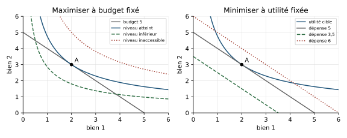
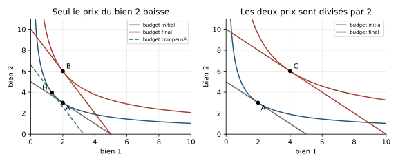
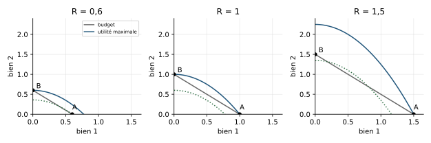
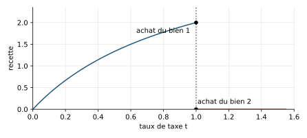

# ENS Paris-Saclay · Analyse microéconomique 2023 — corrigé brut

*Corrigé rédigé par IA, non officiel. Signalez toute erreur.*

**Rédaction** · GPT-6.2 Astra Ultra · vitesse non renseignée · 26 novembre 2026

## Partie 1 — Choisir un panier et mesurer sa dépense

Les quantités sont positives ou nulles ; $p_1,p_2,R>0$. Posons $a=2/5$, $b=3/5$ et $K=a^2b^3=108/3125$.

**1.1 — Solutions sur les axes.** Sur un axe, $U=x_1^2x_2^3=0$. Le panier $(R/(2p_1),R/(2p_2))$ est finançable et procure une utilité strictement positive. Tout optimum est donc intérieur en quantités.

**1.2 — Saturation.** Si un tel panier laissait du revenu inutilisé, il serait possible d’augmenter légèrement $x_1$ à $x_2$ inchangé. Son utilité augmenterait puisque $2x_1x_2^3>0$. Ainsi $p_1x_1+p_2x_2=R$.

**1.3 — Représentation des préférences.** $(1,0)$ et $(0,2)$ sont indifférents pour $U$ mais valent 1 et 8 pour $Z=x_1^2+x_2^3$. Les deux fonctions ne classent donc pas les paniers de la même manière. Même dans l’intérieur, $(1,1)$ et $(8,1/4)$ donnent $U=1$ et des $Z$ distincts.

**1.4 — Existence et unicité.** Le triangle budgétaire est compact et $U$ continue, donc le maximum existe. Sur l’intérieur, $\ln U=2\ln x_1+3\ln x_2$ a une hessienne diagonale strictement négative. Ce représentant strictement concave des mêmes préférences assure l’unicité de l’optimum intérieur. $U$ elle-même n’est pas concave : multiplier le panier par deux multiplie $U$ par 32.

**1.5 — Demandes marshalliennes.** Avec le Lagrangien $2\ln x_1+3\ln x_2+\lambda(R-p_1x_1-p_2x_2)$, on trouve $2/x_1=\lambda p_1$, $3/x_2=\lambda p_2$. En sommant les dépenses, $\lambda=5/R$, d’où
$$x_1^*=aR/p_1,\qquad x_2^*=bR/p_2.$$
Les parts budgétaires valent 40 % et 60 %.

**1.6 — Utilité indirecte.** En substituant ces quantités dans le représentant demandé, $V(p_1,p_2,R)=KR^5/(p_1^2p_2^3)$. Dans cette réponse, donner $\ln V$ changerait l’échelle de l’utilité demandée.

**1.7 — Dépense minimale.** Inverser $u=V(p,R)$ en $R$, qui entre de manière strictement croissante, donne
$$E(p_1,p_2,u)=\left(u p_1^2p_2^3/K\right)^{1/5}.$$
Elle est homogène de degré un en prix et croît avec la cible $u$.

**1.8 — Demandes hicksiennes.** Le lemme de Shephard donne $h_j=\partial E/\partial p_j$ à utilité fixée. On obtient $h_1=aE/p_1$ et $h_2=bE/p_2$. Leur argument de quantité de satisfaction est $u$ ; si l’on souhaite les exprimer à partir d’un revenu initial $R$, on fixe $u=V(p^0,R)$.

**1.9.1 — Deux constructions de l’équilibre.** Fixer le budget et chercher la plus haute courbe d’indifférence accessible ; ou fixer l’utilité atteinte et abaisser une droite d’isodépense parallèle jusqu’au premier contact. Les intercepts du budget sont $(R/p_1,0)$ et $(0,R/p_2)$. Les deux constructions ont au point choisi la pente commune $-p_1/p_2=-2x_2/(3x_1)$.

**1.9.2 — Seul le prix du bien 2 est divisé par deux.** Le budget pivote autour de l’intercept horizontal. En partant de $A=(aR/p_1,bR/p_2)$, on atteint $B=(A_1,2A_2)$. À utilité initiale et aux nouveaux prix, la dépense requise vaut $kR$ avec $k=2^{-3/5}$. Le point compensé est $H=(kA_1,2kA_2)$. Dans $A\to H$, la substitution réduit $x_1$ et augmente $x_2$ puisque $1<2k<2$. Dans $H\to B$, le gain de pouvoir d’achat augmente les deux consommations. Pour le bien 1, les deux effets opposés se compensent exactement.

La formule différentielle de Slutsky vérifie le signe : à l’équilibre, $\partial h_1/\partial p_2=b x_1/p_2$ et $x_2\partial x_1/\partial R=b x_1/p_2$. Pour le bien 2, $\partial h_2/\partial p_2=-a x_2/p_2$, et la composante de revenu vaut $-b x_2/p_2$, soit $-x_2/p_2$ en tout pour une *hausse* marginale de prix. Les déplacements finis ci-dessus traitent exactement la baisse de moitié.

**1.9.3 — Les deux prix sont divisés par deux.** Le budget se translate parallèlement vers l’extérieur. Aux nouveaux prix, $R/2$ suffit pour acheter $A$ et atteindre la même utilité ; l’homogénéité hicksienne en prix laisse le panier compensé inchangé. Le mouvement entier $A\to(2A_1,2A_2)$ est un effet de pouvoir d’achat. L’utilité est multipliée par $2^5=32$.

## Partie 2 — Préférences non convexes et taxation

**2.1 — Propriétés.** $W=x_1^2+x_2$ est continue, strictement croissante sur l’orthant et quasi linéaire en bien 2. Sa hessienne est positive semi-définie, donc $W$ est convexe. Les préférences ne sont pas convexes : $(0,1)$ et $(1,0)$ procurent 1, leur moyenne seulement $3/4$.

**2.2 — Courbes d’indifférence.** À utilité $u$, $x_2=u-x_1^2$ pour $0\le x_1\le\sqrt u$. Leur pente est $-2x_1$ et leur courbure $-2$. Plus on possède de bien 1, plus on accepte de céder de bien 2 pour une unité supplémentaire de bien 1. Des niveaux supérieurs correspondent à des translations verticales.

**2.3 — Équilibre graphique.** Sur le segment budgétaire saturé, $W=x_1^2-(p_1/p_2)x_1+R/p_2$. Cette parabole strictement convexe atteint son maximum à un ou aux deux bouts. Si la tangence intérieure existe, elle correspond au minimum sur le segment.

**2.4 — Demande marshallienne.** Aux extrémités $A=(R/p_1,0)$ et $B=(0,R/p_2)$, les niveaux sont $(R/p_1)^2$ et $R/p_2$. Si $R>p_1^2/p_2$, seul $A$ est choisi ; si $R<p_1^2/p_2$, seul $B$ est choisi. À égalité, la demande est l’ensemble $\{A,B\}$ ; aucun mélange strict des deux ne convient.

**2.5 — Utilité indirecte.** Elle est univoque, même quand les demandes sont multiples : $I(p_1,p_2,R)=\max\{(R/p_1)^2,R/p_2\}$.

**2.6 — Dépense.** Le budget minimal permettant d’atteindre $u\ge0$ est $D(p_1,p_2,u)=\min\{p_1\sqrt{u},p_2u\}$. On peut acheter l’une des deux extrémités de l’iso-utilité. Sur tout budget inférieur aux deux montants, même la meilleure extrémité a une utilité inférieure à $u$.

**2.7.1 — Effet d’une taxe ad valorem.** Posons $q=p_1(1+t)$. Tant que le coin 1 reste optimal, $x_1=R/q$ baisse ; à utilité compensée le même coin exigerait la même quantité, d’où un effet de substitution local nul. Au coin 2, un petit changement de $q$ reste sans effet. Un franchissement du seuil provoque une substitution discrète vers le bien 2 ; la demande n’est pas dérivable au seuil. Une décomposition finie en passant par le minimum de dépense à utilité initiale demeure possible, éventuellement multivoque au point critique ; deux effets marginaux continus ne décrivent pas le saut.

**2.7.2 — Recette.** Si le bien 1 est strictement choisi au départ, $p_1<\sqrt{Rp_2}$. Le seuil de basculement est $t_c=\sqrt{Rp_2}/p_1-1>0$. Pour $t<t_c$, recette $tp_1(R/q)=Rt/(1+t)$, de dérivée $R/(1+t)^2>0$. Pour $t>t_c$, la recette est nulle. Au seuil, selon le coin choisi, elle vaut zéro ou $Rt_c/(1+t_c)$. Si le ménage était initialement indifférent mais choisissait le bien 1, $t_c=0$ et toute taxe positive le fait basculer.

**2.7.3 — Stratégie fiscale.** En visant la recette sur ce seul bien, l’État choisit le taux maximal compatible avec son achat. Avec départage favorable, $t=t_c$ rapporte $R-p_1\sqrt{R/p_2}$. Si le consommateur quitte le bien au seuil, ce montant est un supremum qu’on approche par-dessous ; il n’existe alors pas de taux maximisant exactement la recette positive. Si l’État posait un objectif de bien-être ou disposait d’autres instruments, il lui faudrait les spécifier pour définir une autre politique optimale.

**2.7.4.1 — Effet d’un poids $\theta$ accru.** Avec $W=x_1^2+\theta x_2$, le seuil devient $t_c(\theta)=\sqrt{Rp_2/\theta}/p_1-1$. À taux donné, la recette est inchangée tant que le coin 1 est maintenu, puis tombe à zéro quand $\theta$ franchit $Rp_2/[p_1^2(1+t)^2]$.

**2.7.4.2 — Taux optimal.** Plus $\theta$ est élevé, plus il faut modérer le taux pour éviter le basculement. Tant que $t_c(\theta)>0$, le plafond de recette est $R-p_1\sqrt{\theta R/p_2}$. Pour $\theta\ge Rp_2/p_1^2$, le bien 1 ne procure plus aucune recette positive, quel que soit $t\ge0$. La règle de départage de 2.7.3 s’applique toujours à l’égalité.

## Partie 3 — Équilibre avec production

**3.1 — Facteur demandé.** En notant $z=X_2^F$, la firme maximise $10p_1\sqrt z-p_2 z$. En $z>0$ le profit est strictement concave et la productivité marginale devient infinie en zéro. La condition $5p_1/\sqrt z=p_2$ donne $z=25(p_1/p_2)^2$.

**3.2 — Offre.** En substituant dans la technologie, $Y_1=50p_1/p_2$.

**3.3 — Profit.** La recette vaut $50p_1^2/p_2$, le coût $25p_1^2/p_2$, d’où $\pi=25p_1^2/p_2$.

**3.4 — Budgets individuels.** Chaque consommateur reçoit $M=16p_2+\pi/100=16p_2+p_1^2/(4p_2)$. Ses demandes sont $x_1=2M/(5p_1)$ et $x_2=3M/(5p_2)$.

**3.5 — Deux marchés.** Au numéraire $p_2=1$, posons $p=p_1$ et $M=16+p^2/4$. Pour le bien 1, $100(2M/5p)=50p$, soit $640+10p^2=50p^2$. Pour le bien 2, $100(3M/5)+25p^2=1600$, soit $960+40p^2=1600$. Les deux donnent **$p=4$**. La redondance des deux équations résulte des budgets saturés, profits distribués et identités comptables.

**3.6 — Allocation.** $M=20$, $x_1^*=2$ et $x_2^*=12$ par personne. La firme emploie 400 unités de bien 2, offre 200 unités de bien 1 et dégage 400 de profit. Contrôles : $200=100\times2$ et $1600=400+100\times12$.

**3.7 — Pareto-efficacité.** Les ménages maximisent des préférences localement non saturées, la firme maximise son profit, les prix sont positifs et les marchés sont complets dans ce modèle sans externalité. Le premier théorème du bien-être s’applique. Directement, une amélioration stricte pour au moins un agent, sans perte pour les autres, demanderait à ces prix une dépense agrégée supérieure aux revenus, tandis qu’aucun autre plan réalisable de production ne donne un profit supérieur.

**3.8.1 — Programme égalitaire.** Pour une même paire $(x_1,x_2)$ attribuée à tous, maximiser $100x_1^2x_2^3$ sous $100x_1\le10\sqrt z$, $100x_2+z\le1600$, $0\le z\le1600$, $x_1,x_2\ge0$.

**3.8.2 — Résolution.** À l’optimum positif, les deux contraintes sont saturées. Substituer $x_1=\sqrt z/10$ et $x_2=(1600-z)/100$ réduit l’objectif à une constante positive fois $z(1600-z)^3$. Sa dérivée est proportionnelle à $(1600-z)^2(1600-4z)$, positive avant 400, négative après. Ainsi $z=400$, puis $x_1=2$ et $x_2=12$.

**3.8.3 — Comparaison.** On retrouve le même panier. L’équilibre est efficace et déjà égalitaire, du fait des préférences, dotations et parts de profit identiques et de l’unicité de la demande Cobb-Douglas. Aucun autre panier commun ne pourrait donner aux cent personnes une utilité supérieure. Sans la contrainte d’égalité, la somme des utilités dépend de leur représentation cardinale.

**3.9 — Équilibre avec préférences non convexes.** Toujours $p_2=1$. Si $p^2<64/3$, alors $M>p^2$, et tous demandent exclusivement le bien 1. L’apurement du marché du bien 2 imposerait $25p^2=1600$, donc $p^2=64$, en contradiction avec ce régime. Si $p^2>64/3$, tous demandent le bien 2 et l’offre strictement positive de bien 1 reste invendue. Le seul prix possible vérifie $p^2=64/3$, soit $p=8/\sqrt3$, $M=p^2$. Chaque consommateur peut choisir $(p,0)$ ou $(0,p^2)$.

Si $n$ personnes prennent le premier coin, l’équilibre du bien 1 impose $np=50p$, donc $n=50$. Les 50 autres prennent chacun $64/3$ unités de bien 2 et la firme en utilise $25(64/3)$ : au total $(50+25)64/3=1600$. **Il existe donc un équilibre**, où deux groupes d’agents initialement identiques choisissent des coins distincts. Imposer que tous choisissent la même extrémité ferait manquer cette allocation ; allouer un demi-panier de chaque bien à chacun violerait leur optimalité.

## Sources

[Énoncé officiel](https://ens-paris-saclay.fr/sites/default/files/CONCOURS/ANNALES_1C/1C_D2_1/2023_sujet_ecrit_ecoG_micro_lundi_2023.pdf)
