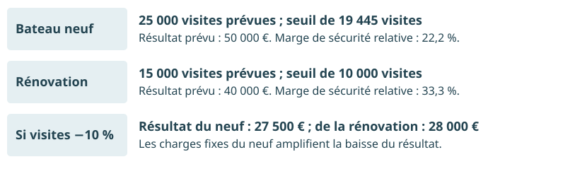

# ENS Paris-Saclay · Épreuve à option — dominante gestion 2023 — corrigé guidé

*Corrigé rédigé par IA, non officiel. Signalez toute erreur.*

**Rédaction** · GPT-6.2 Astra Ultra · vitesse non renseignée · 26 novembre 2026

## Étude de cas

Le groupe européen doit moderniser le bateau à bascule de Wunderland, comptabiliser le terrain de la ferme solaire de Tierragua et répondre aux actionnaires sur la distribution des dividendes. Les dossiers sont indépendants. Les montants financiers sont exprimés en euros.

### Construire le compte différentiel à la visite

Traduisez d’abord « 900 € pour 1 000 visiteurs » en 0,90 € par visite. Pour le neuf, le gain d’une visite au-delà du seuil est donc $10-0{,}90-0{,}10=9$ €. Le montant d’achat n’est pas une charge annuelle : inscrivez sa consommation sur quinze ans. Refaites le calcul avec dix ans pour la rénovation. Ensuite, faites disparaître 10 % des visiteurs sans changer les frais fixes. Le nouveau résultat permet de vérifier le levier d’exploitation.

### Séparer l’achat du terrain des travaux

Tracez deux colonnes, « frais de l’acquisition » et « coût de préparation en interne ». Le taux de sous-activité vise les coûts fixes indirects de production imputés aux travaux ; il ne réduit pas le prix du terrain et il ne supprime pas 20 % des heures effectivement affectées à celui-ci. Pour un coût dit administratif, demandez quel lien il possède avec le chantier.

### Dater les loyers avant de les actualiser

Sur huit graduations annuelles, placez le premier paiement le 1er janvier 2020 et le dernier le 1er janvier 2027. Barrez les trois premiers déjà payés au 31 décembre 2022. La première des cinq redevances restantes arrive le lendemain de l’évaluation : avec la convention annuelle elle n’est pas divisée par 1,035. L’erreur d’un rang d’actualisation changerait à la fois la valeur de la dette et celle de l’action.

### Choisir le bon indicateur pour répondre à l’actionnaire

Le modèle de dividendes attribue une valeur aux distributions futures. Le bilan patrimonial estime la valeur nette revenant aux actionnaires à une date ; il faut dire si le dividende à payer y est encore compris. Pour proposer une politique, reliez ensuite les montants retenus dans l’entreprise au rendement que la rénovation peut produire.

## Résolution des dossiers

### Gestion financière et comptable — Choix de l’attraction

**1. Résultats différentiels pour une année.** On suppose un exercice entier au niveau d’activité annoncé, un amortissement linéaire sans valeur résiduelle et des charges de personnel et d’assurance fixes dans la plage étudiée. Les deux charges exprimées par millier de visiteurs sont variables. Les 10 € par visite représentent une recette attribuée à l’attraction, et non un prix encaissé séparément à chaque passage.

| Euros par an | Nouveau bateau | Bateau rénové |
|---|---:|---:|
| Fréquentation prévue | 25 000 | 15 000 |
| Chiffre d’affaires à 10 € la visite | 250 000 | 150 000 |
| Énergie | 25 × 900 = 22 500 | 15 × 1 200 = 18 000 |
| Entretien | 25 × 100 = 2 500 | 15 × 800 = 12 000 |
| Charges variables | 25 000 | 30 000 |
| Marge sur coût variable | 225 000, soit 90 % du CA | 120 000, soit 80 % du CA |
| Personnel et assurance | 30 000 + 3 500 | 15 000 + 1 500 |
| Amortissement | 2 122 500 / 15 = 141 500 | 635 000 / 10 = 63 500 |
| Charges fixes totales | 175 000 | 80 000 |
| **Résultat d’exploitation** | **50 000** | **40 000** |

**2. Trois indicateurs du risque d’exploitation.** Le seuil fixe le nombre minimal de visites pour couvrir les charges ; l’indice de sécurité mesure la baisse proportionnelle de fréquentation admissible ; le levier mesure la sensibilité du résultat à une fluctuation des visites.

| Indicateur | Neuf | Rénové |
|---|---:|---:|
| Seuil en visites : fixes / marge par visite | 175 000 / 9 = 19 444,44 | 80 000 / 8 = 10 000 |
| Seuil en CA | 194 444,44 € | 100 000 € |
| Marge de sécurité en CA | 55 555,56 € | 50 000 € |
| Indice de sécurité : (CA − seuil) / CA | 22,22 % | 33,33 % |
| Levier d’exploitation : marge variable / résultat | 4,50 | 3,00 |

Il faut 19 445 visites entières pour un résultat positif avec le neuf ; 10 000 visites couvrent exactement les frais de la rénovation. Sous des prix et coûts unitaires constants, une baisse de 10 % des visites enlève $2\,500\times9=22\,500$ € au neuf (−45 % du résultat) et $1\,500\times8=12\,000$ € au rénové (−30 %). Le matériel neuf dégage une marge unitaire plus élevée, mais dépend davantage de la réalisation de sa prévision de fréquentation.

**3. Rémunération et théorie de l’agence.** Les actionnaires et la direction du groupe délèguent la décision ou l’exécution au directeur de parc. Celui-ci connaît mieux l’état réel des installations et l’effort des équipes. Sa rémunération fixe liée entre autres aux effectifs et au nombre de visiteurs peut l’inciter à préférer le projet neuf, qui crée un poste et attire davantage de monde. Une part variable fondée sur la transition rend une partie de son gain dépendante des effets recherchés par le groupe. Vérifier toutefois le choix des indicateurs : privilégier le CO₂ par visite seul pourrait masquer une hausse des émissions totales, et un objectif annuel de coûts pourrait décourager une maintenance utile. Utiliser des objectifs pluriannuels mesurables et contrôlables, encadrés par des critères de sécurité, de qualité et de conditions de travail.

**4. Proposition.** Les deux solutions doivent satisfaire la même exigence de sécurité. Sur l’année type, le neuf dégage 10 000 € de bénéfice comptable de plus et les salariés apprécient le poste créé. Il mobilise toutefois 1 487 500 € d’investissement supplémentaire. La rénovation présente un résultat positif, une exposition moindre au risque de fréquentation et s’inscrit dans l’objectif de prolonger la vie des installations. L’utilisation engendre $25\,000\times0{,}6=15\,000$ kg CO₂e par an pour le neuf et $15\,000\times0{,}4=6\,000$ kg pour le rénové. Ce sont des émissions d’usage ; il faut encore mesurer fabrication, travaux et fin de vie. Je retiendrais la rénovation sous réserve d’un contrôle technique indépendant et d’un plan d’entretien. Les durées de dix et quinze ans diffèrent : comparer les flux actualisés sur une durée de service commune ou leur annuité équivalente avant d’arbitrer à partir du seul bénéfice annuel. Vérifier aussi que les visites supplémentaires du neuf produiraient réellement des entrées ou dépenses supplémentaires pour le parc.

### Ferme solaire de Tierragua

**5. Conditions d’activation.** Le terrain est une ressource physique identifiable acquise par la société, qu’elle contrôle et qu’elle utilisera au-delà d’un exercice. Elle en attend des avantages économiques futurs, grâce à l’exploitation de la ferme solaire et aux économies ou ventes d’électricité selon le montage retenu. Le prix et les coûts de préparation peuvent être mesurés. La destination durable à l’exploitation le classe en immobilisation corporelle. Distinguer le sol, normalement non amortissable en l’absence de consommation prévisible, des panneaux ou aménagements à durée d’utilité limitée.

**6. Valeur d’entrée.** Le prix d’achat est 100 000 €. On retient l’option d’immobiliser les 10 000 € de frais d’acte. Les salaires de 18 500 € et les matières et énergies de 5 000 € rendent directement le terrain utilisable. La part normale des charges fixes indirectes de production est $1-20\%=80\%$ ; le coût de la capacité inemployée reste en charge.

| Coût incorporé | Montant |
|---|---:|
| Prix et frais d’acte | 110 000 € |
| Coûts variables directs des travaux | 23 500 € |
| Matériels utilisés : 80 % de 2 000 | 1 600 € |
| Quote-part administrative **si elle est propre aux travaux** : 80 % de 5 000 | 4 000 € |
| **Valeur si les deux charges fixes indirectes du document 4 sont affectables à la préparation** | **139 100 €** |

Dans cette lecture du tableau, 1 400 € de sous-activité restent en charges. Si les 5 000 € décrivent l’administration générale du parc, leur simple qualification de charges fixes indirectes ne suffit pas à les affecter au chantier : ils restent entièrement en charges et la valeur devient **135 100 €**. Si l’entreprise passe les frais d’acte en charges conformément à son option comptable, retirer en outre 10 000 € du montant correspondant. L’acquisition elle-même ne subit aucun abattement pour sous-activité.

### Valeur des actions au 31 décembre 2022

**7. Fondement du modèle.** L’action donne droit à des revenus futurs incertains. Un euro attendu dans un an vaut aujourd’hui $1/(1+k_E)$ euro, où $k_E$ rémunère le temps et le risque supporté par l’actionnaire. À un horizon $n$, $P_0=\sum_{t=1}^{n}D_t/(1+k_E)^t+P_n/(1+k_E)^n$. Si l’on prolonge cette relation et que le terme de revente actualisé s’éteint à l’infini, la valeur est la somme des dividendes actualisés. Pour une rente perpétuelle de dividendes constants $D$ et un coût des fonds propres positif et constant, la série géométrique donne $P_0=D/k_E$. La formule du courrier introduit donc une hypothèse sur **tous** les dividendes futurs.

**8. Valeur de rendement.** Le capital de 5 000 000 € divisé par 100 € de nominal représente **50 000 actions**. Le dividende total annoncé de 625 000 € donne $D=12{,}50$ € par action. Si ce montant se reproduit indéfiniment et si le premier versement intervient dans un an, $12{,}50/0{,}05=\mathbf{250}$ € par action, soit 12,5 M€ au total. Le dernier bénéfice de 1 239 940 € n’est pas le dividende versé.

**9. Crédit-bail.** Le contrat commence le 1er janvier 2020 ; les loyers sont payables en début d’année. En l’absence de prix d’option communiqué, le taux effectif $i$ vérifie
$$
7\,000\,000=984\,000\sum_{j=0}^{7}(1+i)^{-j}.
$$
Pour $i=3{,}50\%$, la somme actualisée vaut 7 000 711 €. La résolution numérique donne $i=3{,}50317\%$, soit **3,50 %** au centième de point. À fin 2022 les paiements des 1ers janvier 2020, 2021 et 2022 ont été effectués. Juste avant l’échéance de janvier 2023, il reste cinq annuités. Avec le taux arrondi demandé et la convention annuelle :
$$
L=984\,000\sum_{j=0}^{4}(1{,}035)^{-j}=4\,598\,309{,}94\text{ €}.
$$
À défaut de cote de marché, on estime la valeur du bien par son coût diminué de trois ans d’amortissement économique : $7\,000\,000(1-3/15)=5\,600\,000$ €. La jouissance estimée excède la valeur actuelle des loyers restant dus : **plus-value latente de 1 001 690,06 €**. C’est une estimation patrimoniale sous ces hypothèses, sans encaissement immédiat.

**10. Valeur mathématique intrinsèque.** Les comptes sociaux ne font apparaître ni le bien loué ni le financement correspondant. Le retraitement économique ajoute le bien et retranche les échéances restantes, soit la plus-value nette calculée en question 9. Les frais d’établissement non amortis n’ont pas de valeur de réalisation retenue ici. Le dividende distribué est soustrait pour calculer une valeur ex-dividende. Aucun autre écart de valeur ou impôt latent n’est chiffré par l’énoncé.

| Calcul de l’actif net corrigé | € |
|---|---:|
| Capitaux propres comptables avant répartition | 14 773 310,00 |
| Frais d’établissement nets (250 000 − 100 000) | −150 000,00 |
| Valeur latente du contrat | +1 001 690,06 |
| Actif net corrigé avant distribution | 15 625 000,06 |
| Dividende à détacher | −625 000,00 |
| **Actif net corrigé après distribution** | **15 000 000,06** |

Pour 50 000 titres, la **valeur mathématique après détachement est 300,00 € par action**. La valeur patrimoniale avant détachement, droits au dividende inclus, vaut 312,50 €. Indiquer la convention est indispensable pour comparer des cours observés à des dates différentes.

**11. Note à M. Barks.** Monsieur, le montant de 250 € représente la valeur d’un dividende de 12,50 € reconduit à perpétuité à un taux de 5 %. Si une baisse de 1 € était permanente, avec tous les autres paramètres inchangés, cette valeur diminuerait de 20 €. Si elle se limitait au prochain versement, les versements suivants restant inchangés, l’écart présent serait seulement $1/1{,}05$, soit environ 0,95 €. Le modèle simplifié ne prédit donc pas, à lui seul, la conséquence d’une réduction temporaire.

Les fonds conservés peuvent financer des projets dont les économies futures, nettes des investissements et des risques, soutiendront les distributions ultérieures. Un investissement créant une VAN positive ajoute de la valeur ; retenir des bénéfices pour un projet insuffisamment rentable peut en détruire. Nous proposons de communiquer les dépenses engagées, l’énergie évitée, les flux attendus et réalisés et le calendrier de réexamen du dividende. La valeur patrimoniale de 300 € après détachement fournit un autre point de comparaison. Elle estime des actifs nets et n’assure ni un cours de marché ni un rendement futur déterminé.

### Management

**12. Performance globale de la ferme solaire.** L’efficacité se juge par l’atteinte d’un objectif ; l’efficience par les ressources nécessaires à ce résultat. La performance globale combine les effets économiques, sociaux et environnementaux dans le temps et pour les parties prenantes. Le projet de 10 000 m² est annoncé à 1 GWh par an, soit environ la moitié de la consommation annuelle du parc ; ce rapprochement de volumes ne prouve pas que le parc divisera sa facture par deux. Il faut connaître la simultanéité entre production et usage, le raccordement, le régime de vente et le prix d’achat de l’électricité.

| Dimension | Critères mesurables et décision associée |
|---|---|
| Technique et économique | Estimer les kWh livrés mois par mois, le taux d’autoconsommation ou le tarif contractuel de vente et la durée d’indisponibilité. Actualiser économies et ventes nettes de maintenance, renouvellements et coûts de raccordement. Comparer à une réduction de la consommation et aux contrats existants. |
| Environnementale | Calculer les tonnes de CO₂e évitées sur le cycle de vie en tenant compte de l’électricité substituée, de la fabrication et du traitement final des panneaux. Cartographier habitats et usages du terrain : l’emplacement adjacent n’établit pas qu’il soit une friche. Vérifier l’absence de conflit avec l’usage agricole et comparer une implantation sur ombrières ou surfaces déjà artificialisées. |
| Sociale et territoriale | Évaluer les emplois et compétences nécessaires aux travaux et à l’entretien, les accidents ou incidents, les formations sécurité, les nuisances et les recours des riverains. Identifier les responsables de la maintenance et interroger la commune sur urbanisme et paysage. |

Une autorisation d’urbanisme et un raccordement réalisable sont des conditions préalables. Le comité du parc peut ensuite comparer les scénarios à hypothèses communes et publier les écarts entre production réelle et prévision. Une solution peu chère dont l’impact sur les sols ou les salariés est inacceptable doit être modifiée.

**13. Sources de motivation et moyens d’agir.** Robert Kurt décrit une accumulation de tâches, des départs et un écart salarial avec le marché. Paola Brune tire du service rendu aux visiteurs et de l’engagement écologique une fierté intrinsèque, tout en signalant des bas salaires et des clans. Leur divergence exprime des conditions et des attentes différentes. La satisfaction d’un salarié engagé ne renseigne pas sur la disponibilité de ses collègues pour absorber davantage de travail.

La distinction de Herzberg invite à traiter les facteurs d’insatisfaction (rémunération, charge, relations de travail) en même temps que les possibilités d’accomplissement, de reconnaissance et de responsabilité. Vérifier les pratiques salariales par métier, traiter les écarts injustifiés, prévoir le remplacement des agents mobilisés aux travaux et financer les qualifications nécessaires répond aux difficultés matérielles. Récompenser individuellement un objectif dépendant d’un ensoleillement exceptionnel ou d’une décision du siège serait difficilement perçu comme équitable.

Dans la perspective de Vroom, les salariés s’engageront si leur effort peut produire un résultat, si ce résultat est reconnu et si la reconnaissance a de la valeur pour eux. Donner du temps, former et confier une marge de décision rend l’effort possible. Associer techniciens, espaces verts, exploitation et représentants des salariés à un essai permet de construire des objectifs qu’ils contrôlent, par exemple le traitement des anomalies ou la réduction des arrêts évitables. Valoriser les compétences acquises dans les parcours professionnels, prévoir des temps de restitution rémunérés et rendre visible l’utilité du travail soutient les motivations immatérielles. Consulter les sceptiques sur les contraintes et organiser des binômes entre services pour éviter que le projet ne renforce les clans. Suivre conjointement participation, charge ressentie, accidents et départs.

**14. Rendre le changement de culture perceptible.** La culture d’une organisation comprend ses valeurs déclarées, ses pratiques et les critères effectivement récompensés. Le changement sera crédible lorsque les décisions modifieront le quotidien des parcs. En interne, faire expliquer par la direction un arbitrage réel, par exemple le maintien du bateau rénové malgré l’attrait d’un modèle neuf. Chaque demande d’investissement devrait comparer rénovation et acquisition avec des hypothèses communes, puis être discutée avec les équipes. Donner la parole aux agents qui ont mesuré une économie ou constaté un défaut ; communiquer ce qui a été corrigé après une alerte. Former les responsables, réserver un budget et intégrer qualité du service, sécurité et bilan carbone dans leur évaluation.

À l’extérieur, les visiteurs doivent pouvoir comprendre le périmètre des engagements : distinguer kWh produits sur place, kWh achetés sous contrat et consommation évitée. Publier une année de référence, des résultats comparables par parc et les limites de la mesure. Réunir riverains, commune et associations autour des conséquences foncières de la ferme ; indiquer comment leurs objections changent ou précisent le projet. Aux actionnaires, présenter les effets sur trésorerie et capacité future de distribution ; aux visiteurs, proposer des visites ou des affichages sur la production effective et les rénovations. Faire vérifier les principaux indicateurs et publier aussi les objectifs manqués réduit le risque qu’un message écologique masque des effets sociaux ou environnementaux défavorables.

## Sources

Concours ENS Paris-Saclay–ENSAI, option dominante gestion, cas Roller-Coaster. Les calculs du risque d’exploitation utilisent le document 3 ; l’évaluation des actions repose sur les documents 6 à 8 ; les recommandations tiennent aussi compte des documents 9 et 10.

[Sujet de la dominante, p. 3](https://ens-paris-saclay.fr/sites/default/files/CONCOURS/ANNALES_1C/1C_D2_1/2023_sujet_ecrit_ecoG_option_mercredi_2023_V2.pdf#page=3) · [Annales institutionnelles](https://ens-paris-saclay.fr/admission/concours/concours-pre-master/annales-concours-pre-master?field_orientation_1c_target_id%5B%5D=289&field_year_target_id%5B%5D=583&page=1)
