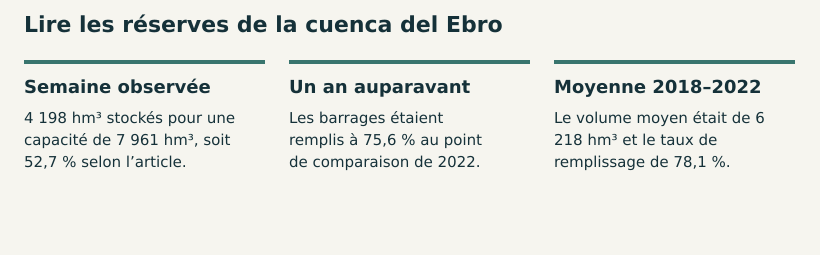

# ENS Paris-Saclay — Économie-gestion option 1 · Espagnol oral 2023 · Corrigé guidé

*Corrigé rédigé par IA, non officiel. Signalez toute erreur.*

**Rédaction** · GPT-6.2 Astra Ultra · vitesse non renseignée

Trente minutes de préparation précédaient trente minutes d’oral, dont environ douze minutes pour le compte rendu et le commentaire avant l’entretien. Le rapport annonce quatre textes et quatre enregistrements, puis parle de trois de chaque.

Les trois extraits de presse reproduits aux p. 3–6 sont traités intégralement dans les bornes imprimées. Pour l’audio, deux publications de DW portent les titres du jury. « Migrantes venezolanos » correspond à plusieurs archives possibles. Les bornes des sons et les questions prononcées restent inconnues. Le rapport ne permet pas d’identifier un éventuel quatrième texte ou enregistrement.

> [!INDICATION]
> Pendant la préparation, noter d’abord les acteurs, les lieux, les données datées et les liens entre les idées. Dans la présentation, annoncer ensuite la question que soulève le document et développer une réponse personnelle. Les relances sont des exercices d’interaction rédigés pour cette édition.

## Audio 1. Migrantes venezolanos

> [!INDICATION]
> Le rapport indique deux diffuseurs pour trois émissions, sans attribuer le premier thème à l’un d’eux. Un épisode du Washington Post d’octobre 2022 contient ces mots dans un titre plus long. Relevez le pays d’accueil et la période effectivement nommés si vous travaillez avec un enregistrement.

**Commentaire.** Una familia venezolana que se establece en una ciudad vecina y otra que atraviesa varios países en busca de protección pueden figurar bajo el mismo rótulo y necesitar respuestas diferentes. En una ciudad de acogida, cuestiones aparentemente administrativas como obtener un documento aceptado por un empleador, inscribir a un niño en la escuela o abrir una cuenta determinan si una familia puede organizar su vida a largo plazo. En un lugar de tránsito pesan antes la posibilidad de acceder a información fiable y a una atención inmediata.

El episodio del Washington Post del catorce de octubre de 2022 anuncia, entre varios asuntos, la relación entre migrantes venezolanos, Estados Unidos y México. Es un ejemplo de por qué la unidad de análisis importa. Un acuerdo entre gobiernos puede cambiar dónde espera una persona o si tiene acceso efectivo a un procedimiento. El número de llegadas a un país puede disminuir aunque aumente la dificultad de vivir en el país vecino. Evaluaría una respuesta regional observando tanto las condiciones en el lugar de llegada como la capacidad del migrante para documentar su situación, trabajar y reunirse con su familia. [Archive thématiquement proche du Washington Post](https://www.washingtonpost.com/podcasts/el-post/migrantes-venezolanos-eeuu-y-mxico-el-congreso-y-trump-adis-a-messi-cristiano-y-modric/)

**Relance proposée.** *¿Todos los venezolanos que salen del país tienen la misma condición jurídica?* No. Hay motivos y situaciones diferentes. Conviene distinguir el hecho de emigrar, la solicitud de protección y la decisión que finalmente toma la autoridad competente.

## Audio 2. Félix Maradiaga y el Premio al Valor 2023

> [!INDICATION]
> Séparez la distinction attribuée par des organisations de défense des droits humains, la condamnation prononcée au Nicaragua et les mesures qui ont suivi la détention. La notice de DW fournit un ordre des faits, sans reproduire le témoignage intégral.

**Compte rendu des éléments attribuables.** DW Español presenta al opositor nicaragüense Félix Maradiaga como galardonado con el Premio al Valor de 2023. La reseña recuerda la acusación formulada contra él en nombre de la integridad nacional, su privación de libertad durante 611 días, el aislamiento y, posteriormente, su expulsión y la pérdida de su nacionalidad. La distinción internacional llega cuando Maradiaga ya se encuentra fuera del país. La convocatoria de la Cumbre de Ginebra confirma por separado el nombre del galardón, el destinatario y la ceremonia prevista para el diecisiete de mayo. [Publication de DW](https://www.youtube.com/watch?v=vvkuaOOOxfY) · [Organisateurs du prix](https://genevasummit.org/25-human-rights-ngos-announce-freed-nicaraguan-opposition-leader-felix-maradiaga-to-receive-2023-courage-award/)

**Commentaire.** ¿Qué cambia un premio concedido en el exilio? Al dar un nombre y una trayectoria al problema, el reconocimiento facilita que la prensa extranjera escuche a una persona a quien su gobierno ha privado de la posibilidad de participar en la vida política nacional. Una ceremonia también puede poner en contacto a familias y organizaciones capaces de mantener la atención cuando se ha apagado el interés por una noticia.

Pero hay una diferencia entre visibilidad y restitución de derechos. Un premio no devuelve una nacionalidad ni establece por sí solo las condiciones para regresar. Tampoco debería reducir la pluralidad de las experiencias de exilio a la figura de un solo dirigente. Su efecto más duradero sería que las preguntas se mantuvieran después del homenaje. ¿Hay garantías para disentir? ¿Puede una persona obtener documentación y acudir a una autoridad independiente? Ahí se mide el alcance político de lo que un acto público hace visible.

**Relance proposée.** *¿Salir de la cárcel equivale a recuperar la libertad política?* La excarcelación cambia la situación personal de manera decisiva. Si va acompañada de expulsión y pérdida de nacionalidad, persisten restricciones que afectan a la residencia, la participación y la posibilidad de volver.

## Audio 3. Disputa entre el presidente y el fiscal general de Colombia

> [!INDICATION]
> Le mot *fiscal* désigne ici le chef du parquet colombien. La querelle institutionnelle avec Francisco Barbosa et le reportage de presse sur les tweets de Petro forment deux sujets distincts. Placez d’abord la question de compétence, puis la réaction politique.

**Compte rendu des éléments attribuables.** La publicación de DW Español del seis de mayo de 2023 se centra en una disputa entre el presidente colombiano Gustavo Petro y el fiscal general Francisco Barbosa. El desacuerdo adquirió una dimensión institucional cuando Petro afirmó que era el jefe del fiscal. La controversia enfrenta dos ideas que pueden parecer similares al oírlas deprisa. El presidente es jefe del Estado. De esa condición no se desprende que todas las autoridades estatales estén sometidas a sus órdenes en las decisiones que les corresponden. La Corte Suprema manifestó su preocupación por la interpretación presidencial, según la información paralela de DW. [Publication de DW](https://www.youtube.com/watch?v=Lt6lQDLmXRc) · [Réaction de la Cour suprême rapportée par DW](https://amp.dw.com/es/corte-suprema-de-colombia-petro-interpreta-erradamente-la-constituci%C3%B3n-en-disputa-con-fiscal/a-65533193)

**Commentaire.** La distinción interesa a un ciudadano aunque no comparta las posiciones de ninguno de los protagonistas. Si un fiscal investigara a personas próximas al Ejecutivo y tuviera que obedecer instrucciones del presidente sobre ese expediente, la imparcialidad quedaría en entredicho desde el comienzo. A la inversa, autonomía nunca debería significar ausencia de controles. Es legítimo pedir explicaciones sobre criterios públicos de actuación o sobre retrasos en la investigación sin ordenar qué conclusión debe alcanzar la autoridad investigadora.

Preferiría, por tanto, que un desacuerdo así se discutiera indicando el acto concreto, la norma que lo rige y el órgano autorizado para revisarlo. Personalizarlo en dos dirigentes facilita un titular, pero deja al ciudadano sin respuesta a la pregunta decisiva. Cuando ambos cargos estén ocupados por otras personas, ¿seguirán funcionando las mismas garantías?

**Relance proposée.** *¿Coordinarse implica obediencia?* No necesariamente. Dos organismos pueden intercambiar información o acordar procedimientos sin que uno decida el resultado de los expedientes que corresponden al otro.

## Texte 1. La sequía pasará a producirse uno de cada cuatro años con el cambio climático

> [!INDICATION]
> Le texte d’Ignacio Martín occupe les p. 3–4. Annoncez trois échelles de temps, la semaine observée, l’été agricole et la fréquence attendue à long terme. Un hectomètre cube mesure un volume et un taux de remplissage exprime la part de la capacité disponible.

**Compte rendu.** Ignacio Martín describe el tres de mayo de 2023 la situación de la cuenca del Ebro antes de un verano que agricultores y gestores del agua prevén muy difícil. La Confederación Hidrográfica se prepara para confirmar la situación excepcional de varias unidades territoriales. Paralelamente somete a consulta pública, hasta el treinta de junio, el borrador de un plan especial de sequía. Miguel Ángel García Vera distingue la intervención ante una escasez inmediata de las grandes decisiones de planificación. El plan especial proporciona indicadores, protocolos y posibles respuestas, desde repartos proporcionales hasta declaraciones extraordinarias. Actualiza un trabajo iniciado a raíz de las dificultades de los años noventa e incorpora nuevos embalses y ajustes territoriales.

Las cifras ayudan a entender la urgencia. Los embalses de la cuenca contienen 4.198 hectómetros cúbicos de una capacidad de 7.961. El 52,7 % de llenado queda muy por debajo del 75,6 % del año anterior y del 78,1 % de media del quinquenio 2018–2022. Hay diferencias en la margen derecha, donde el nivel supera el mínimo local de 2018. A más largo plazo, el autor señala una frecuencia histórica de sequía en España de un año de cada cinco y la posibilidad de que pase a uno de cada cuatro por el cambio climático. [Extrait du concours, p. 3–4](https://ens-paris-saclay.fr/sites/default/files/CONCOURS/ANNALES_1C/1C_D2_1/2023_EcoG1_rapport_oral_Espagnol.pdf#page=3)

**Commentaire.** ¿Por qué discutir las restricciones antes de saber exactamente cuánto lloverá? Cuando los usuarios conocen de antemano los indicadores que activan las medidas, pueden ajustar decisiones como la superficie sembrada y pedir explicaciones si la autoridad se aparta de sus reglas. A la vez, un único porcentaje para toda la cuenca ocultaría necesidades y reservas locales muy diferentes. La consulta pública permite que el agricultor, el municipio y quienes protegen los ecosistemas confronten esas diferencias antes de una emergencia. Su utilidad depende de que las reglas incluyan datos actualizados, un reparto explicable de los esfuerzos y la posibilidad de revisar una decisión cuando cambien las circunstancias.

**Relance proposée.** *¿Habrá entonces una sequía exactamente cada cuatro años?* No es un calendario. El 25 % describe una frecuencia estimada a largo plazo. Pueden darse dos sequías próximas o un intervalo más largo. El 52,7 % responde a otra pregunta, cuánto se encontraba almacenado en ese momento.

## Texte 2. Las familias que todavía no existen para el Estado peruano

> [!INDICATION]
> Aux p. 4–5, partez du contraste entre le lien quotidien de Carmen avec Victoria et les documents de l’enfant. Attribuez les pourcentages à l’étude citée. Le reportage situe la situation juridique au Pérou en mai 2023.

**Compte rendu.** Renzo Gómez Vega parte de un tatuaje de Carmen Arriola para mostrar una relación que no aparece en los papeles de Victoria. Carmen y Natalia Vega, casadas en Estados Unidos, recurrieron a una técnica de reproducción asistida en la que una aporta el óvulo y la otra lleva el embarazo. Natalia dio a luz en Lima en febrero de 2021. Carmen cría a Victoria, pero no figura como madre en su inscripción de nacimiento ni en su documento de identidad. Las dos eligieron Arriola como tercer nombre de la niña ante la imposibilidad de transmitirle el apellido de Carmen. El reportaje explica las consecuencias que podría tener esa falta de reconocimiento si Natalia falleciera, tanto para los cuidados como para la protección patrimonial de la familia.

El autor amplía la perspectiva con un estudio encargado a Ipsos por la asociación peruana de familias homoparentales y presentado al Congreso. Entre las familias estudiadas, un 56 % había sufrido discriminación en espacios públicos y un 45 % en su familia directa. Entre los niños, uno de cada diez había sido rechazado en centros escolares. El caso del profesor Martín Miranda y del pintor Eduardo Quispe incorpora a parejas sin hijos con un proyecto de vida común. Los dibujos realizados por hijos de las familias asociadas cierran el texto mostrando cómo los niños representan a quienes los cuidan. [Extrait du concours, p. 4–5](https://ens-paris-saclay.fr/sites/default/files/CONCOURS/ANNALES_1C/1C_D2_1/2023_EcoG1_rapport_oral_Espagnol.pdf#page=4) · [Article de Renzo Gómez Vega](https://elpais.com/internacional/2023-05-22/las-familias-que-todavia-no-existen-para-el-estado-peruano.html)

**Commentaire.** ¿Qué protege un documento de filiación? Mientras la familia puede organizar cada día sin contratiempos, parece que los afectos y el reparto de tareas bastan. Cuando ocurre una emergencia, el hospital, la escuela o un tribunal necesitan saber quién está autorizado a decidir por la niña. La distancia entre la vida cotidiana y el registro se convierte entonces en una incertidumbre que recae sobre ella. La historia personal permite ver lo que está en juego, mientras la encuesta muestra que el problema no se agota en un hogar. Para evaluar una reforma preguntaría primero si garantiza continuidad en los cuidados y claridad en los derechos de los hijos. Es una pregunta distinta de cuántos adultos deciden casarse en el extranjero.

**Relance proposée.** *¿Qué aporta el testimonio de Martín si no tiene hijos?* Amplía el significado de familia empleado por la asociación y muestra cómo se condiciona un proyecto futuro. Su experiencia como profesor también permite hablar de la visibilidad de distintos modelos de vida ante los alumnos.

## Texte 3. Petro y el alto costo de un ‘trino en falso’: los tropiezos del presidente en Twitter

> [!INDICATION]
> Dans le texte de Camila Osorio, daté du 19 mai 2023, « trino » désigne un tweet. Gardez le point de vue de cette date. Distinguez l’annonce prématurée, la source invoquée et la rectification. La suite historique du sauvetage serait un autre récit.

**Compte rendu.** Camila Osorio abre el artículo con el anuncio, posteriormente borrado, de que habían sido rescatados cuatro niños desaparecidos en la selva. El gobierno explicó que Gustavo Petro había recibido información del organismo de protección de la infancia, el ICBF. El presidente no la había confirmado con los responsables del rescate. Al día siguiente se retractó. Las familias reclamaron prudencia al mandatario y a los medios que difundieron la noticia. La periodista recuerda un precedente. El anuncio de un cese del fuego con el ELN dio por concluido un acuerdo que los negociadores no habían alcanzado.

El texto explica también por qué resulta atractiva esa forma de comunicación. Petro lleva años usando Twitter, quiere dirigirse a los ciudadanos sin intermediarios y considera que las redes dieron visibilidad a su proyecto político. Aunque, según el artículo, menos del diez por ciento de los colombianos usa la plataforma, los periodistas siguen al presidente y sus mensajes marcan la agenda. La Fundación para la Libertad de Prensa reconoce el valor de una comunicación directa y sus posibilidades pedagógicas. Critica, sin embargo, que se ataque públicamente a periodistas en vez de solicitar una rectificación por los cauces previstos. La ausencia de edición facilita la rapidez a costa de aumentar el riesgo de desinformación. [Extrait du concours, p. 5–6](https://ens-paris-saclay.fr/sites/default/files/CONCOURS/ANNALES_1C/1C_D2_1/2023_EcoG1_rapport_oral_Espagnol.pdf#page=5) · [Article de Camila Osorio](https://elpais.com/america-colombia/2023-05-19/petro-y-el-alto-costo-de-un-trino-en-falso-los-tropiezos-del-presidente-en-twitter.html)

**Commentaire.** ¿Puede un presidente escribir como un ciudadano cualquiera? La libertad de intervenir en el debate tiene valor, pero cambia el efecto de las palabras cuando quien escribe dirige instituciones. En un rescate, una noticia prematura puede llegar a la familia antes que una comunicación oficial. Borrar el mensaje impide que siga en la cuenta original, pero no retira las capturas ni los titulares que ya circulan. Un procedimiento sencillo consistiría en indicar qué equipo confirmó el hecho y publicar una corrección suficientemente visible cuando se cometió un error. También distinguiría las explicaciones de una reforma, sobre la que el presidente puede defender su criterio, de las noticias sobre operaciones cuyo resultado depende de información aún incompleta. Esa distinción preservaría el acceso directo sin convertir la velocidad en el único criterio editorial.

**Relance proposée.** *Si pocas personas utilizan la plataforma, ¿por qué importa un error?* Porque los intermediarios no desaparecen. Un periodista puede reproducir el mensaje en radio o televisión y multiplicar su alcance antes de que el desmentido llegue a quienes oyeron la primera versión.

[Rapport du jury](https://ens-paris-saclay.fr/sites/default/files/CONCOURS/ANNALES_1C/1C_D2_1/2023_EcoG1_rapport_oral_Espagnol.pdf)
