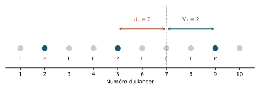
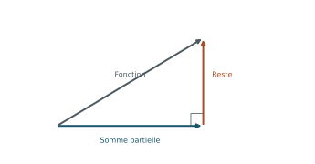

# ENS Paris-Saclay, économie et gestion option 1 — Mathématiques et statistiques 2023 · Corrigé guidé

*Corrigé rédigé par IA, non officiel. Signalez toute erreur.*

**Rédaction** · GPT-6.2 Astra Ultra · vitesse non renseignée

**Révision (tour 1)** · GPT-6.2 Astra Ultra · vitesse non renseignée

Les trois problèmes indépendants portent sur des coordonnées matricielles, les temps d’attente entre piles et les sommes partielles de Fourier. Le deuxième problème autorise aussi les pièces déterministes.

## Problème 1 · Algèbre

### Question 1

> [!INDICATION]
> Exploiter les coefficients diagonaux de la combinaison nulle.

#### Solution

La famille engendre $F$ par définition. Supposons $aA+bB+cC=0$. Les coefficients diagonaux donnent successivement $b-2c=0$, $-b+c=0$ et $a+b=0$. Les deux premières identités forcent $b=c=0$, puis $a=0$. La famille est donc libre et constitue une base de $F$, de dimension trois.

### Question 2

> [!INDICATION]
> Calculer le carré et identifier la combinaison des trois matrices.

#### Solution

Le produit matriciel donne
$$C^2=\begin{pmatrix}4&0&0\\-3&1&0\\4&0&0\end{pmatrix}=6A-6B-5C.$$
On retrouve les coefficients par la diagonale, puis on vérifie l’égalité sur les entrées hors diagonale. Ainsi $C^2\in F$ de coordonnées $(6,-6,-5)$ dans $\mathcal B$.

### Question 3

> [!INDICATION]
> Écrire les trois nouveaux éléments dans la base déjà connue.

#### Solution

Les colonnes représentant $N_1,N_2,N_3$ dans $\mathcal B$ sont $(1,-1,-1)^T,(2,-2,-1)^T,(1,0,0)^T$. Leur déterminant vaut $(-1)(-1)-(-2)(-1)=-1$. Les trois vecteurs sont donc libres dans un espace de dimension trois et y forment une base.

### Question 4

> [!INDICATION]
> La matrice de passage convertit les coordonnées nouvelles en anciennes.

#### Solution

La convention des colonnes donne
$$P=\begin{pmatrix}1&2&1\\-1&-2&0\\-1&-1&0\end{pmatrix},\qquad
P^{-1}=\begin{pmatrix}0&1&-2\\0&-1&1\\1&1&0\end{pmatrix}.$$
Pour calculer l’inverse, résolvons $a=x+2y+z$, $b=-x-2y$, $c=-x-y$. On en tire $y=c-b$, $x=b-2c$ puis $z=a+b$, ce qui donne bien les lignes affichées.

### Question 5

> [!INDICATION]
> Appliquer la matrice dans le sens approprié.

#### Solution

On a $(a,b,c)^T=P(x,y,z)^T$. La multiplication par $P^{-1}$ donne $x=b-2c$, $y=c-b$, $z=a+b$. En substituant dans $xN_1+yN_2+zN_3$, les coefficients de $A,B,C$ redeviennent $a,b,c$.

## Problème 2 · Probabilités et statistiques

### Question 1

> [!INDICATION]
> Compter les succès parmi n lancers indépendants.

#### Solution

La somme $S_n$ compte les piles des $n$ premiers lancers. Les variables indicatrices étant indépendantes de même paramètre $p$, $S_n\sim\mathcal B(n,p)$. Plus précisément $\mathbb P(S_n=m)=\binom nm p^mq^{n-m}$ pour $0\le m\le n$, car chaque arrangement a la même probabilité, et zéro ailleurs. Si $p=0$ ou $1$, la somme est déterministe, égale à $0$ ou $n$.

### Question 2

> [!INDICATION]
> Compter les faces qui précèdent la première pile et traiter les paramètres extrêmes.

#### Solution

Pour $p>0$ et $i\ge1$, l’événement exige $i-1$ faces puis une pile, donc $\mathbb P(T_1=i)=q^{i-1}p$. La loi est géométrique sur $\mathbb N^*$, d’espérance $\sum_{k\ge0}\mathbb P(T_1>k)=\sum_{k\ge0}q^k=1/p$. Si $p=1$, $T_1=1$. Si $p=0$, il n’y a jamais de pile et $T_1=+\infty$ presque sûrement en adoptant la convention usuelle pour un temps d’attente non réalisé.

### Question 3a

> [!INDICATION]
> Repérer le premier succès après le k-ième succès déjà observé.

#### Solution

Pour $p>0$, les succès arrivent presque sûrement en temps fini. $T_{k+1}-T_k$ compte les lancers après la $k$-ième pile jusqu’à la suivante, en incluant le lancer de cette nouvelle pile. Pour $k=0$ c’est $T_1$. Pour $p=0$, les temps positifs $T_k$ sont infinis et la différence de deux de ces temps n’est pas définie.

### Question 3b

> [!INDICATION]
> Décrire la suite des résultats jusqu’au dernier temps prescrit.

#### Solution

Si les entiers vérifient $1\le t_1<\cdots<t_m$, il faut une pile aux $m$ instants désignés et une face à chacun des $t_m-m$ autres instants jusqu’à $t_m$. L’indépendance donne $p^m q^{t_m-m}$. Lorsque $0<p<1$, ceci vaut $(p/q)^m q^{t_m}$ comme dans le sujet. Pour tous autres temps finis, la probabilité est nulle. À $p=1$, seuls $t_j=j$ pour tous les $j$ conviennent, avec probabilité un. À $p=0$ et $m\ge1$, toute prescription finie a probabilité nulle.

### Question 4

> [!INDICATION]
> Sous le conditionnement, tous les choix de m positions de piles sont équiprobables.

#### Solution

Pour un choix valide $1\le t_1<\cdots<t_m\le n$, l’intersection $A\cap B$ prescrit toute la suite des $n$ premiers lancers. Pour $0<p<1$, sa probabilité est $p^m q^{n-m}$ et $\mathbb P(A)=\binom nm p^m q^{n-m}$. Ainsi $\mathbb P(B\mid A)=1/\binom nm$. Des temps répétés donnent zéro. Pour $m=0$, la prescription vide est certaine. Aux extrêmes, le conditionnement n’existe que pour $m=0$ si $p=0$ ou $m=n$ si $p=1$ : la seule configuration possible a alors probabilité un.

### Question 5

> [!INDICATION]
> Séparer le rang d’apparition d’une pile et le numéro du lancer.

#### Solution

Pour $p>0$, $T_{S_n}$ est le numéro du dernier lancer pile **au plus** égal à $n$, avec $T_0=0$ si aucune pile n’a encore été vue. $T_{S_n+1}$ est le numéro du premier lancer pile strictement postérieur à $n$. La différence est la longueur de l’intervalle entre ces deux instants, avec l’origine comme borne si $S_n=0$. Si $p=0$, ils valent respectivement $0$ et $+\infty$.

### Question 6a

> [!INDICATION]
> Distinguer la présence d’une dernière pile passée et l’absence totale de pile passée.

#### Solution

Pour $0\le i<n$, $j\ge1$, il faut des piles à $n-i$ et $n+j$, et des faces à tous les $i+j-1$ lancers entre elles. Le passé antérieur est libre. Donc $\mathbb P(U_n=i,V_n=j)=p^2q^{i+j-1}$. Si $i=n$, les $n$ premiers lancers sont des faces, suivis de $j-1$ autres faces puis d’une pile. On obtient $pq^{n+j-1}$. Pour $p=1$, le seul couple est $(0,1)$ ; pour $p=0$, il est $(n,+\infty)$.

### Question 6b

> [!INDICATION]
> Sommer sur l’autre coordonnée en laissant à part la masse terminale.

#### Solution

Pour $0<p<1$, la sommation sur $j\ge1$ donne $\mathbb P(U_n=i)=pq^i$ pour $0\le i<n$ et $\mathbb P(U_n=n)=q^n$. La sommation sur $i$ donne
$$\mathbb P(V_n=j)=pq^{j-1}\left(\sum_{i=0}^{n-1}pq^i+q^n\right)=pq^{j-1}.$$
On retrouve aussi cette loi en ne regardant que les lancers postérieurs à $n$. À $p=1$, $U_n=0,V_n=1$ ; à $p=0$, $U_n=n,V_n=+\infty$.

### Question 6c

> [!INDICATION]
> Factoriser la loi conjointe ou utiliser les deux séries séparées de lancers.

#### Solution

Pour $p>0$, les probabilités de 6a sont exactement les produits des marginales de 6b, aussi bien pour $i<n$ que pour $i=n$. Les variables sont indépendantes. En effet $U_n$ ne dépend que des $n$ premiers lancers et $V_n$ des lancers suivants. L’indépendance vaut encore pour les deux variables déterministes dans les cas extrêmes.

### Question 7

> [!INDICATION]
> Écrire l’intervalle complet comme somme de son passé et de son futur puis utiliser les probabilités de queue.

#### Solution

Par définition $T_{S_n+1}-T_{S_n}=U_n+V_n$. Pour $1\le k\le n$, $U_n\ge k$ signifie que les $k$ derniers lancers sont des faces. Ainsi pour $p>0$,
$$\mathbb E[U_n]=\sum_{k=1}^{n}q^k=\frac{q(1-q^n)}p,\qquad
\mathbb E[T_{S_n+1}-T_{S_n}]=\frac{1+q(1-q^n)}p.$$
La différence avec $\mathbb E[T_1]=1/p$ est strictement positive pour $0<p<1$ et nulle pour $p=1$. Si $p=0$, les deux temps comparés valent $+\infty$ presque sûrement. Pour $0<p<1$ fixé, la longueur moyenne de l’intervalle contenant l’instant $n$ tend vers $(1+q)/p=(2-p)/p$. Choisir un instant favorise les longs intervalles. Dans le calcul, le supplément est exactement la moyenne du temps déjà écoulé depuis la dernière pile.

## Problème 3 · Analyse

### Question 1

> [!INDICATION]
> Ajouter ou retrancher les formules de somme et différence.

#### Solution

La parité des fonctions trigonométriques donne $\cos(a-b)=\cos a\cos b+\sin a\sin b$ et $\sin(a-b)=\sin a\cos b-\cos a\sin b$. En ajoutant les deux cosinus puis en soustrayant les deux sinus, on trouve
$$\cos a\cos b=\tfrac12[\cos(a+b)+\cos(a-b)],\qquad
\cos a\sin b=\tfrac12[\sin(a+b)-\sin(a-b)].$$

### Question 2

> [!INDICATION]
> Intégrer chaque fréquence et isoler la fréquence nulle.

#### Solution

Pour $k\in\mathbb Z$, $\pi^{-1}\int_{-\pi}^{\pi}\cos(kx)\,dx$ vaut $2$ si $k=0$, et $0$ sinon. L’intégrale de $\sin(kx)$ est toujours nulle par imparité. La première formule de 1 et $\sin a\sin b=(\cos(a-b)-\cos(a+b))/2$ donnent donc $\langle c_n,c_m\rangle=\langle s_n,s_m\rangle=0$ pour $n\ne m$, et ces deux produits valent un pour $n=m>0$. Si $n=m=0$, les résultats sont $2$ pour les cosinus et $0$ pour les sinus. Enfin $c_n s_m$ est impair, donc $\langle c_n,s_m\rangle=0$ pour tous $m,n$.

### Question 3

> [!INDICATION]
> Identifier la parité de chacun des produits intégrés.

#### Solution

Si $f$ est paire, $f(x)\sin(mx)$ est impaire et son intégrale sur $[-\pi,\pi]$ est nulle, donc $b_{m,f}=0$ pour $m>0$ et $b_{0,f}=0$ par convention. Si $f$ est impaire, les produits $fc_m$ sont impairs, y compris $f$ seul pour $m=0$, donc tous les $a_{m,f}$ sont nuls.

### Question 4a

> [!INDICATION]
> Vérifier la continuité et la période commune de chaque terme.

#### Solution

Pour $m$ entier, les fonctions $x\mapsto\cos(mx),\sin(mx)$ sont continues et $2\pi$-périodiques, car $2m\pi$ est un multiple entier de leur période en l’argument. Une constante et les sommes finies conservent ces propriétés. Ainsi $g\in C_{2\pi}$.

### Question 4b

> [!INDICATION]
> Prendre successivement les produits avec le cosinus et le sinus d’un rang fixé.

#### Solution

Par linéarité et 2, pour $1\le k\le n$, seuls le terme $a_k c_k$ dans $\langle g,c_k\rangle$ et le terme $b_k s_k$ dans $\langle g,s_k\rangle$ survivent. D’où $a_{k,g}=a_k$, $b_{k,g}=b_k$. Enfin $a_{0,g}=\langle g,1\rangle/2=a_0$ puisque $\langle1,1\rangle=2$. L’éventuel coefficient $b_0$ de la liste ne figure pas dans $g$.

### Question 5a

> [!INDICATION]
> Développer le carré en utilisant les normes correctes des fonctions de base.

#### Solution

Les termes de la somme partielle $S_n(f)$ sont deux à deux orthogonaux, y compris la constante. Puisque $\|1\|^2=2$ et $\|c_m\|^2=\|s_m\|^2=1$ pour $m\ge1$, on obtient
$$\|S_n(f)\|^2=2a_{0,f}^2+\sum_{m=1}^n(a_{m,f}^2+b_{m,f}^2).$$

### Question 5b

> [!INDICATION]
> Quels coefficients de Fourier du reste s’annulent ?

#### Solution

Par 4b, $f-S_n(f)$ a ses coefficients jusqu’à $n$ nuls. Il est donc orthogonal à $1$ et aux $c_m,s_m$ pour $1\le m\le n$. Par bilinéarité $\langle f-S_n(f),S_n(f)\rangle=0$. En développant la norme de $f=(f-S_n(f))+S_n(f)$, on obtient $\|f\|^2=\|S_n(f)\|^2+\|f-S_n(f)\|^2$.

### Question 5c

> [!INDICATION]
> Supprimer un terme positif puis tenir compte de la demi-normalisation.

#### Solution

La norme carrée du reste est positive ou nulle, donc $\|S_n(f)\|^2\le\|f\|^2$. À cet ordre $n$ fixé, on a égalité exactement quand $f=S_n(f)$ : si l’intégrale du carré de la différence est nulle, la continuité impose son annulation partout. En divisant par deux et en appliquant 5a, on trouve
$$a_{0,f}^2+\tfrac12\sum_{m=1}^n(a_{m,f}^2+b_{m,f}^2)\le\frac1{2\pi}\int_{-\pi}^{\pi} f(x)^2\,dx.$$

### Question 5d

> [!INDICATION]
> Utiliser la convergence monotone d’une suite réelle de sommes partielles majorées.

#### Solution

La suite $\sum_{m=1}^n(a_{m,f}^2+b_{m,f}^2)$ est croissante et majorée d’après 5c. Elle converge vers une limite finie. Le passage à la limite dans 5c donne l’inégalité de Bessel avec la normalisation imprimée,
$$a_{0,f}^2+\tfrac12\sum_{m=1}^\infty(a_{m,f}^2+b_{m,f}^2)\le\frac1{2\pi}\int_{-\pi}^{\pi}f(x)^2\,dx.$$
