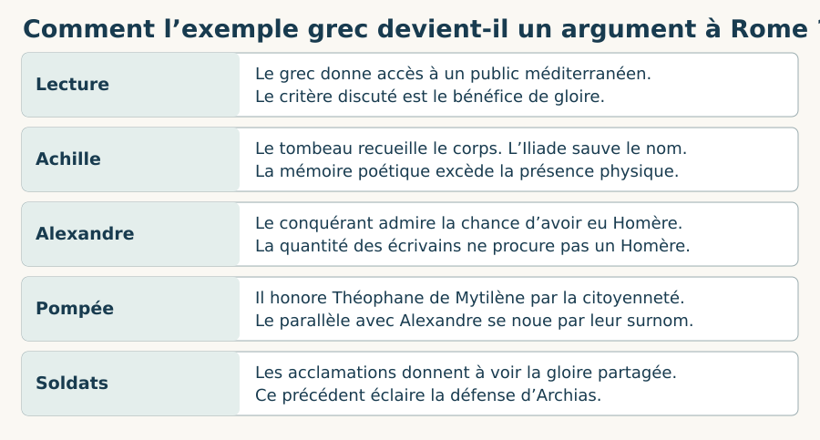

# ENS-PSL · CNEL Lettres — Cicéron — le Pro Archia 2023 · Corrigé guidé

*Corrigé rédigé par IA, non officiel. Signalez toute erreur.*

**Rédaction** · GPT-6.2 Astra Ultra · vitesse non renseignée

**Autocontrôle** · GPT-6.2 Astra Ultra · vitesse non renseignée

## Quel problème pose la langue grecque au tribunal ?

Le client est un poète grec dont la citoyenneté romaine est discutée. Expliquez comment l’avocat passe d’une question de droit à un argument d’opportunité culturelle. Trois mouvements sont lisibles sur la page : aire de diffusion des langues, tombeau d’Achille, citoyenneté accordée à Théophane.

1. **Que compare le premier mouvement ?** Le public accessible, puis le bénéfice de renommée. La phrase ne classe pas la qualité des deux poésies. Conservez l’atténuation de *fere*.
2. **Pourquoi Alexandre envie-t-il Achille alors qu’il a de nombreux écrivains ?** Le nombre ne garantit ni la qualité ni la postérité d’une œuvre. Le monument enferme un corps, l’*Iliade* fait survivre un nom.
3. **Qui se cache derrière *noster hic Magnus* ?** La note du sujet identifie Pompée. Le passage du surnom grec au surnom romain prépare une comparaison entre deux attitudes à l’égard des auteurs.
4. **Qui reçoit la citoyenneté et qui la défend en justice ?** Théophane reçoit celle que Pompée lui accorde dans l’exemple. Dans la cause présente, Cicéron défend Archias. La valeur argumentative du précédent ne remplace pas la preuve juridique du dossier.

Terminez par les soldats et *quasi*. L’orateur fait de l’acclamation une preuve que la littérature contribue à une gloire partagée. Cela répond à la seconde partie de la consigne sur la place de la littérature dans les deux sociétés.

## La littérature grecque, relais et juge de la gloire romaine

En 62 avant notre ère, Cicéron défend Archias, poète grec dont le droit de cité romain est contesté. Au paragraphe 23, il ne produit pas un acte d’état civil. Il prend au sérieux une objection de valeur : un poète qui célèbre des actions romaines dans une autre langue serait-il moins utile qu’un poète latin ? Pour que le jugement soit favorable à son client, Cicéron montre que l’extension du grec répond aux ambitions de Rome, puis il retourne la relation de dépendance entre l’homme d’action et celui qui raconte, avant de faire du précédent de Pompée un modèle pour le public romain.

### L’extension des langues se mesure à celle des publics

Le premier *si quis* construit un contradicteur hypothétique. L’adversaire supposé mesure la valeur des vers à l’origine de leur langue. Cicéron choisit un autre critère, le *fructus gloriae*, le fruit qu’une action peut tirer de la gloire. Les deux verbes de la phrase dessinent des géographies opposées : les écrits grecs sont lus presque partout, les textes latins restent contenus à l’intérieur de limites étroites. L’adverbe *fere* tempère l’universalité affirmée. Dans la Méditerranée de la fin de la République, la diffusion du grec parmi les publics lettrés permet d’atteindre des lecteurs qui ne lisent pas couramment le latin. L’orateur grossit le contraste pour les besoins de sa cause. Ce serait un contresens de lui faire prononcer un jugement d’infériorité esthétique de la poésie latine ou de reprendre cette géographie comme une statistique des alphabétisés.

La période suivante transforme le constat en obligation collective. La première personne du pluriel de *gessimus* inclut les auditeurs dans les actions de Rome. De l’étendue attribuée à ces actions, Cicéron conclut à l’étendue souhaitable de la renommée : *quo ... eodem* apparie les lieux atteints par les armes et ceux que devra atteindre la gloire. Le succès politique ne garantit pas sa propre intelligibilité auprès d’autres peuples. Les vers d’un Grec répondent à ce besoin spécifiquement romain de reconnaissance. Ils contribuent également, selon l’avocat, à inciter des individus à affronter peines et périls. Le récit agit ainsi en aval de l’exploit par la mémoire qu’il conserve, en amont par la récompense qu’il rend imaginable.

### Alexandre reconnaît que le poète donne une seconde vie à l’action

L’exemple d’Alexandre précise ce que la seule extension géographique ne permettait pas de penser. Beaucoup d’écrivains l’entourent, mais devant le tombeau d’Achille à Sigée il envie au héros d’avoir eu Homère. Le discours direct donne la parole à un conquérant glorieux pour qu’il désigne lui-même celui dont dépend sa gloire. Le mot *praeco*, héraut, semblerait réduire le poète à la fonction de faire connaître une valeur déjà complète. L’hypothèse irréelle qui suit lui confère un pouvoir plus profond. Sans l’*Iliade*, le même tombeau qui a recouvert le corps aurait aussi enseveli le nom. La disparition physique n’a lieu qu’une fois, tandis que l’œuvre fait survivre une action dans des publics toujours futurs.

Le poète cesse alors d’être un simple employé de la renommée. Alexandre peut choisir les écrivains de sa suite, mais il ne peut s’assurer un Homère en les multipliant. La grandeur du texte relève d’une puissance que l’homme d’action admire sans la commander. Cicéron ne développe pas une doctrine de l’indépendance des arts. Il en fait ici assez sentir la nécessité pour convaincre le tribunal qu’honorer un poète sert des intérêts que l’action militaire, laissée à elle-même, ne pourrait atteindre.

### De l’épitaphe homérique à la citoyenneté du poète

Le passage d’Alexandre le Grand à *noster hic Magnus* tire parti d’un même surnom. Le Grand qui appartient au monde romain, c’est Pompée. Il a donné en assemblée militaire la citoyenneté à Théophane de Mytilène, auteur d’un récit de ses actes. L’exemple complète celui d’Achille. Après avoir montré ce que le héros reçoit de la poésie, Cicéron montre ce que la cité peut accorder en retour à un écrivain grec. La concession de Pompée ne prouve pas à elle seule la situation juridique d’Archias. Elle rend cependant difficile, devant des auditeurs soucieux de gloire romaine, de traiter sa qualité de poète grec comme une raison de le tenir à distance.

Le trait final porte sur les soldats. L’orateur les présente comme courageux mais peu lettrés. Ils acclament pourtant la distinction accordée à Théophane, parce qu’ils se sentent *quasi participes*, comme associés à la même louange. L’atténuation importe. Chacun ne devient pas littéralement héros du livre. Mais la littérature fait d’une mémoire réservée au commandant un bien dont la communauté peut éprouver la « douceur ». Elle institue un public solidaire jusque parmi ceux qui ne liront peut-être pas le texte grec. Ce que le plaidoyer propose est donc un échange inégal et réciproque : Rome peut ouvrir sa citoyenneté et fournir des sujets au récit, la culture grecque lui donne des lecteurs, des modèles et une durée. Cicéron le démontre dans un discours latin rempli de mémoire grecque, donnant dans sa propre pratique une forme à leur alliance.

[Sujet officiel](https://www.ens.psl.eu/sites/default/files/sc.antiquite-cnel-10.pdf)
