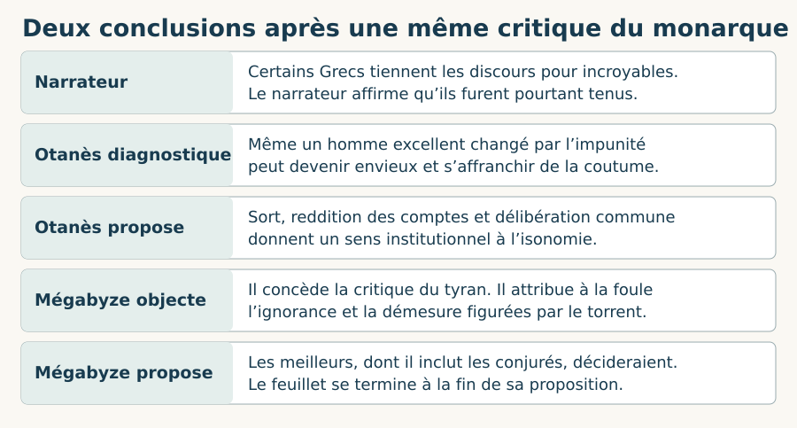

# ENS-PSL · CNEL Lettres — Hérodote — le débat sur les régimes politiques 2023 · Corrigé guidé

*Corrigé rédigé par IA, non officiel. Signalez toute erreur.*

**Rédaction** · GPT-6.2 Astra Ultra · vitesse non renseignée

**Autocontrôle** · GPT-6.2 Astra Ultra · vitesse non renseignée

## Lire le débat effectivement reproduit

Marquez les frontières des voix : avertissement du narrateur, discours d’Otanès, transition attributive, discours de Mégabyze, phrase de clôture. Le cadre annonce Darius et la référence imprimée couvre III, 80-82, mais la page donnée se termine sur Mégabyze. Ce qui arrive ensuite ne doit pas remplacer le commentaire du texte.

1. **Otanès s’en prend-il seulement au caractère de Cambyse ?** Son hypothèse porte sur le meilleur homme placé en situation de ne rendre aucun compte. Il propose ensuite une institution qui exige précisément de rendre des comptes.
2. **Que désigne l’isonomie dans ce passage ?** Relevez les trois indices concrets : sort, responsabilité et délibération commune. Discutez ensuite la valeur du nombre.
3. **Mégabyze réfute-t-il l’accusation de tyrannie ?** Il la reprend. Sa critique vise le remède populaire, auquel il attribue ignorance et démesure. L’image du torrent a valeur d’argument et de disqualification.
4. **Qui choisira les meilleurs ?** La proposition est adressée aux conjurés et Mégabyze les inclut dans l’élite envisagée. L’incise articule le principe d’excellence et l’intérêt de l’auditoire.

Pour prolonger en recherche, choisissez un autre discours rapporté, identifiez la voix qui emploie ses catégories et demandez quel public elle veut convaincre. Distinguez cette proposition de travail des observations déjà établies sur les deux pages.

## À qui confier les affaires communes ?

Hérodote interrompt le récit de la succession perse pour faire entendre une délibération. Le cadre fourni par le sujet situe la scène après la mort de Cambyse et la chute du mage. Le feuillet annonce *Histoires* III, 80-82 ; l’extrait effectivement reproduit va du préambule narratif aux dernières paroles de Mégabyze et à la phrase qui les clôt. Darius et sa défense de la monarchie appartiennent à l’horizon de la scène. Le lecteur n’en lit pas le discours. L’enjeu du morceau imprimé est de faire comprendre comment deux adversaires du pouvoir d’un seul peuvent tirer d’expériences communes des institutions opposées.

Le narrateur commence par mettre ses lecteurs au défi. Certains Grecs, dit-il, jugent ces paroles incroyables. La répétition verbale par laquelle il maintient qu’elles ont été prononcées ne fait pas de lui un sténographe présent en Perse. Elle place le débat dans l’enquête sur ce qui peut être cru, rapporté et pensé d’un peuple étranger. Pour un auditeur qui rattacherait volontiers la discussion constitutionnelle aux seules cités grecques, l’attribution à des Perses mérite d’être soulignée. Reconnaître dans le texte des catégories grecques de délibération politique ne suffit pas non plus à démontrer que toute discussion sur le gouvernement aurait été impossible en Perse. Hérodote compose une scène où ses lecteurs doivent travailler simultanément sur la forme du récit et sur les arguments qu’il prête aux protagonistes.

Otanès propose de déposer les affaires au milieu des Perses, *es meson*. Il commence par deux souvenirs auxquels le groupe a part, l’orgueil de Cambyse et l’expérience récente du pouvoir du mage. Il ne conclut pas simplement que deux hommes mauvais se sont succédé. Même le meilleur des hommes placé en position de faire ce qu’il veut sans rendre de comptes se trouverait, selon lui, déplacé hors de ses dispositions ordinaires. Une institution produit donc des effets sur le caractère. La prospérité nourrit la *hybris*, l’envie s’attaque à toute valeur rivale. Le paradoxe du souverain que l’on offense en l’admirant trop peu et que l’on irrite en le flattant trop montre l’impossibilité de satisfaire une volonté sans règle. Le tableau s’achève sur le bouleversement des coutumes, les violences et les condamnations sans jugement. L’arbitraire se lit dans ce qu’il fait aux autres.

À cette absence de contrôle répond le terme d’*isonomia*. L’éloge de son beau nom est suivi de dispositions déterminées : les charges se distribuent par le sort, leur exercice doit faire l’objet d’une reddition de comptes et les délibérations reviennent au commun. Le deuxième trait répond exactement au défaut initial du pouvoir monarchique. L’égalité en cause acquiert un sens institutionnel, bien au-delà de l’addition des préférences d’une foule. Otanès lie ainsi le nombre à des procédures capables d’empêcher qu’un détenteur de charge confonde sa volonté avec le bien commun. Son argument donne sa force à l’appel final au grand nombre, sans que le détail des procédures d’une cité grecque puisse être simplement projeté sur la Perse historique.

Mégabyze commence en faisant sien ce qu’Otanès vient de dire contre la tyrannie. Cette concession concentre la dissidence sur le passage du diagnostic à la solution. La foule, à ses yeux, peut reproduire la démesure du monarque et y ajouter l’ignorance. Le despote sait au moins ce qu’il fait, tandis que le grand nombre ne saurait agir en connaissance de cause. L’image d’un torrent rend sensible l’action impétueuse qu’aucun jugement ne dirige. Elle transforme le peuple équipé par Otanès de procédures en une multitude sans instruction ni expérience : les deux hommes ne nomment déjà plus le même collectif. Le premier raisonne sur l’organisation de la décision, le second sur la qualité supposée des décideurs. Aussi Mégabyze peut-il retourner le refus de l’arbitraire contre le gouvernement populaire lui-même.

L’oligarchie qu’il propose doit réunir les meilleurs pour obtenir les meilleures délibérations. Le rapprochement lexical d’*aristoi* et des meilleures décisions condense l’inférence. Mais il reste à expliquer comment reconnaître les meilleurs, et le propos reconnaît que les conjurés eux-mêmes seraient du nombre. Cette incise peut être lue comme argument de persuasion à l’adresse d’un groupe choisi et comme indice des intérêts engagés dans la définition de l’excellence. Hérodote ne tranche pas la querelle en son propre nom. Les formules narratives qui attribuent successivement à chacun son avis préservent la pluralité des positions. L’histoire politique devient une enquête sur la façon dont des groupes qualifient leurs propres prétentions à décider.

Un projet de recherche pourrait comparer les mots du nombre et de la qualité dans d’autres discours rapportés des *Histoires*. Il s’agirait de distinguer les qualifications du narrateur de celles des orateurs, de noter les destinataires, et de rechercher quand une même collectivité devient « peuple », « multitude » ou conseil des meilleurs. Cette enquête permettrait d’étudier la circulation de catégories politiques grecques dans une histoire des Perses sans réduire l’extrait ni à une constitution documentaire ni à une simple profession de foi d’Hérodote.

[Sujet officiel](https://www.ens.psl.eu/sites/default/files/sc.antiquite-cnel-8.pdf)
