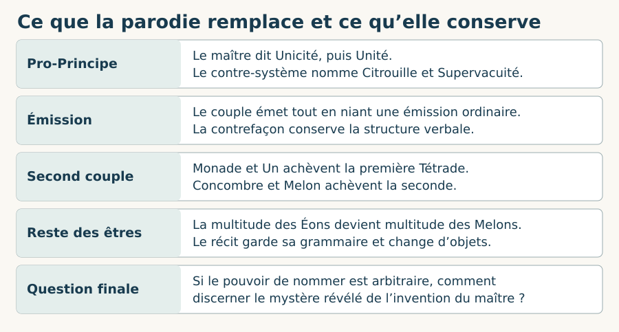

# ENS-PSL · CNEL Lettres — Irénée de Lyon — commentaire latin 2023 · Corrigé brut

*Corrigé rédigé par IA, non officiel. Signalez toute erreur.*

**Rédaction** · GPT-6.2 Astra Ultra · vitesse non renseignée

**Autocontrôle** · GPT-6.2 Astra Ultra · vitesse non renseignée

## Du principe innommable au melon : expliquer la réfutation dans le témoin latin

Dans le livre I du *Contre les hérésies*, Irénée rapporte les variantes de l’enseignement valentinien. I, 11, 3 s’ouvre sur un maître réputé parmi « eux », non sur une prise de parole directe de Valentin lui-même. L’auteur écrit en grec au IIe siècle, mais la version continue remise au candidat est une traduction latine ancienne accompagnée de la traduction française d’Adelin Rousseau. Le texte latin fait d’abord entendre un discours de haute spéculation, le reprend ensuite pour en isoler l’acte de nomination, puis en conserve presque intacte la construction en lui substituant des légumes. Cette parodie demande à être lue comme une épreuve de la prétention à dire vrai.

La phrase d’introduction présente le maître dans une posture d’élévation : *in maius sublime* et *in maiorem agnitionem* redoublent l’idée de progrès que le détenteur de la gnose revendique. Le qualificatif *clarus* attribue cette réputation à son milieu ; le flottement du *quasi* laisse déjà entendre la distance du rapporteur. La voix rapportée décrit ensuite un Pro-Principe antérieur à tout, inaccessible à la pensée, à l’énoncé et au nom. Les formes négatives s’accumulent jusqu’à *innominabilis*. Immédiatement arrive *quam ego Monotetam uoco*. La syntaxe fait succéder le verbe personnel « j’appelle » au caractère innommable de son objet. L’adversaire pourrait répondre qu’un nom technique indique un mystère sans le définir. Irénée va contester le privilège qui garantirait à ses seules indications une valeur de vérité.

Le premier couple, Unicité et Unité, émet un Principe, la Monade, à laquelle coexiste une puissance de même substance, l’Un. La traduction latine conserve une partie des noms grecs. L’effet tient autant à la proximité de sens entre les quatre termes qu’à l’insistance sur leurs différences. Il faut individualiser quatre puissances toutes nommées à partir de l’un. La formule redoublant l’émission et sa négation, *emiserunt, cum nihil emiserint*, tente de séparer l’engendrement des puissances d’une émission qui ferait perdre quelque chose au premier couple. On peut y reconnaître un effort pour penser une origine sans division. Dans le mouvement polémique, la répétition met surtout à nu un langage dont aucune expérience ordinaire ne semble pouvoir éprouver les distinctions. Le paragraphe se clôt sur la série des quatre noms, puis sur l’émission du reste des Éons. L’accumulation avait donc une portée explicative revendiquée : elle décrit les premiers termes d’une généalogie du divin.

Le paragraphe 4 change brusquement de voix et de registre. *Iu iu! et pheu pheu!* emprunte la plainte à la scène tragique. L’affect est délibérément trop grand pour l’objet dénoncé, une fabrication de noms. Irénée feint de n’avoir d’autre ressource que de gémir, puis raisonne très précisément. Il prélève dans le discours de l’autre les deux formules à la première personne et les retourne contre lui. Dire « j’appelle » deviendrait un aveu : celui qui s’exprime aurait lui-même posé sur une fiction des noms que personne n’employait. *Figmenta* et *figmento* font passer l’opération de dénommer à l’accusation d’avoir fabriqué les objets mêmes qu’on nomme. La pointe temporelle qui suit en fait sentir l’invraisemblance. À le croire, la vérité attendait jusqu’à aujourd’hui qu’un maître assez audacieux lui donne un nom. L’argument tire sa force du contraste entre l’antériorité absolue du principe et l’arrivée historiquement tardive de son inventeur supposé.

*Nihil igitur prohibet* annonce une contre-expérience. Un autre pourrait déployer une généalogie de même forme. Irénée conserve le Pro-Principe, redouble jusqu’à l’excès les préfixes de la langue savante, puis prononce *Cucurbitam uoco*. La Citrouille et la Supervacuité correspondent au premier couple. Leur produit, *Cucumis*, le Concombre, est décrit comme visible, bon à manger et doux. Au lieu de l’intelligible, inengendré et invisible, le lecteur peut se représenter un fruit qu’il goûterait. À ce Concombre est associé *Pepo*, le Melon. Les « Melons » finaux remplacent la multitude des Éons. La proximité sonore des terminaisons, la récurrence de *cum hac*, *uoco* et *emiserunt* permettent de reconnaître la machine syntaxique pendant que les objets se dégradent. Le fragment grec du premier paragraphe confirme au besoin la première personne *egô* au point même où le latin porte *ego*. Cet appui précise l’effet polémique du latin dans une œuvre traduite.

La dernière question revient sur le caractère commun de la langue. Si chacun pose les noms qu’il veut, pourquoi ne pas prendre ceux que l’usage a rendus familiers et que tous connaissent ? Parler de fruit n’établit évidemment pas une autre théologie. La substitution démontre que le moule verbal suffit à produire des noms et des relations mais ne peut garantir, par sa seule cohérence, ce dont il parle. Elle n’invalide pas en toute généralité le droit à l’innovation lexicale, dont Irénée use avec virtuosité. Elle réclame de l’adversaire un critère qui départagerait une généalogie révélée et une fable bien construite. Aucun verset biblique n’est cité dans l’extrait : la relation à l’exégèse porte ici sur l’autorité dont une communauté se réclame en interprétant, non sur une interprétation ligne à ligne de l’Écriture.

Un projet hypothétique sur le passage d’une polémique grecque vers un lectorat latin pourrait suivre les noms translittérés, les calques et les réactions attendues d’un public bilingue. Il faudrait distinguer le dispositif d’Irénée de la manière dont la traduction ancienne puis la traduction française le rendent audible. La consigne de ce feuillet invite à garder le latin pour fil conducteur ; les fragments ne deviennent pas un deuxième texte à expliquer séparément.

[Sujet officiel](https://www.ens.psl.eu/sites/default/files/sc.antiquite-cnel-1.pdf)
