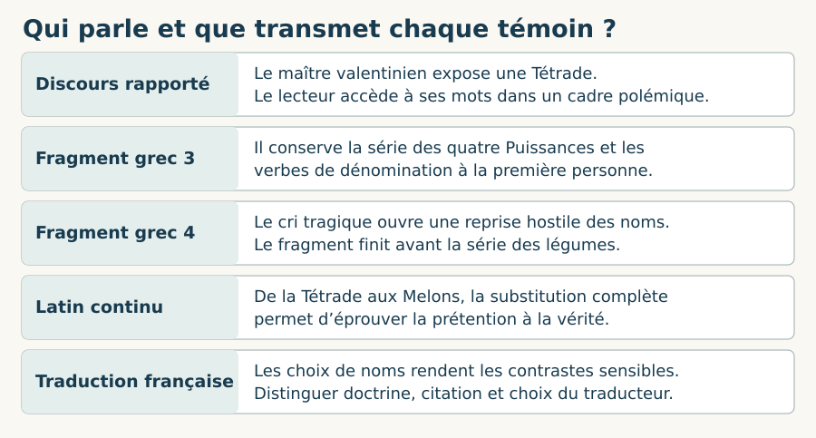

# ENS-PSL · CNEL Lettres — Irénée de Lyon — polémique et exégèse 2023 · Corrigé guidé

*Corrigé rédigé par IA, non officiel. Signalez toute erreur.*

**Rédaction** · GPT-6.2 Astra Ultra · vitesse non renseignée

**Autocontrôle** · GPT-6.2 Astra Ultra · vitesse non renseignée

## Distinguer un texte, ses voix et ses témoins

Les dossiers 6 et 11 donnent la même consigne et le même passage sous deux présentations. Le texte est d’Irénée, le système est attribué à un maître du milieu valentinien, la version suivie est en latin, les deux fragments en grec sont transmis par des citateurs et la traduction française est celle d’Adelin Rousseau.

- **Fragment grec 3.** Repérez l’adjectif négatif désignant l’innommable, le pronom personnel et le verbe « j’appelle ». Comparez le réseau Unicité, Unité, Monade, Un aux formes que le latin conserve.
- **Fragment grec 4.** Repérez la plainte d’allure tragique et les deux formules du paragraphe précédent qu’Irénée isole. La citation change de sens argumentatif en changeant de cadre.
- **Fin conservée en continu dans le dossier latin.** La dernière phrase grecque du feuillet ouvre la possibilité d’un autre inventeur. Le morceau français et latin fournit l’expérience complète avec les quatre puissances parodiques.
- **Problème d’interprétation.** La satire ne prouve pas que tout terme technique est faux. Elle attaque la prétention à la vérité fondée sur l’autorité de celui qui donne les noms. Discutez la force de l’argument et sa limite.

Pour un projet sur la transmission d’Orient en Occident, choisissez deux opérations observables, par exemple un calque conceptuel et une translittération, puis mesurez leur effet sur la lecture. Gardez distinct le projet que vous proposez de mener et ce que démontre déjà la page imprimée.

## Mettre la gnose en citation : la polémique et ses témoins

Irénée combat les systèmes qu’il rapporte, mais il les rend aussi lisibles en les citant. Cette situation importe particulièrement ici. Un adversaire valentinien est cité par Irénée, qui écrit en grec. Nous lisons son texte continu à travers une ancienne version latine, et deux fragments de son grec à travers des témoins qui citent à leur tour. L’enjeu de I, 11, 3-4 est donc autant littéraire que doctrinal. Comment une réfutation qui prétend démasquer des noms fictifs peut-elle convaincre en se livrant elle-même à la plus inventive des fictions ?

### Faire parler le maître jusqu’au point où sa parole se retourne

Le premier fragment grec présente le maître comme réputé, puis affecte de suivre son élan vers une connaissance plus élevée et plus « gnostique ». Ce dernier mot tourne en surenchère ce qui constitue déjà une prétention distinctive. Vient une succession de propositions sur une première Tétrade. La première puissance reçoit plusieurs déterminations négatives : le Pro-Principe précède l’objet même d’une pensée et il est réputé indicible et innommable. Or le discours passe aussitôt au geste de celui qui le désigne, *hên egô Monotêta kalô*, « que moi j’appelle Unicité ». À celle-ci coexiste une puissance nommée Unité. Les deux émettent, sans émettre, un second principe dit Monade, auquel est associée la puissance nommée l’Un. Le groupe des quatre émet les autres Éons. Le parallélisme des couples essaie de penser la multiplicité à partir d’un vocabulaire de l’un. Pour le lecteur du polémiste, il conserve surtout, à chaque étape, l’empreinte d’un sujet qui nomme.

La version latine ne dissimule pas l’origine grecque de cette terminologie. *Monotes*, *Henotes*, *Monas*, *Hen* se succèdent là où le français distingue Unicité, Unité, Monade et Un. Dans le grec, *homoousios* caractérise la puissance qui accompagne la Monade ; le latin rend la relation par *eiusdem substantiae*. L’important est ici la similitude de substance à l’intérieur de l’enchaînement exposé. Il serait anachronique de lire l’emploi dans ce passage du IIe siècle comme s’il intervenait déjà dans les controverses conciliaires du IVe. En revanche, cette correspondance de langue révèle ce que doit faire le traducteur pour que la relation entre des puissances techniquement nommées reste comprise.

### Répéter une citation pour en produire une autre interprétation

Le second fragment commence par le cri tragique. L’exclamation grecque, également transmise dans le latin *Iu iu! et pheu pheu!*, fait entrer une scène de déploration au milieu de l’exposition spéculative. Ce changement ne signifie pas seulement qu’Irénée est indigné. Il offre au lecteur un rôle : entendre comme un scandale comique ou tragique ce qu’il vient d’entendre comme une formulation technique. Irénée reprend ensuite les mots mêmes du maître sur l’Unicité et l’Unité. Ce qui était posé comme un acte souverain de nomination devient sous sa lecture un aveu de fabrication. Le grec parle de *plasma* et de noms imposés ; le latin reprend l’idée de fiction dans la famille de *figmentum*. Du statut d’interprète du divin, le maître passerait ainsi à celui de producteur d’entités de langage.

Le raisonnement est puissant sans être purement déductif. L’invention d’un terme n’établit pas à elle seule l’inexistence de ce qu’il sert à désigner. Irénée accentue la prétention contraire : le maître pourrait baptiser seul, en son temps, une vérité déclarée antérieure à tous. Il prend ainsi son adversaire au mot là où son autorité paraît dépendre de la singularité même du vocabulaire employé. L’exégèse est déjà à l’œuvre comme lecture adverse d’une formule citée ; le passage ne commente directement aucun verset. Pour élargir la réflexion aux disputes chrétiennes sur l’Écriture, il faudrait d’autres passages permettant de comparer les critères donnés à une interprétation commune ou réservée aux initiés.

### Achever l’épreuve par un système dont chacun perçoit la fabrication

L’extrait grec du paragraphe 4 s’arrête quand l’auteur autorise en principe « un autre » à définir à son tour les noms. Le latin et le français permettent de suivre le développement comique qui vient après cette charnière. La différence est celle de l’étendue des témoins fournis ; elle n’autorise pas à prétendre que la fin n’a jamais été écrite en grec. Irénée joue maintenant le rôle de cet autre inventeur. Il garde la syntaxe des générations et multiplie les préfixes, jusqu’au moment où la nouvelle puissance reçoit un nom de légume. Le couple Citrouille–Supervacuité engendre un fruit, Concombre, qualifié par sa visibilité et son goût. Melon vient compléter le second couple, avant que toute la postérité de Valentin ne se transforme en multitude de Melons. Le premier modèle accumulait des propriétés qui soustrayaient les puissances à l’expérience. Le contre-modèle exagère les propriétés sensibles afin que le ridicule soit immédiatement partagé.

La conclusion place alors les deux prétendues révélations sur le terrain de leurs usages linguistiques. Si l’on ne possède aucun critère supérieur à la liberté de nommer, des mots connus de tous auraient au moins l’avantage de la familiarité. Le rire ne constitue pas une ontologie des légumes. Il fabrique, pour le lecteur, une expérience de substitution susceptible de révéler l’insuffisance d’un critère d’autorité. La prose hérésiologique emprunte ainsi à la tragédie le cri, à la démonstration le raisonnement par réplique, et à la comédie une série de mots ordinaires qu’elle met en mouvement comme des puissances divines.

Un projet possible porterait sur les pratiques chrétiennes de citation polémique. On pourrait mettre en regard le paragraphe grec 3, sa reprise sélective dans le fragment 4 et la continuité du latin. On distinguerait ce qui appartient à la doctrine citée, au cadrage hostile par Irénée, au choix des citateurs postérieurs et aux décisions des traducteurs. La traduction actuelle du dossier rend cette stratification accessible, sans abolir le fait que les dénominations des valentiniens nous parviennent ici à travers l’écriture de leur adversaire.

[Sujet officiel](https://www.ens.psl.eu/sites/default/files/sc.antiquite-cnel-11.pdf) · [Autre présentation officielle de la même consigne](https://www.ens.psl.eu/sites/default/files/sc.antiquite-cnel-6.pdf)
