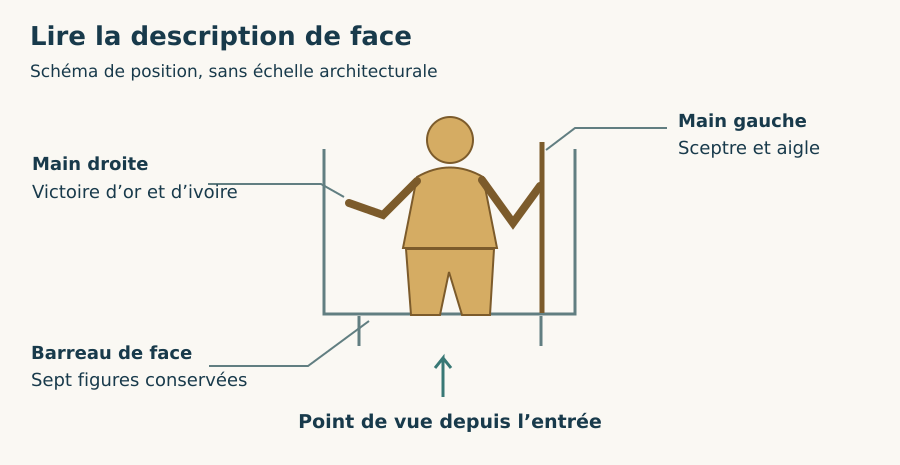

# ENS-PSL · CNEL Lettres — La statue de Zeus à Olympie 2023 · Corrigé brut

*Corrigé rédigé par IA, non officiel. Signalez toute erreur.*

**Rédaction** · GPT-6.2 Astra Ultra · vitesse non renseignée

**Autocontrôle** · GPT-6.2 Astra Ultra · vitesse non renseignée

## Restituer une statue disparue : le Zeus d’Olympie

Le document le plus graphique de ce dossier est aussi le plus éloigné de l’œuvre dans le temps. En 1883, Victor Laloux donne à voir le Zeus assis au centre d’une coupe restaurée du temple. Au IIe siècle de notre ère, Pausanias décrivait dans sa *Périégèse* une statue réalisée par Phidias au Ve siècle avant notre ère. L’aquarelle n’est donc pas un second témoignage oculaire qui permettrait de départager les lectures du premier. En confrontant les deux documents, on peut établir comment la statue se laissait voir, ce que sa décoration faisait signifier au sanctuaire et ce que la nécessité de dessiner fait ajouter à la preuve.

### Du regard sur le dieu au parcours du visiteur

Pausanias commence par une figure assise et en distribue les signes. La couronne imite les rameaux d’olivier. Une Victoire d’ivoire et d’or se tient dans la main droite de Zeus. Le sceptre que porte la main gauche a pour oiseau l’aigle. Les chaussures, le manteau et ses motifs prolongent la richesse de cette présence. Dire la statue chryséléphantine, d’or et d’ivoire, n’équivaut pas à décrire un bloc taillé dans une seule matière. Le trône associe lui-même or, pierres, ébène, ivoire, peinture et sculpture. L’auteur passe d’une œuvre au singulier à un agencement de surfaces de techniques différentes. Les matières attirent l’œil tout en permettant de distinguer le dieu, ses attributs et son siège.

La description change d’orientation avec les précisions sur le barreau situé face à l’entrée et sur les protections qui empêchent de passer sous le trône. Pausanias compare cet accès avec celui d’Amyclées. Il situe le regard dans le bâtiment et pose une limite : l’exhaustivité d’une liste n’implique pas que l’on puisse inspecter l’œuvre sur tous ses côtés. La surface faisant face aux portes est dite bleu sombre, les autres portent des peintures de Panainos. Un visiteur se déplace ou se renseigne. La coupe frontale de Laloux, au contraire, supprime conventionnellement une partie de l’architecture pour montrer en un instant ce qu’elle restitue. Regarder une coupe est un privilège d’architecte dont ne disposait pas le fidèle au seuil de la salle.

### Un trône qui fait tenir ensemble le dieu, les mythes et les concours

Le siège ne sert pas de simple piédestal à la grandeur de Zeus. Les Victoires qui dansent aux pieds du trône répètent et varient la Victoire isolée qu’il tient à la main. Les scènes des sphinges, des enfants de Niobé et de l’affrontement d’Héraclès et des Amazones donnent accès à plusieurs récits mythiques. Entre les pieds, quatre barreaux assurent les liaisons. Quatre colonnettes intérieures complètent les appuis. La superposition de figures à ces parties porteuses transforme ce qu’on pourrait décrire comme une structure en support d’identifications et de mémoire. Les représentations de concours ont une résonance particulière dans le sanctuaire olympique. Le texte fait ainsi cohabiter la victoire comme attribut divin, comme épisode mythique et comme succès d’un athlète.

La précision de Pausanias restitue en même temps ses incertitudes. Sur le barreau de face il compte sept statues là où il y en avait huit ; la cause de la disparition est déclarée inconnue. Il signale comme tradition rapportée l’identification d’un jeune homme se nouant un bandeau avec le lutteur éléen Pantarkès. Il faut distinguer une absence observée, la mémoire d’un état antérieur et une attribution transmise. Le nombre vingt-neuf pour les figures combattantes des autres barreaux n’a pas le même statut que l’affirmation d’une ressemblance personnelle. Cette distinction est décisive pour l’archéologue : on perdrait de l’information en convertissant chaque phrase en détail dessiné avec la même certitude.

### Ce que restitue l’aquarelle et le prix de sa cohérence

L’envoi de Rome de Laloux est une coupe transversale à l’échelle du cinquantième, tracée à l’encre de Chine et mise en couleur. Le feuillet reproduit la planche tournée ; une fois replacée dans le sens des légendes, elle montre Zeus de face sous l’axe du faîte du temple. Les colonnes des deux côtés et la répétition de bandes de décor organisent une symétrie qui conduit vers lui. Les chairs claires, les tons d’or du drapé et les teintes saturées autour du trône individualisent la statue au centre d’une architecture largement blanche. Les pieds posés, le coude et les attributs permettent de raccorder l’image générale à plusieurs indices de Pausanias. La coupe ajoute surtout une relation d’échelle : le dieu assis remplit l’essentiel de la hauteur centrale disponible.

Pour obtenir ce résultat, il faut choisir une hauteur de figure, un rapport au toit, un aspect des surfaces et une continuité du décor que le passage V, 11 ne chiffre pas. Le terme « restaurée » qualifie ici un dessin de restitution savante. Il ne dit pas que la statue a matériellement été remise en place avant de servir de modèle. On peut apprécier le pouvoir explicatif de la coupe sans transformer les choix du XIXe siècle en observations antiques. Le titre de *temple de Jupiter* et la mention de la restauration de l’Altis appartiennent à la langue et au programme de l’architecte. Pausanias, de son côté, parle grec et raconte l’expérience tardive d’un monument grec classique. Les deux sources éclairent donc aussi l’histoire de la réception du dieu.

Un projet hypothétique consisterait à cartographier, sur plusieurs restitutions, les éléments vus de face, attestés par la description ou seulement complétés par symétrie. Il faudrait rapprocher les plans archéologiques, le vocabulaire spatial de la *Périégèse* et les conventions graphiques des envois de Rome. La comparaison pourrait aboutir à plusieurs restitutions compatibles avec une même phrase. C’est précisément là un résultat : rendre visible l’incertitude permet de distinguer la puissance de présence recherchée par la statue de la certitude que nous pouvons aujourd’hui avoir sur sa forme.

[Sujet officiel](https://www.ens.psl.eu/sites/default/files/sc.antiquite-cnel-2.pdf) · [Planche originale de Laloux, ENSBA](https://catzarts.beauxartsparis.fr/fr/notice/env-73-01-altis-d-olympie-a7c479a5-91ea-434c-9563-837385b37114) · [Sanctuaire d’Olympie, UNESCO](https://whc.unesco.org/en/list/517)
