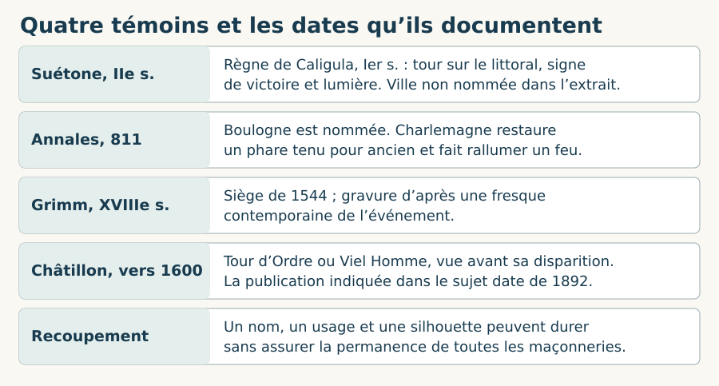

# ENS-PSL · CNEL Lettres — Le phare antique de Boulogne-sur-Mer 2023 · Corrigé guidé

*Corrigé rédigé par IA, non officiel. Signalez toute erreur.*

**Rédaction** · GPT-6.2 Astra Ultra · vitesse non renseignée

**Autocontrôle** · GPT-6.2 Astra Ultra · vitesse non renseignée

## Donner à chaque document sa date et sa question

Suétone écrit après le règne de Caligula. Les annales enregistrent pour 811 une intervention de Charlemagne à Boulogne. Le siège figuré par le document 3 est de 1544, mais le graveur est du XVIIIe siècle et dépend d’une fresque plus ancienne. Le document 4 combine un dessin de la fin du XVIe ou du début du XVIIe siècle et une publication en 1892.

1. **Où lit-on « Boulogne » dans les textes ?** Dans les annales, avec *Bononiam civitatem maritimam*. Chez Suétone, le rivage est celui de l’Océan. L’identification est un raisonnement croisé.
2. **Qu’indique la comparaison avec le Phare ?** Une référence célèbre pour la lumière nocturne et le prestige de la construction. On ne peut recopier les dimensions du phare d’Alexandrie.
3. **Que prouve le verbe restaurer ?** Qu’en 811 on intervient sur un ouvrage tenu pour ancien. L’état exact des maçonneries et les années d’interruption demanderaient d’autres témoignages.
4. **Pourquoi les deux gravures ne se superposent-elles pas ?** La première construit une scène du siège à travers une chaîne d’images. La seconde isole un monument nommé et légendé. Comparez la silhouette et les relations à la mer avant d’avancer une hypothèse de reconstruction.

Pour rattacher la réponse à un projet personnel, l’exemple choisi ici est celui de la transmission des repères portuaires. Le schéma sépare les dates représentées et les dates de fabrication ou de publication des témoignages.

## De la tour impériale à la Tour d’Ordre : comment identifier un monument disparu ?

Deux textes séparés de plusieurs siècles et deux gravures modernes sont réunis sous le nom du phare antique de Boulogne. Pourtant, le premier texte ne nomme pas la ville, le deuxième ne donne aucune forme détaillée et les deux images ne représentent pas la construction romaine au moment de son achèvement. Le dossier ne permet donc pas de dérouler quatre observations successives et identiques. Il permet mieux : comprendre comment des fonctions, des noms de lieu et des images de silhouette se recoupent pour construire une identification tout en laissant ouverte l’histoire des transformations matérielles.

### Une tour entre dérision impériale et service de navigation

Au chapitre XLVI de sa *Vie de Caligula*, Suétone place le monument dans une scène d’ostentation du prince au bord de l’Océan. Les coquillages deviennent des dépouilles prétendument dignes du Capitole et du Palatium. L’expression *in indicium victoriae* invite à lire la haute tour comme un signe de victoire. Le biographe rapporte ensuite la comparaison avec le Phare d’Alexandrie et l’utilité des feux nocturnes pour la direction des navires. Ces deux emplois ne s’excluent pas. Un ouvrage peut rendre un service et monumentaliser dans l’espace une interprétation contestable de l’action impériale. Encadrer le récit du phare par l’épisode des coquillages et le don aux soldats met le lecteur en position de juger la démesure du personnage. Le nom d’Alexandrie éclaire la fonction et le prestige du modèle ; il ne fournit ni un plan ni une preuve de dimensions identiques.

La biographie, écrite au début du IIe siècle pour un règne du Ier, dit « sur le rivage de l’Océan ». Elle ne dit pas dans cet extrait que la tour se trouvait à *Bononia*. Le rapprochement avec Boulogne mobilise donc d’autres indices. La précision est importante : un nom inscrit dans le titre d’un dossier ne doit pas être réintroduit comme citation implicite du premier témoin. De même, le *donativum* qui clôt l’épisode fait sens dans un portrait littéraire de la générosité du prince. Il ne renseigne pas sur le financement de l’ouvrage.

### En 811, un lieu nommé et une fonction réactivée

L’entrée annalistique de 811 situe explicitement la visite de Charlemagne à Boulogne, ville maritime où est rassemblée une flotte dont il avait ordonné la construction l’année précédente. Ici la tour est nommée *farum*. L’adverbe *antiquitus* rapporte l’installation à un passé ancien ; *restauravit* attribue au souverain une restauration et le texte mentionne la remise en fonction du feu au sommet. À la différence de Suétone, l’annaliste réunit un lieu précis, un bâtiment reconnu comme antérieur et une intervention effective sur son usage nocturne. La mention contribue aussi à faire apparaître un souverain qui visite, veille et restaure. La forme annalistique ordonne l’épisode dans l’action du règne, sans donner un cahier technique des réfections.

Les deux textes convergent donc par le service rendu aux navigateurs et l’association à l’autorité souveraine. Ils se complètent en ce que l’un rapporte la volonté de Caligula sur le littoral, l’autre nomme Boulogne et atteste en 811 la mémoire d’un ouvrage ancien. En revanche, le texte franc ne nomme pas Caligula. Il n’établit ni qu’aucune reconstruction n’a eu lieu, ni que pendant les siècles intermédiaires un feu a brillé chaque nuit. La continuité du service comme idéal, la permanence de l’emplacement et celle de la maçonnerie doivent être pesées distinctement.

### Deux images d’époque moderne, deux façons d’isoler la tour

Le document 3 représente le siège de Boulogne de 1544. La gravure de Samuel Hieronymus Grimm, artiste du XVIIIe siècle, est donnée d’après une fresque contemporaine de l’événement. Il faut donc distinguer la date du fait, le modèle et la copie gravée. Dans le fragment distribué, une tour très mince et étagée s’élève au-dessus des personnages, à proximité des embarcations. Des rangées d’ouvertures, un couronnement et un drapeau donnent à cette verticale une grande lisibilité. Sa fonction dans cette composition est aussi de rendre identifiable le lieu du siège. Une échelle strictement métrique déduite des personnages ou des navires serait trompeuse. La mise en image peut accentuer la hauteur pour rendre le repère reconnaissable.

Le document 4 donne en titre « La Tour d’Ordre ou le Viel Homme ». L’édifice domine le centre de l’image. Son massif présente des pans, un retrait sensible vers le haut, des assises horizontales et un petit corps sommital percé d’ouvertures. Par rapport à la vue du siège, la base semble bien plus large et l’ornement plus sobre. Des bateaux, le rivage et l’environnement bâti situent la tour dans un paysage marin. La gravure est attribuée à Claude Châtillon, à la charnière des XVIe et XVIIe siècles, mais la publication signalée par le sujet date de 1892. Prendre 1892 pour la date d’observation renverserait l’intérêt documentaire de la planche : le monument avait disparu lors de l’effondrement de la falaise en 1644. Les recoupements de profil aident à reconnaître le site. Les divergences peuvent tenir à la finalité, au point de vue, à la transmission ou à plusieurs états de la tour. Aucune de ces explications ne peut être choisie pour la seule raison qu’elle produit la silhouette antique la plus séduisante.

Un projet de recherche pourrait porter sur la transmission des repères côtiers entre textes de pouvoir, vues topographiques et documents portuaires. Une première enquête établirait la généalogie des images, de façon à ne pas compter trois copies d’un même modèle comme trois preuves indépendantes. Une seconde confronterait légendes, cartes anciennes, récits d’entretien et évolution du trait de côte. On en attendrait un classement des éléments attestés à chaque date et des hypothèses sur leur persistance, en préservant la distinction entre l’ouvrage antique, sa réutilisation carolingienne et la Tour d’Ordre représentée par les artistes.

[Sujet officiel](https://www.ens.psl.eu/sites/default/files/sc.antiquite-cnel-3.pdf) · [Inventaire du patrimoine des Hauts-de-France](https://inventaire.hautsdefrance.fr/dossier/IA62000334) · [Notice Mérimée](https://pop.culture.gouv.fr/notice/merimee/IA62000334)
