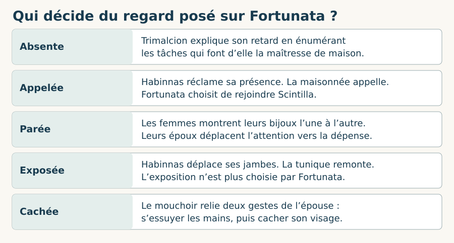

# ENS-PSL · CNEL Lettres — Pétrone — Fortunata et les rapports entre hommes et femmes 2023 · Corrigé guidé

*Corrigé rédigé par IA, non officiel. Signalez toute erreur.*

**Rédaction** · GPT-6.2 Astra Ultra · vitesse non renseignée

**Autocontrôle** · GPT-6.2 Astra Ultra · vitesse non renseignée

## Qui décide de ce qui sera visible ?

Suivez les sujets des verbes avant de classer les personnages. Trimalcion explique, Habinnas réclame, la maisonnée appelle, Fortunata entre et montre. Scintilla répond. Les maris changent le sens des objets montrés, puis Habinnas impose un geste à Fortunata. Cette distribution des initiatives fonde le commentaire sur les relations entre hommes et femmes.

- *Diligentia* et les premières tâches permettent-ils d’appeler Fortunata une simple servante ? Elle veille à des biens précieux et à la distribution des restes aux esclaves. Elle exerce un pouvoir domestique à partir d’une position elle-même déterminée par un ordre social.
- Pourquoi rapprocher les deux bracelets ? Le mari qui dénonce des dépenses féminines se glorifie d’un poids supérieur. Cela permet de discuter le discours du personnage à partir de ses propres gestes.
- Quelle différence y a-t-il entre délier ses parures et voir sa tunique relevée ? Dans le premier cas Fortunata guide le regard de son amie. Dans le second elle subit le geste d’Habinnas, puis cherche à échapper au regard commun.
- Comment traiter le mouchoir ? Relevez ses deux emplois. Il relie dans un même objet la compétence pratique d’une maîtresse de maison et la recherche d’un abri à la fin du passage.

La consigne du dossier privilégie les rapports entre hommes et femmes. Un relevé de vocabulaire vaut ici par ce qu’il permet de comprendre des places, des gestes et des regards.

## Fortunata entre en scène et perd la maîtrise de son image

Avant que Fortunata apparaisse dans le chapitre 67 du *Satiricon*, deux hommes discutent de sa place à table. Habinnas réclame sa présence. Trimalcion explique son absence par les soins qu’elle donne à l’argenterie et aux restes. On pourrait donc attendre que le passage fasse simplement le portrait de l’épouse d’un riche affranchi. Or Fortunata entre, parle, montre, reçoit et se cache, tandis que d’autres parlent d’elle et de ce qu’elle montre. Le banquet donne à voir une femme dont l’autorité domestique est réelle mais dont l’image ne lui appartient jamais entièrement.

### De la maîtresse de maison à l’invitée attendue

La question initiale porte sur un geste précis, *recumbit*, prendre place sur le lit de table. Qui fait fonctionner le banquet quand les convives peuvent déjà boire ? Les deux propositions introduites par *nisi* nomment ce que Fortunata doit avoir accompli avant de prendre elle-même un peu d’eau. Ranger l’argenterie conserve le bien du maître et répartir les restes organise la dépendance de la *familia*. Trimalcion construit une épouse diligente, mais en dispose encore par le récit qu’il fait de sa conduite. La maison compte par ailleurs des esclaves. Fortunata n’est pas une travailleuse isolée : elle administre un ordre qui la distingue d’eux. L’injonction d’Habinnas, qui menace de se lever, décide du moment où doit cesser cette activité. La collectivité qui appelle l’épouse à plusieurs reprises donne à son entrée l’allure d’une apparition préparée.

La tenue décrit un corps actif et paré. Le tissu relevé laisse voir la tunique couleur cerise, les ornements des jambes et les chaussures dorées. Le mouchoir suspendu au cou lui sert à s’essuyer les mains. Cette transition retient quelque chose du travail qu’elle vient de quitter au moment même où sa toilette attire le regard. Elle choisit le lit de Scintilla, le nom latin de l’épouse d’Habinnas. L’accueil, le baiser et la parole adressée à l’amie substituent à la présentation de l’épouse par son mari une relation dont les deux femmes sont les sujets.

### Les bijoux permettent de se montrer et rendent visible la compétition des maris

Fortunata se défait de ses bracelets pour les montrer à Scintilla. Le récit suit le mouvement de l’objet d’un bras vers un regard et de l’admiration reçue à une nouvelle présentation. Son initiative grandit avec le nombre d’ornements qu’elle ôte, jusque dans sa coiffure. En détaillant leur matière et la qualité de leur or, elle fait aussi valoir un savoir sur son bien. Mais Trimalcion fait apporter le tout et transforme la parure en collection exposée à l’assemblée. Il désigne les ornements comme les entraves d’une femme, *mulieris compedes*. L’ironie a une portée sociale particulière dans un monde d’affranchis : ce qui atteste la richesse peut se dire avec le mot de l’entrave. Le commentaire du mari prétend déplorer le dépouillement des hommes. Sa réplique suivante vante son propre bracelet, plus lourd encore ; la balance qu’il fait venir matérialise sa participation à la surenchère.

Scintilla répond de même à Fortunata en tirant de sa capsule les pendants qu’elle lui remet pour examen. Mais elle rapporte le don au bienfait de son *dominus*. Habinnas saisit la parole pour déprécier le même bijou en fève de verre et imaginer qu’il soustrairait une fille à cette dépense. Les voix masculines imputent aux femmes l’échelle des valeurs qu’elles contribuent elles-mêmes à établir. L’argent est une mesure concurrentielle entre maris autant qu’un moyen de classer les épouses. La relation entre les femmes participe à cette économie de prestige, sans s’y réduire : elles rient et s’embrassent pendant que les hommes tiennent le compte.

### Une solidarité fugitive sous le regard des convives

La fin oppose la réciprocité des gestes féminins aux initiatives unilatérales d’Habinnas. Les deux femmes échangent des marques de tendresse et des éloges. Même là, la conversation sur l’excellence de la maîtresse de maison ou l’indulgence d’un mari rappelle que leur estime s’exprime dans des catégories domestiques. Mais pendant cet intervalle elles paraissent pouvoir orienter l’attention l’une de l’autre. Le geste soudain d’Habinnas met fin à cette scène. Fortunata, qui choisissait jusque-là les objets présentés, voit sa tunique se retrousser au-delà du genou sans l’avoir voulu. La petitesse de la partie découverte en regard de la quantité de bijoux déployée rend d’autant plus sensible la différence entre montrer et être montrée.

Le même *sudarium* qui essuyait les mains au début permet à présent de cacher un visage rougi dans le giron de l’amie. Fortunata réagit, se rajuste et choisit auprès de qui se réfugier. L’adjectif superlatif du récit qui qualifie son visage fait pourtant d’elle un dernier spectacle grotesque. On ne saurait lire ce jugement comme une donnée immédiate sur les femmes romaines : il relève du regard d’une narration satirique. Le passage donne successivement crédit à la caricature de l’épouse dépensière, à sa puissance d’organisation et au désir des hommes de la mettre en scène. Sa force littéraire tient à ce que ces représentations se contredisent sous les yeux du lecteur, jusque dans l’objet qui ferme le tableau.

[Sujet officiel](https://www.ens.psl.eu/sites/default/files/sc.antiquite-cnel-5.pdf)
