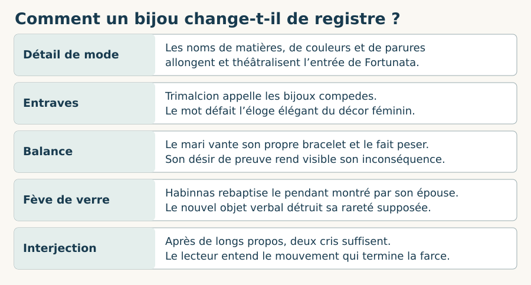

# ENS-PSL · CNEL Lettres — Pétrone — les ressorts du comique 2023 · Corrigé guidé

*Corrigé rédigé par IA, non officiel. Signalez toute erreur.*

**Rédaction** · GPT-6.2 Astra Ultra · vitesse non renseignée

**Autocontrôle** · GPT-6.2 Astra Ultra · vitesse non renseignée

## Faire entendre les personnages

Prenez deux colonnes, le mot choisi et ce qu’il change au moment de la scène. Pour *apoculo*, la traduction donne le mouvement, le latin singularise la façon de parler. Pour *compedes*, le changement de registre retourne l’éloge d’un ornement en plainte contre une entrave. Pour *faba vitrea*, le mari rebaptise un objet que sa femme venait de dire incomparable.

### Trois rapprochements à exploiter

1. **Nisi puis nisi.** Le maître détaille ce que sa femme doit achever. L’invité reprend une tournure conditionnelle pour menacer de partir. La répétition fait monter une situation ordinaire jusqu’à l’appel de toute la maisonnée.
2. **Six livres et demie puis dix.** Trimalcion réprouve les lourds bijoux féminins et veut prouver la masse supérieure de son propre bracelet. La balance rend visible la contradiction de son discours.
3. **Une longue plainte puis deux cris.** Le rare verbe *excatarissasti* et la formule corporelle d’Habinnas remplissent la scène de paroles. Le geste final ramène la parole de Fortunata à *Au! au!*. Traitez ce changement de longueur comme un effet de rythme.

Un mot emprunté ou rare ne fait pas rire par nature. Pour chaque exemple, identifiez le personnage, le niveau de langue, la réplique qui précède et le geste qui suit. La question posée ici porte sur les ressorts du comique, tout particulièrement sur le lexique.

## Des mots qui font monter les enchères

Au début du chapitre 67 du *Satiricon*, on attend une convive. À la fin, deux cris ont remplacé un dialogue nourri, une balance a fait le tour des convives et le mouchoir qui essuyait des mains cache un visage. L’enchaînement serait déjà celui d’une farce. Pétrone en fabrique le rythme par une langue qui distribue les voix et change brusquement l’échelle de valeur de chaque chose. Le comique est moins contenu dans un mot singulier que dans l’intervalle entre le mot choisi, le geste qui le suit et ce qu’un autre convive en fait.

### D’une politesse de table à une entrée en représentation

Habinnas commence par une demande personnelle à Gaïus, le prénom de Trimalcion, adoucie par *rogo*. À une courte question sur la présence de Fortunata répond une explication surchargée : *nisi* revient pour ranger l’argenterie, partager les restes, retarder jusqu’à la gorgée d’eau. Habinnas reprend la même charnière conditionnelle pour annoncer au contraire son départ si l’hôtesse ne s’étend pas au banquet. Surtout, *me apoculo*, que le français traduit simplement par l’idée de s’en aller, a une tournure familière et insolite qui fait entendre le locuteur. Un protocole d’hospitalité solennel tient désormais à cette menace dégonflée. L’appel répété par toute la maisonnée prépare alors une entrée presque disproportionnée à l’objet de la question.

Le portrait remplit cette attente par une abondance de noms de choses. *Galbino*, *cerasina*, *periscelides*, *phaecasiae* font passer de la couleur à l’accessoire et de la tunique aux pieds. La précision de ces termes de toilette, dont plusieurs portent une couleur grecque, donne l’impression qu’on ne saurait regarder sans d’abord nommer tout ce que le goût exhibe. Les sonorités et l’accumulation distendent le court trajet qui conduit l’épouse à table. L’essuyage des mains interrompt cette ostentation d’une notation familière. À peine les convives se sont-ils réunis que le lecteur a changé plusieurs fois de registre.

### Chaque voix propose un nouveau prix pour le même objet

L’exposition des bijoux commence comme la rencontre de deux connaisseuses. Le réseau de cheveux passe pour de l’or de qualité éprouvée ; les pendants sont des *crotalia*. Le discours sur la parure pourrait conférer à celles qui la portent une distinction rare. Trimalcion traduit immédiatement ce prestige dans un autre lexique. Les bijoux féminins deviennent des *compedes*, des entraves, tandis que les hommes qui paient se traitent de *barcalae*, des imbéciles. Le mari passe du mot grossier à la précision arithmétique, six livres et demie, avant d’annoncer ses propres dix livres. Son sérieux opère le renversement. Pour donner crédit à son propos, il produit une balance, comme si la pesée de son bracelet était devenue une question d’intérêt public. L’adverbe de surenchère *ultimo etiam*, déjà employé pour les parures de Fortunata, contribue à faire du mari son double.

Le tour de Scintilla redonne aux objets une intimité presque affectueuse : sa petite capsule d’or porte le nom propre *Felicio*. Le bijou montré à l’amie est déclaré sans rival, puis le mot d’Habinnas le ravale à la *faba vitrea*, la fève de verre. La chute combine plusieurs dévaluations : à la rareté se substitue l’aliment ordinaire, à la richesse de l’or une matière de moindre prestige, au langage du don celui du mari dépouillé. Le rare *excatarissasti* donne un relief sonore à la plainte que la traduction rend par « ratissé ». Il serait vain d’assurer à ce mot une origine incontestable pour expliquer l’effet : sa longueur expressive tranche avec la petite fève sur laquelle débouche la phrase. Le rapprochement du chaud et du froid dans la formule sur les fonctions corporelles et la boisson achève cette descente de registre. Les convives savent attribuer à une même chose tous les prix, sauf celui de la mesure.

### Une farce que les mots du narrateur prolongent

Dans *nec melior Scintilla*, le narrateur annonce que l’autre épouse ne fait pas mieux. Cette comparaison brève organise ce qui suit comme la reprise d’un numéro. Les adjectifs appliqués aux femmes introduisent le vin et la désinhibition, tandis que s’accélèrent les gestes : rire, s’embrasser, se tenir, se lever en secret. *Furtim* fait attendre un effet que Fortunata n’attend pas. Après des personnages si habiles à baptiser, définir et chiffrer, il ne reste à l’une d’eux que le redoublement d’une interjection, *Au! au!*. Le lecteur entend la secousse avant que le déplacement de la tunique et le mouvement de protection n’en précisent les conséquences.

Le dernier superlatif, *indecentissimam*, donne au visage rougi une qualification excessive quand le personnage cherche justement à le soustraire aux autres. Et le mouchoir, d’abord accessoire attaché au cou, devient un rideau de fin de scène. La plaisanterie d’Habinnas a une cible qui ne s’en amuse pas ; la scène laisse aussi percevoir la brutalité sociale d’un rire produit aux dépens d’autrui. Le portrait comique se construit donc sur des écarts maîtrisés : noms de luxe et mots familiers, calcul et absurdité, petite chose et grande démonstration, longues tirades et simple cri. La traduction française permet d’en suivre l’action. Les reprises du latin expliquent pourquoi elle a précisément ce tempo.

[Sujet officiel](https://www.ens.psl.eu/sites/default/files/sc.antiquite-cnel-13.pdf)
