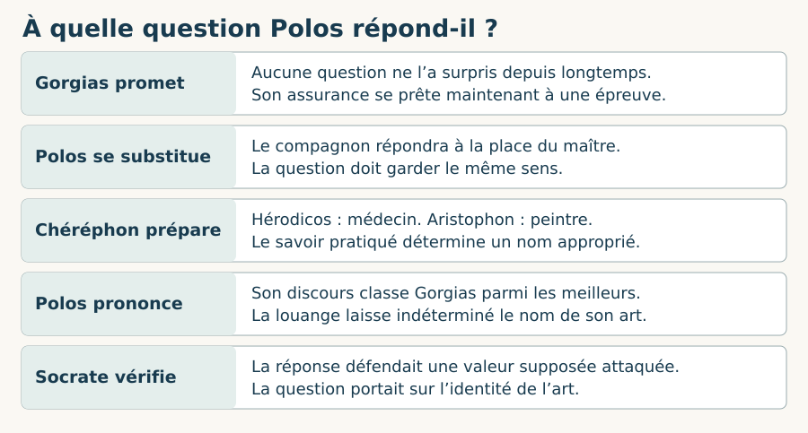

# ENS-PSL · CNEL Lettres — Platon — Gorgias 2023 · Corrigé brut

*Corrigé rédigé par IA, non officiel. Signalez toute erreur.*

**Rédaction** · GPT-6.2 Astra Ultra · vitesse non renseignée

**Autocontrôle** · GPT-6.2 Astra Ultra · vitesse non renseignée

## Répondre à une question et faire l’éloge d’un art

Au seuil du *Gorgias*, Socrate a manqué la démonstration du maître de rhétorique. Il peut cependant lui parler. Or le dialogue attendu entre les deux hommes commence par un échange entre deux autres, Chéréphon et Polos. Ce délai n’est pas un ornement dramatique. En 447d-448e, le lecteur voit une réponse échouer avant que Socrate ne lui dise en quel sens elle a échoué. La scène fait éprouver la différence entre savoir tenir un discours et répondre de son objet.

Chéréphon s’adresse d’abord à Gorgias. La réputation qu’il tient de Calliclès a la forme d’un engagement sans restriction : Gorgias accepterait toute question. Celui-ci confirme sa promesse et ajoute que personne ne lui en a posé de nouvelle depuis longtemps. La nouveauté de la question servirait donc à mesurer la difficulté de la réponse. Chéréphon reprend cette assurance pour en tirer une conséquence apparemment modeste : si le maître a raison, la réponse devrait lui être facile. Gorgias propose de faire l’épreuve, *peiran lambanein*. Au lieu de demander d’emblée ce que vaut la rhétorique, le dialogue construit la situation dans laquelle une promesse publique pourra recevoir ou manquer sa vérification.

Polos se propose à la place de Gorgias, au motif que le maître vient de parler longuement. Chéréphon demande s’il pense pouvoir répondre mieux que lui. Polos rabat cette comparaison sur ce qui pourrait suffire à l’interlocuteur. La reproduction de la relation entre maître et compagnon des deux côtés du dialogue rend le décalage particulièrement suivi : on ne vérifie pas une technique en constatant que celui qui se présente pour l’exercer appartient à la bonne école. Il faut voir ce qu’il fait. Le bref impératif de Polos invitant Chéréphon à poser sa question manifeste alors la confiance de celui qui ignore encore le critère auquel sa parole sera soumise.

Chéréphon construit ce critère avec deux cas. Si Gorgias connaît l’art de son frère Hérodicos, le nom approprié serait « médecin ». S’il pratique celui d’Aristophon ou de son frère, ce serait « peintre ». La seconde fois, Polos peut fournir le nom sans qu’il soit soufflé par la question. L’exercice établit donc une règle comprise en commun : à une compétence déterminée doit correspondre le nom exact de celui qui la possède. Le passage du conditionnel à la situation effective de Gorgias ne change en rien la règle. Les adverbes qui disent le droit ou la justesse de l’appellation invitent à contrôler l’adéquation du mot. On n’a demandé ni si le médecin est bon ni si la peinture est belle.

La réponse de Polos substitue une autre forme d’ordre. Elle commence par la multiplicité des arts chez les humains, fait jouer les termes de la famille d’*empeiria*, oppose l’expérience qui conduit selon l’art à l’inexpérience livrée à la fortune, puis fait correspondre les meilleurs hommes et les meilleurs arts. Sa conclusion situe Gorgias au sommet. L’enchaînement des sonorités et des antithèses peut présenter une réelle habileté. La faute tient précisément à ce qu’un éloge réussi resterait ici une mauvaise réponse : désigner l’art le plus beau parmi tous les arts n’apprend pas lequel il est. Bien plus, on pourrait attribuer cet éloge indistinctement à plusieurs praticiens ; il ne permettrait jamais de trancher entre eux.

Socrate intervient alors en s’adressant de nouveau à Gorgias. Il reconnaît la préparation de Polos aux discours avant de constater qu’il ne fait pas ce qu’il avait promis. Le juge de la réponse ne revendique pas ici l’accès privilégié à une vérité cachée : il rappelle un engagement que le lecteur et les interlocuteurs ont entendu. Lorsque Gorgias propose qu’il interroge directement Polos, Socrate préfère revenir à Gorgias. Il oppose l’exercice de « ce qu’on appelle » la rhétorique à celui de dialoguer, puis formule à Polos le diagnostic précis : il a célébré l’art comme face à un détracteur, au lieu de dire lequel c’était. L’attaque était supposée par celui qui répondait ; aucune des questions de Chéréphon ne l’avait formulée. L’éloge s’avère ainsi sourd à la singularité de l’interlocution. Le morceau ne contient pas encore la réponse développée de Gorgias sur la rhétorique, et n’autorise pas davantage à tenir toute prise de parole longue pour mensongère.

Une piste de recherche possible porterait sur la dramaturgie des définitions chez Platon. On pourrait comparer ces modèles du médecin et du peintre aux autres dialogues où un cas simple stabilise provisoirement le sens d’une question. Il faudrait y relever non seulement les définitions finales, mais encore celui qui demande, celui qui répond, les verbes de promesse et les moments où le type de la réponse change. L’apport du passage est de rendre visible qu’une règle du discours rationnel peut se transmettre dans la mise en scène d’un échec.

[Sujet officiel](https://www.ens.psl.eu/sites/default/files/sc.antiquite-cnel-7.pdf)
