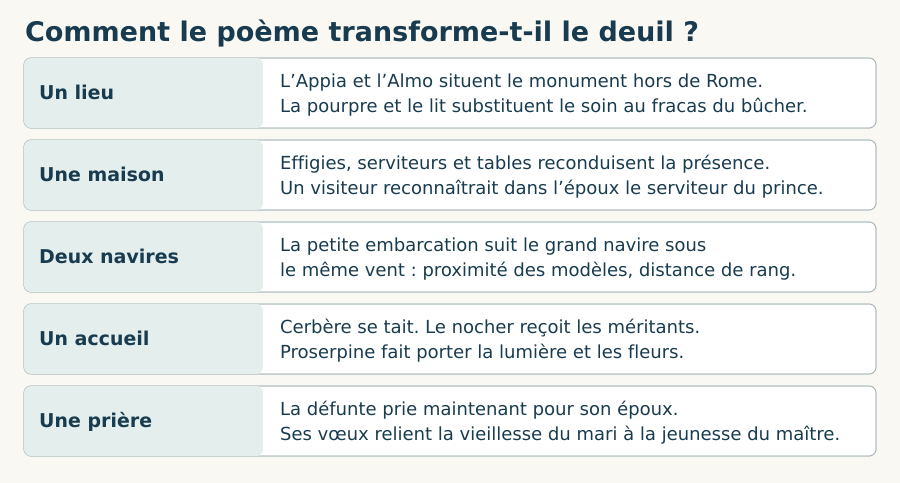

# ENS-PSL · CNEL Lettres — Stace — l’éloge de Priscilla 2023 · Corrigé brut

*Corrigé rédigé par IA, non officiel. Signalez toute erreur.*

**Rédaction** · GPT-6.2 Astra Ultra · vitesse non renseignée

**Autocontrôle** · GPT-6.2 Astra Ultra · vitesse non renseignée

## Faire du tombeau de Priscilla une maison et du deuil une promesse

À la fin de la première *Silve* du livre V, Stace conduit son lecteur près de la voie Appienne, au monument de Priscilla, épouse d’Abascantus, affranchi chargé de la correspondance de Domitien. Ce qui pourrait être la description finale d’un tombeau change plusieurs fois de destinataire et de lieu : le poète s’adresse à la morte, il invite un visiteur à juger ce que fait le veuf, il conduit enfin celui-ci à imaginer l’accueil de son épouse aux Enfers. La consolation n’est donc pas une maxime ajoutée à l’éloge. Elle résulte de transformations successives par lesquelles une absence devient présence domestique, modèle de piété puis puissance d’intercession.

Le vers initial, *Est locus*, inaugure une présentation presque topographique. Le nom de l’Appia, celui de l’Almo et celui de Cybèle situent la sépulture dans un paysage sacré aux portes de Rome. Le passage évoque la déesse déposant ses gémissements dans le cours d’eau italien et ne se souvenant plus des eaux de l’Ida. Le franchissement d’une peine et le déplacement d’un culte précèdent ainsi le récit d’un deuil romain. À la troisième personne de l’évocation géographique succède *hic te*, « ici, toi ». L’apostrophe à Priscilla la fait entrer dans l’espace comme interlocutrice. Abascantus l’a délicatement disposée sur un lit, enveloppée de pourpre de Sidon. Le foyer funèbre est évoqué par les fumées et le fracas que le mari n’a pu supporter. Les négations répétées qui suivent refusent d’avance aux années le pouvoir de dégrader le corps. Il s’agit d’une promesse poétique tirée de la sollicitude de l’époux, sans description technique précise d’un mode de conservation.

Les images multiplient ensuite la présence que le temps menaçait d’entamer. Priscilla est renouvelée dans diverses effigies. Les démonstratifs *hoc*, *illo* invitent à parcourir bronzes, édicule et marbre comme si le regard du lecteur pouvait s’arrêter devant chacune des apparitions. Cérès, la figure crétoise d’Ariane, Maïa et une Vénus que l’épithète soustrait à l’impudeur offrent plusieurs manières de louer une même femme. Les divinités reçoivent volontiers son visage : Stace inverse le langage banal d’une défunte ressemblant aux déesses. La variété iconographique fonde une louange, sans que l’identification idéale à une déesse établisse pour Priscilla une consécration impériale officielle. Les serviteurs entourent l’effigie, les tables et les lits demeurent préparés. *Domus ista, domus!* La reprise interdit presque de prononcer le nom de tombeau. Les services qui l’entouraient dans la vie redonnent à l’absente une place au sein de sa maison.

Une autre voix devient possible. Celui qui verrait cette piété reconnaîtrait le serviteur du souverain qui a élevé un sanctuaire pour sa propre famille et placé ses astres dans un autre ciel. Le regard passe de l’intérieur familial à la maison flavienne. La comparaison du gros navire quittant Pharos et de la petite embarcation qui, dans son sillage, réclame sa part du même vent exprime tout à la fois participation et distance de rang. L’acte du serviteur reprend à son échelle le modèle du maître. Les deux navires ne sont pas égaux, mais le petit n’est pas immobile : il avance sous un souffle commun. Cet éloge du lien à Domitien est solidaire de la consolation. La grandeur de ce qu’Abascantus a fait pour son épouse devient compatible avec ce qu’il doit à sa position de serviteur.

À partir de *Quid nunc*, le destinataire direct est le veuf. Pourquoi entretient-il encore une douleur que le poète déclare sans mesure ? Les questions sur Cerbère et le nocher donnent des objets précis à sa crainte et les dissipent aussitôt. Le gardien se tait devant les âmes pieuses, le passeur devient l’hôte qui reçoit les méritants dans sa barque. La lumière pourprée que Proserpine ordonne de faire paraître et les fleurs venues de l’Élysée transforment les ténèbres en accueil cérémoniel. La pourpre fait écho à celle dont le mari enveloppait le corps au début du passage. À la sollicitude domestique de l’ici répond une réception bienveillante dans l’ailleurs.

Le renversement décisif se produit quand l’épouse devient le sujet du verbe de prière. Celle pour qui le mari s’inquiétait intercède désormais pour lui. Elle demande qu’il atteigne la vieillesse, tandis que le souverain demeurera jeune, occupé à pacifier le monde. Le contraste final *iuuenem ... ipse senex* distribue les biens attendus selon deux ordres : au particulier une longue vie menée à son terme, au prince la perpétuation d’une vigueur idéale. Le serment des Parques donne à la parole consolatrice une garantie que seul le poème peut offrir. Il joint ainsi l’éloge de la défunte, l’apaisement espéré du mari et la louange attendue de son maître.

Un projet de recherche pourrait confronter l’espace de cette *Silve* aux images et inscriptions funéraires des affranchis impériaux. On étudierait les rôles donnés aux épouses comme images de vertu, destinataires de soins et protectrices des vivants. L’hypothèse ne ferait pas des quatre effigies un relevé archéologique assuré : elle distinguerait les pratiques attestées par plusieurs supports et les déplacements de voix que seule l’écriture de Stace rend possibles.

[Sujet officiel](https://www.ens.psl.eu/sites/default/files/sc.antiquite-cnel-9.pdf)
