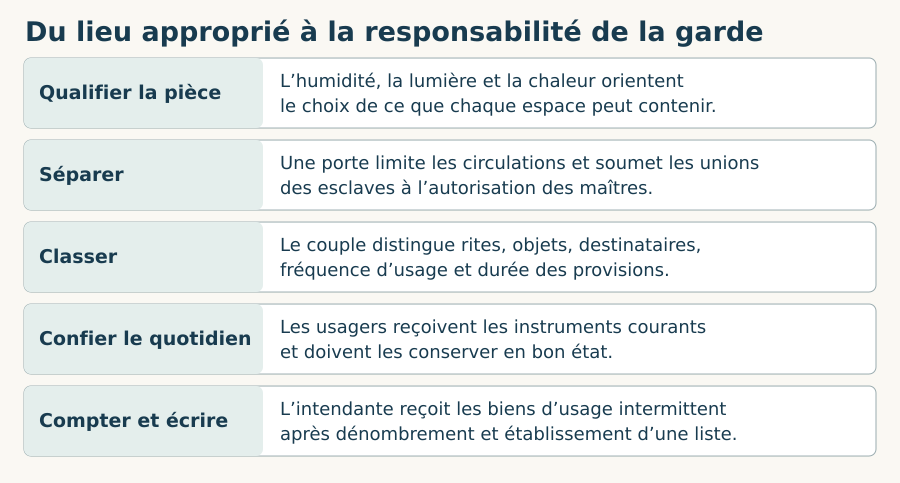

# ENS-PSL · CNEL Lettres — Xénophon — l’Économique 2023 · Corrigé brut

*Corrigé rédigé par IA, non officiel. Signalez toute erreur.*

**Rédaction** · GPT-6.2 Astra Ultra · vitesse non renseignée

**Autocontrôle** · GPT-6.2 Astra Ultra · vitesse non renseignée

## Classer des objets pour gouverner une maison

L’*Économique* de Xénophon met à distance la voix qui organise la maison. Ischomaque raconte à Socrate comment il a montré à sa femme l’usage des pièces et des biens. On entend donc un homme présenter à un autre l’éducation conjugale qu’il a conduite. Dans l’extrait IX, 2-10, la visite se transforme en classification, puis en distribution des responsabilités. L’enjeu est de montrer comment l’ordre matériel rend la prévision et la surveillance possibles, tout en donnant à cet ordre une apparence d’évidence.

La première justification est construite comme un raisonnement sur les fins. Les pièces ne sont pas distinguées par l’ornement que l’on devrait y admirer. Elles doivent convenir aux objets ou aux personnes qu’elles contiennent. Le sec préserve les céréales, le frais convient au vin, la lumière à certains travaux. L’orientation au midi est rapportée au soleil d’hiver et à l’ombre d’été. La répétition du verbe montrer établit l’autorité du pédagogue, mais la syntaxe fait aussi des pièces des sujets qui semblent appeler ce qui leur convient. Si la maison « invite » à faire le bon choix, Ischomaque peut présenter son enseignement comme la lecture d’une nécessité inscrite dans les choses. Cette figure naturalise un ordre qui contient à la fois une expérience des matériaux et des décisions prises par le maître.

Dans le passage à la porte fermée entre espace des femmes et espace des hommes, l’ambivalence devient manifeste. On pourrait croire lire seulement une description de l’habitat athénien. Or le locuteur précise ce à quoi la séparation doit servir dans sa maison. Elle contrôle la circulation des biens et soumet les unions fécondes des esclaves à l’autorisation des maîtres. Le jugement qui associe la naissance d’enfants, selon les cas, au dévouement ou au risque d’une action jugée mauvaise est celui du propriétaire. Il rend les corps et les familles intégrables à un projet de gestion. Le pronom « notre » dans l’expression de l’autorisation donne à l’épouse une part du pouvoir exercé sur d’autres personnes, au sein d’un dispositif dont son mari se présente comme le concepteur. Le texte distingue ainsi plusieurs rapports hiérarchiques que l’opposition entre hommes et femmes ne résume pas.

La visite change ensuite de sujet grammatical. Le « je lui montrais » fait place au « nous » qui rassemble et répartit les biens *kata phylas*, par catégories. Les objets du sacrifice viennent en tête. Puis le texte distingue notamment les parures des jours de fête, les vêtements et chaussures, les instruments de la laine, les ustensiles de cuisine et les services de table. Ce n’est pas un simple inventaire du contenu d’une demeure. Certaines divisions tiennent au destinataire, d’autres au geste, d’autres encore à la fréquence d’usage. Le service d’apparat se range autrement que le service quotidien ; des réserves prévues pour un an doivent rester distinctes des dépenses du mois. Les mêmes biens se trouvent ainsi rapportés à plusieurs calendriers, domestique, rituel et saisonnier. Savoir où quelque chose se trouve permet de savoir aussi combien de temps il doit durer.

L’ordre ne s’achève pas quand les objets ont rejoint leur place. Les usagers réguliers reçoivent les instruments dont ils se servent, apprennent où les ranger et doivent les rendre en bon état. Le circuit des biens d’usage intermittent est différent : l’intendante, *tamia*, reçoit les objets des fêtes et de l’hospitalité après indication des emplacements, dénombrement et établissement d’une liste écrite. La différence n’oppose donc pas mécaniquement objets coûteux et objets sans valeur. Le rythme irrégulier de consultation justifie une technique de mémoire distincte. Un outil quotidien manquant gêne immédiatement le travail, alors qu’une pièce d’apparat peut ne manquer aux yeux de personne pendant des mois. L’écrit rend possible la vérification en l’absence du besoin présent. Il matérialise aussi une relation de responsabilité entre celui qui confie et celle qui garde.

Le projet d’Ischomaque donne par conséquent à l’épouse une place active dans le « nous » de la gestion. Toutefois ses paroles directes sont absentes du passage, et les appréciations des esclaves n’ont aucune voix propre. Une demeure aisée, telle qu’un personnage la met en ordre devant Socrate, n’est pas le plan-type de toute maison grecque. Une piste de recherche consisterait à comparer les catégories de ce texte avec la répartition des objets dans des demeures fouillées, en distinguant soigneusement attribution archéologique d’un usage et norme littéraire. Un lot de pesons de métier peut documenter un travail de la laine en un lieu donné, sans identifier par lui-même le sexe ou le statut de chaque usager. L’écart entre l’ordonnance très lisible du récit et une preuve matérielle souvent équivoque devient alors une question historique, au lieu d’un défaut qu’il faudrait masquer.

[Sujet officiel](https://www.ens.psl.eu/sites/default/files/sc.antiquite-cnel-4.pdf)
