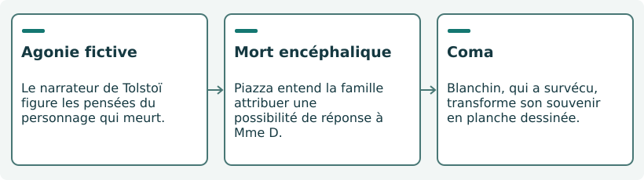

# ENS-PSL · Médecine-Humanités · Les expériences de mort imminente 2023 — Corrigé brut

*Corrigé rédigé par IA, non officiel. Signalez toute erreur.*

**Rédaction** · GPT-6.2 Astra Ultra · vitesse non renseignée

**Révision** · GPT-6.2 Astra Ultra · vitesse non renseignée

Écrit de 2023, trois heures. Le rapport commente en détail les trois pièces du dossier. [Sujet](https://web.archive.org/web/20240329005700id_/https://medecine-humanites.ens.fr/wp-content/uploads/2023/06/Sujet-1-EMI-MH2023.pdf) · [Rapport](https://web.archive.org/web/20240331041515id_/https://medecine-humanites.ens.fr/wp-content/uploads/2023/06/Rapport-Jury-MH2023.pdf)

## Qui peut raconter le seuil de la mort ?

Le fils d’Ivan Ilitch baise la main de son père. Pour l’enfant, le geste accompagne des cris et une longue agonie. Pour son père, dont Tolstoï nous fait partager les pensées, il transforme le sens de ce qui arrive. Deux heures s’écouleront encore au chevet de l’homme pour qui tout vient de se décider en un instant. Qui pourrait constater une pareille discordance hors d’un récit ? Le titre du dossier rapproche une agonie fictive, une situation de mort encéphalique et le souvenir d’un coma. Leurs issues et leurs témoins diffèrent. Leur confrontation porte dès lors sur une difficulté commune : comment reconnaître ce qu’un autre vit lorsque les signes de son corps ne donnent pas directement accès à son point de vue ?

## Ce que la fiction et le dessin rendent possible

La dernière expérience d’Ivan Ilitch débouche sur sa mort. Il ne reviendra pas sur ce moment pour le raconter. Tolstoï peut pourtant faire alterner les bruits entendus par les proches et la parole intérieure du personnage. La phrase « C’est fini ! », prononcée derrière le lit, change même de sens en changeant de lieu. Quelqu’un annonce la fin de l’agonie, Ivan comprend que c’en est fini de la mort. Le point lumineux prend son sens dans une scène morale précise. Ivan aperçoit son fils puis sa femme, reconnaît leur peine et voudrait les en délivrer. La lumière succède à l’effort pour demander pardon. La ramener à un symptôme commun à tous les mourants effacerait la construction de cette vie fictive. Le dénouement permet au lecteur de penser une expérience dont aucune personne morte ne pourrait livrer ensuite le récit.

Matthieu Blanchin, lui, dessine après avoir survécu au coma. La première personne désigne tantôt la silhouette recroquevillée, tantôt celui qui la regarde d’en haut. Les cadres changent d’échelle. Un corps que l’on voyait assez distinctement devient minuscule au pied de formes massives. Au milieu de la planche, le commentaire se demande comment la pensée tient encore au corps. Pendant ce temps, lettres étirées et cris déformés font percevoir l’effort de produire des sons. Le lecteur peut saisir simultanément la pensée articulée du récitatif et la difficulté de l’appel. Dans la dernière bande, une case très étroite sépare deux larges images de la silhouette aux prises avec ce que le narrateur nomme un « océan de feu ». Cette case ne contient plus qu’un fragment de cri au-dessus des flammes. L’œil du lecteur doit franchir la coupure pour retrouver le corps dont il vient de perdre la trace. Sous elles, le trait des mots finit par s’épaissir jusqu’à menacer leur lisibilité. Le dessin rend communicable une expérience de dissociation sans fournir pour autant l’enregistrement de ce qu’un témoin aurait pu filmer. Entre le coma et la page, il y a eu la survie, le souvenir et le travail du dessinateur.

## Deux interprétations au même chevet

Chez Sara Piazza, la situation est encore différente. Des examens ont confirmé la mort encéphalique de Mme D. L’équipe doit l’annoncer à ses proches devant un corps dont l’apparence demeure familière. L’« inquiétante étrangeté » renvoie à ce trouble du partage entre animé et inanimé. Un médecin propose à la fille d’assister à un nouvel examen afin de lui apporter une preuve. De fait, tous deux voient la même absence de réaction. Cette observation a toutefois des significations qui divergent. Pour le médecin, elle reçoit son sens des fonctions évaluées et du diagnostic déjà établi. Pour la fille, c’est un moment décisif que sa mère pourrait encore saisir. Lorsqu’elle sollicite sa mère plus vivement, elle essaie de lui venir en aide.

Le récit de l’entretien qui suit apporte ici une information qu’aucun examen neurologique ne pouvait produire. Ce qui désespère la fille, c’est qu’à ses yeux sa mère n’a pas pu répondre *au bon moment*. Elle lui prête donc une possibilité persistante de percevoir la situation et d’y prendre part. Cette attribution d’une expérience témoigne de la manière dont une famille pense le voisinage de la mort. Elle ne constitue pas un témoignage de Mme D sur une expérience personnelle. Inversement, reconnaître la valeur clinique des examens ne dispense pas d’écouter cette représentation. La présence d’une cousine qui connaît le milieu médical et parle français facilite les échanges, mais le malentendu excède la traduction des mots.

## Le temps nécessaire pour comprendre ce que l’autre entend

Les trois documents empêchent finalement de faire du visible un arbitre unique. Le geste de l’enfant chez Tolstoï obtient une réponse que le langage du mourant déforme. Le geste de la fille de Mme D n’en obtient pas, bien qu’il exprime lui aussi un attachement. Identifier les deux situations reviendrait à transporter le pouvoir du romancier au chevet d’une patiente réelle, comme s’il nous permettait d’en connaître les pensées. L’expérience rapportée par Blanchin ne permet pas davantage d’assimiler un coma dont on revient à la mort encéphalique. Elle donne en revanche aux soignants et aux proches une raison de se demander ce que signifient pour eux des mots aussi ordinaires que « présence » ou « réponse ». Pour la fille de Mme D, la demande de preuve a pris la forme d’une épreuve imposée à sa mère. En revenant sur ce qu’elle a compris, l’équipe peut enfin lui expliquer que le diagnostic ne dépendait d’aucun effort que sa mère aurait dû accomplir à cet instant.

## Conclusion

Le récit de fiction accueille une dernière pensée, l’autobiographie graphique reconstruit un vécu de survivant et la clinique rapporte une expérience attribuée par un tiers. Chacun éclaire une relation humaine à la mort, avec des possibilités de preuve différentes. Au chevet de quelqu’un, respecter cette différence peut commencer par une question simple : ce que je viens de vous montrer, qu’avez-vous compris qu’il arrivait à votre proche ?
