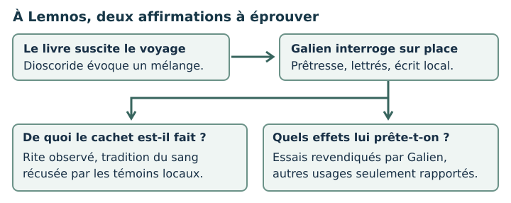

# ENS-PSL · Études classiques et archéologie · 2023 — corrigé brut

*Corrigé rédigé par IA, non officiel. Signalez toute erreur.*

**Rédaction** · GPT-6.2 Astra Ultra · vitesse non renseignée · 26 novembre 2026

## La pharmacie au temps de Galien

Près de Soles, à Chypre, des ouvriers se débarrassent d’une scorie dont Galien se charge volontiers. Comment un matériau délaissé par une mine peut-il devenir un médicament recherché à Rome ? Les huit passages traduits des *Simples* et des *Antidotes* invitent à suivre davantage qu’un itinéraire commercial. Au IIe siècle de notre ère, exercer la pharmacie suppose d’accéder aux matières, d’apprendre à les reconnaître, puis d’apprécier ce qu’elles deviennent dans un magasin ou au chevet d’un malade. À chaque étape, Galien inscrit son propre témoignage dans un ensemble de savoirs qui le précèdent et dont il veut éprouver la solidité.

### Aller à la source

Le site de Soles met en présence deux hommes pour qui le même lieu a des fonctions différentes. Aux yeux du préposé, le diphryge est un rebut de la métallurgie. Pour le médecin qui dit l’avoir employé contre des ulcères, cette matière est précieuse (texte 1). Le changement de valeur tient au déplacement d’un savoir et d’un usage. Il dépend aussi de l’accès au site de production. Dans le texte 2, le préposé montre à Galien trois couches superposées. Leur ordre lui permet de distinguer sory, chalcite et misy dans leur contexte et de comprendre quelles substances sont alors abondantes. Il serait hasardeux d’assigner à chacun de ces noms antiques une identité chimique certaine. Le renseignement communiqué sur le terrain importe aussi pour un achat immédiat. Les réserves voyagent ensuite de Chypre en Asie Mineure, puis à Rome. Près de trente ans plus tard, le médecin en possède encore.

Cette mobilité associe des acteurs très différents. Pour voir les cachets de Lemnos, Galien traverse une partie de l’Empire par terre, gagne la côte après Philippes et rejoint l’île par Thasos (texte 3). Le détail des étapes fait sentir le coût d’une vérification. D’autres fois, les produits accomplissent la plus grande partie du trajet à sa place. De retour de Palestine, il trouve en Phénicie du nerprun et de l’aloès réputés indiens (texte 5). La caravane et l’absence supposée, au pays des marchands, du bois qui sert de substitut appuient son jugement d’authenticité. Le trajet du lot est ici un indice. Constater son arrivée ne revient pas à avoir vu la récolte en Inde. Ces vérifications supposent enfin du temps et des ressources. Le texte 6 associe l’achat de réserves destinées à durer toute une vie à un apprentissage technique personnel, acquis dans sa jeunesse auprès d’un maître rémunéré à grand prix.

### Ce qu’une enquête permet de soutenir

À Lemnos, le voyage part d’une autorité livresque. Chez Dioscoride et d’autres auteurs, Galien a lu qu’on mêlait à la terre locale du sang de bouc. Il vient demander dans quelle proportion (texte 3). Ce qui lui arrive est plus instructif qu’une réponse chiffrée. Il observe la prêtresse, le geste rituel des grains jetés à terre, le prélèvement de la terre et son façonnage en cachets. Les lettrés interrogés accueillent par le rire la tradition du sang (texte 4). C’est donc la prémisse même de la question initiale qui doit être révisée. Le rite, en revanche, appartient bien à la pratique observée. Rejeter une histoire de mélange n’autorise pas à effacer la prêtresse de l’histoire du médicament. La note moderne jointe au troisième extrait reprend la tradition contestée dans le quatrième. Il faut faire entendre ce désaccord.

Le nouveau savoir ne se réduit pas davantage à ce que l’œil pourrait vérifier seul. Un habitant donne à Galien un ouvrage ancien sur les usages locaux. Galien acquiert vingt mille cachets et distingue, dans sa relation, plusieurs degrés d’engagement. Son informateur attribue à la terre des effets sur les blessures, les morsures et certains empoisonnements. Galien revendique pour sa part une expérience dans quelques cas déterminés. La guérison après morsure d’un chien enragé demeure attribuée à son interlocuteur. Rien dans le dossier n’établit cette efficacité. Voir fabriquer un objet et certifier ce qu’il guérit sont deux opérations distinctes. La première peut étayer une histoire du médicament même lorsque la seconde reste incertaine.

### Le temps d'une substance et celui du malade

La constitution d’un stock résout le problème du voyage et en fait apparaître un autre. La pharmacie impériale conserve de la cannelle issue de plusieurs règnes. Galien compare la force de l’odeur et du goût de lots dont les qualités originelles lui paraissent bonnes (texte 7). Un arbre récemment apporté fournit à Marc-Aurèle une préparation qu’il juge si satisfaisante qu’il veut l’employer avant la maturation habituelle. À la succession de Commode, l’intérêt impérial change et des réserves se perdent. Lorsque Septime Sévère demande que l’on refasse la préparation, les anciens lots sont moins puissants au jugement de Galien. La permanence d’une recette écrite ne garantit donc pas l’identité du résultat. La conservation, le renouvellement des matières et les décisions du prince entrent tous dans l’histoire du médicament.

Le dernier extrait change encore l’échelle de temps. Galien observe chez Marc-Aurèle une succession d’états au cours de l’usage quotidien de la thériaque (texte 8). Il rapporte la somnolence diurne, l’insomnie après suppression du jus de pavot, puis la reprise d’une préparation dont le composant est plus ancien. Pour l’expliquer, il associe l’habitude du patient, l’action desséchante qu’il prête au produit et l’affaiblissement lié à l’âge de celui-ci. Un lecteur moderne peut y reconnaître des signes compatibles avec une dépendance physique. Le dossier ne permet de mesurer ni les propriétés des différents lots ni le rôle de chaque composant. Il ne suffit pas non plus à poser rétrospectivement un diagnostic d’addiction. La précision de la chronologie permet justement de séparer ce qui fut observé des causes qu’on lui attribue.

### Conclusion

L’excellence que revendique Galien repose sur une aptitude à suivre les matières jusque dans leurs transformations. Elle associe le savoir du mineur, la pratique de la prêtresse, les lectures et les échanges avec les lettrés, l’apprentissage auprès d’un spécialiste et l’accès aux magasins impériaux. La première personne de ces récits construit l’autorité du médecin autant qu’elle délimite son témoignage. Elle nous permet de savoir où il était, ce qu’on lui a dit et ce qu’il a cru constater. Reconstituer ces différences donne à la fois une histoire matérielle de la pharmacie romaine et une lecture critique de ses prétentions à la preuve.
