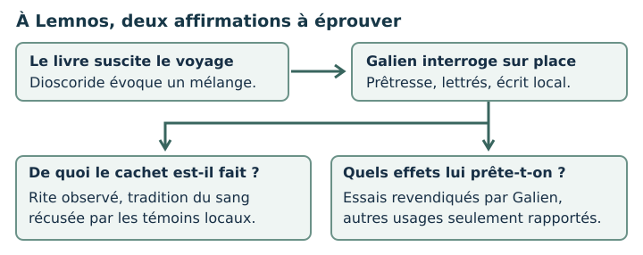

# ENS-PSL · Études classiques et archéologie · 2023 — corrigé guidé

*Corrigé rédigé par IA, non officiel. Signalez toute erreur.*

**Rédaction** · GPT-6.2 Astra Ultra · vitesse non renseignée · 26 novembre 2026

## Faire la synthèse des huit textes de Galien

L’oral se déroule en français après une heure de préparation. Le passage dure trente minutes. Le sujet demande une synthèse avec introduction, parties et conclusion. Pour trouver votre question directrice, repartez du texte 1. Ce que l’on jette à la sortie d’une mine passe dans la collection d’un médecin. Par quel travail un matériau acquiert-il à ses yeux une identité, une valeur et une indication médicale ?

### Relever les pièces à conviction

Consacrez un premier passage à la lecture des textes et de leurs notes. Pour chacun, relevez qui parle, ce qui a été vu et ce qui est déduit. Vous obtiendrez huit indices utilisables à plusieurs endroits du plan.

| Texte | Détail à retenir | Ce qu’il permet d’expliquer |
| ----- | ---------------- | --------------------------- |
| 1 | Le diphryge est jeté près de la mine de Soles. | Une substance sans valeur pour le préposé acquiert une valeur d’usage pour le médecin. |
| 2 | Le préposé montre trois couches. Les acquisitions passent par l’Asie Mineure avant de gagner Rome. | L’observation locale distingue les minéraux. Le transport rend possibles des réserves conservées des décennies. |
| 3 | Une lecture de Dioscoride pousse Galien à chercher une proportion. Il rejoint Lemnos par Philippes et Thasos. | Une affirmation écrite crée une question dont la vérification coûte un voyage. |
| 4 | La prêtresse accomplit son rite. Les lettrés rient du mélange allégué. Un habitant fournit un livre. | Ce que Galien voit, ce qu’il lit et ce que d’autres garantissent ont des statuts distincts. |
| 5 | Des marchands arrivent en Phénicie avec des substances réputées venir d’Inde. | Galien infère l’authenticité à partir du circuit et d’un argument sur la répartition du bois de substitution. |
| 6 | Un spécialiste rémunéré lui enseigne à préparer les remèdes. | L’acquisition de matières en quantité sert un savoir-faire appris et financé. |
| 7 | Des dépôts de cannelle s’échelonnent depuis Trajan. Plusieurs règnes modifient le stock accessible. | Une même recette dépend de la fraîcheur des lots et des décisions des empereurs. |
| 8 | Le récit suit les effets successifs de la thériaque prise par Marc-Aurèle. | La chronologie fournit des observations et suscite des explications concurrentes. |

### Regrouper les textes pour faire avancer une question

**D’où vient une matière jugée digne d’entrer dans la pharmacie ?** Développez ensemble les textes 1, 2, 5 et 6. Dans une mine, le dépôt environnant et le savoir du préposé renseignent Galien sur ce qu’il emporte. Sur un marché lointain du lieu de récolte, il doit remonter le circuit en pensée. La provenance relève alors de l’indice. Le transport à dos de chameau, pris isolément, ne certifie aucune origine botanique. Reliez ces deux manières de choisir au prix payé pour l’apprentissage et au coût du voyage. Acheter en une fois une réserve pour la vie est une décision économique aussi bien que technique. Terminez par une transition vers la vérification : que se passe-t-il quand le déplacement contredit la source qui l’avait motivé ?

**À Lemnos, qu’est-ce qui fait changer la question ?** Faites de la succession des textes 3 et 4 le centre de l’exposé. Galien arrive pour déterminer la proportion d’un mélange dont il présume l’existence. Le rite auquel il assiste et les réponses locales l’amènent à douter de ce présupposé. Le détail du blé et de l’orge appartient à l’observation. La croyance au sang de bouc appartient à la tradition qu’il interroge. La note moderne du texte 3 reprend cette tradition, alors que le récit du texte 4 la met en cause. L’épisode ne s’achève pas sur le rejet des livres : un lettré du lieu en fournit un autre. Séparez ensuite ce que Galien dit avoir essayé de ce que son informateur attribue aux cachets. La promesse de guérir la morsure d’un chien enragé n’est accompagnée ici d’aucune démonstration.

**Que peut-on encore affirmer après des années de conservation ou d’emploi ?** Revenez à la réserve chypriote du texte 2 et confrontez-la à la cannelle du texte 7. Posséder encore une substance ne renseigne pas en soi sur la permanence de ses propriétés. La série impériale donne l’occasion d’une comparaison sensorielle. On peut aussi y lire une histoire politique. Marc-Aurèle privilégie un nouveau lot, Commode laisse périr des réserves, puis Septime Sévère demande à reprendre l’ancienne fabrication. Avec le texte 8, passez de la durée du stock à celle de la prise par le patient. Somnolence, interruption d’un constituant, insomnie et reprise forment une séquence. Galien fait jouer l’habitude, la complexion et l’âge du produit. Une lecture actuelle peut envisager un phénomène de dépendance physique. Un récit de cas, sans comparaison contrôlée, laisse la cause précise ouverte.

### Faire entendre le raisonnement

**Une introduction possible.** « Il faut parcourir des centaines de stades pour apprendre qu’une question est peut-être mal posée. Galien est venu à Lemnos chercher la proportion d’un ingrédient. Ses interlocuteurs lui demandent implicitement pourquoi il croit qu’on l’utilise. Cette scène éclaire les huit textes : comment le médecin construit-il son autorité sur des substances dont il ne peut connaître seul la provenance, la préparation et les effets ? »

**Une conclusion possible.** « Galien demande au terrain de contrôler les livres, aux praticiens de lui enseigner un geste et à la répétition d’une observation de l’éclairer sur un effet. L’Empire donne à cette enquête des routes, des langues de travail, des marchés et des magasins impériaux. Le médecin ordonne en récit ce que ces réseaux lui ont permis de connaître. Les différents niveaux de preuve demeurent lisibles, jusque dans les hypothèses qu’un lecteur d’aujourd’hui ne saurait confirmer. »

**Pour l’entretien.** Si l’on vous demande pourquoi un témoignage de première main garde des limites, opposez la visite de la mine à l’interprétation du sommeil de Marc-Aurèle. Dans les deux cas Galien est présent, mais observer une couche minérale et attribuer un effet à un constituant sont deux opérations intellectuelles différentes. Si l’on vous demande s’il écarte le rite de la pharmacie, rappelez le rôle effectif de la prêtresse. Un acte peut avoir une importance sociale et matérielle attestée sans que son efficacité thérapeutique soit établie.
