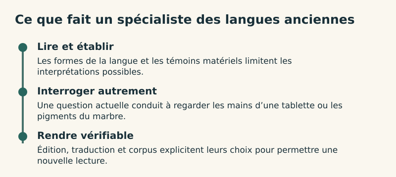

# ENS-PSL — Études classiques 2023 · Corrigé guidé

*Corrigé rédigé par IA, non officiel. Signalez toute erreur.*

**Rédaction** · GPT-6.2 Astra Ultra · vitesse non renseignée

[Sujet officiel](https://www.ens.psl.eu/sites/default/files/et.classiques-archeologie-ecrit-sil2023.pdf)

L’écrit de trois heures demande en français ce que signifie être helléniste ou latiniste aujourd’hui. Le vers d’Ovide, *Fastes*, I, 225, sert de point de départ. La copie proposée suit les deux à quatre parties prescrites.

## Construire la réponse

**Partir du verbe.** Entourer les deux premières personnes du pluriel et rendre à *utimur* le sens d’un usage. Le commentaire de ce vers doit ouvrir l’argumentation, puis l’essai répondra à la question sur un métier ou une pratique actuels.

**Faire travailler un exemple.** Dans la tablette d’invitation de Vindolanda, distinguer deux mains permet de séparer l’attribution de la lettre, la présence probable d’un secrétaire et l’intervention personnelle de l’expéditrice. C’est cette inférence contrôlée, plus que l’anecdote de l’anniversaire, qui répond au sujet.

**Choisir le nombre de parties demandé.** Trois opérations ordonnent ici la copie, établir ce qu’on peut lire, laisser des questions nouvelles rencontrer des traces résistantes, puis rendre les résultats contrôlables. Chacune s’appuie sur un cas et conduit à une proposition sur la pratique contemporaine.

## Exposé

Lorsque, dans les *Fastes*, Janus oppose les anciens que l’on célèbre aux années dont on fait usage, sa remarque survient dans une conversation sur les étrennes et le goût de l’or. Le passé vertueux fait un excellent sujet de louange, mais les cadeaux que l’on aime recevoir se choisissent au présent. La pointe atteint également celui qui se réclame aujourd’hui des lettres anciennes. S’il ne fait que louer l’Antiquité, le chercheur peut reproduire exactement la complaisance qu’Ovide prête à ses contemporains. À quoi reconnaîtrait-on un usage exigeant du grec et du latin qui assume son temps et ne prête pas aux anciens les évidences du nôtre ?

### Acquérir des moyens de contredire sa première lecture

L’helléniste ou le latiniste apprend d’abord à ralentir une opération qui semble aller de soi, traduire un mot par un autre. Dans le vers proposé, le sujet de *laudamus* est aussi celui de *utimur*. Celui qui célèbre et celui qui vit sont la même personne. L’ablatif *nostris annis* dépend du déponent *utimur* et l’action d’user de son propre temps donne un contenu concret à l’opposition. La traduction fluide « nous sommes de notre temps » restitue la pointe sans rendre sensible au même degré cette idée d’usage. Lire les formes permet de discuter les choix qui nous livrent un texte sans avoir à contester pour autant la compétence de son traducteur.

Il arrive aussi qu’il faille demander de quel texte nous disposons. Un papyrus mutilé de Sappho et une citation du même poème chez un autre auteur ne sont pas deux photocopies d’un original. La citation a pu adapter sa source à un argument et le papyrus a perdu une partie de ses lettres. Un éditeur rend service à ses lecteurs lorsqu’il affiche ce qu’il restitue et laisse ouvertes les lectures entre lesquelles il ne peut décider. L’incertitude documentée est alors un résultat du savoir. Voilà une première manière d’appartenir au présent, en offrant au public de quoi vérifier une affirmation d’autorité.

### Changer les questions en gardant le droit de recevoir une réponse dérangeante

Les disciplines classiques se sont longtemps reconnues dans un petit nombre d’œuvres enseignées et recopiées. Elles disposent pourtant d’autres voix, par exemple des tablettes de Vindolanda, sur la frontière nord de la Bretagne romaine. L’invitation de Claudia Severa à Sulpicia Lepidina pour son anniversaire fait apparaître la sociabilité de femmes liées aux garnisons. La différence de main entre le corps de la lettre et son salut personnel invite à distinguer rédaction matérielle, énonciation et signature. Une question très présente, celle des femmes à l’écrit, rencontre ainsi un détail susceptible de modifier la réponse. La lettre ne démontre pas que toutes les habitantes de la frontière jouissaient de la même liberté d’écrire ou de recevoir.

De même, considérer la couleur des sculptures grecques oblige à confronter une longue admiration européenne pour le marbre blanc avec les traces de pigments. Une reconstitution demeure une hypothèse documentée quant aux zones colorées, aux matières et parfois à leur éclat. Ni la blancheur familière des salles de musée ni une restitution spectaculaire n’ont le pouvoir de décider à elles seules de l’apparence ancienne. L’helléniste tient ici autant du lecteur que de l’interlocuteur de l’archéologue, du restaurateur et du public qui a appris à admirer ces œuvres d’une certaine façon.

### Faire circuler les textes et rendre les interprétations responsables

Un corpus numérique peut permettre de retrouver en quelques instants les emplois d’un terme et leurs contextes. Il ne suffit pas de compter les résultats pour connaître la pensée « des Grecs » ou « des Romains ». Des genres littéraires ont été beaucoup mieux transmis que d’autres. Une recherche portant sur une seule forme fléchie perdra les autres cas du même mot. La compétence linguistique et l’histoire de la conservation permettent de préciser ce que le décompte mesure. La publication du corpus et de la requête offre ensuite à des lecteurs éloignés la possibilité d’en éprouver les conclusions. Se servir des instruments de son temps oblige donc à rendre compte de leurs limites aussi bien que de leur puissance.

Cette responsabilité s’étend à l’enseignement et à la traduction publique. Mettre une traduction en regard du grec ou du latin ouvre l’accès à celui qui débute et lui donne en même temps les moyens de dépasser sa première lecture. Le spécialiste ne possède aucun monopole sur les œuvres. Il a mieux à offrir qu’un certificat de noblesse culturelle, la possibilité donnée à d’autres de revoir une traduction, de rectifier une attribution, de découvrir un témoin qui manquait. Être helléniste ou latiniste aujourd’hui, c’est rendre des questions présentes responsables devant des traces anciennes et rendre ses propres réponses accessibles à ceux qui les reprendront après nous.

## Mettre l’argument à l’épreuve

**Une base de données garantit-elle la représentativité ?** Il faut connaître les textes inclus, la qualité de leur balisage et les choix de transmission qui précèdent la numérisation. Une occurrence retrouvée est un fait local, une absence de résultat exige davantage de précautions.

**Un amateur peut-il être helléniste ou latiniste ?** Le statut professionnel ne tranche pas la question. La capacité à justifier une lecture, à distinguer une donnée d’une restitution et à accepter la correction fournit un critère plus directement lié aux pratiques discutées.
