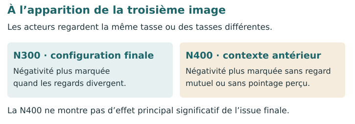

# ENS-PSL · Sélection internationale Lettres — Signaux de communication, oral 2023 · Corrigé brut

*Corrigé rédigé par IA, non officiel. Signalez toute erreur.*

**Lecture du rapport du jury** · GPT-6.2 Astra Ultra · vitesse non renseignée

**Rédaction** · GPT-6.2 Astra Ultra · vitesse non renseignée

**Couverture partielle de l’oral.** Le jury décrit trente minutes de préparation et trente minutes d’oral en visioconférence. Le billet scientifique comporte les dix questions traitées ici. L’entretien de motivation, seconde partie obligatoire, portait sur le parcours, la connaissance de la formation et les objectifs de la personne admise à passer l’épreuve. Le rapport en décrit les thèmes. Les questions effectivement posées et les réponses personnelles restent inconnues.

### 1. Le problème d’un observateur extérieur

Quand deux personnes échangent un regard et que l’une pointe un objet, que s’attend à voir un tiers ? Kourtis et ses collègues cherchent à savoir si les signaux non verbaux l’amènent à attendre une issue précise, l’attention des partenaires au même objet, ou s’ils facilitent plus largement l’interprétation de leur conduite ultérieure. L’étude porte sur l’observateur, qui ne participe pas à l’échange.

### 2. Les prédictions

Les auteurs distinguent deux moments après l’apparition de la scène finale. Une première catégorisation visuelle devrait être facilitée quand les acteurs regardent le même objet, configuration supposée familière. Elle se traduirait par une composante électrique N300 moins marquée. Une seconde opération rapporterait la scène à l’échange précédent. Elle devrait demander davantage d’intégration s’il a manqué un contact visuel mutuel ou si le destinataire n’a pas vu le pointage. La négativité N400 devrait alors être plus marquée.

Deux hypothèses précisent ce dernier effet. Si la communication crée une attente spécifique d’attention conjointe, les regards divergents après un échange devraient troubler l’intégration de la scène. Si elle rend plusieurs réponses compréhensibles, l’observateur pourra interpréter les deux issues et la N400 distinguera peu les regards conjoints et divergents.

### 3. Trois images et huit conditions

Vingt-quatre adultes regardent des suites de trois photographies de deux acteurs à une table où se trouvent deux tasses. Sur l’image 1 (1,5 seconde), le premier regarde son partenaire, qui soutient son regard ou a les yeux fermés. Sur l’image 2 (1,8 seconde), le premier pointe une tasse en la regardant. Le destinataire a les yeux ouverts ou fermés. Sur l’image 3 (1 seconde), le premier regarde la tasse désignée et le second regarde cette même tasse ou l’autre. Ces trois facteurs binaires se croisent en huit conditions. L’EEG du spectateur est enregistré. Certains essais sont suivis d’une question factuelle sur l’une des trois images, pour vérifier qu’il suit l’échange.

### 4. Ce que signalent regard mutuel et pointage

Le contact visuel réciproque établit une relation entre les deux personnes. Il donne au tiers une raison d’inférer qu’elles communiquent, tout en laissant ouvert le référent. Le pointage est dirigé vers une cible, ici l’une des tasses. Le voir permet d’identifier cette cible sans suffire à décider si le geste signifie « prends-la », « regarde-la » ou autre chose. Le geste du premier est présent à chaque essai. C’est l’accès visuel du destinataire au geste qui change. Le spectateur voit la scène dans les deux cas.

### 5. Comment l’EEG met les prédictions à l’épreuve

Les chercheurs alignent les enregistrements sur l’apparition de la troisième image et moyennent les signaux par condition. Ils comparent les amplitudes des potentiels évoqués dans plusieurs régions médianes du cuir chevelu. La N300 fournit un indice du traitement visuel précoce de la relation entre acteurs et objets. La N400 renseigne sur l’intégration de la scène avec les informations données antérieurement. Leur succession rend testable une dissociation temporelle. La P300, également analysée, sert d’indice indirect de processus de mémoire de travail. Aucun de ces potentiels ne livre le contenu précis qu’un participant attribue au geste.

### 6. Le contrebalancement

Le plan fait varier séparément contact mutuel, accès au pointage et objet finalement regardé, chaque modalité sur la moitié des essais. Un signal ne permet donc pas de deviner l’issue par sa seule fréquence. Huit blocs de 72 essais comportent chacun douze essais avec question. Les questions se rapportent aux trois images à probabilités égales. Le communicateur figure à gauche dans la moitié des blocs et à droite dans l’autre moitié. Les côtés alternent, l’ordre de départ et l’affectation des touches « oui » et « non » sont contrebalancés entre participants.

Ce plan est approprié pour distinguer les trois facteurs. Une limite demeure dans leur matérialisation, car fermer les yeux modifie à la fois l’accès au signal et l’aspect visible de la scène. L’équilibre des fréquences ne sépare pas ces deux propriétés.

### 7. Ce que montrent les résultats

Les participants répondent correctement à environ 90 % des questions de contrôle. La N300 est plus marquée quand les acteurs finissent par regarder des objets distincts ($p=0{,}027$), conformément à l’hypothèse d’une première catégorisation sensible à la configuration finale. Une interaction supplémentaire avec la région de mesure et les deux signaux est rapportée. Les auteurs sont prudents quant à son interprétation.

Pour la N400, les effets principaux correspondent aux **signaux antérieurs**. La négativité est plus forte en l’absence de regard mutuel ($p=0{,}012$) et quand le destinataire n’a pas vu le pointage ($p=0{,}025$). L’effet principal de l’attention conjointe finale n’est pas significatif ($p=0{,}201$). Une interaction avec la région existe, mais aucun contraste local ne franchit le seuil corrigé. La P300 varie avec la région, sans effet significatif des facteurs sociaux. Le profil favorise l’idée d’une interprétation facilitée pour plusieurs issues. L’absence de différence significative ne démontre pas l’identité exacte des réponses aux deux issues.

### 8. Les limites

L’échantillon compte 24 adultes. La répétition de photos fixes avec deux objets et des issues équiprobables peut créer des attentes propres à la tâche. Les questions de contrôle vérifient la mémoire des scènes, sans demander ce que le destinataire voulait dire. Elles peuvent inciter à suivre explicitement les yeux des acteurs. Enfin, un regard détourné, une distraction et des yeux fermés ne signalent pas la même chose dans la vie ordinaire. La généralisation à un échange vivant ou à un autre mode de communication demande des données nouvelles.

### 9. La question théorique

L’établissement d’un contact communicatif impose-t-il une interprétation déterminée, ou aide-t-il à trouver un sens à plusieurs conduites ? Une personne peut reconnaître vite une scène d’attention conjointe, puis admettre, en contexte, qu’un partenaire qui a vu le geste ait de bonnes raisons de regarder ailleurs. La sensibilité précoce à la configuration et la sensibilité tardive aux indices antérieurs rendent cette articulation plausible. La N400 et les réponses factuelles ne permettent cependant pas de compter les interprétations envisagées ni d’établir qu’une intention particulière a été attribuée.

### 10. Une extension qui départage des explications

On pourrait apprendre au spectateur que le rôle des deux acteurs change selon la consigne. Lorsqu’ils doivent choisir ensemble une tasse, regarder la même est cohérent. Lorsqu’ils doivent inspecter les deux tasses en se répartissant le travail, regarder des objets différents est cohérent. On montrerait les mêmes photos finales et on équilibrerait leurs fréquences dans chaque contexte. Si la N400 reflète une intégration au but, la configuration qui l’augmente devrait changer avec la consigne. Un avantage purement visuel pour les regards convergents devrait se maintenir à la N300. Un jugement de plausibilité recueilli séparément permettrait de vérifier que les spectateurs ont compris les deux buts.

## Documents de l’épreuve

[Feuillet bilingue du jury](https://www.ens.psl.eu/sites/default/files/cogsci-oral-sil2023.pdf) · [Kourtis et collègues (2020)](https://www.nature.com/articles/s41598-020-75283-3.pdf) · [Rapport du jury de la session](https://www.ens.psl.eu/sites/default/files/rapport_sil_dec_2022-2023.pdf)
