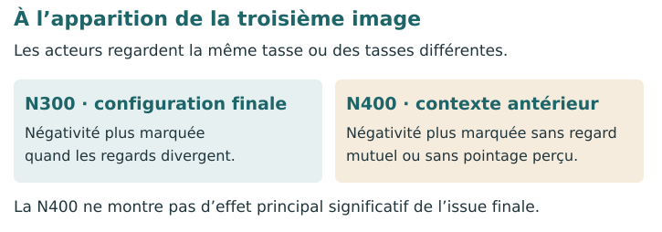

# ENS-PSL · Sélection internationale Lettres — Signaux de communication, oral 2023 · Corrigé guidé

*Corrigé rédigé par IA, non officiel. Signalez toute erreur.*

**Lecture du rapport du jury** · GPT-6.2 Astra Ultra · vitesse non renseignée

**Rédaction** · GPT-6.2 Astra Ultra · vitesse non renseignée

**Couverture partielle de l’oral.** La préparation peut porter sur toutes les questions de l’article de Kourtis et collègues. Le rapport signale également un entretien obligatoire sur les motivations, la formation et le projet de la personne convoquée. Cette partie personnalisée, dont les échanges ne sont pas publiés, reste hors de la couverture effective. Le rapport compte trente minutes de préparation et trente minutes d’épreuve pour l’ensemble de l’oral.

### 1. Se placer du côté de la troisième personne

Imaginez deux personnes qui se regardent, puis l’une d’elles qui montre une tasse. Vous voyez enfin leurs yeux se diriger vers deux objets différents. Est-ce inattendu ? Pourquoi ? L’objectif de l’article est de savoir comment **vous**, observateur, interprétez la dernière scène en fonction des deux premières. Un auditeur ou un destinataire personnellement engagé disposerait d’autres informations.

### 2. Formuler deux prédictions qui pourraient diverger

Commencez par masquer le début de la séquence. La scène où deux personnes proches partagent leur regard sur une tasse pourrait être plus facile à catégoriser. On prévoit pour elle une N300 atténuée. Rétablissez ensuite les images antérieures. Reconnaître qu’un échange a eu lieu devrait faciliter l’intégration de la fin et atténuer la N400. Reste une alternative. Si le pointage crée une attente étroite, la fin divergente après communication devrait engendrer une difficulté spécifique. S’il rend l’échange intelligible pour plusieurs fins possibles, la N400 pourra s’atténuer même quand le destinataire regarde ailleurs.

### 3. Reconstituer un essai

Choisissez mentalement trois réponses binaires. Les acteurs se sont-ils regardés ? Le second a-t-il pu voir le doigt qui désigne une des deux tasses ? A-t-il ensuite regardé la tasse que regarde le premier ? Chacune de ces réponses décrit une photographie différente. L’ordre est fixe et correspond à celui de l’interaction. Toutes les combinaisons donnent huit conditions. Les 24 volontaires voient ces séquences pendant l’enregistrement de leur EEG. De temps à autre une question porte sur l’une des trois images, ce qui oblige à suivre tout l’essai.

### 4. Décomposer l’information apportée

Dans la première image, un regard partagé fait savoir au tiers que les partenaires peuvent se reconnaître comme interlocuteurs. Il dit encore peu sur un objet extérieur. Dans la deuxième, le doigt et le regard du premier acteur fixent une direction. L’index désigne une tasse, mais le but de ce geste reste ouvert. Observez aussi le second acteur. Si ses yeux sont fermés, le doigt a bien été tendu et vous, spectateur, l’avez vu. Le destinataire ne dispose pas de la même information. Cette distinction est précisément la manipulation expérimentale.

### 5. Lire deux fenêtres temporelles

Prenez l’apparition de la troisième photographie comme origine du temps. Les chercheurs alignent et moyennent les réponses électriques dans chaque condition pour estimer les potentiels évoqués. Comparez d’abord les configurations de regards finaux. Une différence précoce de N300 convient à l’idée d’une catégorisation rapide. Comparez ensuite des fins en tenant compte des signaux qui les précédaient. Une différence de N400 serait compatible avec une intégration contextuelle. La P300 apporte un indice complémentaire sur la mobilisation de la mémoire de travail. L’analyse porte sur des différences d’amplitude selon plusieurs régions du scalp. Une onde isolée ne constitue pas le récit de ce que pense un observateur.

### 6. Vérifier un risque de confusion à la fois

Si le pointage vu conduisait presque toujours à la même tasse, une prédiction pourrait venir de la fréquence apprise. Ici, les trois alternatives à deux niveaux sont croisées et équilibrées. Si le premier acteur était toujours à gauche, le côté pourrait orienter l’attention. Les blocs alternent le côté, avec contrebalancement de l’ordre initial entre personnes. L’affectation oui/non aux touches est inversée entre participants. Enfin, douze essais sur 72 dans chaque bloc se terminent par une question, répartie entre les trois images. Cet équilibre satisfait une grande partie de la demande méthodologique. La différence visuelle entre paupières ouvertes et fermées accompagne toujours la perception figurée du signal. Elle mérite un contrôle supplémentaire.

### 7. Dire à la fois l’effet et la comparaison

Lorsque les deux acteurs regardent deux tasses différentes, la N300 est plus ample que lorsqu’ils en regardent une seule. Ce résultat va dans le sens d’une catégorisation visuelle plus aisée de l’attention conjointe. À la N400, cherchez plutôt ce qu’a vu le destinataire. Un contact visuel mutuel antérieur ou un pointage perçu atténue cette composante. L’effet principal du partage final de l’attention n’atteint pas la significativité. Une interaction entre partage et région est observée, sans différence locale significative après correction. La P300 n’apporte pas d’effet social correspondant. Les quelque 90 % de bonnes réponses aux essais de contrôle confirment que le groupe suivait les événements. On peut défendre l’hypothèse d’un effet contextuel assez général et garder ouverte la possibilité d’une différence de faible amplitude entre les deux fins.

### 8. Relier une limite à la conclusion menacée

Les volontaires regardent à répétition des photographies avec deux objets. La fréquence d’un regard divergent est élevée, ce qui peut le rendre moins surprenant qu’il ne le serait dans un échange naturel. Le groupe est de petite taille pour écarter un effet subtil. Les yeux fermés changent en même temps l’apparence, l’engagement attribué à l’acteur et son accès à l’information. Enfin, les réponses demandées portent sur ce qui était visible. Une suite de photos bien mémorisée peut recevoir plusieurs interprétations dont aucune n’est recueillie directement.

### 9. Défendre une interprétation théorique en deux phrases

Un signal adressé à quelqu’un peut annoncer un échange sans imposer à l’observateur une intention ou une réponse uniques. Les données conviennent à une distinction entre une organisation visuelle rapidement reconnue et une appréciation ultérieure de plusieurs issues en contexte. Pour défendre cette lecture devant le jury, citez la dissociation N300/N400, puis dites ce qui manque. Un choix entre plusieurs intentions ou un jugement de plausibilité permettrait d’identifier les interprétations effectivement retenues par les participants.

### 10. Concevoir une vérification nouvelle

Donnez aux deux acteurs, selon les blocs, un but de sélection commune ou un but de répartition du travail. Dans le second cas, chacun doit inspecter une tasse différente. Gardez les mêmes images finales et leurs proportions, et contrebalancez l’ordre des blocs. Demandez d’abord à d’autres participants de juger quelle fin convient à chaque consigne. Si l’intégration sémantique dépend du but, la fin la plus facile à interpréter devrait s’inverser avec ce but et la N400 suivre ce changement. Si la première catégorisation tient surtout à la scène finale, l’avantage N300 des regards convergents devrait persister. Il s’agit de prédictions pour une étude à venir.

## Documents de l’épreuve

[Feuillet bilingue du jury](https://www.ens.psl.eu/sites/default/files/cogsci-oral-sil2023.pdf) · [Kourtis et collègues (2020)](https://www.nature.com/articles/s41598-020-75283-3.pdf) · [Rapport du jury de la session](https://www.ens.psl.eu/sites/default/files/rapport_sil_dec_2022-2023.pdf)
