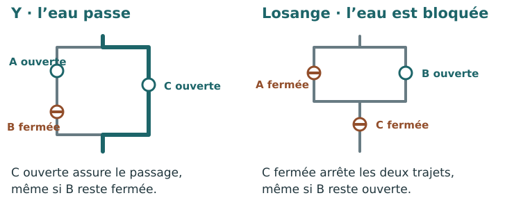

# ENS-PSL · Sélection internationale Lettres — Études cognitives 2023 · Corrigé brut

*Corrigé rédigé par IA, non officiel. Signalez toute erreur.*

**Lecture du rapport du jury** · GPT-6.2 Astra Ultra · vitesse non renseignée

**Rédaction** · GPT-6.2 Astra Ultra · vitesse non renseignée

L’écrit de deux heures demande de répondre en français aux sept questions sur l’article de Chung, Bade, Blanc-Cuenca et Mascarenhas (2022).

### 1. Une erreur de déduction peut-elle être induite visuellement ?

Les auteurs cherchent à comprendre pourquoi l’on accepte souvent $b$ lorsqu’on sait que $(a \land b) \lor c$ et que $a$. Les prémisses sont compatibles avec $a$ et $c$ vrais et $b$ faux. La déduction est donc invalide, même si l’on donne au « ou » un sens exclusif entre les deux branches. Pourtant, dans un énoncé en langue naturelle, un auditeur peut enrichir le sens de la première prémisse et croire que l’information reçue écarte ce contre-exemple. L’étude cherche si une présentation visuelle qui évite la formulation verbale des prémisses produit encore l’illusion et ce que cela révèle sur le raisonnement par alternatives.

### 2. Les hypothèses et les prédictions

Le modèle en termes de questions et de réponses décrit la disjonction comme l’ouverture d’une question implicite. Laquelle des deux possibilités, $a \land b$ ou $c$, explique ce qui arrive ? Apprendre $a$ ressemble à un indice en faveur de la première. Le sujet risque alors de retenir cette branche entière, donc $b$, alors que $a$ est aussi compatible avec la seconde branche. Une inférence pragmatique liée à la formulation en mots pourrait amplifier cet effet.

Si cette dynamique opère devant une animation, révéler $a$ doit augmenter les « oui, $b$ est certain » par rapport à une animation de référence sans cet indice et à un problème de contrôle manifestement indéterminé. Les erreurs devraient rester moins fréquentes que dans les études verbales antérieures. Les auteurs envisagent deux influences de la géométrie du montage. Dans le Y, la proximité pourrait renforcer l’association entre les deux premières vannes. Le losange, plus complexe, pourrait aussi augmenter les erreurs.

### 3. Le protocole

401 adultes recrutés en ligne sont répartis aléatoirement entre quatre groupes. Deux animations de familiarisation montrent le trajet de l’eau, l’effet d’une vanne et la possibilité qu’une vanne tourne derrière un cache. Chaque personne reçoit ensuite un essai critique, Y ou losange, cible ou référence.

Dans le Y, l’eau s’est mise à couler. Elle peut traverser deux vannes en série à gauche, A et B, ou passer par C à droite. En condition cible, une fenêtre montre A ouverte. Le participant doit décider si B est **nécessairement** ouverte. Dans le losange, A et B occupent deux branches parallèles qui se rejoignent avant C. L’eau a cessé de passer. A et B doivent être toutes deux fermées, ou C doit être fermée. Montrer A fermée laisse ouverte la question de B. Dans chaque montage, la référence omet la révélation de A. Des animations de syllogisme disjonctif et des images statiques complètent l’épreuve.

### 4. L’intérêt du paradigme visuel

L’écoulement ou l’arrêt de l’eau matérialise la disjonction. Le participant peut examiner les possibilités sans interpréter une phrase contenant les mots « et » et « ou ». On réduit ainsi l’effet d’une lecture exhaustive qui voudrait, par exemple, que si la seconde branche explique tout, aucune partie de la première ne soit réalisée. L’observation d’erreurs avec ce matériel montre qu’une telle lecture verbale n’est pas indispensable. La question finale porte sur la certitude et l’animation est manifestement construite par autrui. Un traitement pragmatique de l’intention de montrer A reste possible.

### 5. Les contrôles et leur objet

- Chaque scénario a sa propre référence, identique quant au circuit et au résultat de l’écoulement, mais sans information sur A. Elle estime la tendance à affirmer B à partir de l’image seule.
- Le losange contrôle deux explications particulières au Y. A et B ne sont plus en série sur le même trajet et les trois vannes sont à égale distance. La proximité et une poussée d’eau supposée ouvrir les deux vannes de la branche gauche expliquent moins facilement une erreur persistante.
- Le contrôle à réponse **oui** représente $a\lor b$ avec $\neg a$. Il faut alors inférer $b$. Le contrôle à réponse **non** ajoute une troisième possibilité, $a\lor b\lor c$ avec $\neg a$. Ni $b$ ni $c$ n’est garanti isolément. Les deux testent la compréhension de relations plus simples. Le second fournit aussi un niveau de comparaison pour les affirmations erronées de certitude.
- Trois images statiques demandent si l’eau peut passer lorsque certaines vannes sont fermées. Une mauvaise compréhension du fonctionnement matériel conduit à l’exclusion de l’analyse. Ces images remplissent une fonction différente des comparaisons de l’essai critique.

### 6. Les résultats et leur portée

373 participants sont retenus sur 401. Les cibles suscitent environ **42 % de réponses erronées dans le losange** et **19 % dans le Y**. Dans le losange, la cible dépasse sa référence ($p=0{,}0032$) et le contrôle à réponse non ($p<0{,}0001$). Dans le Y, le contraste avec ce dernier est significatif ($p=0{,}0011$), celui avec la référence propre au montage ne l’est pas ($p=0{,}1386$). Le modèle n’établit pas d’interaction significative entre scénario et condition. Une différence de significativité des deux comparaisons ne prouve pas une différence de leurs effets.

Les animations rendent donc la fausse conclusion attractive, surtout de façon nette dans le losange. La simple proximité des vannes du Y explique difficilement ce profil. Les taux sont inférieurs aux plus de 80 % rapportés pour des problèmes verbaux antérieurs, comme les auteurs le prévoyaient. Ces comparaisons entre études ne mesurent pas directement l’effet causal du passage des mots à l’image.

### 7. Les limites

Un participant peut penser que le choix de lui révéler A est intentionnel et informatif. L’article écarte ainsi une explication entièrement attachée aux mots, mais ne départage pas une dynamique de questions et réponses intrinsèque au raisonnement d’une inférence sur l’intention de l’expérimentateur. Le losange change à la fois la disposition et l’événement à expliquer, blocage plutôt qu’écoulement. Un seul essai critique par personne et l’exclusion des personnes en difficulté sur les images statiques limitent aussi la généralisation. Pour dissocier communication et raisonnement, on pourrait tirer au sort la fenêtre révélée, le faire constater au sujet, puis comparer ce cas à une révélation délibérée à information logique identique. Les nourrissons et les animaux ne figurent pas dans l’échantillon.

## Documents de l’épreuve

[Feuillet bilingue du jury](https://www.ens.psl.eu/sites/default/files/cogsci-ecrit-sil2023.pdf) · [Chung, Bade, Blanc-Cuenca et Mascarenhas (2022)](https://escholarship.org/content/qt9711612q/qt9711612q.pdf) · [Rapport du jury de la session](https://www.ens.psl.eu/sites/default/files/rapport_sil_dec_2022-2023.pdf)
