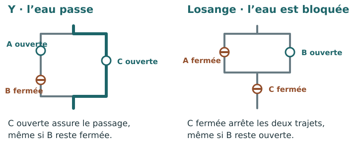

# ENS-PSL · Sélection internationale Lettres — Études cognitives 2023 · Corrigé guidé

*Corrigé rédigé par IA, non officiel. Signalez toute erreur.*

**Lecture du rapport du jury** · GPT-6.2 Astra Ultra · vitesse non renseignée

**Rédaction** · GPT-6.2 Astra Ultra · vitesse non renseignée

L’épreuve écrite dure deux heures. Les réponses sont en français, avec un complément possible en anglais. Pour lire l’article, gardez distincts ce que montre un circuit, ce que la question demande de garantir et ce qu’un participant trouve plausible.

### 1. Tester la conclusion avant de discuter l’erreur

Prenez trois cartes portant les lettres A, B et C. On vous assure que « A et B sont retournées ensemble, ou C est retournée », puis l’on vous montre A retournée. Essayez de laisser B face cachée. Il suffit que C soit retournée pour que la première information soit vraie. Voilà une situation qui conserve les deux prémisses et contredit la conclusion. Les auteurs veulent savoir si, lorsque la même information est portée par l’image, les adultes commettent encore l’erreur de croire B certaine. Ils cherchent ainsi à distinguer une erreur de raisonnement d’un enrichissement de la signification des phrases.

### 2. Reconstruire le raisonnement qui séduit

Interprétez la première information comme une invitation à choisir une explication. La seconde attire l’attention sur A. Il est tentant de choisir toute la branche « A et B », puis d’y lire B. L’étape fragile consiste à éliminer C, car la présence de A n’exclut aucunement C. Si la dynamique question-réponse est disponible sans énoncé disjonctif, une révélation de A dans l’animation produira plus de conclusions injustifiées que les contrôles. Le retrait des indices linguistiques devrait toutefois réduire l’erreur par rapport aux taux verbaux connus. Une question supplémentaire concerne les deux montages, proximité trompeuse dans le Y ou difficulté accrue dans le losange.

### 3. Suivre le trajet de l’eau dans les deux sens

Dans le Y, essayez une réalisation concrète. Ouvrez A et C, laissez B fermée. L’eau passe par C, et la fenêtre qui montre A ne révèle rien sur B. Dans le losange, changez la signification de chaque lettre en « cette vanne est fermée ». Fermez A et C et laissez B ouverte. Même si l’eau arrive par B, C la bloque. L’observation de l’arrêt général et de A fermée ne garantit donc pas la fermeture de B.

Replacez ces exemples dans le protocole. 401 adultes sont répartis au hasard entre Y cible, Y de référence, losange cible et losange de référence. Chacun voit deux familiarisations puis un essai critique. La référence utilise le même montage sans révéler A. Suivent des animations sur des disjonctions simples et trois contrôles statiques. Le pourcentage d’affirmations de certitude est la mesure principale de l’illusion.

### 4. Repérer ce que la substitution de l’image aux mots enlève

Dans une conversation, « ou bien le couple A et B, ou bien C » peut suggérer que, si C est vrai, même A prise séparément est faux. Le circuit ne code pas cette exclusion renforcée. Il autorise physiquement le contre-exemple. Une erreur qui subsiste ne peut donc exiger la présence du mot « ou ». L’expérience laisse néanmoins subsister les consignes et le fait qu’une personne a choisi de montrer telle vanne. L’attribution d’une intention informative peut se produire devant une image.

### 5. Apparier chaque contrôle à une explication concurrente

**La révélation de A suffit-elle à modifier les réponses ?** Comparez chaque cible à la même canalisation montrée sans révélation de A. **Les deux vannes paraissent-elles liées simplement parce qu’elles se touchent presque ?** Le losange les met sur des branches distinctes et supprime l’explication d’une ouverture successive par pression dans un conduit commun.

**Les sujets savent-ils reconnaître une conclusion nécessaire ?** Avec deux issues seulement, éliminer A impose B. Avec trois issues, éliminer A laisse B et C possibles. Ces contrôles appellent respectivement « oui » et « non ». Le second mesure aussi l’acceptation d’une autre conclusion injustifiée. **Les sujets comprennent-ils la plomberie de l’animation ?** C’est ce que testent les trois images fixes utilisées pour sélectionner les données analysables. Il ne faut pas confondre la sélection des participants et l’estimation d’une propension à l’erreur.

### 6. Comparer d’abord chaque cible à sa référence

Sur les 373 personnes retenues après les contrôles statiques, 42 % environ des participants à la cible losange se trompent, contre 19 % à la cible Y. Dans le losange, ajouter l’information sur A augmente les « oui » relativement à la référence et au contrôle à réponse non. Dans le Y, l’écart est établi vis-à-vis du contrôle à réponse non. L’écart cible-référence reste incertain ($p=0{,}1386$). L’interaction scénario-condition est non significative. Évitez de transformer « significatif ici, non significatif là » en preuve directe que les deux effets sont différents.

La répétition d’une erreur sans disjonction formulée étaye la prédiction principale, avec cette réserve pour le Y. L’erreur plus fréquente dans le losange contredit l’idée que la proximité propre au Y suffirait à la produire. Comparés aux taux historiquement supérieurs à 80 % sur des phrases, les deux taux visuels sont plus faibles. Cette observation est compatible avec une contribution du langage.

### 7. Proposer une limite qui change une prédiction

Supposez que le participant raisonne ainsi : « Si l’auteur m’a montré A, cela doit m’aider à décider pour B. » Le choix d’une fenêtre pourrait alors fonctionner comme un conseil implicite. Dans une expérience nouvelle, on comparerait l’ouverture délibérée d’une fenêtre à la même ouverture choisie par un procédé manifestement aléatoire. Les circuits et ce qui est visible resteraient identiques. Une baisse des erreurs dans le second cas appuierait une contribution de l’intention communicative perçue. Enfin, la comparaison avec le verbal vient de travaux distincts et l’échantillon étudié est adulte. L’article ouvre la possibilité de nouvelles tâches auprès de publics sans langage sans avoir déjà établi leurs résultats.

## Documents de l’épreuve

[Feuillet bilingue du jury](https://www.ens.psl.eu/sites/default/files/cogsci-ecrit-sil2023.pdf) · [Chung, Bade, Blanc-Cuenca et Mascarenhas (2022)](https://escholarship.org/content/qt9711612q/qt9711612q.pdf) · [Rapport du jury de la session](https://www.ens.psl.eu/sites/default/files/rapport_sil_dec_2022-2023.pdf)
