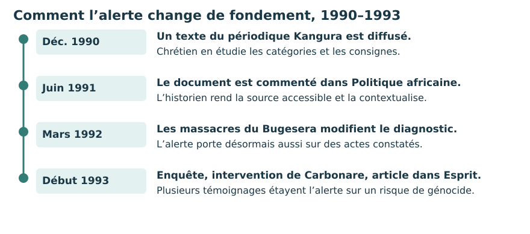

# ENS-PSL · Études politiques — Jean-Pierre Chrétien et le génocide des Tutsi (oral) 2023 — corrigé guidé

*Corrigé rédigé par IA, non officiel. Signalez toute erreur.*

**Rédaction** · GPT-6.2 Astra Ultra · vitesse non renseignée · 26 novembre 2026

## Épreuve et document

Le support d’oral est un extrait d’entretien publié en 2014. Jean-Pierre Chrétien y répond aux historiens Stéphane Audoin-Rouzeau et Hélène Dumas. Le haut de la feuille mentionne également le sujet d’écrit « Les réfugiés et les conflits ». L’exposé demandé à l’oral porte sur les paroles de Chrétien, leurs preuves et leur réception.

## Préparer l’oral

### Poser trois dates avant de prendre la parole

Sur une feuille, inscrivez 1990–1993, 1994 et 2014 sur trois lignes. À la première, associez ce qui pouvait alors être lu, observé et raisonnablement craint ; à la deuxième, le génocide des Tutsi au Rwanda ; à la troisième, l’entretien dans lequel deux historiens interrogent Chrétien après les faits. La mention du Burundi en 1972 figure dans la présentation du parcours de Chrétien. Le récit d’alerte de cet extrait concerne le Rwanda. Cette chronologie évite de faire de chacune des violences évoquées un épisode indifférencié d’une même histoire régionale.

### Écouter les questions aussi bien que les réponses

Les interlocuteurs attirent l’attention sur la précocité du mot « génocide », puis sur la formule finale dite frappante pour un public européen. Demandez-vous ce que cette manière d’interroger invite le témoin à expliquer : une décision de parole, ses destinataires et le seuil de preuve qu’il estimait atteint. Dans la réponse, relevez ce qui change quand Chrétien passe du singulier « je » au collectif mobilisé en conférence de presse. À l’oral, restituez les formes de la propagande par l’analyse de ses cibles et de son rôle ; il suffit de citer un mot du texte pour montrer comment il est examiné.

### Trois relances pour éprouver le commentaire

**« Pourquoi un historien engagé demeure-t-il une source à critiquer ? »** Il peut identifier et publier un document accessible à d’autres, puis joindre sa voix à une alerte. Son entretien éclaire les raisons de sa démarche. Pour établir la diffusion d’un discours ou la conduite d’une administration, il faut aussi comparer articles contemporains, rapports, correspondances et témoignages d’autres acteurs.

**« Quel est le poids de l’exemple des mariages ? »** Les liens familiaux traversent les identifications hutu et tutsi. Ils contredisent l’idée que la naissance aurait imposé une position politique uniforme et inévitable. À eux seuls, ils n’expliquent pas la mobilisation raciste ni la diversité des conduites individuelles.

**« L’analogie finale est-elle une explication ? »** Elle vise des auditeurs européens et attire leur attention sur une idéologie racialisante. Revenez ensuite au travail proprement historique : repérer les auteurs, les institutions, les dates et les choix dans le cas rwandais. L’extrait s’arrête sur l’acquiescement du témoin ; il ne fournit pas une comparaison historique détaillée.

## Proposition d’exposé

L’un des passages les plus révélateurs de cet entretien tient en un mot. En mars 1992, des personnes sont tuées au Bugesera. Selon Jean-Pierre Chrétien, l’ambassadeur de France à Kigali parle d’« agitations ». Le terme employé change ce qu’un destinataire éloigné du Rwanda peut comprendre : entend-il parler d’un désordre local ou de violences dirigées contre des personnes désignées comme membres d’un groupe ? L’objet du texte est précisément la bataille pour rendre des faits politiquement intelligibles avant qu’il soit trop tard.

En 2014, Stéphane Audoin-Rouzeau et Hélène Dumas interrogent un historien de l’Afrique des Grands Lacs sur les raisons qui l’ont conduit à alerter publiquement avant le génocide des Tutsi au Rwanda en 1994. Chrétien revient sur sa lecture de documents rwandais et sur la faible réception de ses interventions en France. Comment peut-on construire une alerte suffisamment documentée pour rompre avec une explication reçue, alors que l’événement à venir n’est pas encore connu ? Le texte fait suivre au lecteur trois opérations : défaire une interprétation fataliste, évaluer des indices de nature différente, puis chercher des mots capables d’atteindre les interlocuteurs.

### Rendre aux acteurs leurs choix politiques

Chrétien commence par mettre à distance le vocabulaire de ceux que l’on appelait les « amis du Rwanda ». Il rapporte l’interprétation de certains soutiens surtout français du régime de Juvénal Habyarimana autour de 1990. Dans leur lecture, la volonté du gouvernement serait bonne, les violences seraient des accidents et l’explication profonde résiderait dans une hostilité ethnique très ancienne. Ces trois propositions se soutiennent : si la violence est réputée venir d’un passé sans acteurs identifiables, le régime actuel apparaît moins susceptible de devoir répondre des choix politiques présents. Lorsque Chrétien écrit qu’ils « feignaient de croire », il porte un jugement sur cette présentation. Le commentaire doit lui en laisser la responsabilité.

À quelle explication substitue-t-il cette apparente évidence ? L’historien demande comment des catégories d’appartenance ont été transformées en un principe d’assignation politique. Il ne prétend pas que personne ne se serait identifié comme Hutu ou Tutsi avant les années 1990. Il refuse la déduction selon laquelle la naissance déterminerait les convictions et rendrait l’affrontement inévitable. Vers la fin de l’extrait, il donne à cette critique un point d’appui concret : des mariages relient des familles hutu et tutsi. Une société ainsi imbriquée ne correspond guère à l’image de deux blocs homogènes. Pour convertir une distinction en frontière exclusive, un travail de classement, de persuasion et d’exclusion a donc été nécessaire. Ce déplacement du regard réintroduit les décisions et les responsabilités là où le cliché d’une hostilité immémoriale les effaçait.

### Transformer des indices publics en alerte argumentée

La chronologie est ici une démonstration. En décembre 1990, le périodique *Kangura* publie un texte de propagande. Les catégories qu’il impose ne décrivent pas simplement des relations existantes : elles enjoignent aux lecteurs hutu d’adopter une conduite envers les Tutsi et prétendent définir qui appartient au groupe des « bons » Hutu. Chrétien reconnaît des motifs de stigmatisation qu’il rapproche de certains thèmes de l’antisémitisme. Il interroge leur fonction dans le discours. En juin 1991, il publie dans *Politique africaine* le document accompagné d’un commentaire. Un lecteur peut donc examiner la source, vérifier la date et discuter l’interprétation. La présence de ce texte atteste la mise en circulation d’une idéologie raciste ; elle n’établit à elle seule ni l’adhésion de tous ses lecteurs ni la certitude d’un génocide futur.

Le passage décisif est marqué par le changement de matériau au printemps 1992. Les massacres du Bugesera constituent des actes à mettre en relation avec des désignations et des menaces déjà repérées. Chrétien participe à une conférence de presse organisée par la Fédération internationale des droits de l’Homme et la Communauté rwandaise de France. Il y appelle la classe politique rwandaise à prendre la mesure du danger. Il envisage une possible répétition : le mot compte parce qu’on peut documenter un risque assez grave pour justifier une action sans disposer d’une prédiction certaine. L’historien passe de la publication savante à une prise de parole tournée vers des décideurs et un public plus large. La seconde démarche engage son jugement civique ; la première lui fournit des raisons exposables et vérifiables.

Début 1993 surviennent de nouvelles violences. La note de la fiche situe au 24 janvier l’intervention télévisée du militant Jean Carbonare, revenant d’une enquête internationale. Chrétien dit combien ce témoignage a compté dans sa propre décision d’écrire. Les formulations doivent être attribuées soigneusement : dans le souvenir qu’en donne Chrétien, Carbonare allait jusqu’à signaler un processus en cours ; Chrétien, quant à lui, explique avoir publiquement nommé une **menace** de génocide. La deuxième note renvoie à son article paru dans *Esprit* en mars-avril 1993. Ce repère contemporain permet d’éprouver le souvenir rétrospectif. Quand l’entretien de 2014 revient sur le génocide commis en 1994 contre les Tutsi, la question rigoureuse est de savoir quelles raisons existaient en 1993 de prendre le danger au sérieux. Elle conserve le caractère ouvert de la situation dans laquelle il a fallu décider de parler.

### Comprendre pourquoi l’avertissement a été peu entendu

Le silence décrit dans le texte n’est pas l’absence de tout message. Des documents circulent, une conférence de presse se tient, des associations enquêtent et un témoignage passe à la télévision. Le paradoxe porte sur la réception. La représentation de deux populations naturellement ennemies livre une explication toute faite à chaque information nouvelle. Si le destinataire voit dans des massacres de simples épisodes d’un conflit réputé permanent, il peut être au courant des faits et persister à méconnaître leur portée. L’expertise et les mots de la diplomatie ont alors des conséquences politiques : qualifier un événement influe sur ce qu’il paraît raisonnable de demander au gouvernement ou à ses soutiens.

Chrétien distingue plusieurs acteurs français. Des défenseurs des droits humains soutiennent l’alerte ; d’autres interlocuteurs restent peu réceptifs. Il rapporte qu’en septembre 1992 Bruno Delaye, proche du président François Mitterrand, remercie Jean-Bosco Barayagwiza, dirigeant de la Coalition pour la défense de la République, de son appui à la politique française. L’épisode donne au diagnostic un objet précis : un échange avec le représentant d’une formation décrite comme extrémiste. Il éclaire l’écart entre les avertissements et certaines relations politiques ; pour conclure à une conduite identique de toutes les autorités ou à une connaissance uniforme de leurs intentions, il faudrait d’autres documents.

La dernière question déplace enfin l’attention vers le choix d’une analogie forgée pour des Européens. La formule de « nazisme tropical » cherchait à faire reconnaître le rôle d’une idéologie raciale là où se répétait un récit réputé traditionnel. Son efficacité d’alerte a pour contrepartie le risque que le public remplace une simplification par une autre, en plaquant une histoire européenne sur celle du Rwanda. L’extrait ne développe pas une équivalence entre les deux histoires. Il s’achève sur la réponse affirmative de Chrétien à une question portant sur ses raisons d’employer ces mots.

Ce témoignage invite ainsi à distinguer quatre choses : disposer d’une information, en reconnaître la signification politique, en établir publiquement la gravité et être entendu. En replaçant la parole de 1993 entre les sources déjà disponibles et un avenir encore incertain, on comprend la responsabilité particulière que Chrétien attribue à son métier. Rendre visibles des choix politiques et leurs victimes pouvait déjà justifier une alerte, avant que la connaissance de l’issue ne vienne rétrospectivement lui donner raison.

## Sources

Jean-Pierre Chrétien, entretien avec Stéphane Audoin-Rouzeau et Hélène Dumas, « Un historien face au génocide des Tutsi », Vingtième Siècle. Revue d’histoire, n° 122, 2014, p. 23–35. La fiche d’oral reproduit deux pages et leurs notes. [Fiche de l’ENS-PSL](https://www.ens.psl.eu/sites/default/files/oral-1.pdf) · [Copie archivée consultée](https://web.archive.org/web/20230529064642id_/https://www.ens.psl.eu/sites/default/files/oral-1.pdf) · [Index institutionnel](https://www.ens.psl.eu/une-formation-d-exception/admission-concours/international/concours-selection-internationale-0)
