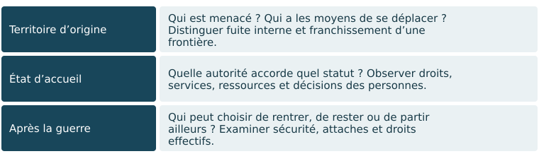

# ENS-PSL · Études politiques — les réfugiés et les conflits 2023 — corrigé brut

*Corrigé rédigé par IA, non officiel. Signalez toute erreur.*

**Rédaction** · GPT-6.2 Astra Ultra · vitesse non renseignée · 26 novembre 2026

## Sujet

« Les réfugiés et les conflits ». La fiche 1 donne cet intitulé écrit. Elle réserve l’entretien avec Jean-Pierre Chrétien à l’épreuve orale.

## Copie proposée

En 2022, la fuite devant l’invasion de l’Ukraine conduit l’Union européenne à activer pour la première fois sa directive de 2001 sur la protection temporaire. La présence d’une guerre explique l’urgence des départs. Elle ne suffit pas à expliquer la forme de la protection accordée ni les différences avec d’autres exils. Quel lien unit la production des déplacements, leur qualification juridique et les conflits politiques qui se nouent autour de l’accueil ?

### Les conflits produisent des déplacements diversement qualifiés

Les civils peuvent fuir des persécutions ciblées, la destruction de leurs moyens de vivre ou le danger d’une zone de combat. Se déplacer suppose aussi des ressources, des contacts et une issue accessible. Certains restent dans leur pays. D’autres franchissent une frontière, parfois après plusieurs déplacements internes. Un demandeur d’asile sollicite la reconnaissance d’un besoin de protection. La Convention de Genève de 1951, dont le protocole de 1967 lève les principales limitations temporelles et géographiques du dispositif initial, vise une personne hors de son pays qui craint avec raison une persécution liée à l’un des motifs qu’elle énumère et ne peut ou ne veut, du fait de cette crainte, se réclamer de la protection de ce pays. Une situation de guerre peut satisfaire ces critères, selon les circonstances. À l’échelle régionale africaine, la Convention de l’OUA de 1969 retient aussi certaines situations collectives, dont des événements troublant gravement l’ordre public. Le principe de non-refoulement encadre les décisions de retour vers le danger.

Ces qualifications ont des effets politiques. Deux familles exposées à une menace comparable peuvent relever d’autorités différentes de part et d’autre d’une frontière. Les réponses aux arrivées massives peuvent prendre une forme collective et provisoire. En Europe, la décision de mars 2022 ouvre, pour les catégories qu’elle définit, un séjour et un accès notamment au travail et à la scolarité. Cette voie laisse subsister la possibilité de demander l’asile.

### L’accueil redistribue des ressources et des responsabilités

Les déplacements depuis la Syrie après 2011 se sont d’abord dirigés massivement vers les pays voisins, notamment la Turquie, le Liban et la Jordanie. La proximité, les liens et l’accessibilité des routes comptent. Les États plus éloignés peuvent financer l’aide, accueillir par réinstallation ou limiter l’accès à leur territoire. L’invocation d’une responsabilité commune ne règle pas sa répartition. Une municipalité qui reçoit de nouveaux habitants doit adapter écoles, transports et services. Les effets sur l’emploi, les loyers et la demande dépendent de l’offre locale, des droits au travail et des financements. Des employeurs, des propriétaires, des habitants et des nouveaux arrivants peuvent en éprouver des effets divergents.

Les modes d’accueil changent aussi les possibilités d’action des personnes. En ville, l’accès au droit et aux réseaux conditionne la recherche d’un logement. Dans un camp, les organismes d’aide et les autorités locales répartissent des ressources indispensables. Les habitants transmettent de l’information, créent des associations, travaillent et défendent des droits. Ce pouvoir d’action existe sous de fortes contraintes. Faire du réfugié une victime passive conduit à négliger ces pratiques. Lui attribuer collectivement un danger reproduit, à l’inverse, une lecture sécuritaire qui peut elle-même nourrir des conflits.

### Sortir d’une guerre ne suffit pas à sortir de l’exil

La région des Grands Lacs après le génocide des Tutsi en 1994 illustre la nécessité de distinguer des populations civiles en fuite et des responsables ou structures armées présents dans certains lieux d’exil. Le contrôle exercé par des groupes organisés et les interventions étatiques doivent être rapportés à des acteurs identifiables. Imputer le prolongement du conflit aux réfugiés comme ensemble masquerait cette répartition du pouvoir et fragiliserait leur protection.

Retour volontaire dans la sécurité et la dignité, intégration locale et réinstallation dans un pays tiers sont trois solutions dont l’existence dépend de décisions politiques et des préférences des intéressés. Un cessez-le-feu laisse parfois en suspens le logement, les titres de propriété, la sécurité des minorités ou les moyens de subsistance. Des enfants nés en exil ont noué d’autres attaches. Le conflit peut ainsi continuer à peser sur les biographies longtemps après la fin des combats. La question politique porte autant sur le droit de partir et d’être protégé que sur le pouvoir de décider où et comment reconstruire sa vie.

## Source

[Feuillet officiel avec l’intitulé écrit](https://web.archive.org/web/20230529064642id_/https://www.ens.psl.eu/sites/default/files/oral-1.pdf)
