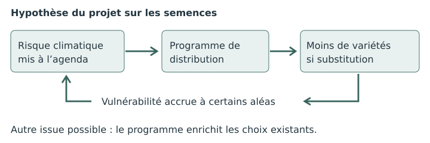

# ENS-PSL · Géographie · 2023 — corrigé brut

*Corrigé rédigé par IA, non officiel. Signalez toute erreur.*

**Rédaction** · GPT-6.2 Astra Ultra · vitesse non renseignée · 26 novembre 2026

## L’Anthropocène sous les tropiques

*Pour la seconde consigne, la copie prend comme projet de recherche un exemple construit pour le corrigé, portant sur les semences de mil au Sénégal.*

### 1. Résumé critique

Dans leur éditorial de *Belgeo* (2020), Géraud Magrin et Bénédicte Thibaud partent d’une question embarrassante pour la géographie. Pourquoi parler encore de « tropicalité » si la latitude explique si peu les inégalités de développement ? La notion a deux histoires. Chez Pierre Gourou, l’action des sociétés sur leur milieu dépend de leurs formes d’organisation technique et politique. Une autre lecture interroge le regard européen qui a constitué les tropiques en réservoir de produits et en terrain de conquête. Plantation, travail forcé et échanges asymétriques ont façonné des inégalités que le climat ne suffit pas à expliquer.

L’Anthropocène déplace la première question. Les humains subissent des aléas, mais les systèmes productifs transforment désormais les conditions mêmes de la vie à l’échelle planétaire. La seconde histoire empêche d’imputer cette transformation à une humanité uniformément responsable. Faire commencer le récit par l’industrialisation, la grande accélération d’après-guerre ou la plantation ne met pas les mêmes acteurs en cause. La pauvreté accentue souvent l’exposition aux dommages, avec de fortes différences entre États, entre milieux et au sein d’une ville. Des pays qui ont peu contribué aux perturbations doivent chercher des voies de développement différentes de celles qui ont enrichi les sociétés industrielles. Le mot « transition » suggère une destination connue, là où les trajectoires demeurent incertaines.

La contribution géographique la plus féconde est l’analyse des rétroactions entre échelles. Un changement global légitime un aménagement qui peut, localement, fragiliser les capacités d’adaptation. Le transfert d’eau envisagé vers le lac Tchad en fournit une illustration. À Quito, l’ancienneté des coulées boueuses oblige à discuter leur attribution aux habitants récemment installés sur les pentes. Le rapprochement de telles enquêtes fournit une hypothèse de lecture des politiques publiques. Un éditorial présentant six contributions contrastées ne démontre cependant ni la fréquence de cette boucle ni son caractère propre à tous les tropiques.

### 2. Apports et limites pour mon projet

Mon projet porterait sur les choix de semences de mil dans deux communes du bassin arachidier sénégalais. Je voudrais comprendre dans quelles conditions les programmes de distribution modifient la diversité des variétés que les familles peuvent effectivement ressemer. L’éditorial m’invite à déplacer l’enquête. Au lieu de mesurer une adaptation à la seule échelle de la parcelle, je remonterais des choix de semences jusqu’aux critères des programmes qui les subventionnent.

L’hypothèse est que, si les mêmes lots supplantent plusieurs réseaux d’échange, certains ménages perdent une possibilité de répartir les risques entre des variétés aux calendriers différents. La conclusion pourrait être inverse si les variétés distribuées complètent les stocks locaux. Pour le vérifier, je comparerais deux communes de conditions pluviométriques proches mais d’accès différent au programme. Je croiserais listes de variétés effectivement semées sur plusieurs campagnes, entretiens sur l’origine des lots et calendriers des pluies. Je distinguerais la simple réception d’un lot de sa multiplication et de sa circulation ultérieure.

Les auteurs ne fournissent ni état initial de ces communes ni données sur les arbitrages entre rendement, goût, travail et sécurité. Les villages bénéficiaires ont pu être retenus précisément parce qu’ils disposaient déjà de réseaux particuliers. Reconstituer l’histoire de cette sélection limiterait le risque d’attribuer à la distribution une différence plus ancienne. L’intérêt du texte pour mon projet est donc de rendre observable un effet possible d’une politique globale, tout en me donnant une raison précise de le mettre à l’épreuve.

