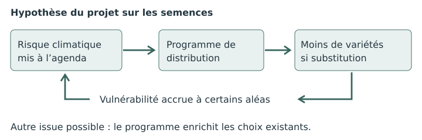

# ENS-PSL · Géographie · 2023 — corrigé guidé

*Corrigé rédigé par IA, non officiel. Signalez toute erreur.*

**Rédaction** · GPT-6.2 Astra Ultra · vitesse non renseignée · 26 novembre 2026

## D’une lecture suivie à une copie double

Le jury demande d’abord de dégager les idées des auteurs dans un résumé critique, puis de discuter les apports et les limites du texte pour *votre* projet de recherche. Une seule copie double accueille l’ensemble. Le projet illustratif porte ici sur le choix des semences de mil au Sénégal. Si votre terrain est différent, changez l’hypothèse, les observations et les limites en conséquence.

### 1. Retrouver l’argument de Magrin et Thibaud

**Paragraphes 1 à 5.** Distinguez les deux sens de « tropicalité ». Les géographes comme Gourou étudient les moyens par lesquels une société organise sa relation au milieu. Le rapprochement entre pauvreté et climat ignore la diversité de ces organisations. Une histoire postcoloniale s’intéresse, elle, à la production du « monde tropical » par les demandes européennes en sucre, en matières et en terres. Reliez plantation et rapports de domination à la question du développement.

**Paragraphes 6 à 18.** Expliquez le renversement de perspective. Le milieu agit sur les sociétés, tandis que la puissance de transformation de certains systèmes productifs atteint une échelle planétaire. Les différents commencements proposés pour l’Anthropocène portent des explications historiques distinctes. La plantation met l’accent sur la domination coloniale, la révolution industrielle sur l’énergie et la production de masse. Les bénéfices du modèle industriel et l’exposition à ses effets sont inégalement distribués. Dès lors, qui a les moyens de se développer, sous quelles contraintes et vers quelle destination ? Le langage rassurant de la « transition » risque de masquer l’incertitude et l’injustice de cette transformation.

**Paragraphes 19 à 30.** L’éditorial annonce cinq articles et un éclairage. Pour choisir une preuve, demandez ce que chacun fait varier. Le parc national en périphérie de Mumbai interroge les modèles de protection importés. Les projets sahéliens changent l’échelle de l’intervention. Les systèmes semenciers ouest-africains ouvrent la question de la diversité cultivée. Les archives de Quito allongent la durée d’observation des coulées. Les hautes terres éthio-érythréennes permettent de suivre les effets des politiques agricoles sur des capacités d’adaptation plus anciennes. Le dernier éclairage demande où, pour qui et à quelle échelle on parle d’effondrement. Deux exemples bien expliqués suffisent dans la copie.

**Formulation synthétique.** « L’Anthropocène renouvelle la question tropicale à condition de rendre visibles les inégalités de responsabilité et les allers-retours d’échelle. Certaines politiques d’adaptation, décidées à distance, transforment les territoires et peuvent accroître la vulnérabilité qu’elles devaient réduire. Les cas présentés donnent à cette hypothèse une portée comparative, sans constituer un échantillon représentatif de tous les tropiques. »

### 2. Mettre réellement le texte au travail

Définissez votre objet avant de parler de l’article. Ici, l’unité d’observation est le ménage qui obtient, sème, conserve ou échange un lot de mil. La politique de distribution s’observe dans les règlements, les listes de bénéficiaires et la chronologie de l’intervention. La variabilité des pluies se mesure sur plusieurs campagnes. Associer ces trois séries permet de tester les changements d’échelle décrits dans l’éditorial.

**Passage de discussion possible.** « Je comparerais deux communes dont l’accès au programme diffère, en reconstituant les échanges de semences antérieurs à son arrivée. Je chercherais si les distributions remplacent certains lots à cycle différent ou si elles viennent enrichir la gamme accessible. Les durées des cycles sont pertinentes parce qu’une saison des pluies courte n’a pas les mêmes effets sur toutes les cultures. Le nombre de sachets distribués ne mesure ni la diversité effectivement semée ni les récoltes d’une mauvaise année. Des entretiens permettraient aussi d’identifier les choix liés au goût ou au coût du travail. »

**Donner une limite qui modifie la méthode.** L’article ouvre une question à tester, mais aucune des communes du projet n’y fait l’objet d’un suivi. Un accès plus facile à un marché ou une organisation paysanne plus ancienne peuvent expliquer des différences antérieures au programme. Il faut donc reconstituer les critères de choix des communes et comparer les pratiques à plusieurs dates. Si les lots distribués s’ajoutent aux semences conservées et élargissent les options de ménages jusque-là isolés, l’hypothèse d’une vulnérabilité accrue devra être révisée.

Réservez de la place pour cette dernière opération. La première partie explique ce que les auteurs avancent et le type de preuve qu’ils présentent. La seconde doit pouvoir nommer une observation qui ferait changer votre propre conclusion.
