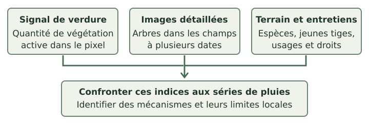

# ENS-PSL · Géographie orale · 2023 — corrigé brut

*Corrigé rédigé par IA, non officiel. Signalez toute erreur.*

**Rédaction** · GPT-6.2 Astra Ultra · vitesse non renseignée · 26 novembre 2026

## Ce que le reverdissement du Niger change à notre compréhension des changements globaux

Une image d’un champ cultivé dans la plaine de Maradi, au sud du Niger, peut montrer davantage d’arbres au début du XXIe siècle que pendant les grandes sécheresses sahéliennes des années 1970. Faut-il y voir la preuve que le désert recule, que le climat s’améliore ou que l’action des paysans porte ses fruits ? Aucune de ces conclusions ne se lit directement sur une couleur ou sur une photographie. J’ai choisi cet exemple parce qu’il permet de répondre à la question du jury dans les deux sens. Les changements globaux amènent à interroger ce qui arrive dans un territoire. En retour, un territoire bien étudié conduit à corriger ce que l’on croyait mesurer et à nommer les mécanismes à comparer ailleurs.

### Un paradoxe de paysage

Les espaces étudiés appartiennent au sud agricole du Niger, notamment aux régions de Maradi et de Zinder, proches du Nigeria. Ils forment des parcs agroforestiers, autrement dit des champs cultivés où les exploitants maintiennent certains arbres. Quand on imagine le Sahel à partir de la seule image d’une lisière de désert qui avancerait vers le sud, on manque déjà l’objet de l’enquête. Ces terres cultivées peuvent se densifier, perdre des jachères et gagner simultanément des arbres sur certaines parcelles. Une extension de la culture ne suffit donc pas à décrire l’évolution de leur couverture ligneuse.

Smale, Tappan et Reij ont comparé des images détaillées de ces paysages. À l’horizon 2005, ils relèvent des parcs jeunes et parfois denses autour de villages, là où le couvert arboré était clairsemé dans les années 1970. Entre 2005 et 2013, la densité reste à peu près stable dans la plupart de leurs placettes, augmente dans près d’un quart et baisse dans moins de 2 %. Les périodes ne racontent donc pas exactement la même histoire. Un gain suivi d’une relative stabilité peut signaler la persistance d’une transformation majeure. Les placettes ne sont cependant pas un dénombrement de tous les arbres du pays. [Comparaison des images et des placettes, 2018](https://www.usgs.gov/publications/farmer-managed-restoration-agroforestry-parklands-niger)

### Distinguer les causes derrière un même signal

Une première explication d’un paysage plus vert serait climatique. L’herbe et les cultures peuvent répondre rapidement à une saison humide. Un indice satellitaire comme le NDVI traduit un contraste entre deux bandes spectrales sensible à l’activité végétale. Il ne dit à lui seul ni quelles espèces ont poussé ni qui a décidé de les conserver. Une deuxième explication part d’une opération à la portée du cultivateur. Là où subsistent des souches vivantes et des repousses, celui-ci peut sélectionner certaines tiges, les protéger et les conduire au milieu des cultures. Cette régénération naturelle assistée produit une répartition particulière des arbres, champ par champ. Les deux explications peuvent agir ensemble.

Comment les départager ? Une étude à Dan Saga et El Guiéza, dans la région de Maradi, rapproche les images de végétation de 1999 à 2018, les séries de précipitations et des mesures d’arbres et d’arbustes. L’extension de surfaces au signal plus vert y coexiste avec des épisodes de déficit pluviométrique et une proportion importante de jeunes ligneux. Ces indices rendent insuffisant un récit où tout changement résulterait d’un simple retour de la pluie. Or ces deux sites ont été choisis pour leur longue pratique de la régénération. Ce choix est excellent pour découvrir comment le processus fonctionne et insuffisant pour lui attribuer tout le reverdissement du Sahel. [Étude de terrain à Dan Saga et El Guiéza](https://www.agrimaroc.org/index.php/Actes_IAVH2/article/view/911)

L’arbre conservé fournit selon les espèces du fourrage, du bois et des produits alimentaires. Pour que ces perspectives modifient les pratiques, le cultivateur doit pouvoir espérer bénéficier demain de ce qu’il protège aujourd’hui. La reconnaissance de droits sur les arbres dans les années 1990 a accompagné des initiatives déjà engagées. Une politique a donc renforcé une pratique dont elle n’était pas l’unique origine. À Maradi et Zinder, une synthèse publiée en 2021 évalue à 4,2 millions d’hectares la surface concernée par la régénération assistée. Il s’agit de terres agricoles sur lesquelles on gère les arbres. Transformer ce chiffre en surface de forêt créée ferait disparaître le travail agricole qui explique précisément le paysage. [Synthèse sur les usages des terres au Sahel, 2021](https://pubs.usgs.gov/publication/70249332)

### Ce qui voyage avec l’étude de cas

Premier apport pour comprendre les changements globaux : le cas aide à construire les catégories de mesure. Si une carte classe chaque parcelle exclusivement en « forêt » ou en « culture », un champ qui gagne des arbres peut garder exactement la même étiquette. Si une autre carte ne mesure que la verdure d’une saison, elle risque au contraire d’attribuer à des arbres une variation des cultures annuelles. L’enquête au Niger apprend ce qu’il faut vérifier lorsque l’on agrège des pixels pour dresser un bilan régional ou mondial de la dégradation des terres.

Deuxième apport : elle rend comparables des mécanismes. Dans un autre pays semi-aride, on pourrait demander si des repousses existent, qui exerce les droits d’usage, qui protège les jeunes arbres et qui en recueille les produits. Des droits incertains, l’absence de souches ou des conflits d’accès peuvent modifier la réponse. Comparer ces conditions est plus instructif que transférer partout le nombre d’hectares nigériens. Une même hausse de végétation ne garantit d’ailleurs ni une hausse de la diversité des espèces ni un gain égal pour cultivateurs, éleveurs et ménages sans terre.

Enfin, l’exemple déplace le regard porté sur l’adaptation. Une réponse au changement environnemental peut partir de choix ordinaires dont l’accumulation modifie un paysage à l’échelle régionale. Le bilan climatique global de ces arbres, lui, exigerait des mesures de biomasse et de permanence, ainsi qu’une comparaison avec l’évolution des parcelles sans cette gestion. Le Niger apporte donc une correction décisive à l’analyse globale : il montre comment établir une transformation, comment en rechercher les causes et à quelles conditions la comparaison devient légitime.
