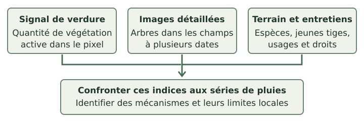

# ENS-PSL · Géographie orale · 2023 — corrigé guidé

*Corrigé rédigé par IA, non officiel. Signalez toute erreur.*

**Rédaction** · GPT-6.2 Astra Ultra · vitesse non renseignée · 26 novembre 2026

## Préparer dix minutes sur le Niger

Le sujet demande ce qu’apporte une étude de cas à la *compréhension* des changements environnementaux globaux. Il laisse le pays au choix. Ici, l’objet est la gestion des arbres dans les champs du sud du Niger. À la fin de chaque partie, faites entendre ce que cet exemple oblige à changer dans un diagnostic plus général.

### 0 à 2 minutes · Situer le problème

Situez le Niger en Afrique de l’Ouest, puis resserrez sur les plaines agricoles du sud, près de la frontière avec le Nigeria. Ces plaines sont très différentes des régions sahariennes du nord du pays. Le mot précis est **parc agroforestier**. L’arbre et la culture occupent la même parcelle. Le lieu choisi invite donc à réexaminer les classements qui opposent systématiquement extension des cultures et présence d’arbres.

**Ouverture possible.** « À proximité de Maradi, deux photographies prises à plusieurs décennies d’intervalle peuvent montrer à la fois des champs plus intensément occupés et davantage d’arbres. Comment expliquer ce résultat après les grandes sécheresses des années 1970 et 1980 ? En suivant cette question, on apprend comment relier des mesures planétaires à des pratiques précises et comment éviter les erreurs d’attribution. »

### 2 à 5 minutes · Faire parler les observations

Commencez par les dates. Des images montrent des espaces agricoles à faible couvert arboré dans les années 1970, puis de jeunes parcs souvent bien développés en 2005. La comparaison suivante, entre 2005 et 2013, montre surtout une stabilisation sur les placettes échantillonnées, avec encore des hausses sur près d’un quart d’entre elles. Une stabilisation après reconstitution diffère d’un paysage qui serait resté identique depuis quarante ans. Ne confondez pas les deux périodes. [Smale, Tappan et Reij, 2018](https://www.usgs.gov/publications/farmer-managed-restoration-agroforestry-parklands-niger)

Passez ensuite des couronnes d’arbres visibles sur des images détaillées au signal de verdure mesuré par satellite. Faites imaginer deux parcelles qui ont la même valeur d’indice de végétation. Dans la première, la saison des pluies a favorisé une culture annuelle. Dans la seconde, des arbustes conduits sur plusieurs années se développent parmi les cultures. L’indice ne départage pas les explications. Il faut comparer les dates des images, la pluviométrie, la densité et l’âge des arbres. L’étude de Dan Saga et d’El Guiéza combine précisément télédétection, pluies et observations de ligneux. Ces villages de Maradi ont une longue pratique de la régénération assistée. Leur sélection donne accès au mécanisme mais limite l’extrapolation à d’autres villages. [Étude des deux terroirs](https://www.agrimaroc.org/index.php/Actes_IAVH2/article/view/911)

### 5 à 7 minutes · Expliquer pourquoi un arbre reste dans le champ

Racontez la décision d’un cultivateur qui rencontre une repousse. Il peut la supprimer ou conserver plusieurs tiges et les protéger. Des produits de l’arbre ont une utilité pour son ménage ou ses animaux. S’il n’a pas l’assurance d’en garder l’usage, l’intérêt à la conservation risque de diminuer. La réforme des droits sur les arbres en 1993 éclaire la diffusion d’une pratique dont les premiers témoignages précèdent cette réforme. L’exemple donne un acteur et une chronologie à l’idée générale d’adaptation. [Historique des pratiques et de la réforme](https://www.usgs.gov/publications/farmer-managed-restoration-agroforestry-parklands-niger)

Indiquez l’ordre de grandeur sans changer l’unité. Une synthèse donne 4,2 millions d’hectares de **terres sous régénération naturelle assistée** dans les régions de Maradi et de Zinder. Cette surface inclut des cultures. On ignore à partir de ce chiffre seul le nombre exact d’arbres, la biomasse concernée ou la répartition des bénéfices. [Cotillon, Tappan et Reij, 2021](https://pubs.usgs.gov/publication/70249332)

### 7 à 10 minutes · Monter en généralité

Formulez trois résultats différents. D’abord, les observations sur place apprennent à interpréter une statistique de changement d’occupation des sols. Une carte de surfaces cultivées peut laisser invisible l’évolution des arbres *dans* la classe des cultures. Ensuite, la décision de garder une tige relie des échelles : elle se prend sur une parcelle, dépend en partie de droits d’usage et se répète assez pour transformer une région. Enfin, le cas fournit des conditions à comparer ailleurs. Existe-t-il des rejets vivants, des droits reconnus et un intérêt local à protéger l’arbre ? La réponse peut varier selon les ménages et les modes d’accès au sol.

**Conclusion possible.** « Un cas bien délimité apprend à interpréter un signal qui, vu de loin, reste ambigu. Au Niger, le climat, les droits et les choix de gestion peuvent modifier le même paysage. Les hectares et les proportions valent pour les territoires et les périodes étudiés. Le raisonnement, lui, peut être repris dans d’autres pays, en vérifiant chaque fois ce qui tient et ce qui change. »

**Entraînement.** Si l’on vous demande si un champ plus vert prouve l’efficacité d’une politique climatique, demandez d’abord quel résultat on veut expliquer. Pour le couvert arboré, confrontez des images de même saison et un inventaire de terrain. Pour le stockage de carbone, il faut d’autres données, notamment sur la biomasse et sa durée de conservation. Pour l’efficacité de la politique, il faut reconstruire la situation initiale et une comparaison crédible avec des parcelles où la politique n’a pas eu le même effet.
