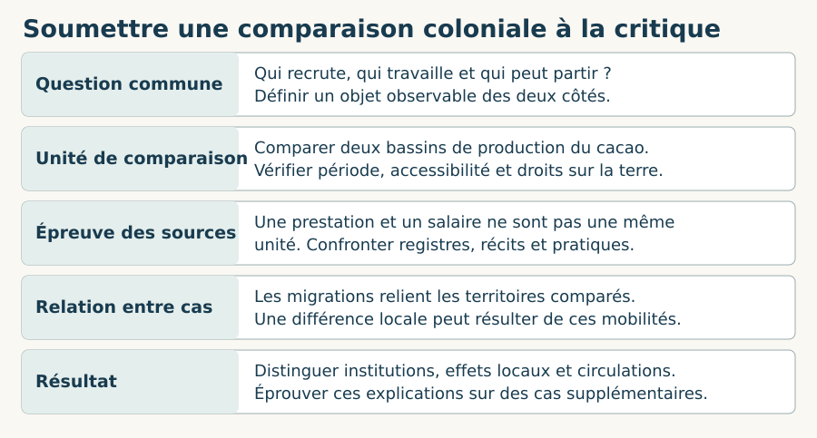

# ENS-PSL · Sélection internationale Lettres — Histoire — comparaison en histoire coloniale 2023 · Corrigé guidé

*Corrigé rédigé par IA, non officiel. Signalez toute erreur.*

**Rédaction** · GPT-6.2 Astra Ultra · vitesse non renseignée

**Autocontrôle** · GPT-6.2 Astra Ultra · vitesse non renseignée

## Choisir une comparaison qui pourrait contredire son auteur

Écrire « la France assimile, la Grande-Bretagne administre indirectement » donne deux étiquettes. Choisissez une action observable, par exemple nommer un chef, recruter un travailleur ou faire voter une assemblée. Demandez ensuite quelles archives renseignent le choix, la contrainte et les marges de manœuvre dans chacun des cas.

### Pourquoi les exemples produisent-ils une preuve ?

**Deux territoires cacaoyers.** Le produit commun rend une question sur la main-d’œuvre comparable. Il ne rend identiques ni les droits fonciers ni l’accès aux marchés. Si les statistiques proviennent de services différents, déterminez d’abord ce que compte chaque colonne.

**Deux sorties d’empire.** Ghana en 1957, Côte d’Ivoire en 1960 sont des repères. Pour expliquer, comparez plutôt qui contrôle quels revenus publics avant et après les transferts de compétence. Une différence de trois ans ne mesure pas par elle-même une différence de liberté politique.

**Une frontière traversée.** Si un travailleur passe d’un territoire sous domination française vers la Gold Coast, il entre dans l’histoire des deux côtés. Le traiter comme deux observations indépendantes fausserait la comparaison. Restituer son parcours peut montrer qu’une situation de recrutement influence l’autre.

Le second sujet du feuillet est individuel. Ces cas sont proposés pour éprouver une méthode. La même démonstration pourrait partir d’autres cas si l’on identifie rigoureusement l’unité d’observation, les conditions de comparaison et les archives mobilisées.

## Qu’est-ce qu’une approche comparative peut apporter à l’histoire coloniale ?

Un fonctionnaire français décrivant le gouvernement britannique en Afrique occidentale oppose volontiers l’administration par les chefs locaux à sa propre tradition d’administration directe. Faut-il prendre cette comparaison pour une explication ? Elle est d’abord un objet d’histoire : celui qui la propose a intérêt à mettre en valeur l’unité et la singularité de sa politique. La comparaison de l’historien consiste au contraire à poser à plusieurs configurations une question suffisamment précise pour que leurs différences puissent mettre une hypothèse à l’épreuve. Elle peut porter sur deux empires, sur des territoires du même empire ou sur des groupes distincts d’une même société colonisée. L’Afrique occidentale française et la Gold Coast britannique, aux XIXe et XXe siècles, permettront ici d’examiner trois gains : dénaturaliser les catégories impériales, tester des explications et retrouver les relations qui rendent les cas à la fois comparables et interdépendants.

### La mise en série des cas rend visibles les écarts entre doctrine et pratique

Partir des termes d’« assimilation » et d’*indirect rule* promet une opposition facile. Pourtant, une administration qui tient un discours d’assimilation doit encore collecter l’impôt, recruter des travailleurs et rendre ses décisions effectives à distance. Elle s’appuie pour cela sur des intermédiaires qu’elle choisit, confirme ou transforme. Une administration britannique qui affirme gouverner par des autorités coutumières fixe elle aussi des circonscriptions et détermine quelles autorités seront reconnues et dans quelles limites. Une première comparaison porte donc sur une opération précise : qui désigne l’intermédiaire, qui peut le révoquer, dans quelles affaires ses décisions sont-elles susceptibles de recours ? Elle fait apparaître une relation politique construite là où le vocabulaire administratif semblait décrire deux essences nationales.

La variation interne constitue un contrôle indispensable. En Afrique occidentale française, le statut ancien des ressortissants des quatre communes du Sénégal et celui des habitants d’autres territoires éclairent l’hétérogénéité de l’accès aux droits. Dans la Gold Coast, le littoral, l’Asante et les territoires du Nord ne peuvent davantage être traités comme un ensemble uniforme. Une différence entre Dakar et une région rurale de la Gold Coast ne s’explique pas immédiatement par la nationalité du colonisateur. Ressources fiscales, urbanisation, institutions politiques antérieures, éducation et présence de groupes mobilisés constituent des différences à examiner. Réduire l’unité de comparaison à une ville, à une institution ou à une période rend souvent l’inférence plus exigeante et plus féconde.

### La comparaison permet de mettre à l’épreuve les causes et les chronologies

Prenons pour objet le travail et les économies de plantation en Afrique occidentale. La Côte d’Ivoire et la Gold Coast produisent toutes deux du cacao et dépendent des marchés mondiaux. Des populations venues de l’intérieur contribuent à la main-d’œuvre dans les zones de production. Ces propriétés communes fournissent un point de départ pour comparer les formes de recrutement, l’accès à la terre et la rémunération. Elles ne suffisent pas à rendre équivalentes les catégories des archives : un registre de prestations imposées, un relevé de travailleurs migrants et une estimation des journées travaillées ne comptent ni les mêmes opérations ni les mêmes personnes. Croiser les archives de poste avec des récits de vie et des dossiers d’exploitation permettrait de distinguer contrainte administrative, dépendance envers un employeur et initiative migratoire. En 1946, l’abolition du travail forcé dans les territoires français d’outre-mer change le cadre juridique. Mesurer quand et comment les pratiques changent suppose précisément des indicateurs indépendants du vocabulaire de la réforme.

La même démarche éclaire les sorties d’empire. La loi française du 7 mai 1946 reconnaît aux ressortissants des territoires d’outre-mer la qualité de citoyen ; cette reconnaissance n’instaure pas à elle seule l’égalité effective des suffrages dans toutes les élections. La Gold Coast accède à l’indépendance sous le nom de Ghana en 1957, la Côte d’Ivoire en 1960. Si l’on prend pour seule variable la date d’indépendance, les trois années d’écart paraissent la principale chose à expliquer. Si l’on compare la capacité des élus à contrôler un budget, le rôle des partis ou les échelles territoriales auxquelles se conçoivent les projets politiques, les séquences ne coïncident plus. L’historien découvre que des acteurs pouvaient revendiquer en même temps plus de droits, des possibilités fédérales et un autre partage des ressources, sans préfigurer nécessairement un État-nation dans ses frontières futures. La comparaison ébranle ainsi la tentation de lire la colonisation à partir d’une issue déjà connue.

### En comparant des cas reliés, on rend aux acteurs une capacité de choix et on corrige les archives

Une comparaison strictement parallèle supposerait deux expériences indépendantes. Or des travailleurs de territoires sous domination française se rendent sur la Gold Coast. Ils comparent eux-mêmes les possibilités de revenu, les contraintes, les réseaux de parents et les voies de déplacement. Ces mobilités peuvent modifier les disponibilités de main-d’œuvre dont se préoccupent les autorités françaises. Ainsi, la différence observée de part et d’autre de la frontière est aussi produite par son franchissement. L’histoire connectée complète ici la comparaison : il faut d’abord distinguer les conditions de travail dans les deux espaces pour expliquer une circulation, puis suivre cette circulation pour comprendre pourquoi les conditions évoluent.

Les archives comportent enfin leur propre politique comparative. Les fonctionnaires peuvent ajouter à leurs rapports des tableaux comparant la productivité de deux territoires sans enregistrer le travail domestique ou la subsistance nécessaire à la production marchande. Reprendre ces colonnes telles quelles conduirait à ériger leurs silences communs en preuve d’une similitude. Il faut demander pour chaque donnée qui l’a produite, dans quelle unité, à quelles fins et quelle expérience lui échappe. Une enquête orale tardive a d’autres biais que le registre fiscal contemporain. Leur confrontation, avec la datation et la critique appropriées, permet de restituer les catégories des colonisés autant que celles des administrations. On comparera alors, par exemple, les raisons données par deux générations de migrants pour une même destination, et pas seulement les moyennes de revenu calculées pour deux colonies.

L’apport décisif de la comparaison tient donc à la possibilité de changer la question lorsque l’observation résiste. Une différence peut relever de l’institution impériale, du contexte local ou de la circulation entre deux espaces. Des ressemblances peuvent résulter de structures communes du marché ou de catégories d’archives également réductrices. À condition d’énoncer ses unités, sa chronologie et les preuves qui départagent ces explications, l’histoire coloniale peut analyser une domination partagée sans effacer la pluralité des expériences.

[Sujet officiel](https://www.ens.psl.eu/sites/default/files/histoire-ecrit-sil2023.pdf) · [Loi du 7 mai 1946, texte et contexte](https://mjp.univ-perp.fr/france/loi1946-940.htm) · [Migrations et décolonisation en Afrique, UCL Press](https://discovery.ucl.ac.uk/1543203/1/Britain-France-and-the-Decolonization-of-Africa.pdf) · [National Archives, Gold Coast et indépendance](https://cdn.nationalarchives.gov.uk/documents/migratedarchives-2.guidance.pdf)
