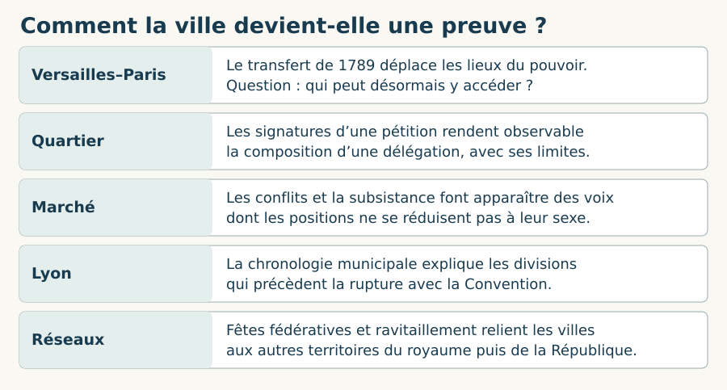

# ENS-PSL · Sélection internationale Lettres — Histoire — villes et Révolution 2023 · Corrigé brut

*Corrigé rédigé par IA, non officiel. Signalez toute erreur.*

**Rédaction** · GPT-6.2 Astra Ultra · vitesse non renseignée

**Autocontrôle** · GPT-6.2 Astra Ultra · vitesse non renseignée

## En quoi l’histoire urbaine renouvelle notre connaissance de la période révolutionnaire ?

Le 6 octobre 1789, la famille royale quitte Versailles pour Paris. Une chronologie politique peut enregistrer la pression populaire puis le déplacement de la cour. Une histoire urbaine doit encore expliquer comment la question de l’approvisionnement de la capitale a pu rejoindre celle du lieu d’exercice de la souveraineté, et ce que le transfert change aux rapports entre gouvernés et gouvernants. Une ville n’est donc pas seulement le lieu où un événement s’est produit. C’est un ensemble de marchés, de quartiers, de pouvoirs et de relations avec d’autres territoires. On prendra ici pour cadre la Révolution française, de 1789 à la fin du Directoire, avec Paris et Lyon pour principaux points d’observation. Comment l’analyse de ces relations permet-elle de modifier les explications et les acteurs d’une histoire d’abord ordonnée par les changements de régime ?

### Les lieux de la décision changent la manière dont se forme le pouvoir

En juillet 1789, Paris se donne une municipalité révolutionnaire dont Jean-Sylvain Bailly devient le premier maire. L’histoire constitutionnelle rend compte de l’affaiblissement de l’autorité royale. L’histoire de la ville montre aussi que l’organisation des élections aux États généraux avait fourni des lieux et des habitudes de réunion. Dans les districts, des hommes qui s’étaient assemblés pour désigner des représentants peuvent prolonger la délibération. Il ne suffit pas que la nation soit proclamée souveraine à Versailles pour savoir qui, dans chaque rue, sera publiquement reconnu comme habilité à parler ou à recevoir une pétition. Les procès-verbaux municipaux et les listes d’élus donnent accès à cette constitution concrète du pouvoir. Comparer les professions et les mandats antérieurs de ces élus peut ainsi révéler du renouvellement politique au sein de groupes socialement proches, là où le seul mot de bourgeoisie suggérerait abusivement que les mêmes hommes sont restés en place.

En octobre, les difficultés du ravitaillement, le rôle des marchés et le trajet de Paris à Versailles rapprochent une expérience quotidienne de la crise politique. Des femmes font valoir publiquement l’urgence des subsistances. À Paris, le retour du roi aux Tuileries, bientôt suivi par l’Assemblée, transforme durablement la relation spatiale entre représentation et mobilisation. Une délégation peut désormais rencontrer des députés ou assister aux débats sans quitter la capitale. Cette proximité n’implique pas que les Parisiens décident à eux seuls du sort du royaume. Elle crée des possibilités d’information et de pression très inégalement distribuées. Une carte comparée des lieux de réunion, des marchés et des sièges du pouvoir avant et après octobre ferait apparaître une modification que le texte de la Déclaration des droits ne peut enregistrer.

### Quartiers et sociabilités font apparaître plusieurs peuples dans le peuple souverain

Les quarante-huit sections parisiennes instituées en 1790 inscrivent l’assemblée politique dans une géographie administrative. Le temps disponible pour y siéger, la proximité d’un lieu de réunion, les relations d’atelier et de voisinage conditionnent la présence réelle. Une pétition ne livre donc pas l’opinion transparente d’un quartier. La comparer aux signatures d’une autre pétition, aux adresses des signataires et aux comptes rendus des séances peut faire apparaître un noyau de militants, ou au contraire un élargissement de la participation. L’échelle de la section permet d’étudier le travail par lequel des demandes deviennent celles du « peuple », en demandant qui les porte, à qui elles s’adressent et qui manque à l’appel.

Les citoyennes républicaines révolutionnaires de Paris donnent à cette méthode toute sa portée. Une députation de femmes peut être admise à la barre de la Convention le 7 octobre 1793. Le 30 octobre, les clubs de femmes sont interdits. Entre les deux, les tensions dans les marchés autour des signes d’appartenance politique révèlent des désaccords entre femmes aussi bien qu’entre représentants et militantes. L’histoire urbaine restitue ces positions que la seule alternative entre inclusion et exclusion effacerait. Une marchande qui défend sa manière de travailler et une militante qui propose une forme de mobilisation commune peuvent toutes deux prendre part à la Révolution en s’opposant. Le rapport présenté pour justifier l’interdiction est une source sur les catégories politiques mobilisées contre les clubs. Il ne saurait être tenu pour une description impartiale de chaque participante.

### La comparaison décentre Paris et oblige à sortir des limites de la ville

Lyon n’est pas un Paris en retard. Ville de manufactures, structurée notamment par la soierie et les rapports entre négociants et travailleurs, elle connaît ses propres oppositions sur les pouvoirs municipaux, le travail et les prix. Le 29 mai 1793, la municipalité dominée par les partisans de Chalier est renversée. La rupture avec la Convention, le siège puis la répression redéfinissent l’appartenance politique de la ville. Le nom de Commune-Affranchie donné à Lyon après sa défaite traduit la prétention du pouvoir national à refonder symboliquement une communauté politique. Rapporter tous les habitants à la catégorie de ville rebelle ferait disparaître les républicains lyonnais divisés sur la conduite de la Révolution et les oppositions qui avaient précédé l’affrontement avec Paris. Croiser délibérations locales et décisions de la Convention permet de reconstituer la succession des choix plutôt que de projeter l’issue de l’automne sur le printemps.

Cette comparaison conduit hors des murs. Le grain de Paris vient de campagnes dont les producteurs, les voituriers et les marchés ont leurs propres contraintes. La soie lyonnaise est liée à des circuits de matières, de crédit et de débouchés qui excèdent l’espace municipal. Un prix observé en ville porte la trace de ces relations sans les décrire entièrement. Inversement, les fêtes fédératives, les journaux et les délégations font circuler des pratiques politiques : on peut comparer la fête lyonnaise de mai 1790 à celle du Champ-de-Mars le 14 juillet suivant. L’unité nationale n’est plus seulement décrite comme une règle partie du centre. Elle se forme aussi par des initiatives locales, des imitations et des interprétations concurrentes.

L’histoire urbaine renouvelle ainsi la connaissance de la Révolution en déplaçant les preuves et les rapports de causalité. Elle rend visibles les conditions matérielles de la participation, la pluralité des voix et les liens entre décisions nationales et conflits locaux. Elle exige en retour de comparer les villes, de travailler sur leurs relations avec les campagnes et de confronter les sources officielles aux traces de pratiques. L’abondance des archives parisiennes devient alors un problème de méthode, au lieu d’être la mesure tacite de toute la période.

[Sujet officiel](https://www.ens.psl.eu/sites/default/files/histoire-ecrit-sil2023.pdf) · [Musée Carnavalet, Paris pendant la Révolution](https://carnavalet.paris.fr/le-nouveau-parcours?page=2) · [Lyon sous la Révolution, musée Gadagne](https://www.gadagne-lyon.fr/sites/gadagne/files/medias/documents/2020-11/MHL-Gadagne_FicheTheme_18e-ChronologieRevolution.pdf) · [Archives parlementaires, la députation du 7 octobre 1793](https://www.persee.fr/doc/arcpa_0000-0000_1910_num_76_1_45487_t1_0190_0000_15) · [Les premières élections municipales](https://books.openedition.org/pur/6428)
