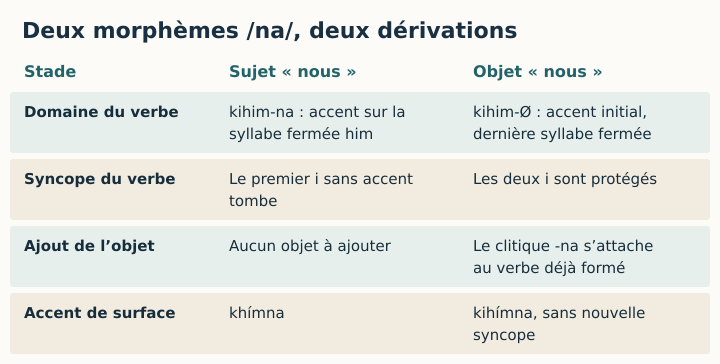

# ENS-PSL · Sélection internationale Lettres · Linguistique 2023 — Corrigé guidé

*Corrigé rédigé par IA, non officiel. Signalez toute erreur.*

**Rédaction** · GPT-6.2 Astra Ultra · vitesse non renseignée

[Sujet officiel](https://www.ens.psl.eu/sites/default/files/linguistique-ecrit-sil2023.pdf)

La première langue a été aménagée pour l’exercice et la troisième peut être fictive. On cherche des règles qui rendent compte des formes et des lectures imprimées. Dans les dérivations, les points marquent les frontières syllabiques et les crochets les domaines morphologiques. L’accent aigu note l’accent lexical.

## Préparer la réponse

Pour l’exercice 1, écrire d’abord toutes les voyelles du radical, même celles qui ne se prononceront pas. Syllaber avec le suffixe de sujet, déterminer l’accent, puis marquer les voyelles qui ont effectivement le droit de tomber. Ajouter ensuite le clitique en conservant la trace du premier calcul. Le meilleur test consiste à opposer les deux chaînes terminées par *na*. Le son du suffixe ne dit pas s’il fait déjà partie du verbe ou s’il vient s’y attacher comme objet.

Pour l’exercice 2, dessiner une boîte autour de la proposition qui contient le clitique et souligner son sujet **tout entier**. Pour chaque lecture, écrire les ensembles de personnes désignées par le sujet et par l’objet. Les relations utiles sont l’identité, la disjonction et le recouvrement partiel. Il faut justifier une lecture impossible même si sa traduction en français courant semble sémantiquement compréhensible.

Pour l’exercice 3, construire d’abord le groupe de deux termes que le sens rend solidaire. Appliquer la règle lors d’une composition binaire et examiner la nature du membre droit. Tester sa formulation sur les deux interprétations de *nipo-taro-saba*. Une règle qui donne toujours deux consonnes sonores aux deux dernières positions a perdu l’information syntaxique.

## Exercice 1 · Accentuation et processus segmentaux

### 1. La voyelle qui tombe

Posons le radical /kihim/. Il est directement visible sous sa forme non syncopée au masculin singulier. Le paradigme montre une **syncope**. Un *i* bref sans accent tombe lorsqu’il est le noyau d’une syllabe ouverte. On n’efface donc ni un *i* accentué, ni celui d’une syllabe fermée. La règle porte sur une voyelle haute attestée dans le corpus, distincte du *a* du verbe « écrire ». Les données n’obligent pas à généraliser à d’autres voyelles hautes.

| Forme avec l’accent calculé avant syncope | Application de la règle | Surface |
|---|---|---|
| kí.him | Le deuxième *i* est sans accent mais en syllabe fermée. | kíhim |
| kí.hi.mu | Le deuxième *i*, sans accent en syllabe ouverte, tombe. | kíhmu |
| kí.hi.mat | Dans le verbe avec *-at*, même syllabe médiane ouverte. | kíhmat |
| ki.hím.na | La pénultième fermée reçoit l’accent. Le *i* initial tombe. | khímna |
| ki.hímt | La finale extra-lourde est accentuée. Le *i* initial tombe. | khímt |

La syllabation déplace la consonne *m* vers l’attaque de la syllabe suivante lorsque le suffixe commence par une voyelle. C’est pourquoi le second *i* est protégé dans la première ligne et exposé dans les deux suivantes. La syncope peut laisser un groupe consonantique en début de mot.

### 2. L’ordre des règles

Il faut **calculer l’accent avant d’appliquer la syncope** dans le domaine verbal. Dans /kihim-u/, les deux premières syllabes sont ouvertes. La pénultième étant légère, l’accent tombe sur l’antépénultième et protège le premier *i*. Dans /kihim-na/, la pénultième se ferme, porte l’accent et c’est l’autre *i* qui disparaît. Dire que la première voyelle tombe toujours, ou que la seconde tombe toujours, échoue. Une suppression qui ignorerait l’accent effacerait aussi une voyelle qu’il faut conserver, notamment dans /ki.hi.mu/. La distribution du poids et celle de l’accent s’établissent donc sur une forme qui a encore ses deux *i*.

### 3. L’objet après le verbe fléchi

Le calcul effectué en une seule fois sur /kihim-at-u/ donne *ki.hi.ma.tu*. La finale et la pénultième sont légères. L’antépénultième est *hi*, ce qui donnerait *ki.hí.ma.tu*, puis *khímatu*. Or la forme indiquée est **kíhmatu**. Il faut permettre à la flexion du verbe de produire un résultat avant que l’objet entre dans le calcul.

Une solution consiste à distinguer le verbe avec sa marque de sujet et le mot élargi avec son clitique. Au premier stade, on accentue et l’on applique la syncope. On ajoute ensuite le clitique, on resyllabe et, en conservant momentanément l’accent du verbe, on efface un *i* faible qu’une voyelle du clitique aurait placé en syllabe ouverte. Enfin on ajuste l’accent au poids du mot élargi. Cette dernière accentuation ne déclenche pas une nouvelle syncope. Une voyelle déjà perdue au premier stade ne réapparaît pas.

Ainsi /kihim-at/ donne *kí.hi.mat*, puis **kíhmat**. Avec *-u*, la forme intermédiaire se resyllabe *kíh.ma.tu*. La pénultième est légère, l’accent final tombe sur l’antépénultième, d’où **kíhmatu**. Avec les clitiques consonantiques *-na* et *-kum*, on obtient respectivement *kih.mát.na* et *kih.mát.kum*. Dans les deux cas la syllabe *mat* est désormais pénultième et lourde. La différence d’accent entre *kíhmat* et *kihmátna* interdit de figer définitivement l’accent au premier stade.

Avec un verbe à sujet masculin singulier sans suffixe audible, le premier stade livre *kí.him*. Devant les objets vocaliques *-u*, *-ak* et *-ik*, *m* devient l’attaque de la syllabe suivante. Le second *i* sans accent, jusque-là fermé, est désormais en syllabe ouverte et disparaît. Les sorties sont **kíhmu**, **kíhmak** et **kíhmik**. On a suivi les chaînes segmentales du fascicule. Certaines gloses françaises et indications de personne de la page 2 ne concordent pas entre elles, ce qui ne change ni les segments ni les positions accentuées à expliquer.

### 4. Bonus · Deux places pour *na*

Dans **khímna**, *-na* marque le sujet et se trouve à l’intérieur du premier domaine. La dérivation est /[kihim-na]/ → *ki.hím.na* → *khímna*. Le premier *i* tombe parce qu’il est sans accent au stade où la règle peut le supprimer.

Dans **kihím-Ø-na**, le sujet est marqué par zéro et *-na* est l’objet. La structure est /[[kihim-Ø]-na]/. Le premier stade produit *kí.him*. L’objet à initiale consonantique ne rend pas ouverte la syllabe *him*. Au moment où une syncope est encore possible, le premier *i* est protégé par son accent et le second par la fermeture de sa syllabe. L’ajustement final donne *ki.hím.na* sans effacement ultérieur. Le morphème zéro ne crée aucune syllabe. Il permet de localiser la frontière entre flexion et clitique. Le contraste ne s’expliquerait donc pas en changeant la prononciation de *na*.

## Exercice 2 · Pronoms singuliers et pluriels

### 1. Quel sujet est local ?

Dans ces données de clitiques objets, **se** doit recevoir la référence du sujet de sa propre proposition. **Le** et **la** doivent être distincts de ce sujet local. Un nom simplement contenu dans le sujet, par exemple *Paul* dans *le fils de Paul*, ne se confond pas avec l’ensemble du groupe sujet. Un sujet d’une proposition supérieure ne compte pas non plus comme sujet local du verbe enchâssé. Ainsi (1) et (2) opposent l’interdiction et l’obligation de reprendre Paul. En (3) et (4), la référence locale est celle du fils. En (5) et (6), Jacques est le sujet local, Paul celui du verbe principal. Les pronoms non réfléchis peuvent aussi désigner une personne du contexte qui n’est nommée nulle part.

Pour (7), notons *i* la fille, *j* Isabelle, *k* la mère et *l* Gloria dans une situation où il s’agit de quatre personnes distinctes. On obtient **la fille d’Isabelle dit que la mère de Gloria la regarde**, avec **la = i, j, l ou une autre femme. La lecture la = k est exclue**. Seule la mère de Gloria est le sujet local de *regarde*. La fille peut être reprise même si elle est sujet de *dit*, et Gloria peut l’être même si son nom figure dans le sujet local.

### 2. La référence au pluriel

Pour le clitique non réfléchi, il faut renforcer « distinct » en **disjoint**. En (9), le sujet ne désigne que Pierre, l’objet désignerait Pierre et Marie. Leurs références diffèrent mais se recouvrent, et la lecture est exclue. En (10), le sujet tout entier est la sœur de Pierre, extérieure au couple. *Les* peut donc reprendre le couple bien que le nom de Pierre figure à l’intérieur du sujet. En (11), le sujet coordonné dénote exactement le groupe formé par Pierre et Marie. Le réfléchi reprend ce même groupe. Une partie du groupe, ou un groupe différent contenant un seul de ses membres, ne convient pas. Un éventuel contraste entre lecture réciproque et lecture distributive n’autorise aucun changement dans la composition du groupe de référence.

### 3. Le syncrétisme de *te* et *vous*

L’**hypothèse 2** rend compte de l’ensemble. Une même forme sonore peut être employée comme réfléchi à référence identique ou comme non-réfléchi à référence disjointe. En (12) et (14), Marie ou *il* sont distincts des destinataires que désigne l’objet. En (13) et (15), les deux arguments ont le même référent, singulier ou pluriel. Ces seuls exemples ne départagent pas les hypothèses.

Soit *P* Pierre et *M* Marie. En (16), le sujet **{P}** et l’objet **{P, M}** se recouvrent sans être identiques. En (19), l’inclusion est inversée, avec **{P, M}** sujet et **{P}** objet. Dans les deux cas, la lecture échoue aux deux tests. La graphie de l’accord verbal imprimée en (16) n’est pas le phénomène testé. Avec *tu regardes*, le recouvrement reste impossible. En (17), le sujet local est le groupe des enfants, extérieur à **{P, M}**. En (18), le sujet local de *admire* est le locuteur, distinct du couple, même si *tu* figure dans la principale. En (20) et (21), ce même locuteur est extérieur à **{P}**, quel que soit le groupe désigné par le sujet principal ou son possessif. Ces quatre lectures non réfléchies sont possibles. L’hypothèse 1 ne prédit pas l’échec sélectif de (16) et (19).

## Exercice 3 · La structure des composés

### 1. Le changement segmental

À la jointure observée dans les composés binaires, l’obstruante sourde initiale du deuxième mot devient sonore en conservant son lieu et son mode d’articulation. Les couples attestés sont *p/b*, *f/v*, *t/d* et *s/z*. La seconde question fournit aussi *k/g*. Le premier mot ne subit pas ce changement. La finale de *kon* montre que la règle n’exige pas simplement la présence d’une voyelle précédente.

### 2. Deux groupements

Une formulation compatible avec toutes les données est la suivante. À chaque étape où l’on assemble **[X Y]**, on sonorise l’obstruante sourde initiale de **Y si Y est un mot simple**. Quand Y est lui-même un composé, sa consonne initiale ne subit pas ce changement à la jointure externe. Les changements survenus lors de la construction interne restent acquis.

- Dans (5), la queue est blanche. La structure est **[[a sula] rasi]**. À l’intérieur se forme *a-zula*. L’ajout de *rasi* à droite ne produit aucun changement audible puisque *r* n’est pas une obstruante sourde. Résultat **a-zula-rasi**.
- Dans (6), c’est le tigre qui est blanc. La structure est **[man [sula koo]]**. On construit *sula-goo* puisque *koo* est le membre droit simple du composé interne. Le membre droit externe est ce composé entier. Son *s* initial reste sourd. Résultat **man-sula-goo**.

### 3. Le meuble rouge ou les robes rouges

Sous la lecture « robes rouges », le premier constituant est **[nipo taro]**, qui produit *nipo-daro*. On ajoute à droite le nom simple *saba*, qui devient *zaba*. La structure **[[nipo taro] saba]** donne donc **nipo-daro-zaba**. Sous la lecture « armoire rouge », on construit d’abord **[taro saba]**, soit *taro-zaba*. On lui associe ensuite l’adjectif de couleur à gauche. Le mot initial *taro* appartient désormais au composé placé à droite du dernier assemblage. Sa consonne échappe à la sonorisation externe. La structure **[nipo [taro saba]]** donne **nipo-taro-zaba**. Dans les deux lectures le dernier *s* devient *z*. C’est le sort de *t* qui permet de retrouver à quelle entité s’applique la couleur.
