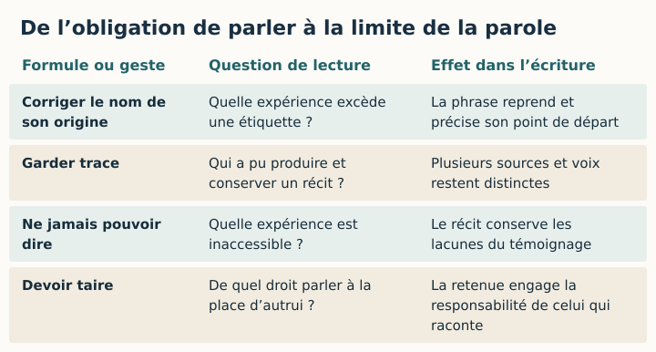

# ENS-PSL · Sélection internationale Lettres · Littérature — Assia Djebar 2023 — Corrigé brut

*Corrigé rédigé par IA, non officiel. Signalez toute erreur.*

**Rédaction** · GPT-6.2 Astra Ultra · vitesse non renseignée

[Sujet officiel](https://www.ens.psl.eu/sites/default/files/litterature-sujet3-sil2023.pdf)

L’épreuve de deux heures porte sur la façon dont Assia Djebar formule son esthétique en 1993 dans « Écrivain/Écrivaine ». Cette proposition mobilise ses récits et deux expériences de lecture extérieures à son œuvre.

## Ce qu’oblige une trace

Un père algérien conduit sa fille par la main à l’école française. Ainsi s’ouvre *L’Amour, la fantasia*. On pourrait croire que la scène raconte simplement le passage du monde familial vers la langue d’un autre. Pourtant c’est une main familière qui mène l’enfant jusqu’à cette école et c’est en français, bien des années après, que la scène nous est donnée à lire. Où passe exactement la frontière ? Quand Assia Djebar tente en 1993 de formuler son esthétique, elle commence par préciser et reprendre les mots qui la situent. Puis elle la définit par deux exigences dont on voit mal comment une même phrase pourrait s’acquitter. Il faut dire et il y a quelque chose qu’on ne pourra, ou qu’on ne devra, jamais dire. Je voudrais suivre ces corrections dans la phrase de Djebar. Elles permettent de comprendre pourquoi un livre peut garder trace d’une vie sans prétendre posséder sa voix.

La première hésitation intervient dès que l’écrivaine parle de son éducation. « Arabe » peut désigner une langue, une transmission culturelle, un ensemble de pratiques et de savoirs. Mais, laissé seul après le mot *éducation*, l’adjectif risque de faire croire qu’une origine suffirait à expliquer une œuvre. Djebar reprend la phrase et parle de « sensibilité maghrébine ». Ce qui vient du Maghreb se manifeste dans une façon d’écouter et d’éprouver qui ne se laisse déduire d’aucun programme scolaire. Puis vient une détermination spatiale singulière. Cette sensibilité travaille au creux du français. Elle ne l’attend pas devant l’école comme une possession que l’enfant serait obligée de laisser à la porte. Elle peut infléchir une phrase française, donner à entendre sous ses mots une adresse, une retenue ou une absence auxquelles un autre lecteur de la même langue n’aurait pas été attentif. La langue de l’œuvre devient ainsi le lieu du problème qu’une biographie trop simple prétendrait résoudre.

Relisant la première scène de *L’Amour, la fantasia*, je suis frappée par la différence entre ce qu’un passant aurait pu voir et ce que seule l’écriture réunit. Il aurait vu un père avec son enfant. Il n’aurait pu lire sur leurs visages l’avenir que ce choix scolaire ouvre à la fille, ni la distance que ce choix introduira entre certaines expériences intimes et les mots dont elle disposera pour s’adresser au monde. Le livre peut faire tenir ces significations dans un même geste parce qu’il est écrit après coup. Il s’exposerait pourtant à une injustice s’il prêtait au père ou à l’enfant la pleine conscience des conséquences que la narratrice connaît. Les tâtonnements revendiqués par Djebar ont ici une valeur très concrète. Il faut revenir à la scène sous plusieurs éclairages pour qu’aucun ne passe pour la vérité entière d’une intention ancienne.

Le devoir de dire se fait plus pressant encore lorsque l’écrivaine reprend les récits français de la conquête de l’Algérie. Une opération militaire a trouvé des officiers, des chroniqueurs, des destinataires et des mots pour entrer dans l’archive. Des personnes qui l’ont subie ont laissé bien moins de témoignages écrits à la disposition de la postérité. Reprendre une description des violences de la conquête, la lire avec une attention différente de celle qu’escomptait son auteur, c’est déjà déplacer la distribution des voix. Un détail qu’un témoin conquérant estimait propre à célébrer une victoire peut permettre d’apercevoir quelqu’un dont il ne voulait rien raconter. Mais si le roman mettait sans précaution un discours complet dans la bouche de cette personne, il ferait disparaître une seconde fois un fait historique décisif. Sa parole n’a pas été recueillie dans les mêmes conditions que celle du vainqueur. Inventer l’archive qui manque risquerait de rendre l’inégalité invisible.

D’où la justesse du mot « trace ». Une trace atteste un passage, parfois une violence. Elle ne se présente pas de son propre mouvement comme un récit complet et ordonné. C’est le lecteur qui la suit. Chez Djebar, l’alternance entre des strates autobiographiques, les textes de la conquête et les voix de femmes qui se souviennent de la guerre met précisément ce lecteur au travail. Il ne peut confondre la parole écrite d’un militaire, produite dans le temps de l’opération, avec une voix entendue et transmise bien plus tard. Il ne peut non plus les ranger dans des compartiments étanches. Une voix écoutée aujourd’hui fait relire une phrase ancienne. Écrire revient à organiser cette rencontre et à faire sentir l’écart de temps, de situation et de langue qui l’a rendue difficile. Préserver un écart est déjà un acte positif de composition.

La seconde correction de la citation fait néanmoins surgir une difficulté plus rude. « Ne jamais pouvoir dire » pourrait être la plainte d’un écrivain qui ne trouve pas ses mots. « Devoir taire » introduit une obligation. Il se peut que je connaisse quelque chose de la vie d’autrui et que le faire connaître à mon tour constitue un abus. Il se peut aussi que le silence m’ait été imposé par d’autres et qu’y consentir prolonge l’injustice. Djebar n’offre aucun moyen simple de distinguer d’avance les deux situations. L’adjectif « obscur » dit bien l’épreuve à laquelle doit se soumettre chaque récit. Je lis autrement, à partir de là, l’ouverture d’*Hiroshima mon amour* de Marguerite Duras. Une femme énumère ce qu’elle a vu à Hiroshima, tandis qu’une autre voix lui refuse la possession de ce savoir. Elle a vraiment vu des lieux et des images. Lui répondre qu’elle n’a rien vu ne fait pas disparaître son expérience. Cela lui interdit de substituer sa visite à celle des personnes qui ont vécu le bombardement. Le refus ouvre le dialogue à la condition que la visiteuse ne s’en proclame pas le dernier témoin autorisé.

Ce dispositif de dénégation est différent de celui de Djebar. Les histoires de l’Algérie coloniale et d’Hiroshima ne sont pas interchangeables. C’est précisément la différence des formes qui éclaire la question esthétique. Duras met deux assertions en présence et fait persister la voix qui objecte. Djebar laisse revenir, à l’intérieur d’une seule phrase, une parole qui rectifie sa propre portée. Chez Georges Perec, dans *W ou le souvenir d’enfance*, ce sont les récits alternés, les lacunes et les reprises qui empêchent le lecteur de transformer les bribes d’une enfance bouleversée par la persécution en un témoignage continu. Une hésitation sur le détail exact d’un souvenir ne prive pas le livre de sa valeur. Elle enregistre ce que le survivant a reçu à la place d’une certitude. Ces trois expériences m’apprennent à ne pas chercher le respect du silence uniquement dans une page blanche. On peut le reconnaître dans un changement de voix, dans une interruption, jusque dans le retour d’un mot qui ne convient plus tout à fait.

Demeure le danger inverse. En faisant l’éloge de l’indicible, on pourrait épargner au lecteur le désagrément d’apprendre ce qui a pourtant été dit, et à l’écrivain le travail de le transmettre. Djebar commence par le devoir de dire et maintient la nécessité de garder trace. Toute la force d’une forme fragmentaire tient à ce que les fragments nous parviennent effectivement. Des voix se font entendre, des opérations de conquête deviennent identifiables, une petite fille marche vers une école. Le respect dû à ce qui échappe se mesure à l’attention portée à ce qui peut être établi et raconté. Sans ce mouvement vers la parole, le silence gardé par choix risquerait de se confondre avec le silence imposé par le pouvoir.

L’esthétique que Djebar résume tient ainsi dans une responsabilité dont aucune règle préalable ne suffit à l’acquitter. Il faut écrire pour que demeure quelque chose de personnes que des discours plus puissants auraient recouvertes. Il faut écrire de telle sorte que leur apparition dans un livre ne les transforme pas en possessions du narrateur ou de son lecteur. Les corrections successives de la citation font entendre ce double mouvement dans le travail même de la langue française. Elles invitent à reconnaître une réussite littéraire exigeante, celle d’une phrase qui rend un geste transmissible et qui sait encore marquer l’endroit où une autre personne cesse de nous appartenir.

