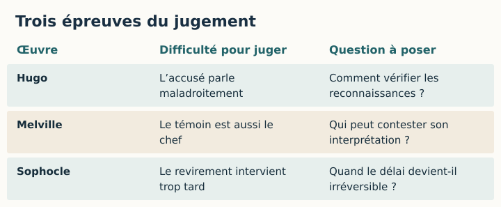

# ENS-PSL · Sélection internationale Lettres · Littérature — Frédérique Leichter-Flack 2023 — Corrigé guidé

*Corrigé rédigé par IA, non officiel. Signalez toute erreur.*

**Rédaction** · GPT-6.2 Astra Ultra · vitesse non renseignée

**Révision (tour 1)** · GPT-6.2 Astra Ultra · vitesse non renseignée

[Sujet officiel](https://www.ens.psl.eu/sites/default/files/litterature-sujet5-sil2023.pdf)

Le sujet de deux heures propose un extrait du Laboratoire des cas de conscience de Frédérique Leichter-Flack. La copie examine comment un récit agit sur le jugement, puis ce que le lecteur peut transporter de cette expérience dans une décision.

## Sujet de l’écrit

Vous analyserez et commenterez la citation ci-dessous sous la forme d’un écrit organisé. Vous pouvez éclairer ces propos par des éléments de contexte, par vos connaissances d’histoire de la littérature. Vous ferez appel à votre expérience de lectrice, sans vous limiter au corpus de votre projet de recherche.

Frédérique Leichter-Flack, *Le Laboratoire des cas de conscience*, Paris, Flammarion, 2012. Le passage commence par « La fiction littéraire porte en elle » et se termine par « à la table du décideur. ».

## Préparer la réponse

**À qui revient le jugement ?** Relevez les verbes dont la fiction est le sujet, puis le nom qui clôt l’extrait. Le texte fait entrer le doute dans la délibération. Il laisse au décideur le soin d’agir. Dans la scène de Melville, distinguez donc la personne qui témoigne, celles qui sont chargées de juger et la position depuis laquelle vous lisez leur échange.

Distinguer trois actes. Éprouver une émotion fait remarquer un intérêt en souffrance. Écouter une autre voix permet de réviser l’attribution des torts. Motiver un jugement exige encore une raison que chacun puisse discuter. Chercher dans chaque scène un détail qui fasse passer d’un acte au suivant.

Pour sa propre copie, on peut partir d’un verdict que l’on croyait évident, puis retrouver le passage qui l’a compliqué. Chez Hugo, différencier ce que savent Champmathieu, les juges et le lecteur. Chez Melville, comparer le récit de la mort de Claggart avec sa relation imprimée après l’exécution. Quelle donnée manque au public qui lit cette dernière ? Le doute porte-t-il sur le fait, sur la règle, ou sur celui qui produit la version reçue ?

## À la table de celui qui doit décider

Quand Champmathieu comparaît devant les assises dans *Les Misérables*, il suffirait, semble-t-il, qu’un témoin dise la vérité. Un homme est pris pour Jean Valjean. Le lecteur sait que Jean Valjean est assis dans la salle. Que peut donc ajouter à cette donnée simple le long récit que Hugo consacre à l’affaire ? Précisément le temps que met un homme à devenir ce témoin, les raisons qu’il trouve de se taire et la difficulté pour un tribunal de reconnaître une parole vraie quand elle lui parvient. La « réserve de sens » que Frédérique Leichter-Flack attribue à la fiction apparaît dans cet écart entre une proposition facilement énonçable et les actes nécessaires pour lui donner effet. Encore faut-il expliquer comment une émotion de lecture peut contribuer à la justice, alors qu’elle peut aussi nous attacher au seul être que le récit nous a donné à aimer.

D’une phrase à l’autre, la fiction demeure sujet des verbes chez Leichter-Flack, mais change de rôle. Elle détient d’abord une réserve. Elle devient ensuite éducatrice, puis hôtesse qui invite à une table des convives habituellement écartés. Pourquoi cette dernière image ? Une décision a une heure, un lieu et des personnes habilitées à la prendre. Faire entrer le doute à leur table ne lui donne pas le dernier mot. Cela oblige à écouter ce qui survivrait mal à une formulation impersonnelle du cas. Cette différence permet de comprendre pourquoi Hugo prend le temps de nous faire hésiter avec Madeleine, alors que le devoir de libérer Champmathieu ne fait aucun doute.

### Ce qu’ajoute une nuit à un principe

Hugo a placé avant le procès une nuit dont le titre, « Une tempête sous un crâne », désigne le théâtre singulier. L’homme qui délibère s’appelle Madeleine pour ceux dont il est le maire et l’employeur. Que l’ancien forçat se nomme publiquement et sa protection manquera à des familles qui ne sont pour rien dans l’erreur judiciaire. Que le maire se taise et un homme supportera à sa place les conséquences de l’identification. Aucune difficulté à énoncer le principe qui défend de laisser condamner l’innocent. Ce que la narration ajoute à mon jugement, ce sont des existences qui réclament aussi quelque chose au même homme. Et ce que la durée de la nuit ajoute à ma lecture, c’est la tentation de faire servir une raison généreuse à un intérêt secret. Quand la prospérité des ouvriers plaide pour le silence de Madeleine, comment démêler sa sollicitude et sa peur du bagne ? Il serait bien commode de disposer de deux voix intérieures absolument distinctes. Hugo nous oblige à les entendre dans les mêmes mots.

Le procès modifie encore le problème en donnant à voir l’homme dont on discutait en son absence. Champmathieu ne peut produire le récit clair qui devrait, croyons-nous, suffire à le libérer. Il revient maladroitement sur les circonstances, ne reconnaît pas les hommes qui disent le reconnaître. La concordance de plusieurs témoignages a pour elle l’apparence de la méthode. L’émotion que suscite cette scène me fait remarquer une injustice antérieure au verdict. On n’accorde pas le même crédit à l’assurance d’un témoin qu’aux embarras d’un accusé incapable de parler la langue du tribunal. Cette émotion n’a toutefois de portée que si je peux convertir ma gêne en question vérifiable. Sur quoi la reconnaissance repose-t-elle ? Qui pourrait savoir ce que cet homme ne sait pas ? L’intervention de Valjean, capable de rappeler aux anciens forçats des détails de leur passé, répond à ce besoin de preuve. Le roman ne rend pas le lecteur juste par la seule vertu de ses larmes. Il le mène de l’impression d’un malheur à l’examen d’une procédure.

### Celui qui écoute dépend aussi d’un récit

Hugo nous accorde cependant un avantage dont aucun juré ne devrait se croire assuré. Nous connaissons depuis longtemps le véritable Jean Valjean. Il suffirait qu’un narrateur aussi digne de confiance s’attache exclusivement au juge et ménage soigneusement les informations pour que nos émotions changent de camp. *Billy Budd*, de Herman Melville, fait de cette inquiétude une expérience de lecture. Billy est faussement accusé par Claggart. Sommé de répondre, il se heurte à son bégaiement et frappe son accusateur, qui en meurt. Le silence de l’accusé a donc deux histoires. Celui qui a suivi Billy le rapporte à l’obstacle qui l’empêche de parler. Celui qui n’aurait que le fait à juger pourrait voir, dans le coup, une façon de faire taire un témoin. Le changement de point de vue ne supprime ni le mort ni le geste. Il modifie ce qu’on est en droit d’en inférer.

Le capitaine Vere a assisté à la scène. Devant les officiers qui doivent juger Billy, il insiste sur la discipline navale et sur la manière dont une indulgence serait comprise par l’équipage. La difficulté vient de ce que sa parole circule avec deux autorités. Le témoin rapporte un événement auquel eux-mêmes n’ont pas assisté. Le commandant fait peser sur eux son interprétation de ce que réclame le service. Peut-on contester la seconde sans paraître mettre en doute le premier ? Ici le récit travaille plus profondément que ne le ferait l’opposition de la règle au sentiment. Il met en question les conditions dans lesquelles une règle est invoquée et un désaccord rendu possible. Ce lecteur qui plaint Billy doit pouvoir demander pourquoi la procédure donne tant de poids à une seule voix. Que deviendrait son objection devant un accusé moins attachant ?

Melville ne clôt d’ailleurs pas son récit sur l’exécution. Une chronique navale donne de l’affaire une version où Claggart devient celui qui avait découvert un complot. Puis une chanson de marin prête une voix à Billy dans l’attente de la mort. Une lectrice qui les rencontre après le récit reconnaît les déformations de la chronique. Mais celle qui l’aurait ouverte la première aurait pu s’indigner très sincèrement du sort réservé à Claggart, au nom de faits controuvés. Quant à la chanson, son pouvoir de rendre sensible une dernière nuit ne la transforme pas en témoignage judiciaire. Les deux pièces finales donnent toute sa force au verbe « déplacer » employé par Leichter-Flack. Déplacer le regard, c’est aussi revenir sur la confiance que sa première orientation nous inspirait. [Herman Melville, *Billy Budd*](https://www.gutenberg.org/files/76513/76513-h/76513-h.htm)

### Que faire du doute lorsqu’un acte presse ?

Reste la singulière courtoisie de l’image finale. Inquiétude et doute sont invités à la table. On leur fait place dans une délibération qui devra pourtant prendre fin. L’*Antigone* de Sophocle rend presque insoutenable la différence entre le temps du jugement et celui de la décision. Créon croit défendre la cité en refusant la sépulture à celui qui l’a combattue. Antigone lui oppose l’obligation envers le frère mort. L’une des expériences que me fait faire la pièce tient à l’ordre dans lequel les objections parviennent au souverain. Hémon lui rapporte ce qui se dit dans la ville sans oser se dire devant lui. Tirésias donne un autre poids aux conséquences du corps abandonné. Chacun fait arriver jusqu’au pouvoir un savoir que le pouvoir n’obtient pas par lui-même. Créon finit par se retourner. Ce qui pouvait encore être sauvé lorsqu’il entendait la première objection ne peut plus l’être quand les actes suivent sa conversion. Avoir finalement accueilli le doute ne lui rend pas le temps perdu.

Que transporter alors de cette lecture à la table réelle ? Aucun juge ne dispose du dénouement de Sophocle, ni des chapitres de Hugo sur les intentions secrètes d’autrui. Il peut en revanche apprendre à demander qui n’a pas encore parlé, quelles paroles seraient tenues pour crédibles et quelle conséquence de son délai sera irréversible. Ces questions sont formulables et discutables en commun. Leur force tient ici à ce que le lecteur a rencontré, tour à tour, un homme dont les hésitations passaient pour une preuve, des juges placés sous la parole de leur chef, un souverain trop tard sensible à ce qu’on lui répétait. Le raisonnement reprend ainsi des droits auxquels la littérature l’a rendu plus exigeant.

La fiction garde du sens en réserve parce qu’une décision ne consomme jamais toutes les raisons qu’une œuvre nous a fait percevoir. Champmathieu doit être libéré même si les ouvriers de Madeleine demeurent à la charge de notre inquiétude. On peut discuter l’autorité de Vere même si le coup de Billy a bien tué un homme. Rendre justice demande de trancher entre des actes, puis de répondre de ce que cette décision laisse subsister. La littérature donne un visage et une voix à ce reste. Elle nous apprend à rester comptables de lui lorsque le jugement a été prononcé.
