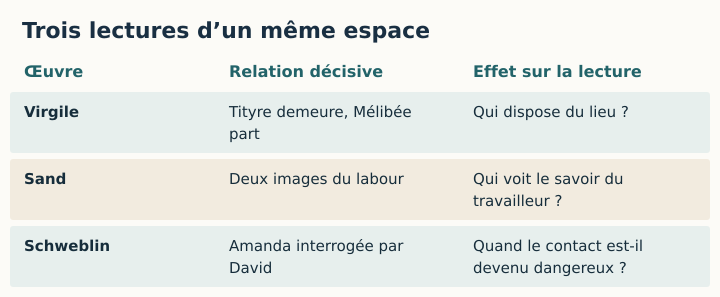

# ENS-PSL · Sélection internationale Lettres · Littérature — Lucía De Leone 2023 — Corrigé brut

*Corrigé rédigé par IA, non officiel. Signalez toute erreur.*

**Rédaction** · GPT-6.2 Astra Ultra · vitesse non renseignée

**Révision (tour 1)** · GPT-6.2 Astra Ultra · vitesse non renseignée

[Sujet officiel](https://www.ens.psl.eu/sites/default/files/litterature-ecrit4-sil2023.pdf)

La sélection internationale demande une composition de deux heures sur un extrait traduit de l’article que Lucía De Leone consacre en 2017 au récit de Samanta Schweblin. La copie suit une même question de lecture à travers trois manières d’écrire le champ. [Article de De Leone dans 452ºF](https://revistes.ub.edu/index.php/452f/article/view/16250)

## Sujet de l’écrit

Vous analyserez et commenterez la citation ci-dessous sous la forme d’un écrit organisé. Vous pouvez éclairer ces propos par des éléments de contexte, par vos connaissances d’histoire et de théorie littéraires et poétiques. Vous ferez appel à votre expérience de lectrice, sans vous limiter au corpus de votre projet de recherche.

Lucia Maria De Leone, « Campos que matan. Espacios, tiempos y narración en Distancia de rescate de Samanta Schweblin », *452ºF*, 16, 2017. Extrait traduit de l’espagnol sur le feuillet. Le passage commence par « De nombreuses expressions artistiques contemporaines » et se termine par « des traces de son passé idéologisé. ».

## À quelle distance voit-on un champ ?

Le pré de la première *Bucolique* de Virgile est assez frais pour qu’un berger puisse y prendre du repos. Un autre berger, qui se tient tout près de lui, a déjà perdu le droit d’y rester. À quel moment leur paysage cesse-t-il d’être le même ? La question me revient en lisant *Distancia de rescate*, le court roman de Samanta Schweblin auquel Lucía De Leone consacre un article en 2017. Pour une mère citadine arrivée en vacances avec sa fille, le village argentin promet d’abord une vie au grand air. Pour une mère qui y vit, le souvenir d’un cheval échappé suffit à en bouleverser la géographie. De Leone voit dans les arts contemporains une façon de se saisir du rural pour y travailler des urgences présentes, tout en y rencontrant les traces de représentations plus anciennes. La formule mérite qu’on la prenne au sérieux jusque dans sa prudence. Qu’est-ce qui se renouvelle, si un même pré pouvait déjà avoir deux sens chez Virgile ? Je partirai de la place que le paysage assigne à celui qui le regarde, avant d’examiner ce qui arrive à cette place quand le danger circule sous les apparences mêmes de la tranquillité.

### Qui a le loisir de voir un paysage ?

Dans la première *Bucolique*, Tityre peut faire de l’ombre d’un arbre le lieu d’un chant. Mélibée doit emmener son troupeau et quitter une terre dont un autre disposera. Le texte ne charge pas une voix souveraine de choisir entre bonheur et désolation. Il fait parler l’un à l’autre deux hommes dont les conditions matérielles déterminent jusqu’à la manière de conjuguer leurs verbes. Pour Tityre, demeure la possibilité d’un lendemain semblable au jour présent. Pour Mélibée, il faut imaginer les soins donnés à ses terres poursuivis ou perdus sous une autre autorité. La proposition de passer la nuit auprès de Tityre mesure précisément la limite de sa générosité. Une soirée de repos est à sa portée, un droit de séjour lui échappe. Le conflit traverse ainsi l’image pastorale dès l’intérieur. Il serait étrange de réserver la découverte du politique à l’écrivain d’aujourd’hui.

Lorsque George Sand ouvre *La Mare au diable*, elle interroge à son tour celui qui produit l’image. Dans la gravure de Holbein dont elle part, la Mort accompagne le laboureur. Une seconde scène répond à la première. Aux champs, Sand voit un homme et un enfant conduire des bœufs. Une racine accroche le soc, les bêtes s’énervent, et la voix du laboureur qui les appelle par leur nom rétablit l’accord. Ce petit incident change ce que l’on peut voir du travail. Il demande une connaissance des êtres qui y prennent part, un ajustement que ferait disparaître aussi bien l’allégorie de la peine que l’image générale d’une campagne paisible. Puis Sand fait un pas supplémentaire. Elle connaît cet homme et cet enfant et ils ont une histoire. Les faire entrer dans un roman, c’est leur donner un passé, des deuils et des préférences qui excèdent leur fonction dans un tableau. Le désir de beauté que revendique Sand oriente assurément son regard. Mais la possibilité même de discuter son idéal tient à ce montage de deux images et au passage de l’image au récit. [George Sand, les deux premiers chapitres](https://www.gutenberg.org/cache/epub/23582/pg23582-images.html)

De Leone distingue ce dont une œuvre parle de la manière dont elle permet d’en faire l’expérience. On peut le vérifier sur le labour de Sand. La racine ne fait pas seulement entrer dans la fiction un fait ordinaire du travail. Quand l’attelage résiste, le jeune homme doit retenir les quatre premiers bœufs et l’enfant gouverner les quatre autres. Mon regard quitte un paysage que je croyais pouvoir embrasser d’un coup pour aller d’un groupe de bêtes à l’autre. La forme du récit fait découvrir une répartition concrète des efforts là où une scène champêtre ne semblait d’abord offrir qu’une image d’harmonie. Cette différence entre motif rural et traitement du motif aide à lire le passage à un tout autre danger chez Schweblin.

### Quand la proximité cesse de protéger

Une lectrice de Sand arrive donc chez Schweblin avec une habitude dont elle doit se défaire. Elle croit pouvoir se fier à la précision d’un regard attentif. Or Amanda, en vacances avec Nina, a justement appris à mesurer entre elle et sa fille un intervalle à l’intérieur duquel un secours resterait possible. Le titre espagnol donne un nom à cette mesure. Elle change selon l’endroit, la position du corps et le temps qu’exigerait le trajet. Elle appartient en cela à la géographie très concrète de quiconque a pris soin d’un enfant. Mais comment réduire une distance lorsque le danger se trouve déjà sous les pieds des personnes que l’on cherche à rapprocher ? Le projet d’Amanda suppose que la menace vienne d’un point identifiable, l’enfant d’un autre. L’eau qui a passé au contact d’une main suffit à défaire cette figure.

Le roman nous en fait éprouver les conséquences à travers deux temps différents. Carla a raconté à Amanda comment son fils David, encore tout petit, avait porté ses mains mouillées à sa bouche en allant avec elle chercher un étalon échappé. Le cheval meurt. Carla se tourne vers la femme de la maison verte et doit envisager que le corps de son enfant survive au prix d’un déplacement de son âme. Lorsque nous entrons dans le livre, c’est pourtant David qui presse Amanda de raconter. Elle est désormais celle qui a besoin d’aide. La voix de l’enfant coupe la parole à l’adulte, écarte des détails auxquels elle s’attache, exige qu’elle reprenne le fil. Où se trouve le point important ? Il faut reconstruire après coup un contact qui avait échappé à l’attention au moment où il comptait. La brièveté des répliques fait sentir dans le temps même de ma lecture ce que la vue d’ensemble d’un champ ne pourrait jamais m’apprendre.

Un tel dispositif déplace aussi la question du genre. On pourrait lire le récit comme le procès de deux mères, chacune sommée de désigner l’instant où elle aurait manqué de vigilance. Or leur expérience, précisément parce qu’elle se répète et se transmet, découvre une exposition qui dépasse les compétences d’une famille. Le rôle qu’on leur assigne fait de l’échec du secours une culpabilité individuelle. Il fournit en même temps au roman la mesure sensible d’un tort collectif. Chez De Leone, le soja et les intérêts agricoles qui transforment la plaine rendent intelligible le voisinage de lieux de villégiature, de champs productifs et de corps atteints. Chez Schweblin, aucun régisseur ne vient expliquer aux personnages le bon usage de cette interprétation. La voix de l’enfant étrange garde son autorité jusque dans ce qu’elle ne livre pas.

### Ce que devient la mémoire pastorale

De Leone parle d’une catégorie « disponible ». Le mot pourrait donner à croire que n’importe quelle histoire se déposerait sur un fond indifférent. C’est pourtant parce que le projet des vacances reconduit une confiance déterminée dans le grand air que l’impossibilité du secours nous touche ainsi. Il faut que la surface verte continue de promettre la santé pour que le défaut de cette promesse soit perceptible. Cette mémoire n’est pas nécessairement un livre que les personnages auraient lu. Elle survit dans un itinéraire, dans le choix de louer une maison, dans ce qu’une mère pense pouvoir laisser faire à son enfant. On comprend alors la portée de la réserve finale de De Leone. Point n’est besoin que Schweblin entreprenne de réfuter expressément une pastorale pour que la croyance dont elle hérite devienne active dans son récit.

Rétrospectivement, celui-ci transforme aussi ma lecture de Sand. Le soin avec lequel le laboureur peut nommer chaque bête et répondre à son mouvement désigne une possibilité fragile du rapport au vivant. Je comprends mieux à la fois ce que Sand sauvait du cadre allégorique et les conditions matérielles d’une telle scène, où l’obstacle qui arrête le soc peut encore être rencontré et surmonté sur place. L’urgence présente donne un relief nouveau à ce détail ancien. Elle n’abolit ni le travail de Sand ni la différence entre les deux agricultures.

Le renouvellement du rural se mesure ainsi à un déplacement précis de la tâche du lecteur. Virgile nous fait écouter deux droits inégaux de demeurer. Sand nous invite à regarder de nouveau un geste dont nous pensions connaître le sens. Schweblin nous fait reprendre le récit d’un contact dont personne ne savait encore qu’il faudrait répondre. La campagne reste ouverte à d’autres significations parce que ses histoires précédentes continuent de décider de ce qu’on y espère, et que ses transformations peuvent rendre ces espérances dangereuses.

